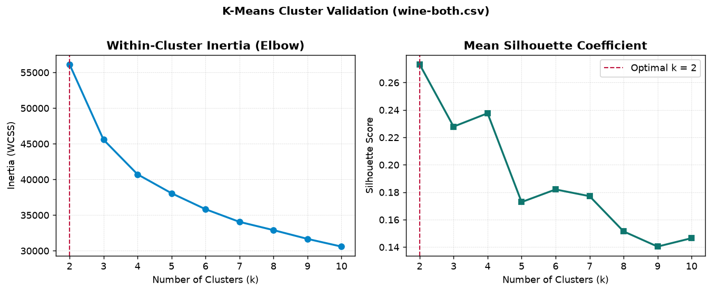
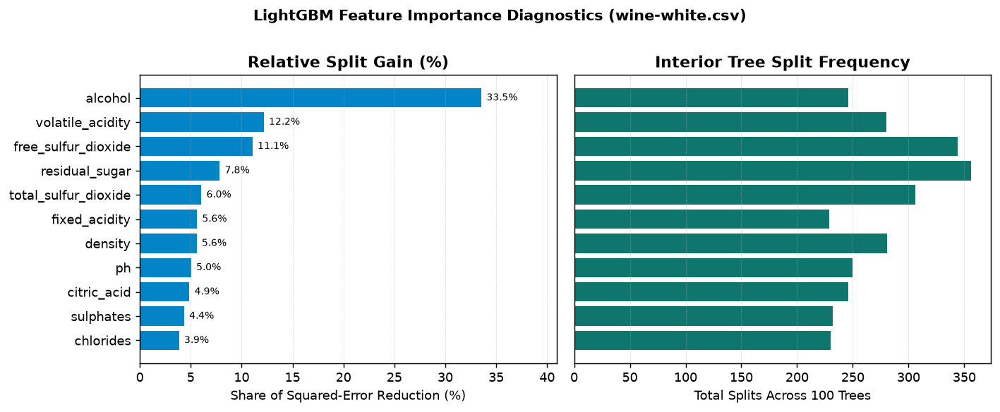
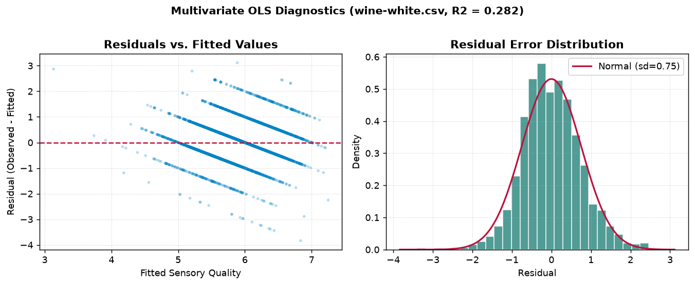
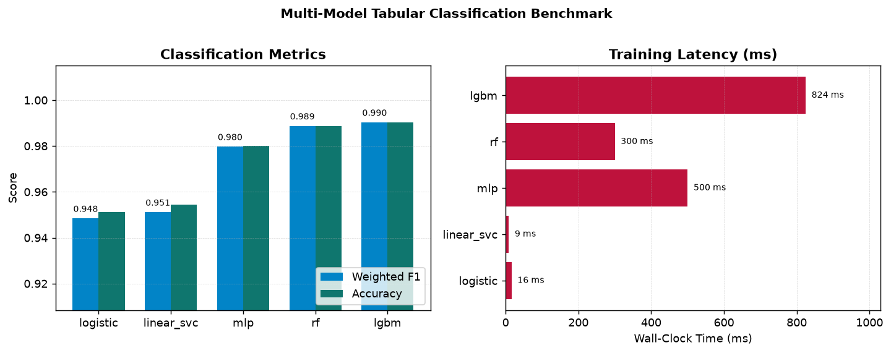

\tableofcontents
\renewcommand{\listfigurename}{Índice de figuras}
\listoffigures
\renewcommand{\listtablename}{Índice de tablas}
\listoftables
\newpage


# Introducción {#chapter-1-introduction}

En la práctica contemporánea de la ciencia de datos, la escala masiva, la heterogeneidad y el dinamismo de los flujos de información exigen herramientas capaces de trascender la rigidez de las interfaces gráficas y la sobrecarga computacional propia de los entornos de desarrollo monolíticos. Durante más de cinco décadas, la consola de comandos de Unix se ha consolidado como el estándar de referencia para la reproducibilidad científica, la automatización desatendida y la eficiencia algorítmica. Su filosofía fundacional postula una premisa de notable vigencia: articular sistemas a partir de programas compactos y modulares, concebidos para resolver una tarea concreta con precisión técnica y acoplarse con naturalidad mediante canales estandarizados de comunicación.

Sin embargo, las shells tradicionales (entre las que destacan Bash y Zsh) fueron proyectadas en una época en que la información en tránsito se interpretaba exclusivamente como secuencias no estructuradas de caracteres. Bajo este esquema clásico, operar sobre matrices de datos, estructuras tabulares complejas o registros jerárquicos demanda intrincadas combinaciones de expresiones regulares y utilidades de corte léxico (tales como `sed`, `awk` y `cut`). Semejante paradigma introduce una fragilidad persistente; resulta vulnerable a delimitadores imprevistos, sufre ante secuencias de escape y, de modo crítico, despoja a las variables de sus atributos semánticos y tipos fundamentales.

Nushell (`nu`) supera de raíz esta limitación histórica mediante una arquitectura concebida expresamente para las exigencias del análisis de datos contemporáneo. En lugar de canalizar flujos de bytes planos y opacos, los pipelines de Nushell transportan estructuras de datos enriquecidas: tablas bidimensionales tipadas, registros jerárquicos indexados por clave y valor, listas ordenadas y valores primitivos regulados por esquemas estrictos. Al reconocer de forma nativa enteros, valores en coma flotante, marcas temporales con huso horario, rutas del sistema de archivos y magnitudes de memoria, Nushell permite filtrar, ordenar, remodelar y agregar conjuntos de información mediante una sintaxis declarativa, concisa y elegante.

A esta claridad expresiva se suma un desempeño computacional extraordinario. Su integración profunda con el motor columnar Polars (programado en Rust y edificado sobre el estándar en memoria Apache Arrow) dota a la terminal de una capacidad analítica sin precedentes. Esta sinergia hace viable ejecutar consultas analíticas multihilo sobre millones de registros en fracciones de segundo, preservando en todo momento la inmediatez y la ligereza del flujo interactivo en la línea de comandos.

Este libro se basa en el trabajo de Jeroen Janssens en su obra *Data Science at the Command Line* (O'Reilly Media). Su propuesta demostró que la terminal de Unix es un entorno ágil y eficaz para el análisis de datos. Sin embargo, las herramientas de línea de comandos han evolucionado notablemente en los últimos años.

Mientras que el libro original utilizaba herramientas clásicas orientadas a texto plano y utilidades como `csvkit`, este libro adopta Nushell y su modelo de datos estructurados. Esto permite mantener los principios de modularidad y reproducibilidad de Unix, pero con tablas tipadas, esquemas claros y mayor robustez al procesar información.

Este libro está pensado para trabajarse de manera práctica, con la terminal abierta junto a la lectura. Por esta razón, la mayoría de los ejemplos de código no incluyen la salida de los comandos (salvo gráficos en consola, imágenes o diagramas indispensables). La intención es que ejecutes cada comando, explores sus resultados y experimentes directamente con Nushell.

Omitir las salidas en los ejemplos responde a tres objetivos prácticos: primero, fomentar el aprendizaje activo escribiendo y ejecutando los comandos en lugar de solo leerlos; segundo, aprovechar las capacidades interactivas de Nushell (como `explore`, la paginación de tablas y el autocompletado), que se aprecian mejor en vivo; y tercero, desarrollar el hábito de inspeccionar datos intermedios con `describe` y diagnosticar errores de forma autónoma. Te invitamos a modificar los parámetros, probar filtros alternativos y explorar los resultados en tu propia terminal.

Para garantizar que cada experiencia práctica se ejecute en condiciones rigurosamente reproducibles e inmunes a divergencias de configuración local, el texto se apoya en un entorno unificado denominado `dsin` (Data Science in Nushell), distribuido como imagen pública de Docker en `ghcr.io/kurokirasama/dsin:latest`. Dicho contenedor constituye una estación analítica completa. Encapsula la versión más reciente de Nushell con un perfil afinado para el procesamiento de datos, su ecosistema de complementos (con soporte nativo para Polars, manipulación de formatos estructurados, consultas relacionales avanzadas, control de versiones y graficación en terminal), entornos robustos de Python y R configurados con sus bibliotecas científicas indispensables, algoritmos de alto rendimiento para modelado predictivo (como Vowpal Wabbit, Tapkee y SKLL), herramientas modernas de línea de comandos (entre las que destacan el editor interactivo `ttt` y el visor gráfico de alta fidelidad `timg`), así como la totalidad de los conjuntos de datos del curso, organizados meticulosamente por capítulos en el directorio `/data`.

Este libro está organizado siguiendo las etapas del ciclo clásico OSEMN (*Obtain*, *Scrub*, *Explore*, *Model* e *iNterpret*), propuesto originalmente por Hilary Mason y Chris Wiggins. El recorrido comienza en el [capítulo 2](#chapter-2-installation) con la instalación del software y la preparación del entorno de trabajo reproducible mediante Docker y el contenedor `dsin`. A continuación, el [capítulo 3](#chapter-3-nushell-fundamentals) establece las bases operativas de la línea de comandos y el sistema de tipos de datos en Nushell, mientras que el [capítulo 4](#chapter-4-programming-cli-tools) profundiza en la programación estructurada y la creación de herramientas modulares reutilizables. El [capítulo 5](#chapter-5-data-acquisition) aborda las estrategias de obtención e ingesta de datos desde la web, APIs, archivos estructurados y bases de datos relacionales. Posteriormente, el [capítulo 6](#chapter-6-data-cleaning) introduce la limpieza y transformación de datos junto a la analítica columnar con Polars. La exploración estadística y la visualización gráfica en la terminal se desarrollan en el [capítulo 7](#chapter-7-data-exploration), dando paso en el [capítulo 8](#chapter-8-parallel-pipelines) a la orquestación de flujos de trabajo, procesamiento en serie y pipelines paralelos. El [capítulo 9](#chapter-9-polyglot-modeling) aborda el modelado predictivo políglota, integrando reducción de dimensionalidad, agrupamiento no supervisado, regresión y clasificación supervisada. Finalmente, el [capítulo 10](#chapter-conclusion) sintetiza los principios arquitectónicos, computacionales y metodológicos que transforman la línea de comandos en un riguroso laboratorio de inteligencia de datos.


\newpage

# Instalación de Software {#chapter-2-installation}

En esta sección se entregaran las instrucciones para instalar el software necesario para este libro, tanto en Windows 10+ como en Linux, para distribución basada en Debian como Ubuntu.

## Windows 10+

### Instalación Ubuntu WSL

1. Habilitar WSL1, ejecutando en Powershell (con permisos de administrador):

```powershell
Enable-WindowsOptionalFeature -Online -FeatureName Microsoft-Windows-Subsystem-Linux

```

2. Habilitar VMP, ejecutando en Powershell:

```powershell
Enable-WindowsOptionalFeature -Online -FeatureName VirtualMachinePlatform

```

3. Listar las distribuciones disponibles y seleccionar (recomendada Ubuntu 24.04):

```powershell
wsl --list --online
```

4. Instalamos la distribución seleccionada:

```powershell
wsl --install -d Ubuntu-24.04
```

4. Configuramos para que la distribución Linux en WSL use v2. Ejecutamos en Powershell:

```powershell
wsl --set-version Ubuntu-24.04 2

```

Para hacerlo por defecto en todas las distribuciones (recomendado):

```powershell
wsl --set-default-version 2

```

5. Actualizar kernel. Descarga desde [WSL](https://wslstorestorage.blob.core.windows.net/wslblob/wsl_update_x64.msi) e instalar.

### Instalación de Docker

1. Descargar instalador Docker para Windows desde: [docker](https://docs.docker.com/desktop/install/windows-install/) y ejecutar. Seleccionar "Usar WSL 2...".

2. Habilitar "Iniciar Docker al iniciar sesión", en la configuración de Docker.

3. Reiniciar.

### Abrir distribución

Para entrar a la distribución instalada, ejecutar en `cmd` o `powershell`:

```powershell
wsl

```


## Linux, WSL2 y el Contenedor `dsin` (Data Science in Nushell) {#section-install-docker}

En este libro trabajaremos sobre una imagen Docker integrada llamada **`dsin`** (*Data Science in Nushell*), publicada en `ghcr.io/kurokirasama/dsin:latest`. A diferencia de los entornos tradicionales basados en *shells* de texto plano, el contenedor `dsin` inicia directamente en **Nushell** como *shell* predeterminado en el directorio de trabajo `/data`, e incluye preconfigurados:

- **Nushell (`nu`)** y su suite completa de complementos registrados: **`nu_plugin_polars`** (motor de DataFrames Arrow/Polars), **`nu_plugin_formats`**, **`nu_plugin_gstat`**, **`nu_plugin_inc`**, **`nu_plugin_query`**, **`nu_plugin_file`**, **`nu_plugin_plot`** (gráficos en la terminal) y **`nu_plugin_port_extension`**.
- **Directorio `/data` integrado por defecto:** Contiene todas las carpetas de datos del libro organizadas exactamente según el número del capítulo en que se utilizan (`/data/ch03`, `/data/ch04`, `/data/ch05`, `/data/ch06`, `/data/ch07`, `/data/ch08` y `/data/ch09`), sin necesidad de descargas ni configuraciones manuales adicionales.
- **Editor de texto en terminal `ttt`** en `$env.PATH` con resaltado de sintaxis y atajos preconfigurados.
- **Visor gráfico de terminal `timg`** en `$env.PATH` para inspeccionar imágenes y gráficos estadísticos directamente en la consola.
- **Ecosistema políglota:** R (`Rscript`, `tidyverse`, `ggplot2`, `rpart`, `class`, `cluster`), Python 3 (`pandas`, `scikit-learn`, `scipy`, `matplotlib`, `seaborn`, `skll`), **GNU Parallel (`parallel`)**, **Tapkee (`tapkee`)** y **Vowpal Wabbit (`vw`)**.
- **Módulo de herramientas del libro (`dsin_tools.nu`):** Comandos personalizados (`to-vw`, `vw-regress`, `tapkee-reduce`, `kmeans-cluster`) cargados automáticamente al iniciar.

### Instalación de Docker en Linux / WSL (basado en Debian/Ubuntu)

```bash
# skip-docker-exec
sudo apt update && sudo apt upgrade -y
sudo apt install -y ca-certificates curl gnupg lsb-release git
sudo usermod -aG docker $USER
```

### Instalación de Docker en Linux (basado en Arch / CachyOS / Manjaro)

```bash
# skip-docker-exec
sudo pacman -Syu --needed docker docker-buildx docker-compose git
sudo systemctl enable --now docker.service
sudo usermod -aG docker $USER
```

### Descarga y Ejecución del Contenedor `dsin`

Para descargar la imagen oficial del libro desde GitHub Container Registry:

```bash
# skip-docker-exec
docker pull ghcr.io/kurokirasama/dsin:latest
```

Para iniciar una sesión interactiva en el contenedor con el entorno listo para usar, ejecutamos:

```bash
# skip-docker-exec
docker run --rm -it ghcr.io/kurokirasama/dsin:latest
```

### Crear alias para llamado simple (opcional)

Si deseas iniciar el contenedor escribiendo únicamente `dsin` en tu terminal anfitriona, puedes definir un alias en tu archivo de configuración del shell anfitrión (`~/.bashrc` o `~/.config/nushell/config.nu`):

```bash
# skip-docker-exec
alias dsin='docker run --rm -it ghcr.io/kurokirasama/dsin:latest'
```

Una vez dentro del contenedor `dsin`, verificamos que nos encontramos en `/home/dsin`, inspeccionamos las carpetas de los capítulos en `/data` y comprobamos que todas las herramientas y complementos están disponibles:

```nu
pwd

ls /data

version

which nu ttt timg parallel vw tapkee run_experiment Rscript python3

plugin list
```


\newpage

# Fundamentos y Estructuras de Datos en Nushell {#chapter-3-nushell-fundamentals}

## Ciencia de Datos

De acuerdo a la definición de Hilary Mason y Chris H. Wiggins ([2010](#ref-mason2010)), la _ciencia de datos_ se define de acuerdo a 4 pasos:

1. Obtención de datos.
2. Depuración de datos.
3. Exploración de datos.
4. Modelación de datos.
5. Interpretación de datos.

En este libro veremos los primeros 4 pasos.

Aunque estos 5 pasos se discuten en forma lineal e incremental, en la practica es común el moverse de uno a otro o incluso realizarlos en paralelo (\refer{Figura}{fig:osemn}). Es decir, la ciencia de datos es un proceso iterativo no lineal.

\begin{figure}[h]
\centering
\includegraphics[width=0.8\textwidth]{dscl_0101.png}
\caption{Proceso de la ciencia de datos.}
\label{fig:osemn}
\end{figure}


### Obtención de datos

Sin datos, no hay ciencia de datos, por lo que el primer paso es obtenerlos. Para ello, se puede necesitar realizar uno o mas de las siguientes tareas:

- Descargar datos desde otra ubicación, por ejemplo, pagina web o servidor.
- Obtener datos desde una base de datos o a través de una API, por ejemplo, MySQL o Twitter.
- Extraer datos de un archivo, por ejemplo, html, excel, csv.
- Generar datos, ya sea mediante sensores o haciendo encuestas.

Los formatos mas usuales para almacenar datos son, texto plano (txt), csv, json, html, xml, excel.

### Depuración de datos

No es poco usual que los datos obtenidos tengan valores faltantes, inconsistencias, errores, caracteres erróneos o columnas no interesantes. En tales casos, los datos deben depurarse o limpiarse antes de poder hacer cualquier cosa con ellos. La operaciones mas comunes incluyen:

- Filtrar lineas.
- Extraer algunas columnas.
- Reemplazar valores.
- Extraer palabras.
- Lidiar con datos faltantes y duplicados.
- Convertir de un formato a otro.

Usualmente, un 80% de cualquier trabajo con datos corresponde a la obtención y depuración. El otro 20% es la exploración, modelación y visualización.

### Exploración de datos

Una vez hecha la limpieza de datos, se procede a explorarlos. Es en esta etapa donde realmente se comprende de mejor forma los datos obtenidos. A través de la terminal se puede:

- Observar los datos.
- Derivar estadísticas.
- Crear visualizaciones.

### Modelación de datos

Si se quiere explicar los datos o predecir lo que pasara, probablemente se necesita crear un modelo estadístico de los datos. Algunas técnicas para crear modelos incluyen clustering, clasificación, regresión y reducción de dimensionalidad.

La terminal no es apta para programar un nuevo modelo desde 0, pero es muy útil el ser capaz de crear un modelo desde ella.

### Interpretación de datos

El ultimo y probablemente mas importante paso es interpretarlos. Este paso involucra:

- Obtener conclusiones.
- Evaluación de resultados.
- Comunicación de resultados.

Esta etapa no involucra la terminal, y queda en manos del investigador.

## Historia de la terminal

La _terminal_ (_terminal emulator_) en un programa o interfaz que nos permite acceder a la _linea de comandos_ (_command line_) a través de un tipo particular de sintaxis llamado _shell_.

Originalmente, una terminal era una pieza de _hardware_ usado para ingresar y mostrar datos a/desde un computador.

Los primeros computadores, eran maquinas que ocupaban mucho espacio (ver \refer{Figura}{fig:first}) y las primeras terminales eran tele-impresoras electrónicas (teletypewriter o tty) como se muestra en la (ver \refer{Figura}{fig:firstterminal}).

\begin{figure}[h]
\centering
\includegraphics[width=0.8\textwidth]{univac-9400.jpg}
\caption{Primeros computadores.}
\label{fig:first}
\end{figure}

\begin{figure}[h]
\centering
\includegraphics[width=0.5\textwidth]{teletype-model-33.jpg}
\caption{Primeras terminales.}
\label{fig:firstterminal}
\end{figure}

Conforme fue avanzando la tecnología, estas terminales se reemplazaron por terminales de video (ver \refer{Figura}{fig:videoterminal}).

\begin{figure}[h]
\centering
\includegraphics[width=0.5\textwidth]{DEC-VT100-terminal.jpg}
\caption{Primeras terminales de video.}
\label{fig:videoterminal}
\end{figure}

Notar que lo mostrado en la \refer{Figura}{fig:videoterminal} no es un computador, es solo la interfaz para poder conectarse al computador. En la \refer{Figura}{fig:videoterminal2} se muestra conectada a uno.

\begin{figure}[h]
\centering
\includegraphics[width=0.5\textwidth]{DEC-VT52-terminal-PDP-11-55.jpg}
\caption{Primeras terminales conectadas a un computador.}
\label{fig:videoterminal2}
\end{figure}

En la actualidad no son necesarias estas terminales de _hardware_, por lo que se usan emuladores de terminales para realizar la comunicación directa con el sistema operativo sin necesidad de una interfaz gráfica (gui), esto ultimo siendo lo mas conocido (ventanas, botones, etc).

### Shell

La _shell_ es la sintaxis particular que se utiliza para ejecutar comandos y programas en la terminal. Hay varios tipos de _shell_, como _bash_, _csh_, _zsh_, _nushell_, entre muchos otros, siendo la mas usual _bash_ como la por defecto en la mayoría de distribuciones Linux.

En este libro utilizaremos la shell Nushell, en la cual a cada comando lo precede un indicador llamado prompt (por ejemplo, `/data>`), que señala que la terminal está lista para recibir instrucciones.

### Ventajas del uso de la terminal

El uso de la terminal para ciencia de datos tienes varias ventajas, como por ejemplo:

- Es ágil: permite explorar datos de forma interactiva, obteniendo resultados de forma casi inmediata.
- Es integradora: se integra bien con otras tecnologías y software.
- Es escalable: se pueden automatizar muchas tareas mediante _scripts_, lo que da como resultado herramientas mas complejas.
- Es extensible: permite el uso de diferentes lenguajes de programación.
- Es ubicua: se encuentra en todos los sistemas operativos.


## La Terminal

Antes de profundizar en las estructuras de datos de Nushell, revisemos los conceptos esenciales del entorno de terminal y cómo operaban los *shells* tradicionales que precedieron a Nushell.

### El Ambiente

En la terminal interactuamos mediante un ciclo continuo conocido como **REPL** (*Read-Eval-Print Loop*: Leer, Evaluar, Imprimir y Repetir):

1. La terminal muestra un indicador o *prompt* (por ejemplo, `/data/ch03>`) indicando el directorio actual y que está lista para recibir instrucciones.
2. El usuario escribe una línea de comando y presiona **`Enter`**.
3. El *shell* analiza (*parsea*) y evalúa la instrucción, ejecutando los programas o transformaciones correspondientes.
4. El resultado se imprime en la pantalla y el *prompt* vuelve a aparecer.

### Ejecutar un Comando y Guardar Resultados en Archivos

Para comenzar a trabajar con los ejemplos de este capítulo, ingresamos a su directorio correspondiente:

```nu
cd /data/ch03
```

A partir de este punto, todos los comandos se ejecutan dentro de `/data/ch03`. Inspeccionemos los archivos disponibles:

```nu
ls
```

Si deseamos inspeccionar las primeras 5 líneas del archivo `movies.txt`, abrimos el archivo en el directorio actual (`open movies.txt`), dividimos sus líneas con `lines` y tomamos las primeras 5 con `first 5`:

```nu
open movies.txt | lines | first 5
```

En ciencia de datos reproducible, además de visualizar el resultado en pantalla, frecuentemente necesitamos persistir el resultado procesado en un nuevo archivo utilizando el comando `save -f`:

```nu
open movies.txt | lines | first 5 | to text | save -f movies_top5.txt

open movies_top5.txt
```

### Tipos de Herramientas en la Línea de Comandos

Cuando escribimos el nombre de un comando en la terminal, este puede corresponder a uno de cinco tipos de herramientas:

1. **Comando interno (*built-in*) de Nushell:** Ejecutado directamente por el motor de Nushell en memoria y que opera nativamente sobre datos estructurados (por ejemplo, `ls`, `open`, `where`, `select`, `math avg`).
2. **Comando personalizado (*custom command* / función):** Definido por el usuario o en un módulo mediante `def` o `export def` (por ejemplo, `to-vw` o `tapkee-reduce`).
3. **Alias:** Un nombre abreviado que expande a otro comando con opciones predefinidas (`alias ll = ls -l`).
4. **Script ejecutable interpretado:** Un archivo de texto con permisos de ejecución y una línea inicial *shebang* (`#!/usr/bin/env nu`, `#!/usr/bin/env python3`, `#!/usr/bin/env Rscript`).
5. **Ejecutable binario compilado:** Un programa compilado a código máquina ubicado en el `$env.PATH` del sistema (como `ttt`, `timg`, `vw`, `tapkee` o `git`).

Podemos consultar de qué tipo es cualquier comando utilizando `which`:

```nu
which ls open ttt timg python3 Rscript
```

### Otros Shells como Bash y Zsh: Qué Hacen, su Filosofía y su Uso

Para comprender cabalmente por qué **Nushell** representa un cambio de paradigma en la ciencia de datos, es fundamental conocer primero cómo funcionan los *shells* tradicionales de Unix/Linux, tales como **Bourne Shell (`sh`)**, **Bourne-Again Shell (`bash`)** y **Z Shell (`zsh`)**.

#### ¿Qué es y qué hace un Shell Tradicional?

Un *shell* tradicional cumple dos roles simultáneos en un sistema operativo tipo Unix:

- **Intérprete interactivo de órdenes:** Actúa como intermediario entre el usuario y el núcleo (*kernel*) del sistema operativo. Cuando escribes un comando en `bash`, el *shell* busca un archivo binario en las rutas de la variable `PATH`, solicita al *kernel* crear un nuevo proceso hijo mediante las llamadas al sistema `fork()` y `execve()`, y espera a que el proceso termine.
- **Lenguaje de *scripting* y automatización:** Permite encadenar programas, definir variables de entorno, evaluar condicionales (`if/then/fi`) y ejecutar ciclos (`for`, `while`) para automatizar tareas repetitivas de administración de sistemas.

#### La Filosofía Unix y los Flujos de Texto Plano

Diseñada en los Laboratorios Bell en la década de 1970 por Ken Thompson, Dennis Ritchie y Douglas McIlroy, la **filosofía Unix** se resume en tres principios fundamentales formulados por McIlroy (creador de las tuberías o *pipes* de Unix en 1973):

1. *Escribe programas que hagan una sola cosa y la hagan bien.*
2. *Escribe programas que trabajen juntos.*
3. *Escribe programas que manejen flujos de texto, porque esa es una interfaz universal.*

En `bash` y los demás *shells* compatibles con el estándar **POSIX**, cada proceso se comunica con el exterior a través de tres canales o flujos de bytes sin estructura:

- **Entrada estándar (`stdin`, descriptor 0):** Flujo de texto que el programa lee como entrada.
- **Salida estándar (`stdout`, descriptor 1):** Flujo de texto donde el programa escribe sus resultados normales.
- **Error estándar (`stderr`, descriptor 2):** Flujo de texto donde el programa emite mensajes de diagnóstico o error.


#### Uso y Sintaxis Habitual en Bash

En un *shell* tradicional como `bash`, todas las herramientas (`grep`, `sed`, `awk`, `cut`, `tr`, `sort`, `uniq`, `wc`, `head`, `tail`) reciben **texto plano línea por línea** y devuelven **texto plano línea por línea**. Por ejemplo, en `bash`:

```bash
# skip-docker-exec
# Filtrar líneas que contienen "CHAPTER" y guardarlas con redirección '>'
grep "CHAPTER" alice.txt > chapters.txt

# Cortar la primera y tercera columna separadas por coma, ordenar y contar líneas
cut -d ',' -f 1,3 datos.csv | sort | uniq -c | head -n 5
```

En `bash`, el símbolo `|` conecta el flujo de bytes crudos del `stdout` del comando izquierdo con el `stdin` del comando derecho, mientras que `>` y `>>` redirigen ese flujo de bytes para sobrescribir o anexar un archivo en disco.

#### ¿Por qué el Modelo de Texto Plano de Bash es Frágil para la Ciencia de Datos?

Aunque el flujo de texto plano fue revolucionario hace cincuenta años, cuando hacemos **ciencia de datos moderna** trabajar únicamente con flujos de caracteres sin estructura introduce cuatro problemas críticos:

1. **Ausencia de tipos de datos:** Para `bash`, el número `42.5`, la fecha `2026-10-20`, el booleano `true` y el texto `"hola"` son exactamente lo mismo: secuencias de bytes ASCII. Para sumar una columna o comparar números hay que invocar lenguajes externos como `awk` o `bc`.
2. **Fragilidad ante delimitadores y espacios:** Herramientas como `cut -d ','` o `awk` dividen el texto buscando comas o espacios literales. Si un archivo CSV contiene un campo entre comillas con una coma interna (por ejemplo, `"Concepción, Chile"`), `cut` y `awk` parten erróneamente la columna por la mitad y corrompen toda la tabla.
3. **Pérdida de encabezados:** Si se aplica `sort` o `grep` a un archivo CSV en `bash`, la primera línea (que contiene los nombres de las columnas) es tratada como una fila de datos cualquiera, mezclándose con los registros o desapareciendo tras el filtro.
4. **Incompatibilidad con datos jerárquicos (JSON, XML, Excel, SQLite, Parquet):** El texto línea por línea no puede representar directamente objetos anidados ni tablas tipadas sin recurrir a múltiples conversores externos (`jq`, `xmllint`, `sqlite3`) con sintaxis inconexas entre sí.

**Nushell conserva lo mejor de la filosofía Unix** (la composición modular mediante pipes `|`), pero reemplaza los flujos de texto crudo por **flujos de datos estructurados y tipados (tablas, registros y listas)**. Comprender esta diferencia hace que la siguiente sección resulte completamente natural.


## Como entender nu

### Nushell no es bash

Nushell es tanto un lenguaje de programación estructurado como un shell interactivo. Debido a esta concepción dual, posee una metodología propia y consistente para operar sobre archivos, directorios, servicios web y estructuras de datos tabulares. Se ha diseñado tomando como inspiración los flujos de trabajo tradicionales de otros shells para facilitar la transición:

```nu
ls | length
```

Nushell también ofrece soporte nativo para inspeccionar el estado y el código de salida de comandos ejecutados previamente mediante la variable de entorno `$env.LAST_EXIT_CODE`.

Sin embargo, a pesar de estas comodidades, Nushell no es bash. El modelo de ejecución de bash y el estándar POSIX tradicional (basado en cadenas de caracteres no estructuradas) difieren de la arquitectura tipada de Nushell. Por ejemplo, en bash se utiliza habitualmente el operador de redirección `>` para escribir en un archivo:

```sh
echo "hello" > output.txt
```

En Nushell, el carácter `>` está reservado como el operador aritmético de comparación "mayor que", lo que garantiza la coherencia sintáctica dentro del lenguaje. Para persistir datos en disco, el flujo se canaliza de forma explícita hacia el comando `save`:

```nu
"hello" | save -f output.txt
```

En Nushell, la información fluye estructuradamente a lo largo del pipeline hasta su presentación final o hasta ser procesada por un comando terminal. Es posible emitir directamente cualquier estructura de datos (escalares, listas, registros y tablas) encadenándolas con el operador pipe (`|`).

### «Bashismos» y Atajos de Productividad Soportados en Nushell

Aunque Nushell no es un shell POSIX y promueve el procesamiento de datos estructurados, incorpora deliberadamente diversos atajos interactivos populares en bash (frecuentemente denominados *bashismos*) para agilizar la labor diaria en la terminal sin comprometer la integridad del lenguaje:

#### Expansión de Historial con Sintaxis *Bang-Bang* (`!`)

Gracias al motor de línea de comandos interactivo de Nushell (`reedline`), se cuenta con soporte nativo para atajos de recuperación de comandos del historial:

- **`!!`:** Inserta en el búfer de entrada el último comando ejecutado.
- **`!$`:** Inserta el último argumento o token separado por espacios del comando previo.
- **`!<índice>`:** Recupera e inserta el comando correspondiente a dicho número de orden en el historial (consultable con `history`).
- **`!-<n>`:** Inserta el comando ejecutado $n$ posiciones atrás en el historial.
- **`!<prefijo>`:** Recupera el comando más reciente que coincida con el prefijo indicado.

A diferencia del comportamiento tradicional en bash (donde los comandos *bang-bang* se ejecutan de manera inmediata), en Nushell **el comando expandido se deposita en el búfer de edición de la línea de comandos**, permitiendo inspeccionar, modificar y validar la instrucción antes de presionar `Enter`. Es posible explorar el tutorial interactivo integrado ejecutando directamente:

```nu
# skip-docker-exec (tutorial interactivo en terminal)
tutor bashisms
```

#### Secuenciación y Control de Procesos Externos

- **Secuenciación con punto y coma (`;`):** Se permite encadenar múltiples instrucciones consecutivas separándolas mediante `;` (por ejemplo, `cd /data; ls`). A diferencia de bash, los operadores booleanos no son `&&` ni `||`, sino las palabras clave `and` y `or` (o bloques condicionales `if`).
- **Invocación explícita de ejecutables externos (`^`):** Cuando un comando interno de Nushell coincide en nombre con un binario instalado en el sistema operativo (como `ls`, `ps` o `find`), anteponer el símbolo circunflejo `^` (`^ls`, `^ps`) fuerza la ejecución directa del binario del sistema operativo ubicado en `$env.PATH`.
- **Variables de entorno por comando (*one-shot*):** Para definir una variable de entorno temporal asociada exclusivamente a una única ejecución externa, se antepone la asignación al comando (por ejemplo, `FOO=bar ^mi_script`).
- **Redirecciones estándar para ejecutables externos:** Nushell dispone de operadores de redirección hacia archivos (`o>` para *stdout*, `e>` para *stderr*, `o+e>` para ambos flujos combinados y `e>|` para canalizar los errores hacia un pipeline).


<!--
### El entorno de Nushell es *scoped*
Nushell toma múltiples indicaciones de diseño de lenguajes compilados. Una de esas indicaciones es que los lenguajes deben evitar el estado mutable global. Los shells han utilizado comúnmente la mutación global para actualizar el entorno, pero Nushell se aleja de este enfoque.

En Nushell, los bloques controlan su propio entorno. Los cambios en el entorno tienen un ámbito limitado al bloque donde ocurren.

En la práctica, esto permite escribir código conciso para trabajar con subdirectorios; por ejemplo, si se requiere compilar cada subproyecto en el directorio actual, se puede ejecutar:

```nu
# skip-docker-exec
ls | where type == dir | each { |row|
    cd $row.name
    make
}
```

El comando `cd` cambia las variables de entorno `PWD`, y este cambio de variable no escapa del bloque, lo que permite que cada iteración comience desde el directorio actual e ingrese al siguiente subdirectorio.

Tener el entorno *scoped* de esta manera hace que los comandos sean más predecibles, fáciles de leer y, cuando llegue el momento, fáciles de depurar. Nushell también proporciona comandos auxiliares como `def --env`, `load-env`, como formas convenientes de realizar lotes de actualizaciones en el entorno.

La buena práctica de codificación de no tener variables mutables globales se extiende al entorno en Nushell. El uso de los comandos auxiliares integrados permitirá trabajar más fácilmente con el entorno en Nushell. Aprovechar el hecho de que los entornos tienen un ámbito limitado a los bloques también puede ayudarte a escribir scripts más concisos e interactuar con comandos externos sin agregar cosas a un entorno global que no necesitas.
-->

<!--AQUI-->


## Elementos básicos de nushell

En esta sección se revisarán los primeros elementos de Nushell.

Nushell funciona bajo el principio fundamental de que todo flujo de información consiste en datos estructurados; en consecuencia, se pueden formular consultas y transformaciones directas (análogas a las de SQL) sobre la salida de cada instrucción. Para ilustrar esta distinción, resulta clarificador contrastar la salida de texto plano que genera el comando externo del sistema operativo con la salida estructurada que produce Nushell.

Si se ejecuta el comando externo tradicional del sistema anteponiendo el acento circunflejo `^`:

```nu
^ls
```

> **Nota sobre el operador `^`:** En Nushell, el símbolo `^` actúa como operador de escape hacia binarios externos del sistema operativo. Le indica al motor que ignore cualquier comando interno (*built-in*), alias o función personalizada de Nushell y ejecute directamente el archivo binario ejecutable que coincida con ese nombre en las rutas de `$env.PATH` (en este caso, `/bin/ls`). Su salida consiste puramente en un flujo de caracteres sin estructura interna.

Por el contrario, al ejecutar el comando nativo `ls` de Nushell:

```nu
ls
```

Se observa que `ls` retorna una tabla estructurada y tipada en lugar de un bloque de texto no estructurado. Cada fila representa un archivo o directorio y cada columna (`name`, `type`, `size`, `modified`) posee un tipo de dato concreto. Al igual que en una base de datos o en una hoja de cálculo, esta tabla permite ordenar, filtrar, proyectar y consultar los registros de manera directa.

Para ordenar la tabla por tamaño, se toma la salida de `ls` y se canaliza hacia un comando capaz de ordenar colecciones tabulares según los valores de una columna:

```nu
ls | sort-by size | reverse

ls | sort-by size -r

ls | sort-by modified
```

Se puede observar que para que esto funcione no se utilizan argumentos de línea de comandos de `ls`. En su lugar, se utiliza el comando `sort-by` que Nu proporciona para hacer la clasificación de la salida del comando `ls`. Para ver los archivos más grandes en la parte superior, también se utiliza `reverse` o la opcion `-r` de `sort-by`.

Nu proporciona muchos comandos que pueden funcionar en tablas. Por ejemplo, se puede utilizar `where` para filtrar el contenido de la tabla `ls` para que sólo muestre los archivos de más de 5 kilobytes

```nu
ls | where size > 100kb
```

Al igual que en la filosofía Unix, ser capaz de hacer que los comandos se comuniquen entre sí entrega formas de mezclar y combinar en muchas combinaciones diferentes. Veamos un comando diferente:

```nu
ps
```

Este comando entrega una lista de todos los procesos actuales que el sistema está ejecutando, cuál es su estado y cuál es su nombre. También podemos ver la carga de CPU de los procesos.

Si se quisiera mostrar los procesos que están utilizando activamente la CPU, se puede proceder como sigue:

```nu
ps | where cpu > 0
```

Nu no solo permite tablas estructuradas de forma simple, si no que también permite anidaciones arbitrarias. Por ejemplo, consideremos el comando `help commands`. Este comando proporciona información para todos los comandos de Nushell como una tabla.

```nu
help commands
```

La salida es bastante extensa, por lo que se obtendra la fila para el comando `each`.

```nu
help commands | where name == each

help commands | where name == each | first
```

Al ecuperar una sola fila de una tabla se obtiene un _registro_ (_record_), que es un conjunto de pares clave-valor. Observar como la columnas "signatures" contiene un registro en lugar de valores simples. Para ver sólo una de estas "claves" o columnas, se puede utilizar el comando `get`:

```nu
help commands | where name == each | first | get description

help commands | where name == each | first | get params
```

El comando `get` nos permite saltar al contenido de los datos estructurados (una tabla, registro o lista). Incluso se puede pasar columnas anidadas para acceder a los datos a cualquier profundidad.

```nu
help commands | where name == each | first | get category

help commands | where name == each | first | get command_type

help commands | where name == each | first | get description

help commands | where name == each | first
```

Estas columnas anidadas se llaman _rutas de celda_ (_cellpaths_). Nu tomará la ruta de la celda e irá al bit de datos correspondiente en una tabla, registro o lista. Las rutas de celda también admiten números de fila, por lo que los comandos anterior también se puede escribir como:

```nu
help commands | where name == each | first | get params

help commands | where name == each | first | get params.0

help commands | where name == each | first | get params.3.description
```

Si se quiere ver la estructura anidada, se puede utilizar `table -e`:

```nu
help commands | where name == each | first | table -e
```

Notar que se pueden acceder a todas las herramientas estandar de la terminal utilizando el símbolo `^` si existe una versión nushell. Si no existe, no es necesario utilizarlo:

```nu
^ls

open tips.csv | first 5

uname
```

Todo comando nushell que retorna datos lo hará en una tabla, por ejemplo:

```nu
#muestra los procesos en ejecucion
ps

#ordenados por mayor utilizacion de cpu
ps | where cpu > 0 | sort-by cpu -r
```

### Obtener Ayuda

Se puede leer texto de ayuda para cualquiera de los comandos incorporados de Nu usando el comando `help` o pasando la opción `--help` a un comando. También se puede buscar un tema utilizando `help -f <topic>`.

```nu
help explore

help http get

help -f open
```

Asimismo, Nushell proporciona el comando `tutor`, una guía interactiva integrada directamente en la terminal orientada al aprendizaje práctico y progresivo de las capacidades de la shell:

- `tutor`: Muestra el mensaje de bienvenida y las instrucciones de uso generales.
- `tutor list`: Enumera todos los temas didácticos disponibles (como tablas, rutas de celda, expresiones, variables, bloques, condicionales y cierres).
- `tutor <tema>`: Carga la lección correspondiente al concepto indicado (por ejemplo, `tutor table`, `tutor closure` o `tutor pipeline-input`).
- `tutor -f <frase>` o `tutor --find <frase>`: Busca términos y explicaciones específicas a lo largo de las lecciones del tutorial.

```nu
tutor

tutor list

tutor table
```


## Tipos de Datos y Variables en Nushell

Tras haber interactuado de forma práctica con las tablas estructuradas de `ls`, los filtros relacionales con unidades dimensionales (`where size > 100kb`) y el direccionamiento mediante rutas de celda, resulta indispensable formalizar los fundamentos teóricos que sustentan este comportamiento. En esta sección se analiza la taxonomía del sistema de tipos de Nushell, el modelo de compilación en dos fases y los mecanismos formales de vinculación y ciclo de vida de variables mediante `let`, `mut` y `const`.

### Sistema de Tipos de Datos en Nushell

Una de las transformaciones conceptuales más profundas que introduce Nushell frente a las shells tradicionales de Unix radica en su sistema de tipos fuertemente estructurado. En entornos convencionales como Bash o Zsh, toda información en tránsito consiste en secuencias arbitrarias de bytes o cadenas de texto sin formato. Dicha arquitectura fuerza al usuario a recurrir de manera constante a utilidades externas como `awk`, `cut` o expresiones regulares complejas para extraer significado numérico, categórico o temporal. Por el contrario, en Nushell cada elemento que fluye a través de un pipeline conserva íntegra su identidad de tipo, lo cual posibilita operaciones semánticas directas, validaciones rigurosas en tiempo de ejecución y notables optimizaciones al manipular datos estructurados.

Para inspeccionar dinámicamente el tipo de cualquier dato o el resultado intermedio transmitido a través de un pipe, se emplea el comando `describe`:

```nu
[
  (42 | describe),
  (3.14 | describe),
  ("ciencia de datos" | describe),
  (true | describe),
  (2026-10-21 | describe),
  (15min | describe),
  (2.5gb | describe)
]
```

Nushell clasifica sus tipos en escalares primitivos, tipos con unidades dimensionales (tamaños de archivo y duraciones temporales), estructuras compuestas y tipos del sistema de ejecución. La Tabla 1 sintetiza este catálogo fundamental:

| Categoría | Tipo de Dato | Sintaxis y Literales de Ejemplo | Descripción Operativa |
| :--- | :--- | :--- | :--- |
| **Escalares** | `int` | `42`, `-10`, `0x2A` | Entero de 64 bits con signo para conteos y operaciones discretas. |
| **Escalares** | `float` | `3.14159`, `-0.001`, `Infinity` | Número decimal de precisión doble IEEE 754 de 64 bits. |
| **Escalares** | `string` | `"texto"`, `'simple'`, `r#'crudo'#` | Cadena de texto codificada en UTF-8 con soporte para interpolación `$"..."`. |
| **Escalares** | `bool` | `true`, `false` | Valor lógico para bifurcaciones condicionales y filtros relacionales. |
| **Escalares** | `nothing` | `null` | Representa la ausencia explícita de valor o resultado vacío. |
| **Dimensionales** | `filesize` | `512b`, `10kb`, `4mb`, `2gb`, `1tb` | Magnitud binaria/decimal con soporte aritmético (`2gb - 500mb`). |
| **Dimensionales** | `duration` | `100ms`, `5sec`, `2min`, `3hr`, `7day` | Intervalo temporal con conversión y suma automática (`1hr + 30min`). |
| **Dimensionales** | `datetime` | `2026-10-21`, `2026-10-21T15:30:00Z` | Marca temporal absoluta en formato ISO 8601 con zona horaria. |
| **Estructuras** | `list<T>` | `[1 2 3]`, `["a" "b" "c"]` | Colección ordenada de valores indexables secuencialmente. |
| **Estructuras** | `record<...>` | `{nombre: "Carlos", edad: 30}` | Conjunto de pares clave-valor heterogéneos análogos a un objeto JSON. |
| **Estructuras** | `table<...>` | `[[id valor]; [1 100] [2 200]]` | Estructura bidimensional equivalente a una lista homogénea de registros. |
| **Estructuras** | `range` | `1..10`, `0..<5`, `1..` | Intervalo numérico continuo o semiabierto eficiente en memoria. |
| **Avanzados** | `binary` | `0x[deadbeef]`, `0x[48 65 6c 6c 6f]` | Secuencia cruda de bytes binarios para flujos de red o archivos binarios. |
| **Avanzados** | `closure` | `{|x| $x * 2 }`, `{ $in > 10 }` | Bloque ejecutable anónimo con argumentos o captura del flujo de entrada `$in`. |
| **Avanzados** | `glob` | `*.csv`, `**/*.parquet` | Patrón de concordancia de rutas del sistema de archivos. |
| **Avanzados** | `cell-path` | `$.nombre`, `$.columna.0` | Ruta de direccionamiento declarativa a columnas o celdas internas. |

Table: Sistema de tipos de datos fundamentales en Nushell.

Los tipos dimensionales representan una de las ventajas analíticas más potentes del entorno: Nushell comprende intrínsecamente las magnitudes físicas y normaliza de forma automática las comparaciones sin exigir conversiones algebraicas manuales. Por ejemplo, al filtrar registros por tamaño de archivo (`where size > 50mb`) o por umbrales de latencia (`where latency < 200ms`), el motor de evaluación ejecuta el cálculo dimensional exacto entre unidades compatibles.

### Nushell como un lenguaje compilado

Una parte importante del diseño de Nushell y específicamente donde difiere de muchos lenguajes dinámicos es que Nushell convierte el código fuente en algo para ejecutar, y luego ejecuta el resultado. No tiene una función `eval` que permita continuar introduciendo nuevo código fuente durante el tiempo de ejecución. Esto significa que las tareas como incluir archivos para que formen parte de un proyecto deben ser rutas conocidas, al igual que las inclusiones en lenguajes compilados como C++ o Rust.

Por ejemplo, lo siguiente no tiene sentido en Nushell, y fallará al ejecutarse si se ejecuta como un script:

```nu
# skip-docker-exec (demostración de error de compilación)
"def abc [] { 1 + 2 }" | save -f output.nu

source "output.nu"

abc
```

El comando `source` aumentará el código fuente que se compila, pero el `save` de la línea anterior no habrá tenido la oportunidad de ejecutarse. Nushell ejecuta todo el bloque como si fuera un solo archivo, en lugar de ejecutar una línea a la vez. En el ejemplo, dado que el archivo `output.nu` no se crea hasta después del paso de 'compilación', el comando `source` no puede leer las definiciones del mismo durante el tiempo de análisis.

Otro problema común es intentar crear dinámicamente el nombre de archivo desde el que obtener el código fuente:

```nu
# skip-docker-exec (demostración de error en tiempo de compilación)
source $"($my_path)/common.nu"
```

Esto no funciona si `my_path` es una variable de tiempo de ejecución regular declarada con `let`. Esto requeriría que el
evaluador se ejecutara y evaluara la cadena, pero desafortunadamente Nushell necesita esta información en tiempo de compilación.

Sin embargo, si `my_path` es una constante, entonces esto
funcionaría, ya que la cadena se puede evaluar en tiempo de compilación:

```nu
# skip-docker-exec (ejemplo ilustrativo de ruta constante)
const my_path = ([$nu.home-dir nushell] | path join)

source $"($my_path)/common.nu" # sources /home/user/nushell/common.nu
```

Nushell está diseñado para usar un solo paso de compilación para todo el código fuente, y esto es independiente de la evaluación. Esto permitirá un fuerte soporte IDE, mensajes de error precisos, un lenguaje más fácil de usar para herramientas de terceros y, en el futuro, incluso una salida más sofisticada, como la posibilidad de compilar Nushell directamente a un archivo binario.

### Declaración y Ciclo de Vida de Variables: let, mut y const {#declaracion-y-ciclo-de-vida-de-variables-let-mut-y-const}

La asignación y vinculación de valores en Nushell se articula en torno a tres palabras clave fundamentales: `let`, `mut` y `const`. Cada una de ellas define un comportamiento específico en relación con el instante de evaluación (tiempo de compilación frente a tiempo de ejecución), las garantías de inmutabilidad en memoria y la capacidad de captura dentro de cierres (*closures*).

#### Reglas de Nomenclatura y Referencia

Una vez declarada una variable, nos referimos a ella anteponiendo el símbolo `$` a su identificador (por ejemplo, `$total`). 

Nushell establece ciertas restricciones sobre los caracteres admisibles en los nombres de variables para prevenir ambigüedades con los operadores de la sintaxis. En particular, los nombres de variables no pueden contener los siguientes caracteres:

```text
.  [  (  {  +  -  *  ^  /  =  !  <  >  &  |
```

Asimismo, en las sentencias de declaración se permite anteponer opcionalmente el carácter `$` al nombre de la variable (`let $var = 42`), lo cual resulta funcionalmente equivalente a declararla sin dicho prefijo (`let var = 42`).

#### Inmutabilidad en tiempo de ejecución: let

Fiel a los principios de la programación funcional moderna, Nushell promueve el uso sistemático de la inmutabilidad. Toda variable declarada mediante `let` se evalúa dinámicamente en tiempo de ejecución, permaneciendo estrictamente inalterable durante toda su existencia en el entorno:

```nu
# skip-docker-exec (demostración de inmutabilidad)
let tasa = 0.15

$tasa = 0.20 # Error: nu::shell::assignment_requires_mutable_variable
```

Aunque una variable inmutable no admite reasignación directa mediante el operador `=`, Nushell implementa de manera nativa el **sombreado de variables** (*variable shadowing*). Este mecanismo permite declarar un nuevo enlace con idéntico identificador dentro del mismo alcance o en un bloque anidado, sustituyendo la referencia previa sin comprometer la transparencia referencial ni alterar el valor original en los ámbitos circundantes:

```nu
let conteo = 10

do {
  let conteo = 50
  $conteo # En el bloque interno vale 50
}

$conteo # En el ámbito exterior continúa valiendo 10

# Sombreado explícito en el ámbito exterior: ahora vale 11
let conteo = $conteo + 1
```

Las variables inmutables gestionadas con `let` son seguras ante concurrencia y pueden capturarse sin restricciones dentro de bloques y cierres funcionales tales como `each` o `par-each`.

#### Mutabilidad imperativa controlada: mut

En escenarios computacionales donde un algoritmo demanda acumulación explícita de estado dentro de estructuras iterativas imperativas (como `loop` o `while`), Nushell proporciona la palabra clave `mut`. Una variable mutable autoriza la reasignación mediante operadores de modificación en sitio:

```nu
mut total = 0

$total += 15

$total *= 2

$total # Resultado: 30
```

Nushell admite una serie de operadores de asignación específicos para variables mutables, detallados en la Tabla 2:

| Operador | Descripción Operativa |
| :--- | :--- |
| `=` | Asigna un nuevo valor directamente a la variable mutable. |
| `+=` | Suma un valor a la variable y actualiza su contenido (`$val += 5`). |
| `-=` | Resta un valor a la variable y actualiza su contenido (`$val -= 2`). |
| `*=` | Multiplica la variable por un valor y actualiza su contenido (`$val *= 3`). |
| `/=` | Divide la variable por un valor y actualiza su contenido (`$val /= 2`). |
| `++=` | Concatena una lista o un elemento adicional a una lista existente. |

Table: Operadores de asignación para variables mutables en Nushell.

Los operadores aritméticos compuestos (`+=`, `-=`, `*=`, `/=`) solo son válidos sobre tipos de datos que admiten la operación matemática subyacente. Por su parte, el operador `++=` requiere expresamente que la variable de destino o el operando proporcionado sea una lista.

Sin embargo, la mutabilidad impone una restricción de diseño fundamental: **los cierres (*closures*) y las funciones anidadas no pueden capturar variables mutables**. La siguiente instrucción desencadenará un error sintáctico inmediato:

```nu
# skip-docker-exec (demostración de restricción en cierres)
mut contador = 0

[1 2 3] | each { $contador += 1 } # Error: nu::shell::capture_of_mutable_var
```

Esta directriz garantiza la robustez del sistema: los comandos integrados en pipelines procesan datos mediante flujos continuos (*streaming*) y con frecuencia se ejecutan de manera concurrente o paralela (mediante primitivas como `par-each`). Permitir la captura y mutación concurrente de variables externas introduciría condiciones de carrera (*race conditions*) y comprometería el determinismo del motor.

#### Constantes de tiempo de análisis: const

La arquitectura interna de Nushell opera bajo una estricta separación en dos fases:

1. **Fase de análisis sintáctico y compilación estática (*parse-time*):** El analizador de Nushell procesa el texto completo del script o bloque de instrucciones antes de que se ejecute la primera línea. En esta fase se verifica la validez gramatical, se determinan las firmas de los comandos, se resuelven las palabras clave y se cargan los módulos externos (`source`, `use`).
2. **Fase de evaluación y ejecución dinámica (*runtime*):** Es la etapa en la que los datos fluyen a través de los pipelines, se evalúan las expresiones, se escribe en el disco (`save`), se invocan procesos externos y se computan los resultados en memoria.

Comprender la frontera entre ambas etapas es esencial en Nushell. Consideremos, por ejemplo, la siguiente secuencia de instrucciones:

```nu
# skip-docker-exec (demostración de la separación parse-time vs runtime)
"def abc [] { 1 + 2 }" | save -f output.nu

source "output.nu"

abc
```

Si se ejecutan estas instrucciones **línea por línea** de manera interactiva en la terminal (REPL), el procedimiento funciona correctamente: la primera línea se compila (*parse-time*) y se ejecuta (*runtime*), creando el archivo `output.nu` en disco; al ingresar la segunda línea, `output.nu` ya existe físicamente, por lo que el analizador puede leerlo estáticamente en su propia fase de análisis e incorporar el comando `abc` al entorno.

Sin embargo, si se intenta **ejecutar todo el bloque en una sola llamada** (o dentro de un script `.nu`), el proceso falla inmediatamente con el error `nu::parser::sourced_file_not_found`:

```text
Error: nu::parser::sourced_file_not_found
  × File not found: output.nu
  help: sourced files need to be available before your script is run
```

El motivo radica en que `source` es una directiva de tiempo de análisis (*parse-time*). Cuando Nushell analiza el bloque completo, necesita inspeccionar el contenido de `output.nu` para compilar la llamada a `abc` en la tercera línea; pero en ese instante la primera línea (`save -f output.nu`) aún no ha comenzado a evaluarse dinámicamente en *runtime*, por lo que el archivo todavía no existe en el sistema de archivos.

Para resolver requerimientos estructurales donde el compilador necesita conocer valores de antemano (como rutas de módulos fijos o valores por defecto en firmas de comandos) se diseñó `const`. Una constante declarada con `const` se resuelve de forma determinista y estática durante la fase de análisis (*parse-time*). En consecuencia, solo puede asociarse a valores literales o expresiones puras que el compilador logre computar íntegramente de manera anticipada:

```nu
# skip-docker-exec (definición de constante en tiempo de compilación)
const ruta_modulos = ([$nu.home-dir mis_scripts] | path join)

use $"($ruta_modulos)/utilidades.nu" *
```

Si intentásemos suministrar una variable declarada con `let` al comando `use` del ejemplo previo, la compilación fallaría de inmediato, dado que el contenido de una vinculación `let` aún no existe en memoria durante el análisis gramatical del script.

La Tabla 3 sintetiza las diferencias operativas y técnicas entre las tres modalidades de vinculación:

| Criterio | `let` (Inmutable) | `mut` (Mutable) | `const` (Constante de compilación) |
| :--- | :--- | :--- | :--- |
| **Fase de evaluación** | Tiempo de ejecución (*runtime*) | Tiempo de ejecución (*runtime*) | Tiempo de análisis (*parse-time*) |
| **Reasignación directa (`=`)** | No permitida | Permitida (`$var = ...`, `+=`) | No permitida |
| **Sombreado (*Shadowing*)** | Sí (`let x = $x + 1`) | No (se emplea asignación) | Sí (en nuevos ámbitos) |
| **Captura en cierres (*Closures*)** | Sí (segura en streaming y paralelo) | No (rechazada por el compilador) | Sí |
| **Válida en `source` / `use`** | No (desconocida al compilar) | No | Sí (resuelta estáticamente) |
| **Uso canónico en Nushell** | Por defecto en el 90%+ del código | Bucles clásicos (`while`, `loop`) | Rutas de módulos, plugins, esquemas fijos |

Table: Comparativa de vinculación de variables en Nushell: `let`, `mut` y `const`.

#### Paradigma Funcional frente a Mutabilidad Imperativa

En el desarrollo idiomático con Nushell, la recomendación fundamental consiste en preferir variables inmutables para la gran mayoría de las tareas analíticas. Las soluciones funcionales basadas en transformaciones de pipelines ofrecen tres ventajas determinantes:

1. **Mayor rendimiento:** Evitan la continua realocación de estructuras intermedias en memoria.
2. **Soporte nativo de streaming:** La siguiente etapa del pipeline comienza a procesar datos en cuanto se emite el primer registro, sin esperar a que el bucle complete la totalidad de las iteraciones.
3. **Escalabilidad concurrente:** Habilitan la paralelización automática de tareas mediante primitivas como `par-each`.

En la práctica, los patrones clásicos que en otros lenguajes demandan acumulación mutable se resuelven en Nushell mediante comandos declarativos de alto nivel:

- **Contadores de iteración:** En lugar de incrementar manualmente un contador mutable, se utiliza `enumerate` en combinación con `each`:
  ```nu
  ls |

    enumerate |

    each { |elt|
      $"Elemento #($elt.index) mide ($elt.item.size)"
    }
  ```

- **Reducción y agregación de valores:** Para acumular un resultado a través de una lista (por ejemplo, localizar la cadena de mayor longitud), se emplea `reduce`:
  ```nu
  [uno dos tres cuatro cinco seis] | reduce { |actual, maximo|
    if ($actual | str length) > ($maximo | str length) {
      $actual
    } else {
      $maximo
    }
  }
  ```

- **Generación dinámica de flujos continuos:** Para consumir datos de fuentes externas o secuencias que se producen bajo demanda, se emplea `generate`:
  ```nu
  # skip-docker-exec (generación funcional de secuencias)
  generate { |contador|
    if $contador < 5 {
      { out: ($contador * 10), next: ($contador + 1) }
    }
  } 0
  ```

##### Consideraciones de Rendimiento

El empleo de filtros de pipeline con variables inmutables es con frecuencia órdenes de magnitud más rápido que la mutación secuencial asistida por sentencias tradicionales como `for` y `while`. Cuando acumulamos valores en una lista mutable dentro de un bucle `for`, cada invocación a `append` genera una nueva lista intermedia, introduciendo una penalización de rendimiento acumulativa:

- **Enfoque imperativo con bucle `for` y variable mutable:**
  ```nu
  timeit {
    mut randoms = []
    for _ in 1..500 {
      $randoms = ($randoms | append (random int))
    }
  }
  ```
  *Tiempo medido aproximado: ~1 minuto y 4 segundos para 50,000 inserciones.*

- **Enfoque idiomático funcional con `each`:**
  ```nu
  timeit {
    let randoms = 1..500 | each { random int }
  }
  ```
  *Tiempo medido aproximado: ~19 milisegundos para 5,000 elementos, y poco más de 4 segundos para 50,000 iteraciones.*

Además de la drástica reducción temporal, `each` transmite sus salidas inmediatamente por el pipeline, permitiendo que las etapas posteriores procesen la información de forma continua e integrada.


## Moviéndose por el Sistema

Una característica definitoria de un shell es la capacidad de navegar e interactuar con el sistema de archivos. Nushell es, por supuesto, ninguna excepción. A continuación se presentan los comandos fundamentales para la interacción con el sistema de archivos:

### Viendo el Contenido de un Directorio

```nu
cd /data/ch03

ls
```

Como se indicó anteriormente, el comando `ls` devuelve el contenido de un directorio en forma de tabla estructurada.

El comando `ls` también admite un argumento posicional opcional para acotar los elementos visualizados. Por ejemplo, se pueden listar los archivos con extensión `.csv`:

```nu
cd /data/ch03

ls *.csv
```

### Patrones Glob (comodines)

Al asterisco (`*`) en el argumento opcional anterior `*.csv` se le denomina habitualmente comodín o *glob*. Permite establecer concordancias de patrones sobre rutas del sistema. El patrón `*.csv` se interpreta como: *«coincidir con cualquier nombre de archivo cuyo sufijo sea .csv»*.

El comodín más general es `*`, que concuerda con cualquier secuencia de caracteres en el directorio activo. Con frecuencia, este patrón se combina con prefijos o extensiones, como `*.bak` o `temp*`.

Nushell también soporta el comodín doble `**`, que desciende recursivamente por subdirectorios anidados. Por ejemplo, `ls **/*` enumera recursivamente todas las rutas no ocultas a partir del directorio de trabajo:

```nu
cd /data

ls **/*.csv
```

Aquí se busca cualquier archivo con extensión `.csv` en cualquier nivel de profundidad a partir del directorio `/data`.

La sintaxis globbing de Nushell no solo admite `*`, sino también la coincidencia de caracteres individuales con `?` y grupos de caracteres con `[...]`.

Escapar los patrones `*`, `?` y `[]` funciona delimitándolos entre comillas simples, comillas dobles o
"cadena raw". Por ejemplo, para mostrar el contenido de un directorio llamado `[slug]`, se utiliza use `ls "[slug]"` o `ls '[slug]'`.

Sin embargo, las cadenas delimitados con _comillas inversas_ (o backtips) no escapan los glob. Por ejemplo, compare los siguientes escenarios:

1. Sin comillas: Patrón glob

    Una _cadena de palabra simple_ sin comillas con caracteres glob se interpreta como un patrón glob, por lo que lo siguiente eliminará todos los archivos en el directorio actual que contengan
    `myfile` como cualquier parte del nombre del archivo:

    ```nu
    rm *myfile*
    ```

2. Entre comillas: Literal de cadena con asteriscos

    Cuando se cita con comillas simples o dobles, o se usa una _cadena raw_, se pasa al comando una _cadena_ con los asteriscos literales escapados (u otros caracteres glob). El resultado no es un glob. El siguiente comando solo eliminará un archivo llamado literalmente `*myfile*` (incluidos los asteriscos). Otros archivos con `myfile` en el nombre no se ven afectados:

    ```nu
    rm "*myfile*"
    ```

3. Entre comillas invertidas: Patrón glob

    Los asteriscos (y otros patrones glob) dentro de una _cadena entre comillas invertidas_ se interpretan como un patrón glob. Observe que este es el mismo comportamiento que el del ejemplo de cadena de palabra simple en el n.° 1 anterior.

    Lo siguiente, como en el primer ejemplo, elimina todos los archivos en el directorio actual que contienen `myfile` como parte del nombre del archivo

    ```nu
    rm `*myfile*`
    ```

> Nushell también incluye un comando `glob` dedicado con soporte para escenarios globbing más complejos.

#### Conversión de Cadenas a Globs

Las técnicas de comillas mencionadas anteriormente son útiles al construir globos literales, pero es posible que se deban construir globs mediante programación. Hay varias técnicas disponibles para este propósito:

1. `into glob`

    El comando `into glob` se puede usar para convertir una cadena (y otros tipos) en un glob. Por ejemplo:

    ```nu
    # Encuentra archivos cuyo nombre incluya el mes actual en el formato YYYY-mm
    let current_month = date now | format date '%Y-%m'

    let glob_pattern = $"*($current_month)*" | into glob

    ls $glob_pattern
    ```

2. El operador de propagación (_spread operator_) combinado con el comando `glob`:

    El comando `glob` (nota: no es lo mismo que `into glob`) produce una `list` de nombres de archivo que coinciden con el patrón de globo. Esta lista se puede expandir y pasar a los comandos del sistema de archivos utilizando el operador de propagación `...`:

    ```nu
    # Encuentra archivos cuyo nombre incluya el mes actual en el formato YYYY-mm
    let current_month = date now | format date '%Y-%m'

    ls ...(glob $"*($current_month)*")
    ```

3. Forzar el tipo `glob` mediante anotación:

    ```nu
    # Encuentra archivos cuyo nombre incluya el mes actual en el formato YYYY-mm
    let current_month = date now | format date '%Y-%m'

    let glob_pattern: glob = $"*($current_month)*"

    ls $glob_pattern
    ```


## Trabajando con strings

Como con la mayoría de los lenguajes, los strings son una colección de 0 o más caracteres que representan texto. Esto puede incluir nombres de archivos, rutas de archivos, nombres de columnas, y mucho más. Las strings son tan comunes que Nushell ofrece múltiples formatos de string para que coincidan con cada caso de uso.

### Formatos de String

| Formato de string                                           | Ejemplo                 | Escapes                             | Notas                                                                                     |
| ----------------------------------------------------------- | ----------------------- | ----------------------------------- | ----------------------------------------------------------------------------------------- |
| [String con comillas simples](#single-quoted-strings)       | `'[^\n]+'`              | Ninguno                             | No puede contener comillas simples dentro del string                                      |
| [String con comillas dobles](#double-quoted-strings)        | `"The\nEnd"`            | Escapes de barra invertida estilo C | Todas las barras invertidas literales deben tener escape                                  |
| [Strings raw](#raw-strings)                                 | `r#'Raw string'#`       | Ninguno                             | Puede incluir comillas simples                                                            |
| [String de palabra simple](#bare-word-strings)              | `ozymandias`            | Ninguno                             | Solo puede contener caracteres de "palabra"; No se puede usar en la posición de comando   |
| [String con comillas invertidas](#backtick-quoted-strings)  | <code>\`[^\n]+\`</code> | Ninguno                             | String simple que puede incluir espacios en blanco. No puede contener comillas invertidas |
| [Interpolación con comillas simples](#string-interpolation) | `$'Captain ($name)'`    | Ninguno                             | No puede contener ningún `'` o `()` no coincidentes                                       |
| [Interpolación con comillas dobles](#string-interpolation)  | `$"Captain ($name)"`    | Escapes de barra invertida estilo C | Todas las barras invertidas literales y `()` deben tener escape                           |

### Strings con Comillas Simples {#single-quoted-strings}

El string más simple en Nushell es el string con comillas simples. Este string usa el carácter `'` para rodear algún texto. Por ejemplo:

```nu
'hello world'

'The

end'
```

Los strings con comillas simples no le hacen nada al texto que se les da, lo que las hace ideales para contener una amplia gama de datos de texto.

### Strings con Comillas Dobles {#double-quoted-strings}

Para strings más complejas, Nushell también ofrece strings con comillas dobles. Estas strings usan el carácter `"` para rodear el texto. También admiten la capacidad de escapar caracteres dentro del texto usando el carácter `\`.

Por ejemplo, se podría escribir un texto seguido de una nueva línea y luego otro texto, usando caracteres de escape y un string con comillas dobles:

```nu
"hello\nworld"
```

Los caracteres de escape permiten agregar rápidamente un carácter que de otro modo sería difícil de escribir.

Nushell actualmente admite los siguientes caracteres de escape:

- `\"` - carácter de comillas dobles
- `\'` - carácter de comillas simples
- `\\` - barra invertida
- `\/` - barra diagonal
- `\b` - retroceso
- `\f` - avance de formulario
- `\r` - retorno de carro
- `\n` - nueva línea (avance de línea)
- `\t` - tabulación
- `\u{X...}` - un solo carácter unicode, donde X... son 1-6 dígitos hexadecimales (0-9, A-F)

### Strings Raw {#raw-strings}

Los strings raw se comportan igual que las strings con comillas simples, excepto que las strings raw también pueden contener comillas simples. Esto es posible porque las strings raw están encerradas por un `r#'` inicial y un `'#` final.

```nu
r#'Raw strings can contain 'quoted' text.'#
```

Se pueden agregar símbolos `#` adicionales al principio y al final del string raw para encerrar
uno menos que la misma cantidad de símbolos `#` junto a un símbolo `'` en el string. Esto se puede usar para anidar strings raw:

```nu
r###'r##'This is an example of a raw string.'##'###
```

### Strings de Palabra Simple {#bare-word-strings}

Al igual que otros lenguajes de shell (pero a diferencia de la mayoría de los otros lenguajes de programación), las strings que constan de una sola 'palabra' también se pueden escribir sin comillas:

```nu
print hello

print "hello"

[hello] | describe
```

Pero se debe tener cuidado: si usa una palabra simple directamente en la línea de comandos (es decir, no dentro de una estructura de datos o como un parámetro de comando) o dentro de paréntesis redondos `(` `)`, se interpretará como un comando externo:

```nu
hello

Error: nu::shell::external_command

  × External command failed

   ╭─[entry #5:1:1]

 1 │ hello

   · ──┬──

   ·   ╰── executable was not found

   ╰────

  help: program not found
```

Además, muchas palabras simples tienen un significado especial en nu, por lo que no se interpretarán como una string:

```nu
true | describe

[true] | describe

[trueX] | describe

"trueX" | describe
```

Entonces, si bien los strings simples son útiles para el uso informal de la línea de comandos, al programar más formalmente en nu, se recomienda usar comillas.

### Strings con Comillas Invertidas {#backtick-quoted-strings}

Las strings de palabras simples, por su naturaleza, no pueden incluir espacios ni comillas. Como alternativa, Nushell también incluye strings con comillas invertidas
usando el carácter <code>`</code>. En la mayoría de los casos, estos deberían funcionar igual que una string de palabra simple.

Por ejemplo, al igual que con una palabra simple, una string entre comillas invertidas en la primera posición de una expresión se interpretará como un _comando_ o _ruta_.
Por ejemplo:

```nu
# skip-docker-exec
# Ejecutar el binario ls externo o cambiar de directorio interactivamente
^ls
```

Las strings con comillas invertidas pueden ser útiles para combinar globs con archivos o directorios que incluyen espacios:

```nu
# skip-docker-exec
ls `./my dir/*`
```

### Strings como comandos externos

Puede colocar el signo `^` delante de cualquier string (incluida una variable) para que Nushell ejecute la string como si fuera un comando externo:

```nu
^ls

^'ls'

let foo = 'ls'

^$foo
```

También se puede usar el comando `run-external` para este propósito, que proporciona indicadores y opciones adicionales.

### Añadir y anteponer a strings

Hay varias formas de anteponer o añadir strings. Si se desea agregar algo al principio de cada string, se puede iterar:

```nu
['foo', 'bar'] | each {|s| '~/' ++ $s} # ~/foo, ~/bar

['foo', 'bar'] | each {|s| '~/' + $s} # ~/foo, ~/bar
```

También puede usar una expresión regular para reemplazar el principio o el final de una string:

```nu
['foo', 'bar'] | str replace -r '^' '~/' # ~/foo, ~/bar

['foo', 'bar'] | str replace -r '$' '~/' # foo~/, bar~/
```

Si se desea obtener un string a partir de una lista:

```nu
"hello" | append "world!" | str join " "

ls | get name | str join "/"
```

También se puede usar reduce:

```nu
1..10 | reduce -f "" {|elt, acc| $acc + ($elt | into string) + " + "}
```

Aunque en el caso de los strings, especialmente si no se tiene que operar en las strings, suele ser más fácil y correcto (observe el + adicional al final del ejemplo anterior) usar `str join`.

Finalmente, también se puede usar la interpolación de strings.

### Interpolación de strings {#string-interpolation}

Los casos de uso de strings más complejos también necesitan una nueva forma de string: interpolación de strings. Esta es una forma de construir texto a partir de texto sin formato y el resultado de ejecutar expresiones. La interpolación de strings combina los resultados, dándo una nueva string.

La interpolación de strings usa `$" "` y `$' '` como formas de encapsular texto interpolado.

Por ejemplo, si se tiene una variable llamada `$name` y queremos saludar al nombre de la persona contenida en esta variable:

```nu
let name = "Alice"

$"greetings, ($name)"

$"greetings, (ls | get name.2)"
```

Al encapsular expresiones en `()`, podemos ejecutarlas hasta su finalización y usar los resultados para ayudar a construir el string.

La interpolación de strings tiene una forma con comillas simples, `$' '`, y una con comillas dobles, `$" "`. Éstas corresponden a las strings con comillas simples y comillas dobles: la interpolación de strings con comillas simples no admite caracteres de escape, mientras que la interpolación de strings con comillas dobles sí.

A partir de la versión 0.61, las strings interpoladas admiten el escape de paréntesis, de modo que los caracteres `(` y `)` se pueden usar en una string sin que Nushell intente evaluar lo que aparece entre ellos:

```nu
$"2 + 2 is (2 + 2) \(adivinaste!)"
```

Los strings interpolados se pueden evaluar en tiempo de análisis, pero si incluyen valores cuyo formato depende de su configuración y su `config.nu` aún no se ha cargado, utilizarán la configuración predeterminada.
Entonces, si se tiene algo como esto en su `config.nu`, `x` será `"2.0 KB"` incluso si su configuración dice que use `MB` para todos los tamaños de archivo (las fechas y horas utilizarán de manera similar la configuración predeterminada).

```nu
const x = $"(2kb)"
```

### Dividir Strings

El comando `split row` crea una lista a partir de una string basándose en un delimitador.

```nu
"red,green,blue" | split row ","
```

El comando `split column` creará una tabla a partir de una string basándose en un delimitador. Esto aplica nombres de columna genéricos a la tabla.

```nu
"red,green,blue" | split column ","
```

Finalmente, el comando `split chars` dividirá una string en una lista de caracteres.

```nu
'aeiou' | split chars
```

### El comando `str`

Muchas funciones de string son subcomandos del comando `str`. Puede obtener una lista completa usando `help str`.

Por ejemplo, puede buscar si una string contiene una subcadena (_substring_) en particular usando `str contains`:

```nu
"hello world" | str contains "o wo"
```

También se puede utilizar el operador `=~`.

#### Recortar Strings

Se puede recortar los lados de una string con el comando `str trim`. De forma predeterminada, el comando `str trim` recorta los espacios en blanco de ambos lados de la string. Por ejemplo:

```nu
'       My   string   ' | str trim
```

Se puede especificar en qué lado se produce el recorte con las opciones `--right` y `--left`. (`-r` y `-l` son las opciones abreviadas respectivamente)

Para recortar un carácter específico, se utiliza `--char <Carácter>` o `-c <Carácter>` para especificar el carácter a recortar.

Ejemplo:

```nu
'=== Nu shell ===' | str trim -r -c '='
```

#### Substrings

Los substrings son porciones de una string. Tienen un punto de inicio y un punto final

```nu
'Hello World!' | str index-of 'o'

'Hello World!' | str index-of 'r'

'Hello World!' | str substring 4..8
```

#### Relleno de Strings

Con el comando `fill` puede agregar relleno a una string. El relleno agrega caracteres a la string hasta que tenga una cierta longitud. Por ejemplo:

```nu
'1234' | fill -a right -c '0' -w 10

'1234' | fill -a left -c '0' -w 10
```

#### Invertir Strings

Esto se puede hacer fácilmente con el comando `str reverse`.

```nu
'Nushell' | str reverse

['Nushell' 'is' 'cool'] | str reverse
```

#### Análisis de Strings

Con el comando `parse` se puede analizar una string en columnas. Por ejemplo:

```nu
'Nushell 0.80' | parse '{shell} {version}'

'where all data is structured!' | parse --regex '(?P<subject>\w*\s?\w+) is (?P<adjective>\w+)'
```

Si se sabe que un string contiene datos separados por comas, separados por tabulaciones o separados por varios espacios, puede usar `from csv`, `from tsv` o `from ssv`, respectivamente:

```nu
"acronym,long\nAPL,A Programming Language" | from csv

"name  duration\nonestop.mid  4:06" | from ssv

"rank\tsuit\nJack\tSpades\nAce\tClubs" | from tsv
```

### Comparación de Strings

Además de los operadores estándar `==` y `!=`, existen algunos operadores para comparar específicamente strings entre sí.

Para expresiones regulares:

```nu
'APL' =~ '^\w{0,3}$'

'FORTRAN' !~ '^\w{0,3}$'
```

Existen otros dos operadores para comparaciones más sencillas:

```nu
'JavaScript' starts-with 'Java'

'OCaml' ends-with 'Caml'
```

### Convertir Strings

Hay varias formas de convertir strings a otros tipos y viceversa.

#### A string

1. Usando `into string`. Ej: `123 | into string`
2. Usando interpolación de strings. Ej: `$'(123)'`

#### De string

1. Usando `into <tipo>`. Ej: `'123' | into int`

### Colorear Strings

Se pueden colorear strings con el comando `ansi`. Por ejemplo:

```nu
$'(ansi purple_bold)This text is a bold purple!(ansi reset)'
```

`ansi purple_bold` hace que el texto sea de color púrpura intenso
`ansi reset` restablece el color al predeterminado. (Consejo: Siempre debe terminar las strings coloreadas con `ansi reset`)


## Trabajando con listas

Las listas son equivalentes a las columnas individuales de las tablas. Una lista es esencialmente una "tabla de una columna" (sin nombre de columna). Por lo tanto, cualquier comando que opere en una columna _también_ opera en una lista. Por ejemplo, `where` se puede usar con listas:

```nu
[bell book candle] | where ($it =~ 'b')
```

### Creando listas

Una lista es una colección ordenada de valores.
Una lista se crea usando corchetes que rodean los valores separados por espacios, saltos de línea y/o comas.
Por ejemplo, `[foo bar baz]` o `[foo, bar, baz]`.

> Las listas de Nushell son similares a las matrices JSON. El mismo `[ "Item1", "Item2", "Item3" ]` que representa una matriz JSON también se puede usar para crear una lista de Nushell.

### Actualizando listas

Se usa `insert` para insertar valores en las listas a medida que fluyen a través de la _pipeline_, por ejemplo, insertamos el valor `10` en el medio de una lista:

```nu
[1, 2, 3, 4] | insert 2 10
```

También se puede usar `update` para reemplazar el segundo elemento con el valor `10`.

```nu
[1, 2, 3, 4] | update 1 10
```

### Eliminando o Agregando Elementos de la Lista

Además de `insert` y `update`, también se tiene `prepend` y `append`. Estos permiten insertar al principio de una lista o al final de la lista, respectivamente.

Por ejemplo:

```nu
let colors = [yellow green]

let colors = $colors | prepend red

let colors = $colors | append purple

let colors = $colors ++ ["blue"]

let colors = ["black"] ++ $colors

$colors # [black red yellow green purple blue]
```

En caso de que se requiera eliminar elementos de la lista, hay muchas maneras. `skip` permite omitir las primeras filas de la entrada, mientras que `drop` permite omitir filas numeradas específicas del final de la lista.

```nu
let colors = [red yellow green purple]

let colors = $colors | skip 1

let colors = $colors | drop 2

$colors # [yellow]
```

También está `last` y `first` que permiten tomar valores desde el final o el principio de la lista, respectivamente.

```nu
let colors = [red yellow green purple black magenta]

let colors = $colors | last 3

$colors # [purple black magenta]
```

Y desde el principio de una lista,

```nu
let colors = [yellow green purple]

let colors = $colors | first 2

$colors # [yellow green]
```

#### Usando el Operador de Propagación

Para agregar una o más listas, opcionalmente con valores intercalados, se puede usar el
operador de propagación (`...`)

```nu
let x = [1 2]

[
   ...$x
   3
   ...(4..7 | take 2)
]
```

### Iterando sobre Listas

Para iterar sobre los elementos de una lista, se utiliza el comando `each` con un bloque
de código Nu que especifica qué hacer con cada elemento. El parámetro de bloque (por ejemplo, `|elt|` en `{ |elt| print $elt }`) es el elemento de lista actual, pero el filtro [`enumerate`](/commands/docs/enumerate.md) se puede usar para proporcionar valores de `index` y `item` si es necesario. Por ejemplo:

```nu
let names = [Mark Tami Amanda Jeremy]

$names | each { |elt| $"Hello, ($elt)!" }

$names | enumerate | each { |elt| $"($elt.index + 1) - ($elt.item)" }
```

El comando `where` se puede usar para crear un subconjunto de una lista, filtrando eficazmente la lista según una condición.

El siguiente ejemplo obtiene todos los colores cuyos nombres terminan en "e".

```nu
let colors = [red orange yellow green blue purple]

$colors | where ($it | str ends-with 'e')

# El bloque pasado a `where` debe evaluarse como un booleano.
# Esto imprime la lista [orange blue purple].
```

En este ejemplo, mantenemos solo los valores superiores a `7`.

```nu
let scores = [7 10 8 6 7]

$scores | where $it > 7 # [10 8]
```

El comando `reduce` calcula un solo valor a partir de una lista.
Utiliza un bloque que toma 2 parámetros: el elemento actual (convencionalmente llamado `elt`) y un acumulador
(convencionalmente llamado `acc`). Para especificar un valor inicial para el acumulador, usa la opción `--fold` (`-f`).
Para cambiar `elt` para que tenga valores de `index` y `item`, se usa el filtro [`enumerate`](/commands/docs/enumerate.md).
Por ejemplo:

```nu
let scores = [3 8 4]

$"total = ($scores | reduce { |elt, acc| $acc + $elt })" # total = 15

$"total = ($scores | math sum)" # enfoque más fácil, mismo resultado

$"product = ($scores | reduce --fold 1 { |elt, acc| $acc * $elt })" # product = 96

$scores | enumerate | reduce --fold 0 { |elt, acc| $acc + $elt.index * $elt.item } # 0*3 + 1*8 + 2*4 = 16
```

### Accediendo a la Lista

Para acceder a un elemento de la lista en un índice dado, se usa la forma `$name.index` donde `$name` es una variable que contiene una lista.

Por ejemplo, se puede acceder al segundo elemento de la lista a continuación con `$names.1`.

```nu
let names = [Mark Tami Amanda Jeremy]

$names.1 # da Tami
```

Si el índice está en alguna variable `$index`, podemos usar el comando `get` para extraer el elemento de la lista.

```nu
let names = [Mark Tami Amanda Jeremy]

let index = 1

$names | get $index # da Tami
```

El comando `length` devuelve el número de elementos de una lista.
Por ejemplo, `[red green blue] | length` imprime `3`.

El comando `is-empty` determina si una cadena, lista o tabla está vacía.
Se puede usar con listas de la siguiente manera:

```nu
let colors = [red green blue]

$colors | is-empty # false

let colors = []

$colors | is-empty # true
```

Los operadores `in` y `not-in` se utilizan para probar si un valor está en una lista. Por ejemplo:

```nu
let colors = [red green blue]

'blue' in $colors # true

'yellow' in $colors # false

'gold' not-in $colors # true
```

El comando `any` determina si algún elemento de una lista coincide con una condición dada.
Por ejemplo:

```nu
let colors = [red green blue]

# ¿Algún nombre de color termina con "e"?
$colors | any {|elt| $elt | str ends-with "e" } # true

# ¿La longitud de algún nombre de color es inferior a 3?
$colors | any {|elt| ($elt | str length) < 3 } # false

let scores = [3 8 4]

# ¿Alguna puntuación es superior a 7?
$scores | any {|elt| $elt > 7 } # true

# ¿Alguna puntuación es impar?
$scores | any {|elt| $elt mod 2 == 1 } # true
```

El comando `all` determina si todos los elementos de una lista coinciden con una condición dada.
Por ejemplo:

```nu
let colors = [red green blue]

# ¿Todos los nombres de color terminan con "e"?
$colors | all {|elt| $elt | str ends-with "e" } # false

# ¿La longitud de todos los nombres de color es mayor o igual a 3?
$colors | all {|elt| ($elt | str length) >= 3 } # true

let scores = [3 8 4]

# ¿Todas las puntuaciones son superiores a 7?
$scores | all {|elt| $elt > 7 } # false

# ¿Todas las puntuaciones son pares?
$scores | all {|elt| $elt mod 2 == 0 } # false
```

### Convirtiendo la Lista

El comando `flatten` crea una nueva lista a partir de una lista existente agregando elementos de listas anidadas a la lista de nivel superior. Esto se puede llamar varias veces para aplanar listas anidadas a cualquier profundidad.
Por ejemplo:

```nu
[1 [2 3] 4 [5 6]]

[1 [2 3] 4 [5 6]] | table -e

[1 [2 3] 4 [5 6]] | flatten # [1 2 3 4 5 6]

[[1 2] [3 [4 5 [6 7 8]]]]

[[1 2] [3 [4 5 [6 7 8]]]] | table -e

[[1 2] [3 [4 5 [6 7 8]]]] | flatten

[[1 2] [3 [4 5 [6 7 8]]]] | flatten | flatten | flatten # [1 2 3 4 5 6 7 8]
```

El comando `wrap` convierte una lista en una tabla. Cada valor de la lista se convertirá en una fila separada con una sola columna:

```nu
let zones = [UTC CET Europe/Moscow Asia/Yekaterinburg]

# Mostrar el reloj mundial para las zonas horarias seleccionadas
$zones |

  wrap 'Zone' |

  upsert Time {|row|
    (date now | date to-timezone $row.Zone | format date '%Y.%m.%d %H:%M')
  }
```


## Trabajando con Registros (records)

Los registros son aproximadamente equivalentes a las filas individuales de una tabla. Esencialmente son una "tabla de una fila". Por lo tanto, la mayoría de los comandos que operan en una fila de tabla _también_ operan en un registro. Por ejemplo, `update` se puede usar con registros:

```nu
let my_record = {
   name: "Sam"
   age: 30
   }

$my_record | update age { $in + 1 }
```

### Creando registros

Un registro es una colección de cero o más asignaciones de pares clave-valor. Es similar a un objeto JSON y se puede crear utilizando la misma sintaxis:

```nu
# Nushell
{ "apples": 543, "bananas": 411, "oranges": 0 }

╭─────────┬─────╮

│ apples  │ 543 │

│ bananas │ 411 │

│ oranges │ 0   │

╰─────────┴─────╯

# JSON
'{ "apples": 543, "bananas": 411, "oranges": 0 }' | from json
```

En Nushell, los pares clave-valor de un registro también se pueden separar utilizando espacios o saltos de línea.

Como los registros pueden tener muchos campos, de forma predeterminada, se muestran verticalmente en lugar de de izquierda a derecha. Para mostrar un registro de izquierda a derecha, de debe convertir a un "nuon". Por ejemplo:

```nu
{
   name: "Sam"
   rank: 10
} | to nuon
```

### Actualizando Registros

Al igual que con las listas, se pueden insertar valores en los registros. Por ejemplo:

```nu
{ "apples": 543, "bananas": 411, "oranges": 0 } | insert pears { 21 }
```

También se pueden actualizar valores:

```nu
{ "apples": 543, "bananas": 411, "oranges": 0 } | update oranges { 100 }
```

Para hacer una copia de un registro con nuevos campos, se puede:

- Usar el comando `merge`:

```nu
let first_record = { name: "Sam", rank: 10 }

$first_record | merge { title: "Mayor" }
```

- Usar el operador de propagación (`...`) para expandir el primer registro dentro de un nuevo registro:

```nu
let first_record = { name: "Sam", rank: 10 }

{
   ...$first_record
   title: "Mayor"
 }
```

### Iterando sobre un Registro

Se puede iterar sobre los pares clave-valor de un registro transponiéndolo primero a una tabla:

```nu
{ "apples": 543, "bananas": 411, "oranges": 0 } |

  transpose fruit count |

  each {|f| $"We have ($f.count) ($f.fruit)" }
```

<!--AQUI-->


## Trabajando con tablas

Una de las maneras comunes de ver datos en Nu es a través de una tabla. Nu viene con una serie de comandos para trabajar con tablas para que sea conveniente encontrar lo que se está buscando, y para reducir los datos a solo lo que se necesita.

Para comenzar, obtenemos una tabla que podamos usar:

```nu
ls
```

### Ordenando los Datos

Se puede ordenar una tabla llamando al comando `sort-by` y estableciendo qué columnas utilizar para ordenar. Si se quisiese ordenar la tabla anterior por el tamaño del archivo:

```nu
ls | sort-by size
```

Se puede ordenar una tabla por cualquier columna que se pueda comparar. Por ejemplo, se podría también haber ordenado la anterior usando las columnas "name", "accessed", o "modified".

### Seleccionando Datos

Se puede seleccionar datos de una tabla eligiendo seleccionar columnas específicas o filas específicas, con el comando `select`:

```nu
ls | select name size
```

Esto ayuda a crear una tabla que está más enfocada en lo que se necesitan. Si solo quisiéramos ver los 5 archivos más pequeños en este directorio, ejecutamos:

```nu
ls | sort-by size | first 5
```

Notar que primero se ordenam la tabla por tamaño para llegar al archivo más pequeño, y luego se utiliza `first 5` para devolver las primeras 5 filas de la tabla.

También se pueden saltar filas que no se necesitan:

```nu
ls | sort-by size | first 5 | skip 2
```

También se pueden seleccionar filas directamente:

```nu
ls | sort-by name | select 5
```

### Obteniendo Datos de una Tabla

Hasta ahora, se ha trabajado con tablas recortando la tabla a solo lo que se necesita. A veces, se puede necesitar ir un paso más allá y solo mirar los valores en las celdas en sí mismas en lugar de tomar una columna completa. Por ejemplo, supongamos que queremos obtener solo una lista de los nombres de los archivos:

```nu
ls | get name
```

Esto podría verse como el comando `select` que se vió anteriormente:

```nu
ls | select name
```

Se ven similares, pero hay diferencias:

- `select`: crea una nueva tabla que incluye solo las columnas especificadas.
- `get`: devuelve los valores dentro de la columna especificada como una lista.

### Cambiando Datos en una Tabla

En adición a seleccionar datos de una tabla, también se pueden actualizar lo que la tabla tiene. Se puede necesitar combinar tablas, añadir nuevas columnas, o editar el contenido de una celda. En Nu, en lugar de editar en el lugar, cada uno de los comandos en la sección devolverá una nueva tabla.

#### Concatenando Tablas

Se pueden concatenar tablas usando `append`:

```nu
let first = [[a b]; [1 2]]

let second = [[a b]; [3 4]]

$first

$second

$first | append $second
```

Si los nombres de columna no son idénticos, entonces, adicionalmente, se crearán columnas y valores según sea necesario:

```nu
let first = [[a b]; [1 2]]

let second = [[a b]; [3 4]]

let third = [[a c]; [3 4]]

$first | append $second | append $third
```

También puede usar el operador `++` como un reemplazo en línea para `append`:

```nu
$first ++ $second ++ $third
```

#### Combinando Tablas

Se puede utilizar el comando `merge` para combinar dos (o más) tablas:

```nu
let first = [[a b]; [1 2]]

let second = [[c d]; [3 4]]

$first | merge $second
```

Con una tercera tabla:

```nu
let third = [[e f]; [5 6]]
```

Se pueden unir las tres tablas de esta manera:

```nu
$first | merge $second  | merge $third
```

O se podría usar el comando `reduce` para combinar dinámicamente todas las tablas:

```nu
[$first $second $third] | reduce {|elt, acc| $acc | merge $elt }
```

### Añadiendo una columna

Se puede utilizar el comando `insert` para agregar una nueva columna a la tabla. Por ejemplo:

```nu
{edition: 2024} | save -f edition.json

open edition.json

open edition.json | save -f edition_copia.json
```

Agregamos una columna llamada "next_edition" con el valor 2025:

```nu
open edition.json | insert next_edition 2025
```

Notar que esta visualización puede ser ligeramente confusa, porque parece que lo que se acaba de hacer es añadir una fila. En este caso, se debe recordar que las filas tienen números, las columnas tienen nombres. Si todavía es confuso, se puede añadir una fila mas, lo quehará que la tabla se renderice como se espera:

```nu
open edition.json | insert next_edition 2025 | append {edition: 2021 next_edition: 2023}
```

Notar que si se abre el archivo original, el contenido se ha mantenido igual:

```nu
open edition.json

open edition.json | save -f edition_copia.json
```

Los cambios en Nu son cambios funcionales, lo que significa que trabajan en los valores en sí mismos en lugar de intentar causar un cambio permanente. Esto permite hacer muchos tipos diferentes de trabajo en la _pipeline_ hasta que se está listo para escribir el resultado con los cambios elegidos. Se puede escribir el resultado usando el comando `save`:

```nu
open edition.json |

  insert next_edition 2025 |

  append {edition: 2021 next_edition: 2023} |

  save -f edition2.json

open edition.json

open edition2.json
```

### Actualizando una Columna

De forma similar al comando `insert`, el comando [`update` sirve para cambiar el contenido de una columna a un nuevo valor.

```nu
open edition.json

open edition.json | save -f edition_copia.json
```

Y ahora, actualizamos la edición:

```nu
open edition.json | update edition 2025
```

También se puede utilizar el comando `upsert`para insertar o actualizar dependiendo de si la columna ya existe.

### Moviendo Columnas

Se puede usar `move` para mover columnas en una tabla. Por ejemplo, si se quisiera mover la columna "name" de `ls` después de la columna "size", se puede realizar:

```nu
ls

ls | move name --after size
```

### Renombrando Columnas

También se puede columnas en una tabla pasándola por el comando `rename`:

```nu
ls | rename filename filetype filesize filedate
```

### Rechazando/Eliminando Columnas

También pueden rechazar/eliminar columnas en una tabla pasándola por el comando de `reject`:

```nu
ls -l

ls -l | reject readonly num_links inode created accessed modified
```


## Navegando y Accediendo a Datos Estructurados

Dado el fuerte soporte de Nushell para datos estructurados, algunas de las tareas más comunes involucran navegar y acceder a esos datos.

### Antecedentes

Para los ejemplos y descripciones a continuación, se debe tener en cuenta varias definiciones con respecto a los datos estructurados:

- **_Lista:_** Las listas contienen una serie de cero o más valores de cualquier tipo. Una lista con cero valores se conoce como una "lista vacía".
- **_Registro:_** Los registros contienen cero o más pares de claves con nombre y su valor correspondiente. Los datos en el valor de un registro también pueden ser de cualquier tipo. Un registro con cero pares clave-valor se conoce como un "registro vacío".
- **_Datos Anidados:_** Los valores contenidos en una lista, registro o tabla pueden ser de un tipo básico o datos estructurados en sí mismos. Esto significa que los datos se pueden anidar en múltiples niveles y en múltiples formas:
    - Los valores de la lista pueden contener tablas, registros e incluso otras listas
        - **_Tabla:_** Las tablas son una lista de registros
    - Los valores de registro pueden contener tablas, listas y otros registros
        - Esto significa que los registros de una tabla también pueden contener tablas anidadas, listas y otros registros

> Debido a que una tabla es una lista de registros, cualquier comando o sintaxis que funcione en una lista también funcionará en una tabla. Lo contrario no es necesariamente el caso; hay algunos comandos y sintaxis que funcionan en tablas pero no en listas.

### Rutas de Celda

Una ruta de celda (_cellpath_) es la forma principal de acceder a valores dentro de datos estructurados. Esta ruta se basa en un concepto similar al de una hoja de cálculo, donde las columnas tienen nombres y las filas tienen números. Los nombres e índices de las rutas de celda están separados por puntos.

#### Registros

Para un registro, la ruta de celda especifica el nombre de una clave, que es una `string`.

Por ejemplo, para acceder a un Valor de Registro:

```nu
let my_record = {
    a: 5
    b: 42
  }

$my_record.b + 5
```

#### Listas

Para una lista, la ruta de celda especifica la posición (índice) del valor en la lista. Este es un `int`:

Por ejemplo, para acceder a un Valor de Lista (recordar que los índices de lista comienzan en 0):

```nu
let scoobies_list = [ Velma Fred Daphne Shaggy Scooby ]

$scoobies_list.3

```

#### Tablas

- Para acceder a una columna, una ruta de celda usa el nombre de la columna, que es una `string`
- Para acceder a una fila, usa el número de índice de la fila, que es un `int`
- Para acceder a una sola celda, usa una combinación del nombre de la columna con el índice de la fila.

Los siguientes ejemplos usarán la siguiente tabla:
<!--fix:tabla no cabe dentro del ancho de pagina-->
```nu
let data = [[date                        temps                                   condition ];
            [2022-02-01T14:30:00+05:00,  [ 38.24, 38.50, 37.99, 37.98, 39.10 ],  'summy'   ],
            [2022-02-02T14:30:00+05:00,  [ 35.24, 35.94, 34.91, 35.24, 36.65 ],  'sunny'   ],
            [2022-02-03T14:30:00+05:00,  [ 35.17, 36.67, 34.42, 35.76, 36.52 ],  'cloudy'  ],
            [2022-02-04T14:30:00+05:00,  [ 39.24, 40.94, 39.21, 38.99, 38.80 ],  'rain'    ],
           ]

$data

$data | table -e
```

Esto representa datos meteorológicos en forma de una tabla con tres columnas:

1. **_date_**: Una `date` de Nushell para cada día
2. **_temps_**: Una `list` de Nushell de 5 valores `float` que representan lecturas de temperatura en diferentes estaciones meteorológicas en el área
3. **_condition_**: Una `string` de Nushell para la condición meteorológica de cada día para el área

##### Ejemplo - Acceder a una Fila de la Tabla (Registro)

Acceder a los datos del segundo día como un registro:

```nu
> $data.1

╭───────────┬───────────────╮

│ date      │ 2 years ago   │

│           │ ╭───┬───────╮ │

│ temps     │ │ 0 │ 35.24 │ │

│           │ │ 1 │ 35.94 │ │

│           │ │ 2 │ 34.91 │ │

│           │ │ 3 │ 35.24 │ │

│           │ │ 4 │ 36.65 │ │

│           │ ╰───┴───────╯ │

│ condition │ sunny         │

╰───────────┴───────────────╯
```

##### Ejemplo - Acceder a una Columna de la Tabla (Lista)

```nu
$data.condition
```

##### Ejemplo - Acceder a una Celda de la Tabla (Valor)

La condición para el cuarto día:

```nu
$data.condition.3

$data | get condition | get 3

$data | get condition.3
```

### Datos Anidados

Dado que los datos se pueden anidar, una ruta de celda puede contener referencias a múltiples nombres o índices.

#### Ejemplo - Accediendo a Datos de Tabla Anidados

Para obtener la temperatura en la segunda estación meteorológica el tercer día:

```nu
$data.temps.2.1
```

El primer índice `2` accede al tercer día, luego el siguiente índice `1` accede a la lectura de temperatura de la segunda estación meteorológica.

### Usando `get` y `select`

Además de la sintaxis literal de la ruta de celda utilizada anteriormente, Nushell también proporciona varios comandos que utilizan rutas de celda. Los más importantes de estos son:

- `get` es equivalente a usar una ruta de celda literal pero con soporte para nombres de variables y expresiones. `get`, como los ejemplos de ruta de celda anteriores, devuelve el **valor** indicado por la ruta de celda.
- `select` es sutilmente, pero críticamente, diferente. Devuelve la **estructura de datos** especificada en sí misma, en lugar de solo su valor.
    - Usar `select` en una tabla devolverá una tabla de igual o menor tamaño
    - Usar `select` en una lista devolverá una lista de igual o menor tamaño
    - usar `select` en un registro devolverá un registro de igual o menor tamaño

Continuando con la tabla de muestra anterior:

#### Ejemplo - `get` vs. `select` una fila de la tabla

```nu
$data | get 1

$data | select 1
```

Observamos que:

- `get` devuelve el mismo registro que el ejemplo `$data.1` anterior
- `select` devuelve una nueva tabla de una sola fila, incluidos los nombres de las columnas y los índices de las filas

Los índices de fila de la tabla resultante de `select` no son los mismos que los del original. La nueva tabla tiene su propio índice que comienza en 0.

Para obtener el índice original, se puede usar el comando [`enumerate`](/commands/docs/enumerate.md). Por ejemplo:

```nu
$data | enumerate | select 1
```

#### Ejemplo - `select` con múltiples filas y columnas

Debido a que `select` da como resultado una nueva tabla, es posible especificar varios nombres de columna, índices de fila o incluso ambos. Este ejemplo crea una nueva tabla que contiene las columnas de fecha y condición de la primera y segunda filas:

```nu
$data | first 2 | select date condition
```

### Nombres de Clave/Columna con espacios

Si un nombre de clave o un nombre de columna contiene espacios u otros caracteres que impiden que sea accesible como una cadena de palabra simple, entonces el nombre de la clave se puede especificar entre comillas.

Ejemplo:

```nu
let record_example = {
    "key x":12
    "key y":4
  }

$record_example."key x"

# o
$record_example | get "key x"
```

También se requieren comillas cuando un nombre de clave puede confundirse con un valor numérico.

Ejemplo:

```nu
let record_example = {
    "1": foo
    "2": baz
    "3": far
  }

$record_example."1"

```

No se debe confundir el nombre de la clave con un índice de fila en este caso. Aquí, al primer elemento se le _asigna_ el nombre de clave `1` (una cadena). Si se convierte a una tabla usando el comando `transpose`, la clave `1` (`string`) estaría en el índice de fila `0` (un entero).

### Manejo de Datos Faltantes

#### El Operador Opcional

De forma predeterminada, el acceso a la ruta de celda fallará si no puede acceder a la fila o columna solicitada. Para suprimir estos errores, puede agregar un `?` a un miembro de la ruta de celda para marcarlo como opcional:

##### Ejemplo - El Operador Opcional

Usando los datos de temperatura de arriba:

```nu
let cp: cell-path = $.temps?.1

$data | reject temps | get $cp
```

De forma predeterminada, las celdas faltantes se reemplazarán por `null` cuando se acceda a ellas a través del operador opcional.

#### Asignar un `default` para datos faltantes o `null`

El comando `default` se puede usar para aplicar un valor predeterminado al resultado de una columna faltante o nula.

```nu
let missing_value = [{a:1 b:2} {b:1}]

$missing_value

let with_default_value = $missing_value | default 'n/a' a

$with_default_value

$with_default_value.1.a
```

### Otros comandos para acceder a datos estructurados

- `reject` es lo opuesto a `select`, eliminando las filas y columnas especificadas
- `range` especifica las filas de una lista o tabla para seleccionar usando un tipo `range`.


## Edición de Archivos en la Terminal con `ttt`

Cuando trabajamos en ciencia de datos desde la línea de comandos (especialmente dentro de contenedores Docker o servidores remotos vía SSH), necesitamos un editor de texto rápido, ergonómico y que funcione íntegramente dentro de la terminal. En el contenedor `dsin` disponemos de **`ttt`** (*Terminal Text Editor*), ubicado directamente en `$env.PATH` y preconfigurado con resaltado de sintaxis y atajos de teclado intuitivos.

Podemos verificar la versión instalada de `ttt` llamándolo directamente desde Nushell:

```nu
ttt -v
```

### Uso Básico de `ttt`

Para crear o editar un script de Nushell, Python, R o un archivo de configuración dentro de nuestro directorio del capítulo (`/data/ch03`), ejecutamos en una sesión interactiva:

```nu
# skip-docker-exec
ttt mi_script.nu
```

Atajos esenciales y configuración predeterminada de `ttt` dentro de `dsin`:

- **`Alt + Q`:** Salir del editor.
- **`Ctrl + S`:** Guardar el archivo actual.
- **`Ctrl + F`:** Buscar texto dentro del archivo.
- **`Ctrl + Z` / `Ctrl + Y`:** Deshacer / Rehacer cambios.

La configuración incluida en el entorno utiliza el tema `black-rain-blur`, tabulación de 4 espacios con sangría suave, ajuste automático de línea (*word wrap*), numeración de líneas, coloreado de pares de delimitadores (*bracket pair colorization*) y visualización de archivos ocultos en el explorador integrado.

También podemos generar archivos estructurados directamente desde pipelines de Nushell en el directorio actual usando `save -f` y luego ejecutarlos o inspeccionarlos:

```nu
"# Script generado en /data/ch03\ndef saludo [nombre: string] {\n  $\"Hola, ($nombre)!\"\n}\nsaludo 'Ciencia de Datos en Nushell'\n" | save -f ejemplo_ttt.nu

nu ejemplo_ttt.nu

nu ejemplo_ttt.nu | save -f saludo_salida.txt

open saludo_salida.txt
```


## Control de Versiones

Esta sección se introduce en el mundo del control de versiones con Git y cómo plataformas como GitHub y GitLab pueden potenciar el flujo de trabajo en ciencia de datos.

En el desarrollo de cualquier proyecto, especialmente en ciencia de datos, el código fuente evoluciona constantemente. Llevar un control de estos cambios resulta crucial para evitar errores, facilitar la colaboración y garantizar la reproducibilidad de los análisis. Aquí es donde entra en juego el **control de versiones**.

El _control de versiones_ es un sistema que registra los cambios realizados en un archivo o conjunto de archivos a lo largo del tiempo. Permite regresar a versiones anteriores, comparar diferentes versiones, identificar quién realizó un cambio específico y mucho más.

Este sistema es esencial para la ciencia de datos debido a:

- **Seguimiento de cambios:** Permite entender la evolución del código, facilitando la identificación y corrección de errores.
- **Colaboración eficiente:** En proyectos colaborativos, varios miembros pueden trabajar simultáneamente sin sobrescribir el trabajo del otro.
- **Restauración de versiones anteriores:** Permite volver a puntos específicos en el desarrollo, lo cual es útil si se introducen errores o se desea revertir un cambio.
- **Reproducibilidad:** Garantiza la consistencia del código y los resultados a lo largo del tiempo, lo que es fundamental en la investigación científica.

### Git: La herramienta esencial

**Git** es un sistema de control de versiones distribuido, ampliamente utilizado en la actualidad. A diferencia de sistemas centralizados, cada usuario posee una copia completa del historial del proyecto, lo que permite trabajar sin conexión y facilita la colaboración.

**Conceptos básicos de Git:**

- **Repositorio:** Un directorio que contiene todos los archivos del proyecto y su historial de cambios.
- **Rama (branch):** Una línea de desarrollo independiente dentro del repositorio. Permite trabajar en nuevas características o corregir errores sin afectar la rama principal.
- **Commit:** Una instantánea del estado del proyecto en un momento determinado. Cada commit contiene un mensaje que describe los cambios realizados.
- **Merge:** La acción de combinar los cambios de una rama a otra.

**Estados de un archivo:**

- **Modificado (modified):** Se han realizado cambios en el archivo, pero aún no se han guardado en el repositorio.
- **Preparado (staged):** Se han marcado los archivos modificados para incluirlos en el siguiente commit.
- **Confirmado (committed):** Los cambios se han guardado en el repositorio.

**Comandos esenciales de Git:**

- **`git init`**: Crea un nuevo repositorio Git en el directorio actual.
- **`git clone <URL>`**: Crea una copia local de un repositorio remoto existente.
- **`git add <archivo>`**: Agrega un archivo al área de preparación (staging area).
- **`git commit -m "Mensaje del commit"`**: Crea un nuevo commit con los archivos preparados.
- **`git push`**: Envía los commits locales al repositorio remoto.
- **`git pull`**: Descarga los cambios del repositorio remoto al repositorio local.
- **`git branch`**: Muestra las ramas existentes.
- **`git checkout <nombre_de_la_rama>`**: Cambia a la rama especificada.
- **`git merge <nombre_de_la_rama>`**: Combina la rama especificada con la rama actual.

**Flujos de trabajo comunes con Git:**

- **Flujo de trabajo centralizado:** Todos los desarrolladores trabajan en una sola rama principal. Es un flujo de trabajo simple, adecuado para proyectos pequeños.
- **Flujo de trabajo con ramas (feature branching):** Se crea una rama separada para cada nueva característica o corrección de errores. Permite un desarrollo más organizado y facilita la colaboración en proyectos grandes.

### Clonar e Instalar Herramientas CLI: Ejemplo con ddgr

Para examinar de forma práctica el ciclo de descarga, instalación e integración de herramientas externas de línea de comandos en el entorno `dsin`, instalaremos `ddgr`. Esta utilidad, desarrollada en Python, permite realizar búsquedas web directamente desde la terminal mediante DuckDuckGo.

En primer lugar, nos aseguramos de estar en el directorio principal del usuario (`~`), creamos un directorio para el código fuente y clonamos el repositorio:

```nu
# skip-docker-exec (requiere conexión a internet para clonar)
cd ~

mkdir ~/software

cd ~/software

git clone --depth 1 https://github.com/jarun/ddgr.git

cd ddgr
```

A continuación, instalamos la herramienta usando `make`. En el contenedor `dsin`, el directorio `/home/dsin/bin` ya se encuentra en `$env.PATH`, por lo que indicamos `/home/dsin` como prefijo de instalación:

```nu
# skip-docker-exec (instalación local en ~/bin)
make install PREFIX=/home/dsin

which ddgr
```

Una vez instalada, podemos utilizar `ddgr` de dos formas distintas:

#### 1. Modo interactivo en la terminal

Podemos realizar búsquedas interactivas directamente en la consola:

```nu
# skip-docker-exec (modo interactivo en terminal)
ddgr como clonar un repositorio github
```

En este modo, navegamos entre los resultados con las teclas `n` (página siguiente) y `p` (página anterior), abrimos enlaces ingresando el número correspondiente y salimos presionando `q`.

#### 2. Salida estructurada e integración con pipelines de Nushell

Una de las mayores ventajas de las herramientas CLI modernas es su capacidad para exportar datos estructurados. Al ejecutar `ddgr` con el parámetro `--json`, podemos enviar su salida a un pipeline de Nushell y procesarla con `from json`:

```nu
# skip-docker-exec (consulta web que requiere acceso a red en vivo)
ddgr --json -n 3 "nushell data science" |

  from json |

  select title url
```

De esta forma, los resultados de búsqueda se convierten inmediatamente en una tabla de Nushell, lo que permite filtrarlos con `where`, proyectar columnas con `select` o exportarlos a otros formatos de manera directa.

### GitHub/GitLab

**GitHub** y **GitLab** son plataformas de alojamiento de código basadas en Git que ofrecen herramientas adicionales para la colaboración y gestión de proyectos.

**Creación de un repositorio remoto:**

1. Crear una cuenta gratuita en GitHub o GitLab.
2. Crear un nuevo repositorio e indicar un nombre y una descripción.

**Conexión del repositorio local con el remoto:**

1. En la configuración del repositorio remoto, copiar la URL de clonación.
2. En la terminal, navegar al directorio del repositorio local.
3. Ejecutar el comando `git remote add origin <URL_del_repositorio_remoto>`.

**Colaboración en proyectos:**

- **Clonar un repositorio existente:** Utilizar el comando `git clone <URL_del_repositorio>` para crear una copia local.
- **Bifurcación (fork) de repositorios:** Crear una copia personal de un repositorio para trabajar en él de forma independiente.
- **Pull requests:** Proponer cambios al repositorio original. Se realiza una solicitud al propietario del repositorio para que revise y combine los cambios.

**Herramientas adicionales en GitHub/GitLab:**

- **Gestión de issues:** Permite registrar errores, tareas y solicitudes de características.
- **Wiki:** Un espacio para documentar el proyecto de forma colaborativa.
- **Integración continua/despliegue continuo (CI/CD):** Permite automatizar pruebas, compilación y despliegue del código.

### Mejores prácticas para proyectos de ciencia de datos

- **Organización de proyectos:** Utilizar una estructura de directorios clara para organizar el código, los datos y la documentación.
- **Archivos `.gitignore`:** Excluir del control de versiones archivos innecesarios, como datos sin procesar o archivos temporales.
- **Mensajes de commit informativos:** Describir claramente los cambios realizados en cada commit.
- **Gestión de dependencias:** Utilizar archivos de requisitos para especificar las librerías y versiones necesarias para ejecutar el código.


### Commit y Push

Para crear proyectos en Gitlab o Github, primero se debe crear una cuenta de usuario.

Github permite la existencia de solo un repositorio personal privado (en su versión gratis), mientras que Gitlab no tiene esa limitante.

Una vez creada la cuenta de usuario, se debe autentificar la maquina local mediante una clave `ssh`.

Creamos la clave (seleccionamos Sí a todo):

```bash
ssh-keygen -t rsa
cat ~/.ssh/id_rsa.pub
```

Copie el contenido de ese archivo y cree una nueva clave ssh en la web de github/gitlab.

Ahora en la web de github/gitlab, creamos un nuevo repositorio vacío y seleccionamos un nombre.

En la máquina local, realizamos los siguiente para conectarla al repositorio.

```bash
git config --global init.defaultBranch main
cd ~/software
mkdir test #o algun nombre seleccionado
cd test
echo "# test" >> README.md
git init
git add README.md
git commit -m "first commit" #mensaje a eleccion
git branch -M main
git remote add origin git@github.com:your_user/your_repo_name.git
git push -u origin main
```

Esto sincroniza el directorio local con el repositorio.

Supongamos que hacemos algún cambio al contenido de este directorio. Por ejemplo, editamos el archivo `README.md`:

```bash
nano README.md
```

Para subir los cambios realizamos:

```bash
git add -A
git status
git commit -am "mensaje apropiado"
git push origin main
```

### Hacer aportes a un repositorio

Para realizar aportes a un repositorio, o una _pull request_ (PR), se debe realizar un siguiente:

1. **Crear una copia del repositorio o un _fork_.**

- En el navegador web, ir al repositorio de GitHubitlab al que desea contribuir.
- En la esquina superior derecha de la página del repositorio, hacer click en el bóton "Fork". Esto crea una copia del repositorio en su cuenta de GitHub/Gitlab.

2. **Clonar su Repositorio Bifurcado.**

- En la página del _fork_ en su repositorio copie la URL de clonación `ssh`.
- En la terminal, ejecutar:

    ```bash
    git clone <copied_https_url>
    ```

Reemplace `<copied_https_url>` con la URL que copió en el paso anterior.

3. **Crear una Nueva Rama (_branch_).**

    ```bash
    cd <repository_directory>
    git checkout -b <your-branch-name>
    ```

> Por ejemplo: `git checkout -b fix-typo-in-readme`

4. **Hacer sus Cambios y hacer el _commit_.**

- Realice los cambios deseados en el código o la documentación.
- Realice `git add`, `git commit` y `git push` según lo descrito en la sección anterior.

5. **Crear la Solicitud de Aporte (_Pull Request_).**

- **Navegar a GitHub:** Vuelva al repositorio original que bifurcó en GitHub.
- **Crear PR:** Por lo general, verá un aviso sobre su rama recientemente enviada. Haga clic en el botón "Comparar y solicitar PR". Si no es así, vaya a la pestaña "Solicitudes de extracción" y haga clic en "Nueva solicitud de extracción", luego seleccione su rama.
- **Revisar y Enviar:** Revisamos cuidadosamente los cambios, agregando un título y una descripción a su solicitud de extracción explicando sus cambios y haga clic en "Crear solicitud de extracción".

### Sugerencias de mensajes commit

Algunas directrices al momento de elegir el mensaje del `commit`.

1. Elija una etiqueta. Algunas sugerencias:

- _build_: Cambios que afectan al sistema de compilación o a las dependencias externas (ejemplos de ámbitos: `gulp`, `broccoli`, `npm`).
- _chore_: Actualización de bibliotecas, derechos de autor u otra configuración del repositorio, incluye la actualización de dependencias.
- _ci_: Cambios en nuestros archivos de configuración y scripts de CI (ejemplos de ámbitos: Travis, Circle, GitHub Actions).
- _docs_: Cambios que no son de código, como corregir errores tipográficos o añadir nueva documentación.
- _feat_: Una confirmación de tipo _feat_ introduce una nueva característica en la base de código.
- _fix_: Una confirmación de tipo _fix_ corrige un error en su base de código.
- _perf_: Un cambio de código que mejora el rendimiento.
- _refactor_: Un cambio de código que no corrige un error ni añade una característica.
- _style_: Cambios que no afectan al significado del código (espacios en blanco, formato, punto y coma faltantes, etc.).
- _test_: Añadir pruebas que faltan o corregir las existentes.

2. Elija un título para la confirmación.

3. Resuma el _commit_, escribiendo una lista mínima de los cambio realizados.

4. El mensaje _commit_ final debe tener el siguiente formato:

    ```md
    <etiqueta>: <título>

    - Item 1
    - Item 2
      etc
    ```

### Recursos adicionales

- **Documentación oficial:**
    - Git: [https://git-scm.com/docs](https://git-scm.com/docs)
    - GitHub: [https://docs.github.com/](https://docs.github.com/)
    - GitLab: [https://docs.gitlab.com/](https://docs.gitlab.com/)

- **Ejemplos de proyectos de ciencia de datos que utilizan Git y GitHub:**
    - [TensorFlow](https://github.com/tensorflow/tensorflow)
    - [scikit-learn](https://github.com/scikit-learn/scikit-learn)
    - [Pandas](https://github.com/pandas-dev/pandas)

### Para mayor exploración

Una lista completa de los comandos o herramientas utilizadas en este libro se encuentran en el siguiente link: [https://jeroenjanssens.com/dsatcl/list-of-command-line-tools](https://jeroenjanssens.com/dsatcl/list-of-command-line-tools).

\newpage

<!-- capitulo 3 -->


\newpage

# Programación y Creación de Herramientas de Línea de Comandos {#chapter-4-programming-cli-tools}

## Programación en Nushell

Esta sección entra en más detalle de Nushell como un lenguaje de programación.

Al igual que la mayoría de los lenguajes de programación permiten definir funciones, Nushell usa comandos personalizados (_custom commands_) para este propósito.

Los _alias_ de Nushell funcionan de manera similar a los alias de otras shell y son parte del lenguaje de programación, no solo una característica del shell.

Las operaciones comunes pueden, como la suma o la búsqueda regex, hacerse con _operadores_.
No todas las operaciones son compatibles con todos los tipos de datos y Nushell se asegurará de hacerlo saber.

Se pueden almacenar resultados intermedios en _variables_. Las variables pueden ser inmutables, mutables o una constante de tiempo de análisis.

Los _scripts_ son la forma más simple de organización del código: simplemente se escribe el código en un archivo y se ejecuta.
Sin embargo, también se pueden ejecutar scripts como programas independientes con firmas de línea de comandos utilizando el comando `main`.

### Operadores

Nushell soporta los siguientes operadores para operaciones comunes de matemáticas, lógica y cadenas:

| Operador      | Descripción                                                               |
| ------------- | ------------------------------------------------------------------------- |
| `+`           | sumar                                                                     |
| `-`           | restar                                                                    |
| `*`           | multiplicar                                                               |
| `/`           | dividir                                                                   |
| `//`          | división de piso                                                          |
| `mod`         | módulo                                                                    |
| `**`          | exponenciación (potencia)                                                 |
| `==`          | igual                                                                     |
| `!=`          | no igual                                                                  |
| `<`           | menor que                                                                 |
| `<=`          | menor o igual que                                                         |
| `>`           | mayor que                                                                 |
| `>=`          | mayor o igual que                                                         |
| `=~`          | coincidencia de expresiones regulares / cadena contiene otra              |
| `!~`          | coincidencia inversa de expresiones regulares / cadena _no_ contiene otra |
| `in`          | valor en lista                                                            |
| `not-in`      | valor no en lista                                                         |
| `not`         | no lógico                                                                 |
| `and`         | y dos expresiones booleanas (cortocircuitos)                              |
| `or`          | o dos expresiones booleanas (cortocircuitos)                              |
| `xor`         | o exclusivo dos expresiones booleanas                                     |
| `bit-or`      | o bit a bit                                                               |
| `bit-xor`     | xor bit a bit                                                             |
| `bit-and`     | y bit a bit                                                               |
| `bit-shl`     | desplazamiento bit a bit a la izquierda                                   |
| `bit-shr`     | desplazamiento bit a bit a la derecha                                     |
| `starts-with` | cadena comienza con                                                       |
| `ends-with`   | cadena termina con                                                        |
| `++`          | agregar listas                                                            |

Los paréntesis se pueden usar para agrupar para especificar el orden de evaluación o para llamar a comandos y usar los resultados en una expresión

#### Orden de Operaciones

Para entender la precedencia de las operaciones, se puede ejecutar el comando: `help operators | sort-by precedence -r`.

Presentado en orden descendente de precedencia, el artículo detalla las operaciones de la siguiente manera:

- Paréntesis (`()`)
- Exponenciación/Potencia (`**`)
- Multiplicar (`*`), Dividir (`/`), División Entera/Suelo (`//`), y Módulo (`mod`)
- Sumar (`+`) y Restar (`-`)
- Desplazamiento de bits (`bit-shl`, `bit-shr`)
- Operaciones de comparación (`==`, `!=`, `<`, `>`, `<=`, `>=`), pruebas de pertenencia (`in`, `not-in`, `starts-with`, `ends-with`), coincidencia de expresiones regulares (`=~`, `!~`), y agregar a la lista (`++`)
- Bit a bit and (`bit-and`)
- Bit a bit xor (`bit-xor`)
- Bit a bit or (`bit-or`)
- Lógico and (`and`)
- Lógico xor (`xor`)
- Lógico or (`or`)
- Operaciones de asignación
- Lógico not (`not`)

Por ejemplo:

```nu
3 * (1 + 2)
```

#### Tipos

No todos las operaciones tienen sentido para todos los tipos de datos.
Si se intenta realizar una operación en tipos de datos no compatibles, se encontrará con un mensaje de error que debería explicar qué salió mal:

```nu
> "spam" - 1

Error: nu::parser::unsupported_operation (link)

  × Tipos no coincidentes para la operación.

   ╭─[entry #49:1:1]

 1 │ "spam" - 1

   · ───┬── ┬ ┬

   ·    │   │ ╰── int

   ·    │   ╰── no admite estos valores.

   ·    ╰── string

   ╰────

  help: Cambie string o int para que sean los tipos correctos e intente nuevamente.
```

Las reglas a veces pueden parecer un poco estrictas, pero por otro lado, debería haber menos efectos secundarios inesperados

#### Expresión Regular / Operadores string-contains

Los operadores `=~` y `!~` proporcionan una forma conveniente de evaluar expresiones regulares. No se necesita saber de expresiones regulares para usarlos; también son una forma fácil de comprobar si una cadena contiene otra.

- `string =~ pattern` devuelve **true** si `string` contiene una coincidencia para `pattern`, y **false** en caso contrario.
- `string !~ pattern` devuelve **false** si `string` contiene una coincidencia para `pattern`, y **true** en caso contrario.

Por ejemplo:

```nu
"foobarbaz" =~ "bar" # devuelve true

"foobarbaz" !~ "bar" # devuelve false

ls | where name =~ ^nu # devuelve todos los archivos cuyos nombres comienzan con "nu"
```

#### Sensibilidad a Mayúsculas y Minúsculas

Los operadores suelen ser sensibles a mayúsculas y minúsculas cuando operan con cadenas. Hay algunas maneras de trabajar sin distinción entre mayúsculas y minúsculas:

1. En los operadores de expresiones regulares, especifique el modificador de modo insensible a mayúsculas y minúsculas `(?i)`:

```nu
"FOO" =~ "foo" # devuelve falso

"FOO" =~ "(?i)foo" # devuelve verdadero
```

2. Utilice la opción `--ignore-case` del comando `str contains`:

```nu
"FOO" | str contains --ignore-case "foo"
```

3. Convierta las cadenas a minúsculas con `str downcase` antes de comparar:

```nu
("FOO" | str downcase) == ("Foo" | str downcase)
```

#### Operador de propagación

Nushell tiene un operador de propagación (`...`) para desempaquetar listas y registros. Se puede
expandir listas o registros en lugares donde se esperan múltiples valores o pares clave-valor.

Hay tres lugares donde puede usar el operador de propagación:

- En literales de lista.
- En literales de registro.
- En llamadas de comando.

##### En literales de Lista

Supongamos que se tienen varias listas que desea concatenar, pero también quiere intercalar
algunos valores individuales. Esto se puede hacer con `append` y `prepend`, pero la propagación el operador puede permitir hacerlo más fácilmente.

```nu
let dogs = [Spot, Teddy, Tommy]

let cats = ["Mr. Humphrey Montgomery", Kitten]

[
    ...$dogs
    Polly
    ...($cats | each { |elt| $"($elt) \(cat\)" })
    ...[Porky Bessie]
    ...Nemo
]
```

El siguiente código es una versión equivalente usando `append`:

```nu
$dogs |

  append Polly |

  append ($cats | each { |elt| $"($elt) \(cat\)" }) |

  append [Porky Bessie] |

  append ...Nemo
```

Considerar que cada llamada a `append` da como resultado la creación de una nueva lista, lo que significa que en este segundo
ejemplo, se crean 3 listas intermedias innecesarias. Este no es el caso con el operador de propagación, por lo que puede haber beneficios de rendimiento (muy menores) al usar `...` si se está uniendo muchas listas grandes
juntas, una y otra vez.

Puede haber notado que el último elemento de la lista resultante anterior es `"...Nemo"`. Esto se debe a que dentro de los literales de lista, solo se puede usar para difundir listas, no cadenas. Como tal, dentro de los literales de lista, solo se puede usar antes de variables (`...$foo`), subexpresiones (`...(foo)`), y literales de lista (`...[foo]`).

El `...` tampoco se reconocerá como el operador de propagación si hay algún espacio en blanco entre él y la siguiente expresión:

```nu
[ ... [] ]
```

Esto es principalmente para que `...` no se confunda con el operador de propagación en comandos como `mv ... $dir`.

##### En literales de Registro

Digamos que se tiene un registro con alguna información de configuración y desea agregar más campos a este registro:

```nu
let my_config = { path: /tmp, limit: 5 }
```

Se puede crear un nuevo registro con todos los campos de `$config` y algunas nuevas adiciones usando la propagación operador. Se puede usar la propagación de múltiples registros dentro de un solo literal de registro.

```nu
{
    ...$my_config,
    users: [alice bob],
    ...{ url: example.com },
    ...(sys mem)
}
```

De manera similar a las listas, dentro de los literales de registro, el operador de propagación solo se puede usar antes de las variables (`...$foo`),
subexpresiones (`...(foo)`), y literales de registro (`...{foo:bar}`). Aquí también, no es necesario que haya espacio en blanco entre el `...` y la siguiente expresión para que se reconozca como el operador de propagación.

##### En llamadas de Comando

También se pueden propagar argumentos a un comando, siempre que tenga un parámetro `rest` o sea un comando externo.

Aquí hay un ejemplo de comando personalizado que tiene un parámetro `rest`:

```nu
def foo [ --flag req opt? ...args ] { [$flag, $req, $opt, $args] | to nuon }
```

Tiene una opción (`--flag`), un parámetro posicional requerido (`req`), un parámetro posicional opcional (`opt?`), y el parámetro rest (`args`).

Si se tiene una lista de argumentos para pasar a `args`, se puede propagar de la misma manera que propagaría una lista dentro de un literal de lista. Se aplican las mismas reglas: el operador de propagación solo se reconoce antes de variables, subexpresiones y literales de lista, y no se permiten espacios en blanco en el medio.

```nu
foo "bar" "baz" ...[1 2 3] # Con ..., los números se tratan como argumentos separados

foo "bar" "baz" [1 2 3] # Sin ..., [1 2 3] se trata como un solo argumento
```

Una forma más útil de usar el operador de propagación es si tiene otro comando con un parámetro `rest` y desea que reenvíe sus argumentos a `foo`:

```nu
def bar [ ...args ] { foo --flag "bar" "baz" ...$args }

bar 1 2 3
```

Puede propagar varias listas en una sola llamada y también intercalar argumentos individuales:

```nu
foo "bar" "baz" 1 ...[2 3] 4 5 ...(6..9 | take 2) last
```

Las opciones/argumentos con nombre pueden ir después de un argumento de propagación, al igual que pueden ir después de argumentos `rest` regulares:

```nu
foo "bar" "baz" 1 ...[2 3] --flag 4
```

Si un argumento de propagación viene antes de un parámetro posicional opcional, ese parámetro opcional se trata como omitido:

```nu
foo "bar" ...[1 2] "not opt"
```

### Variables en Scripts y Herramientas CLI

El modelo conceptual de variables de Nushell, sus reglas de nomenclatura y la distinción entre `let`, `mut` y `const` fueron introducidos en los [fundamentos del Capítulo 3](#declaracion-y-ciclo-de-vida-de-variables-let-mut-y-const). Al diseñar herramientas y funciones reutilizables, la directriz principal consiste en priorizar variables inmutables con `let` y flujos continuos (*streaming*) de transformación, reservando `mut` exclusivamente para algoritmos imperativos donde la acumulación local sea indispensable y `const` para dependencias evaluadas estáticamente durante el análisis de compilación (`source`, `use`).

### Comandos personalizados

La capacidad de Nu para componer _pipelines_ largos permite mucho control sobre los datos y sistema, pero tiene el precio de escribir mucho. Idealmente, se podrían guardar las _pipelines_ bien elaborados para usarlos una y otra vez.

Aquí es donde entran los comandos personalizados.

Un ejemplo de definición de un comando personalizado:

```nu
def greet [name:string] {
  ['hello' $name]
}
```

En esta definición, se define el comando `greet`, que toma un solo parámetro `name`. Siguiendo a este parámetro está el bloque que representa lo que sucederá cuando se ejecute el comando personalizado. Cuando se llama, el comando personalizado establecerá el valor pasado para `name` como la variable `$name`, que estará disponible para el bloque.

Para ejecutar lo anterior, podemos llamarlo como llamaríamos a los comandos integrados:

```nu
greet "world"
```

> El valor producido por la última línea de un comando se convierte en el valor devuelto del comando. En este caso, se devuelve una lista que contiene la cadena `'hello'` y `$name`. Para evitar esto, se puede colocar `null` (o el comando `ignore` al final de la _pipeline_, así: `['hello' $name] | null`. También se debe tener en cuenta que la mayoría de los comandos del sistema de archivos, como `save` o `cd`, siempre generan `null`.

> Si se quiere generar una sola cadena de texto, se puede usa la sintaxis de interpolación de cadenas para incrustar `$name` en ella:

```nu
def greet [name:string] {
  $"hello ($name)"
}

greet nushell
```

### Nombres de Comandos

En Nushell, un nombre de comando es una cadena de caracteres. Aquí hay algunos ejemplos de nombres de comandos válidos: `greet`, `get-size`, `mycommand123`, `my command`, y `emoji_cmd` (o cualquier símbolo unicode admitido).

> Es una práctica común en Nushell separar las palabras del comando con `-` para una mejor legibilidad. Por ejemplo `get-size` en lugar de `getsize` o `get_size`.

### Subcomandos

También se pueden definir subcomandos a comandos usando un espacio. Por ejemplo, si se quisiera agregar un nuevo subcomando a `str`, se puede crear nombrando el subcomando de forma tal que comience con "str ". Por ejemplo:

```nu
def "str mycommand" [] {
  "hello"
}
```

Se puede llamar al comando personalizado como si fuera un subcomando incorporado de `str`:

```nu
def "str mycommand" [] { "hello" }

str mycommand
```

Por supuesto, los comandos con espacios en sus nombres se definen de la misma manera:

```nu
def "custom command" [] {
  "this is a custom command with a space in the name!"
}
```

### Tipos de Parámetros

Cuando se definen comandos personalizados, se puede nombrar y, opcionalmente, establecer el tipo para cada parámetro. Por ejemplo, se puede escribir lo anterior como:

```nu
def greet [name: string] {
  $"hello ($name)"
}
```

Los tipos de parámetros son opcionales. Nushell permite omitirlos y tratar el parámetro como `any` si es así. Si se selecciono un tipo en un parámetro, Nushell comprobará este tipo cuando llame a la función.

Por ejemplo, supongamos que necesitamos un dato tipo `int` en su lugar:

```nu
# skip-docker-exec (demostración de verificación de tipos)
def greet [name: int] {
  $"hello ($name)"
}

greet world
```

Si intentamos ejecutar lo anterior, Nushell nos indica que los tipos no coinciden:

```
error: Type Error
  ┌─ shell:6:7
  │
5 │ greet world
  │       ^^^^^ Expected int
```

Esto ayuda a guiar a los usuarios de las definiciones para que invoquen los comandos únicamente con argumentos del tipo esperado. Para consultar el catálogo completo de los tipos de datos admitidos en Nushell (`string`, `int`, `float`, `filesize`, `datetime`, `table`, etc.) y sus descripciones operativas, consulte la [Tabla 1 en el Capítulo 3](#chapter-3-nushell-fundamentals).

### Parámetros con un Valor Predeterminado

Para hacer un parámetro opcional y directamente proporcionar un valor predeterminado para él, se puede proporcionar un valor predeterminado en la definición del comando.

```nu
def greet [age, name = "nushell"] {
  $"hello ($name) + ($age)"
}
```

Se puede llamar a este comando sin el parámetro o con un valor para anular el valor predeterminado:

```nu
def greet [name = "nushell"] { $"hello ($name)" }

greet

greet world
```

También puede combinar un valor predeterminado con un requisito de tipo:

```nu
def congratulate [age: int = 18] {
  $"Happy birthday! You are ($age) years old now!"
}
```

Si se desea comprobar si un parámetro opcional está presente o no y no solo confiar en un valor predeterminado, se pueden utilizar parámetros posicionales opcionales en su lugar.

### Parámetros Posicionales Opcionales

Por defecto, los parámetros posicionales son requeridos. Si un parámetro posicional no se entrega, se encontrará un error:

```nu
  × Missing required positional argument.

   ╭─[entry #23:1:1]

 1 │ greet

   ·      ▲

   ·      ╰── missing name

   ╰────

  help: Usage: greet <name>
```

Podemos en cambio marcar un parámetro posicional como opcional poniendo un signo de interrogación (`?`) después de su nombre. Por ejemplo:

```nu
def greet [name?: string] {
  $"hello ($name)"
}

greet

greet world
```

Hacer un parámetro posicional opcional no cambia su nombre cuando se accede en el cuerpo. Como el ejemplo de arriba muestra, todavía se accede con `$name`, a pesar del sufijo `?` en la lista de parámetros.

Cuando un parámetro opcional no se entrega, su valor en el cuerpo del comando es igual a `null`. Podemos usar esto para actuar en el caso donde un parámetro no fue entregado:

```nu
def greet [name?: string] {
  if ($name == null) {
    "hello, I don't know your name!"
  } else {
    $"hello ($name)"
  }
}

greet
```

Si solo se quiere establecer un valor por defecto cuando el parámetro falta, es más simple usar un valor por defecto en cambio.

Si se usan parámetros posicionales requeridos y opcionales juntos, entonces los parámetros requeridos deben aparecer en la definición primero.

### Opciones (_flags_)

Además de pasar parámetros posicionales, también puede pasar parámetros con nombre definiendo opciones para los comandos personalizados.

Por ejemplo:

```nu
def greet [
  name: string
  --age: int
] {
  [$name $age]
}
```

En la definición de `greet` anterior, se define el parámetro posicional `name`, así como una opción llamada `age`. Esto permite a quien llama a `greet` pasar opcionalmente también el parámetro `age`.

Se puede llamar a lo anterior usando:

```nu
greet world --age 10
```

O:

```nu
greet --age 10 world
```

O incluso omitir la opción por completo:

```nu
greet world
```

Las opciones también se pueden definir para tener una versión abreviada. Esto permite pasar una opción de forma más simple, así como una opción larga-y-más-fácil-de-leer.

Extendemos el ejemplo anterior para usar una opción abreviada para el valor de `age`:

```nu
def greet [
  name: string
  --age (-a): int
] {
  [$name $age]
}
```

> _Nota:_ Las opciones se nombran por su nombre largo, por lo que el ejemplo anterior necesitaría usar `$age` y no `$a`.

Ahora, se puede llamar a esta definición actualizada usando la la opción abreviada:

```nu
greet -a 10 hello
```

Las opciones también se pueden usar como interruptores (_switches_) básicos. Esto significa que su presencia o ausencia se toma como un argumento para la definición. Extendiendo el ejemplo anterior:

```nu
def greet [
  name: string
  --age (-a): int
  --twice
] {
  if $twice {
    [$name $name $age $age]
  } else {
    [$name $age]
  }
}
```

Y la definición se puede llamar como:

```nu
greet -a 10 --twice hello
```

O simplemente sin la opción del switch:

```nu
greet -a 10 hello
```

También se puede asignar un valor de verdadero/falso para habilitar/deshabilitar la opción:

```nu
greet -a 10 --twice=false hello

greet -a 10 --twice=true hello
```

Las opciones pueden contener guiones. Se puede acceder a ellas reemplazando el guion con un guion bajo:

```nu
def greet [
  name: string
  --age (-a): int
  --two-times
] {
  if $two_times {
    [$name $name $age $age]
  } else {
    [$name $age]
  }
}
```

### Parámetros rest

Puede haber casos en los que se desee definir un comando que tome cualquier número de argumentos posicionales. Podemos hacer esto con un parámetro te tipo `rest`, usando la siguiente sintaxis `...`:

```nu
def greet [...name: string] {
  print "hello all:"
  for $n in $name {
    print $n
  }
}

greet earth mars jupiter venus
```

Se puede llamar a la definición anterior del comando `greet` con cualquier número de argumentos, incluyendo ninguno en absoluto. Todos los argumentos se recopilan en `$name` como una lista.

Los parámetros rest se pueden usar junto con los parámetros posicionales:

```nu
def greet [vip: string, ...name: string] {
  print $"hello to our VIP ($vip)"
  print "and hello to everybody else:"
  for $n in $name {
    print $n
  }
}

greet moon earth mars jupiter venus
```

Para pasar una lista a un parámetro `rest`, puede usar el operador de propagación `...`:

```nu
let planets = [earth mars jupiter venus]

greet moon ...$planets
```

### Documentando un Comando

Para facilitar el uso y mantenimiento de los comandos personalizados, Nushell permite documentar descripciones detalladas tanto a nivel del comando completo como para cada uno de sus parámetros y opciones.

Adicionalmente, Nushell soporta un sistema de **anotaciones y metadatos con `@`** que se anteponen a la definición de `def`:

- **`@category <nombre>`:** Clasifica el comando dentro del inventario general del sistema (visible al consultar `help commands`).
- **`@search-terms <términos...>`:** Registra palabras clave adicionales para que el comando sea localizable mediante búsquedas semánticas con `help --find`.
- **`@example "descripción" { código } --result resultado`:** Incorpora ejemplos ejecutables con su salida esperada, los cuales se renderizan automáticamente en la sección de ejemplos de `help`.

A continuación se muestra una definición exhaustivamente documentada:

```nu
# Comando de saludo personalizado que ilustra anotaciones y documentación
@category utilidades

@search-terms saludo bienvenida mensaje

@example "Saludar indicando la edad" { greet "Carlos" --age 28 } --result ["Carlos", 28]

def greet [
  name: string      # Nombre de la persona a saludar
  --age (-a): int   # Edad opcional de la persona
] {
  [$name $age]
}
```

Una vez registrado el comando, al invocar `help greet` se obtiene una ficha técnica completa generada de manera automática:

```text
Comando de saludo personalizado que ilustra anotaciones y documentación

Search terms: saludo, bienvenida, mensaje

Usage:
  > greet <name> {flags}

Flags:
  -a, --age <int>: Edad opcional de la persona
  -h, --help: Muestra este mensaje de ayuda

Parameters:
  name <string>: Nombre de la persona a saludar

Examples:
  Saludar indicando la edad
  > greet "Carlos" --age 28
  ╭───┬────────╮
  │ 0 │ Carlos │
  │ 1 │     28 │
  ╰───┴────────╯
```

Ahora, si se ejecuta `help greet`, se entrega un texto de ayuda más útil:

```text
A greeting command that can greet the caller

Usage:
  > greet <name> {flags}

Parameters:
  <name> The name of the person to greet

Flags:
  -h, --help: Display this help message
  -a, --age <integer>: The age of the person
```

### Cierres (Closures)

Un **cierre** (*closure*) en Nushell es un bloque anónimo de código ejecutable que puede recibir argumentos, procesar el flujo de entrada de un pipeline (`$in`) y capturar variables de su entorno léxico exterior. Los cierres constituyen ciudadanos de primera clase en el lenguaje: pueden almacenarse en variables, transferirse como argumentos hacia otros comandos y ejecutarse dinámicamente cuando sea requerido.

#### Sintaxis y Parámetros

Los cierres se delimitan mediante llaves `{ ... }`. Cuando un cierre define parámetros formales, estos se especifican entre barras verticales al inicio del bloque (`{ |parámetro1, parámetro2| ... }`), admitiendo anotaciones estáticas de tipo:

```nu
# Cierre con un parámetro tipado
let duplicar = { |x: int| $x * 2 }

# Cierre con dos parámetros
let ponderar = { |val: float, peso: float| $val * $peso }
```

#### Invocación Dinámica con el Comando `do`

Para evaluar un cierre almacenado en una variable se utiliza el comando nativo `do`:

```nu
do $duplicar 21

do $ponderar 4.5 0.8
```

#### Uso en Pipelines y Funciones de Orden Superior

El rol más relevante de los cierres en ciencia de datos tiene lugar al procesar colecciones y tablas en combinación con funciones de orden superior como `each`, `where`, `filter`, `reduce` y `par-each`:

```nu
# Transformación elemento a elemento con each
[1 2 3 4 5] | each { |n| $n ** 2 }

# Filtrado condicional con where
[10 25 3 48 7] | where { |val| $val > 20 }
```

Cuando un cierre no declara parámetros explícitos mediante `|...|`, puede consumir directamente el registro emitido por la etapa anterior del pipeline mediante la variable especial `$in`:

```nu
[5 12 18] | each { $in * 10 }
```

#### Captura de Entorno e Inmutabilidad

Un cierre puede capturar variables inmutables (`let` o `const`) presentes en el ámbito léxico donde fue declarado. Sin embargo, por principios de diseño orientados a la seguridad y a la concurrencia determinista en pipelines paralelos, **los cierres en Nushell tienen estrictamente prohibido capturar y mutar variables mutables (`mut`)**. Cualquier tentativa de modificar una variable mutable exterior desde dentro de un cierre genera un error sintáctico inmediato (`nu::shell::capture_of_mutable_var`).

### Salida de la _pipeline_

Los comandos personalizados transmiten su salida al igual que los comandos incorporados. Por ejemplo:

```nu
ls | get name
```

Hacemos una copia de `ls` a un comando personalizado:

```nu
def my-ls [] { ls }
```

Se puede usar la salida de este comando tal como se haría con `ls`.

```nu
my-ls | get name
```

Esto nos permite construir fácilmente comandos personalizados y procesar su salida. Tenga en cuenta que no usamos sentencias de retorno como otros lenguajes. En cambio, construimos pipelines que generan flujos de datos que se pueden conectar a otros pipelines.

### Entrada de la _pipeline_

Los comandos personalizados también pueden tomar entrada desde la _pipeline_, al igual que otros comandos. Esta entrada se pasa automáticamente al bloque que utiliza el comando personalizado.

Consideremos el siguiente comando que calcula el doble para cada elemento de una lista:

```nu
def double [] {
  each { |elt| 2 * $elt }
}
```

Y puede utilizarse de la siguiente forma:

```nu
[1 2 3] | double
```

También se puede almacenar la entrada para su uso posterior utilizando la variable `$in`:

```nu
def nullify [...cols] {
  let start = $in
  $cols | reduce --fold $start { |col, df|
    $df | upsert $col null
  }
}
```

### Control de flujo

Nushell proporciona varios comandos que ayudan a determinar cómo se ejecutan diferentes grupos de código. En los lenguajes de programación esta funcionalidad a menudo se conoce como _control de flujo_.

#### Elección (Condicionales)

Los siguientes comandos ejecutan código basado en una condición dada.

::: tip
Los comandos de elección/condicionales son expresiones, por lo que devuelven valores, a diferencia de los otros comandos en esta página. Esto significa que lo siguiente funciona.

```nu
'foo' | if $in == 'foo' { 1 } else { 0 } | $in + 2
```

:::

##### `if`

`if` evalúa de código ramificados basados en los resultados de una o más condiciones similares a la funcionalidad "if" en otros lenguajes de programación. Por ejemplo:

```nu
let x = 5

if $x > 0 { 'positivo' }
```

Devuelve `'positivo'` cuando la condición es `true` (`$x` es mayor que cero) y `null` cuando la condición es `false` (`$x` es menor o igual a cero).

Se puede agregar una rama `else` al `if` después del primer bloque que se ejecuta y devuelve el valor resultante del bloque `else` cuando la condición es `false`. Por ejemplo:

```nu
if $x > 0 { 'positivo' } else { 'no-positivo' }
```

Esta vez devuelve `'positivo'` cuando la condición es `true` (`$x` es mayor que cero) y `'no-positivo'` cuando la condición es `false` (`$x` es menor o igual a cero).

También podemos se pueden anidar múltiples `if`s de la siguiente manera:

```nu
if $x > 0 { 'positive' } else if $x == 0 { 'zero' } else { "negative" }
```

o bien:

```nu
if $x > 0 {
   'positive'
} else if $x == 0 {
   'zero'
} else {
   "negativo"
}
```

Cuando la primera condición es `true` (`$x` es mayor que cero) devolverá `'positivo'`, cuando la primera condición es `false` y la siguiente condición es `true` (`$x` es igual a cero) devolverá `'zero'`, de lo contrario devolverá `'negativo'` (cuando `$x` es menor que cero).

##### `match`

`match` ejecuta una de varias ramas condicionales basadas en el valor dado para coincidir. También puede hacer alguna coincidencia de patrones para desempaquetar valores en tipos compuestos como listas y registros.

El uso básico de `match` puede ejecutar condicionalmente diferentes códigos como una sentencia "switch" común en otros lenguajes. `match` comprueba si el valor después de la palabra `match` es igual al valor al comienzo de cada rama antes del `=>` y si lo es, ejecuta el código después del `=>` de esa rama.

```nu
match 2 {
    1 => 'one',
    2 => {
        let w = 'w'
        't' + $w + 'o'
    },
    3 => 'three',
    4 => 'four'
}
```

Las ramas pueden devolver un solo valor o, como se muestra en la segunda rama, pueden devolver los resultados de un bloque.

###### Rama comodín

También puede tener una condición comodín para cuando el valor dado no coincide con ninguna de las otras condiciones al tener una rama cuyo valor coincidente es `_`.

```nu
let foo = match 7 {
    1 => 'one',
    2 => 'two',
    3 => 'three',
    _ => 'other number'
}

$foo
```

> Notar que , `match` es una expresión, por lo que podemos asignar el resultado a una variable.

###### Coincidencia de patrones

Se pueden "desempaquetar" valores de tipos como listas y registros con coincidencia de patrones. Luego se puede asignar variables a las partes que se desea desempaquetar y usarlas en las expresiones coincidentes.

```nu
let foo = { name: 'bar', count: 7 }

match $foo {
    { name: 'bar', count: $it } => ($it + 3),
    { name: _, count: $it } => ($it + 7),
    _ => 1
}
```

El `_` en la segunda rama significa que coincide con cualquier registro con el campo `name` y `count`, no solo con aquellos donde `name` es `'bar'`.

###### Guardias

También puede agregar una condición adicional a cada rama llamada "guardia" (_guard_) para determinar si la rama debe coincidir. Para hacerlo, después del patrón coincidente, se utiliza un `if` y luego la condición antes del `=>`.

```nu
let foo = { name: 'bar', count: 7 }

match $foo {
    { name: 'bar', count: $it } if $it < 5 => ($it + 3),
    { name: 'bar', count: $it } if $it >= 5 => ($it + 7),
    _ => 1
}
```

#### Bucles

Los comandos de bucle permiten repetir un bloque de código varias veces.

##### Bucles y Otros Comandos de Iteración

La funcionalidad de los comandos de bucle es similar a los comandos que aplican un cierre sobre elementos en una lista o tabla como `each` o `where` y muchas veces se puede lograr lo mismo con cualquiera. Por ejemplo:

```nu
mut result = []

for $it in [1 2 3] {
   $result = ($result | append ($it + 1))
}

$result

[1 2 3] | each { $in + 1 }
```

Si bien puede ser tentador usar bucles si se está familiarizado con ellos en otros lenguajes, se considera más en el estilo Nushell (idiomático) usar comandos que aplican cierres cuando se puede resolver un problema de cualquier manera. La razón de esto es debido a una desventaja bastante grande con el uso de bucles.

###### Desventajas del Bucle

La mayor desventaja de los bucles es que son sentencias, a diferencia de `each` que es una expresión. Las expresiones, como `each` siempre resultan en algún valor de salida, sin embargo, las sentencias no.

Esto significa que no funcionan bien con variables inmutables y el uso de variables inmutables se considera más estilo Nushell. Sin una variable mutable declarada de antemano en el ejemplo de la sección anterior, sería imposible usar `for` para obtener la lista de números con números incrementados, o cualquier valor en absoluto.

Las sentencias tampoco funcionan en las _pipelines_ de Nushell, que requieren alguna salida. De hecho, Nushell dará un error si se intentas:

```nu
[1 2 3] | for x in $in { $x + 1 } | $in ++ [5 6 7]

Error: nu::parser::unexpected_keyword

  × Statement used in pipeline.

   ╭─[entry #5:1:1]

 1 │ [1 2 3] | for x in $in { $x + 1 } | $in ++ [5 6 7]

   ·           ─┬─

   ·            ╰── not allowed in pipeline

   ╰────

  help: 'for' keyword is not allowed in pipeline. Use 'for' by itself, outside of a pipeline.
```

Debido a que Nushell está muy orientado a la _pipeline_, esto significa que usar comandos de expresión como `each` es típicamente más natural que las sentencias de bucle.

###### Ventajas del Bucle

Si los bucles tienen una desventaja tan grande, ¿por qué existen? Bueno, una razón es que los cierres (_clousures_), como los que usa `each`, no pueden modificar variables mutables en el entorno circundante. Si se intentas modificar una variable mutable en un cierre, se obtendrá un error:

```nu
mut foo = []

[1 2 3] | each { $foo = ($foo | append ($in + 1)) }

Error: nu::parser::expected_keyword

  × Capture of mutable variable.

   ╭─[entry #8:1:1]

 1 │ [1 2 3] | each { $foo = ($foo | append ($in + 1)) }

   ·                  ──┬─

   ·                    ╰── capture of mutable variable

   ╰────
```

Si se modifica una variable de entorno en un cierre, se puede, pero solo se modificará dentro del alcance del cierre, dejándola sin cambios en cualquier otro lugar. Los bucles, sin embargo, usan bloques lo que significa que pueden modificar una variable mutable regular o una variable de entorno dentro del alcance mayor.

```nu
mut result = []

for $it in [1 2 3] { $result = ($result | append ($it + 1)) }

$result
```

##### `for`

`for` recorre un rango o colección como una lista o una tabla.

```nu
for x in [1 2 3] { $x * $x | print }
```

###### Alternativas de Comandos de Expresión

- `each`
- `par-each`
- `where`
- `reduce`

##### `while`

`while` repite el mismo bloque de código hasta que la condición dada es `false`.

```nu
mut x = 0;

while $x < 10 { $x = $x + 1 }

$x
```

###### Alternativas de Comandos de Expresión

Los comandos "until" y otros comandos "while"

- `take until`
- `take while`
- `skip until`
- `skip while`

##### `loop`

`loop` repite un bloque infinitamente. Se puede usar `break` (como se describe en la siguiente sección) para limitar cuántas veces se repite. También puede ser útil para ejecutar scripts continuamente, como un indicador interactivo.

```nu
mut x = 0; loop { if $x > 10 { break }; $x = $x + 1 }; $x

```

##### `break`

`break` detendrá la ejecución del código en un bucle y reanudará la ejecución después del bucle. Efectivamente "rompiendo" el bucle.

```nu
for x in 1..10 { if $x > 3 { break }; print $x }
```

##### `continue`

`continue` detendrá la ejecución del bucle actual, omitiendo el resto del código en el bucle, e irá al siguiente bucle. Si el bucle normalmente terminaría, como si `for` ha iterado a través de todos los elementos dados, o si la condición de `while` ahora es falsa, no se repetirá de nuevo y la ejecución continuará después del bloque de bucle.

```nu
mut x = -1

while $x <= 6 {
	$x = $x + 1;
	if $x mod 3 == 0 {
		continue
	}
	print $x
}

```

##### Errores

###### `error make`

`error make` crea un error que detiene la ejecución del código y cualquier código que lo haya llamado, hasta que sea manejado por un bloque `try`, o termine el script y muestre el mensaje de error. Esta funcionalidad es la misma que "excepciones" en otros lenguajes.

```nu
error make { msg: 'Some error info' }; print 'unprinted'

Error:   × Some error info

   ╭─[entry #9:1:1]

 1 │ print 'printed'; error make { msg: 'Some error info' }; print 'unprinted'

   ·                  ─────┬────

   ·                       ╰── originates from here

   ╰────
```

El registro que se le pasa proporciona información al código que lo captura o al mensaje de error resultante.

###### `try`

`try` capturará los errores creados en cualquier lugar del bloque de código de `try` y reanudará la ejecución del código después del bloque.

```nu
try { error make { msg: 'Some error info' }}; print 'Resuming'

```

Esto incluye la captura de errores incorporados.

```nu
try { 1 / 0 }; print 'Resuming'
```

El valor resultante será `nothing` si ocurre un error y el valor devuelto del bloque si no ocurre un error.

Si se incluye un bloque `catch` después del bloque `try`, ejecutará el código en el bloque `catch` si ocurrió un error en el bloque `try`.

```nu
try { 1 / 0 } catch { 'An error happened!' } | $in ++ ' And now I am resuming.'
```

> No se ejecutará el bloque `catch` si no se produce un error.

```nu
try { 1 / 0 } catch { |e| $e.msg }
```

##### Otros

###### `return`

`return` finaliza un cierre o comando anticipadamente donde se llama, sin ejecutar el resto del comando/cierre, y devuelve el valor dado. No es a menudo necesario ya que el último valor en un cierre o comando también se devuelve, pero a veces puede ser conveniente.

```nu
def 'positive-check' [it] {
    if $it > 0 {
        return 'positive'
    };

    'non-positive'
}
```

```nu
positive-check 3

positive-check (-3)

let positive_check = {|elt| if $elt > 0 { return 'positive' }; 'non-positive' }

do $positive_check 3

do $positive_check (-3)
```


## Conversión de One-Liners en Herramientas de Línea de Comandos

A lo largo de este libro se construirán numerosos pipelines compactos de una sola línea (*one-liners*). Cuando se requiere reutilizar un *one-liner* frecuentemente sobre distintos archivos o con diferentes parámetros, conviene transformarlo en una **herramienta de línea de comandos ejecutable**.

En `/data/ch04` contamos con el texto completo de *Las aventuras de Alicia en el país de las maravillas* (`alice.txt`) y una lista de palabras vacías del idioma inglés (`stopwords`):

```nu
ls
```

En primer lugar, se muestra cómo obtener las 10 palabras más frecuentes de `alice.txt` en Nushell (sin filtrar y filtrando *stopwords*), mostrando el resultado en pantalla y guardándolo también en un archivo CSV:

```nu
open --raw alice.txt |

  str lowercase |

  parse --regex '(?P<word>[a-z]{2,})' |

  get word |

  uniq -c |

  rename word count |

  sort-by count --reverse |

  first 10
```

A continuación se filtran las palabras vacías contenidas en el archivo `stopwords` y guardamos el resultado tanto en pantalla como en el archivo `top10_alice.csv`:

```nu
let sw = open --raw stopwords | lines | each { str trim | str lowercase }

let top10 = open --raw alice.txt
    | str lowercase
    | parse --regex '(?P<word>[a-z]{2,})'
    | get word
    | where { |w| not ($w in $sw) }
    | uniq -c
    | rename word count
    | sort-by count --reverse
    | first 10

$top10

$top10 | save -f top10_alice.csv
```

Para convertir este *one-liner* en una herramienta de línea de comandos reutilizable y parametrizada en Nushell, se siguen **6 pasos sistemáticos**:

1. Crear el archivo de script (`top-words-1.nu`).
2. Otorgar permisos de ejecución (`chmod u+x`).
3. Definir la directiva *shebang* (`#!/usr/bin/env -S nu --stdin`).
4. Generalizar la entrada para leer dinámicamente desde el pipe (`$in`).
5. Añadir argumentos y opciones tipadas mediante `def main [...]`.
6. Extender la variable de entorno `$env.PATH`.

### Paso 1: Crear el Archivo

En `/data/ch04` se almacena el pipeline inicial dentro del script `top-words-1.nu` (el cual puede editarse interactivamente con `ttt top-words-1.nu`):

```nu
# skip-docker-exec (código de top-words-1.nu)
# Código de top-words-1.nu
let sw = if ("stopwords" | path exists) {
    open --raw stopwords | lines | each { str trim | str lowercase }
} else {
    []
}

open --raw alice.txt
| str lowercase
| parse --regex "(?P<word>[a-z]{2,})"
| get word
| where { |w| not ($w in $sw) }
| uniq -c
| rename word count
| sort-by count --reverse
| first 10
```

Para inspeccionar el contenido de un script o archivo de código fuente desde la terminal, Nushell permite imprimir su texto directamente mediante `open --raw <archivo>`. Adicionalmente, para una lectura más cómoda con resaltado de sintaxis y numeración de líneas, el entorno dispone de la utilidad especializada **`bat`** (`bat top-words-1.nu`). A partir de este punto se adoptará preferentemente `bat` para la visualización de código:

```nu
open --raw top-words-1.nu

bat top-words-1.nu

nu top-words-1.nu

nu top-words-1.nu | save -f salida_paso1.csv
```

### Paso 2: Dar Permisos de Ejecución

Se copia `top-words-1.nu` a `top-words-2.nu` y se le otorgan permisos de ejecución para el usuario propietario mediante `chmod u+x`:

```nu
# skip-docker-exec (código de top-words-2.nu)
# Código de top-words-2.nu (idéntico en contenido a top-words-1.nu)
let sw = if ("stopwords" | path exists) {
    open --raw stopwords | lines | each { str trim | str lowercase }
} else {
    []
}

open --raw alice.txt
| str lowercase
| parse --regex "(?P<word>[a-z]{2,})"
| get word
| where { |w| not ($w in $sw) }
| uniq -c
| rename word count
| sort-by count --reverse
| first 10
```

Se configuran y verifican los permisos con `chmod` y `ls`:

```nu
cp top-words-1.nu top-words-2.nu

chmod u+x top-words-2.nu

ls -l top-words-1.nu top-words-2.nu | select name mode size
```

En la columna `mode` (por ejemplo, `-rwxr-xr-x`), el primer carácter `-` indica un archivo regular, mientras que las ternas siguientes corresponden a los permisos de lectura (`r`), escritura (`w`) y ejecución (`x`) del usuario propietario (`u`), grupo (`g`) y otros usuarios (`o`).

### Paso 3: Definir el Shebang

La directiva *shebang* (`#!/usr/bin/env -S nu --stdin`) en la primera línea del archivo le instruye al núcleo del sistema operativo qué intérprete invocar cuando el script se llama directamente como un binario ejecutable (`./top-words-3.nu`):

```nu
# skip-docker-exec (código de top-words-3.nu)
# Código de top-words-3.nu
#!/usr/bin/env -S nu --stdin
let sw = if ("stopwords" | path exists) {
    open --raw stopwords | lines | each { str trim | str lowercase }
} else {
    []
}

open --raw alice.txt
| str lowercase
| parse --regex "(?P<word>[a-z]{2,})"
| get word
| where { |w| not ($w in $sw) }
| uniq -c
| rename word count
| sort-by count --reverse
| first 10
```

Se visualiza el script con `bat` y se ejecuta directamente:

```nu
bat top-words-3.nu

./top-words-3.nu

./top-words-3.nu | save -f salida_paso3.json
```

### Paso 4: Remover la Entrada Fija

Al reemplazar la referencia fija a `alice.txt` por la variable especial `$in` dentro de una función `main` en `top-words-4.nu`, la herramienta queda desacoplada de cualquier archivo concreto y puede procesar cualquier flujo recibido a través de un pipeline (`|`):

```nu
# skip-docker-exec (código de top-words-4.nu)
# Código de top-words-4.nu
#!/usr/bin/env -S nu --stdin
def main [] {
    $in
    | str lowercase
    | parse --regex "(?P<word>[a-z]{2,})"
    | get word
    | uniq -c
    | sort-by count --reverse
    | first 10
}
```

Se inspecciona con `bat` y se prueba la canalización desde la terminal:

```nu
bat top-words-4.nu

open --raw alice.txt | ./top-words-4.nu

open --raw alice.txt | ./top-words-4.nu | save -f salida_paso4.json
```

### Paso 5: Añadir Argumentos y Opciones Tipadas (`def main`)

Al declarar parámetros formales en `def main [num_words: int = 10, --stopwords-file (-s): path = "stopwords"]` dentro de `top-words-5.nu`, Nushell asume la validación estática de tipos, asigna valores predeterminados y genera automáticamente el panel de ayuda `--help`:

```nu
# skip-docker-exec (código de top-words-5.nu)
# Código de top-words-5.nu
#!/usr/bin/env -S nu --stdin

# Extrae las palabras más frecuentes de un texto excluyendo stopwords
def main [
    num_words: int = 10 # Número de palabras frecuentes a retornar
    --stopwords-file (-s): path = "stopwords" # Archivo de palabras vacías
] {
    let input_text = $in
    let sw = if ($stopwords_file | path exists) {
        open --raw $stopwords_file | lines | each { str trim | str lowercase }
    } else {
        []
    }
    $input_text
    | str lowercase
    | parse --regex "(?P<word>[a-z]{2,})"
    | get word
    | where { |w| not ($w in $sw) }
    | uniq -c
    | rename word count
    | sort-by count --reverse
    | first $num_words
}
```

Se inspecciona con `bat` y se ejecuta especificando parámetros posicionales:

```nu
bat top-words-5.nu

open --raw alice.txt | ./top-words-5.nu 8

open --raw alice.txt | ./top-words-5.nu 8 | save -f top8_alice.json
```

### Paso 6: Extender el `$env.PATH`

Para invocar la herramienta desde cualquier ubicación del sistema de archivos sin necesidad del prefijo `./`, se instala el script en un directorio registrado dentro de `$env.PATH` (como `/home/dsin/bin`):

```nu
cp top-words-5.nu /home/dsin/bin/top-words-nu

chmod +x /home/dsin/bin/top-words-nu

open --raw alice.txt | top-words-nu 5

open --raw alice.txt | top-words-nu 5 | save -f top5_alice.json
```

## Creando Herramientas de Línea de Comandos con Python y R

Dado que la línea de comandos es agnóstica al lenguaje, podemos combinar scripts escritos en **Python** (`#!/usr/bin/env python3`) y **R** (`#!/usr/bin/env Rscript`) dentro de nuestros pipelines de Nushell. Siguiendo las buenas prácticas de este libro, siempre creamos o inspeccionamos primero el archivo `.py` o `.R` en el directorio del capítulo y luego lo invocamos desde Nushell, convirtiendo su salida en una tabla estructurada con `from csv` y guardando los resultados.

### Portando la Herramienta a Python y R

En `/data/ch04` disponemos de las implementaciones completas en Python (`top-words.py`) y en R (`top-words.R`). Inspeccionemos primero el archivo `top-words.py` y ejecutémoslo desde Nushell:

```nu
bat top-words.py

open --raw alice.txt | python3 top-words.py 5 | from csv

open --raw alice.txt | python3 top-words.py 5 | from csv | save -f top_words_py.csv
```

Ahora inspeccionemos el script en R (`top-words.R`), ejecutémoslo sobre `alice.txt`, transformemos su salida a una tabla de Nushell y guardémosla en `top_words_r.csv`:

```nu
bat top-words.R

open --raw alice.txt | Rscript top-words.R 5 | from csv

open --raw alice.txt | Rscript top-words.R 5 | from csv | save -f top_words_r.csv
```

### Procesando Datos en Transmisión (*Streaming*) desde `stdin`

Cuando la entrada es un flujo línea por línea, tanto Python como R pueden procesar cada línea conforme llega desde `stdin`. En `/data/ch04` contamos con `fizzbuzz.py` y `fizzbuzz.R`, que implementan el problema clásico de *FizzBuzz* (imprimir `"fizz"` si el número es divisible por 3, `"buzz"` si es divisible por 5, y `"fizzbuzz"` si es divisible por 15):

```nu
bat fizzbuzz.py

1..15 | to text | python3 fizzbuzz.py | lines | wrap resultado_py

1..15 | to text | python3 fizzbuzz.py | lines | wrap resultado_py | save -f fizzbuzz_py.csv
```

Y de manera idéntica con el script `fizzbuzz.R`:

```nu
bat fizzbuzz.R

1..15 | to text | Rscript fizzbuzz.R | lines | wrap resultado_r

1..15 | to text | Rscript fizzbuzz.R | lines | wrap resultado_r | save -f fizzbuzz_r.csv
```


\newpage

# Obtención de Datos {#chapter-5-data-acquisition}

Este capítulo aborda el primer paso del modelo OSEMN: la **obtención de datos** (*Obtain*). Los datos pueden provenir de archivos locales, servidores web HTTP/HTTPS, archivos comprimidos (`.tar.gz`, `.zip`), hojas de cálculo de Microsoft Excel (`.xlsx`), bases de datos relacionales SQLite (`.db`) o APIs web REST y de transmisión continua (*streaming*).

Comenzamos ingresando al directorio `/data/ch05`, que ya viene incluido por defecto en el contenedor `dsin`:

```nu
cd /data/ch05
```

A partir de este punto, todos los comandos del capítulo se ejecutan dentro de `/data/ch05`. Inspeccionemos sus archivos disponibles:

```nu
ls | sort-by name
```

## Copiando Archivos Locales en el Contenedor Docker

Aunque la imagen `dsin` ya incluye todos los conjuntos de datos del libro en `/data/ch03` a `/data/ch09`, en proyectos propios es frecuente necesitar transferir archivos adicionales entre el computador anfitrión y el contenedor Docker:

- **Montando una carpeta local al iniciar el contenedor:** Ejecutando `docker run --rm -it -v "$(pwd):/data/mis_datos" ghcr.io/kurokirasama/dsin:latest`.
- **Copiando archivos hacia o desde un contenedor en ejecución:** Utilizando `docker cp archivo_local.csv <container_id>:/data/ch05/` desde el sistema anfitrión.

## Descargando desde Internet con `http get`

Nushell incorpora su propio cliente HTTP nativo (`http get`, `http post`, `http head`, `http put`, `http delete`) que reemplaza a herramientas clásicas como `curl` o `wget`. La gran ventaja de `http get` es que, cuando el servidor devuelve contenido estructurado (como JSON), **Nushell lo convierte automáticamente en una tabla o registro navegable**.

### Descargando Archivos JSON y Páginas Web

En `/data/ch05` contamos con el archivo `urls.json` y muestras de publicaciones JSON. Cuando consultamos un *endpoint* REST o abrimos `posts_sample.json`, podemos explorar la tabla devuelta y guardarla inmediatamente en disco con `save -f`:

```nu
let response = open posts_sample.json

$response | first 3 | select userId id title

$response | save -f posts.json

open posts.json | first 3 | select id title
```

Si descargamos o leemos un documento HTML (como `MolinosFriesland.html` en `/data/ch05`), podemos inspeccionar sus primeras líneas con `open --raw` y guardar un extracto procesado:

```nu
# skip-docker-exec (requiere descarga web previa)
open --raw MolinosFriesland.html | lines | first 10

open --raw MolinosFriesland.html | lines | first 10 | to text | save -f molinos_encabezado.txt
```

### Descargando desde Múltiples URLs y Consultas `http post`

En `/data/ch05/urls.json` tenemos una lista de *endpoints* bajo la clave `urls`:

```nu
open urls.json

open urls.json | get urls

open urls.json | get urls | to text | save -f lista_urls.txt
```

Cuando trabajamos con conexión a Internet, podemos recorrer todas las URLs con `each { |u| http get $u }` o enviar cargas útiles (*payloads*) JSON a un servidor mediante `http post`:

```nu
# skip-docker-exec
open urls.json | get urls | each { |u| http get $u } | save -f respuestas_api.json

{
  my_payload: {
    title: "foo"
    body: "bar"
    userId: 1
  }
} | get my_payload | to json | http post --content-type "application/json" https://jsonplaceholder.typicode.com/posts $in
```

### Siguiendo Redirecciones e Inspeccionando Cabeceras HTTP

Cuando se accede a una URL acortada (como `bit.ly`) o se depura un servidor web, es útil inspeccionar únicamente las cabeceras HTTP y el código de estado (por ejemplo, `200 OK`, `301 Moved Permanently`, `303 See Other`, `403 Forbidden`, `404 Not Found`) utilizando `http head` o la bandera `--full` de `http get`:

```nu
# skip-docker-exec
http head https://www.wikipedia.org | first 8
```

## Descomprimiendo Archivos

Cuando un conjunto de datos posee un volumen considerable o agrupa múltiples archivos, habitualmente se distribuye comprimido en formatos como `.tar.gz`, `.zip` o `.7z`.

En `/data/ch05` se dispone del archivo comprimido `logs.tar.gz`. Antes de proceder a su extracción, resulta conveniente examinar su tabla de contenidos. Esto puede realizarse tanto con la utilidad estándar `tar` (`-tzf`) como con la herramienta universal **`7z`** (utilizando el subcomando `l` para listar el contenido):

```nu
tar -tzf logs.tar.gz | lines | first 10

tar -tzf logs.tar.gz | lines | save -f indice_logs.txt

7z l logs.tar.gz
```

Dado que los archivos empaquetados en `logs.tar.gz` no residen dentro de un directorio raíz propio, se crea previamente la carpeta `logs_extraidos` y se procede a la descompresión. En primer lugar, se muestra la extracción mediante `tar` con la opción `-C`:

```nu
rm -rf logs_extraidos

mkdir logs_extraidos

tar -xzf logs.tar.gz -C logs_extraidos
```

De forma equivalente, la descompresión puede llevarse a cabo utilizando **`7z`**. Dado que `logs.tar.gz` corresponde a un archivo `.tar` comprimido con `gzip`, es posible extraerlo de manera directa canalizando la salida estándar de `7z` a través de un pipeline sin escribir archivos intermedios en disco (`-so` para emitir hacia *stdout* y `-si` para leer desde *stdin* con `-o` para especificar la carpeta de destino):

```nu
rm -rf logs_7z

mkdir logs_7z

7z x logs.tar.gz -so | 7z x -si -ttar -o./logs_7z
```

Una vez finalizada la extracción, se consolida el tamaño y el número de líneas de cada archivo de registro en una tabla estructurada de Nushell, guardando el resultado en `resumen_logs.csv`:

```nu
let resumen_logs = ls logs_extraidos
    | each { |f|
        {
            archivo: ($f.name | path basename)
            bytes: $f.size
            lineas: (open --raw $f.name | lines | length)
        }
    }
    | sort-by archivo

$resumen_logs | first 5

$resumen_logs | save -f resumen_logs.csv
```

## Conversión de Hojas de Cálculo de Microsoft Excel y Archivos CSV

El formato CSV (*Comma-Separated Values*) almacena registros tabulares separados por saltos de línea y campos delimitados por comas. En `/data/ch05` se tienen tres variantes del conjunto de datos de las Tortugas Ninja (`tmnt-with-header.csv`, `tmnt-basic.csv` y `tmnt-missing-newline.csv`).

En Nushell, `open` detecta automáticamente el encabezado de `tmnt-with-header.csv`:

```nu
open tmnt-with-header.csv

open tmnt-with-header.csv | save -f tmnt_con_encabezado.json
```

Si un archivo CSV **no posee fila de encabezado** (como `tmnt-missing-newline.csv`), utilizamos `open --raw` combinado con `from csv --noheaders` y asignamos nombres descriptivos con `rename`, guardando la tabla normalizada en `tmnt_normalizado.csv`:

```nu
open --raw tmnt-missing-newline.csv | from csv --noheaders | rename nombre apodo color arma

open --raw tmnt-missing-newline.csv | from csv --noheaders | rename nombre apodo color arma | save -f tmnt_normalizado.csv
```

Por su parte, para trabajar con hojas de cálculo de **Microsoft Excel (`.xlsx` y `.xls`)**, Nushell no necesita herramientas externas: el comando `open` lee directamente el libro Excel y devuelve un registro donde cada clave es el nombre de una hoja de trabajo. Inspeccionemos `cars.xlsx` en `/data/ch05`:

```nu
open cars.xlsx | columns
```

Vemos que `cars.xlsx` contiene la hoja `autos`. Extraemos dicha hoja con `get autos`, mostramos sus primeras filas y la exportamos a un archivo CSV (`cars_exportado.csv`):

```nu
open cars.xlsx | get autos | first 5 | select make "body.style" horsepower "city.mpg" price

open cars.xlsx | get autos | save -f cars.csv

open cars.xlsx | get autos | save -f cars_exportado.csv
```

Si deseamos filtrar únicamente los vehículos de la marca `toyota` usando una expresión regular (`^toyota$`), mostramos la tabla resultante y la guardamos en `cars_toyota.csv`:

```nu
open cars.csv | where make =~ '^toyota$' | select make "body.style" "engine.size" horsepower price | first 8

open cars.csv | where make =~ '^toyota$' | save -f cars_toyota.csv
```

## Consultando Bases de Datos Relacionales (SQLite)

En `/data/ch05` disponemos de la base de datos relacional SQLite `r-datasets.db`, que almacena conjuntos de datos clásicos de R. En Nushell podemos inspeccionar las tablas contenidas en la base de datos directamente con `open r-datasets.db | columns`:

```nu
open r-datasets.db | columns | first 10
```

Para ejecutar consultas SQL `SELECT` directamente sobre `r-datasets.db`, utilizamos el comando nativo **`query db`**, mostrando el resultado como tabla Nushell y guardándolo en `mtcars_ordenado.csv`:

```nu
open r-datasets.db | query db "SELECT row_names, mpg, cyl, hp, wt FROM mtcars ORDER BY mpg DESC" | first 8

open r-datasets.db | query db "SELECT row_names, mpg, cyl, hp, wt FROM mtcars ORDER BY mpg DESC" | save -f mtcars_ordenado.csv
```

También podemos realizar agrupaciones SQL directamente con `query db` y guardar el resumen en `mtcars_por_cilindros.csv`:

```nu
let resumen_cyl = open r-datasets.db
    | query db "SELECT cyl, COUNT(*) AS n_autos, ROUND(AVG(mpg), 2) AS mpg_promedio, ROUND(AVG(hp), 1) AS hp_promedio FROM mtcars GROUP BY cyl ORDER BY cyl"

$resumen_cyl

$resumen_cyl | save -f mtcars_por_cilindros.csv
```

## Llamando a las API Web

Las APIs web (*Application Programming Interfaces*) devuelven datos estructurados (generalmente en formato JSON) listos para ser consumidos y procesados dentro de los pipelines de Nushell. En la práctica analítica contemporánea, gran parte de los datos no reside en archivos locales, sino en plataformas remotas accesibles mediante peticiones HTTP autenticadas o flujos de eventos en tiempo real.

A continuación, examinaremos la autenticación con claves y cuatro casos de estudio prácticos en Nushell, estructurados como comandos y módulos reutilizables listos para integrarse en pipelines de datos:

1. **Construcción de URLs autenticadas con News API:** Generación segura de endpoints mediante registros y `url join`.
2. **Geocodificación con la API de Google Maps:** Conversión bidireccional entre direcciones postales y coordenadas geográficas (latitud y longitud).
3. **Traducción Automatizada con Google Translate:** Traducción dinámica de cadenas y flujos de texto en pipelines analíticos.
4. **Búsqueda Web Estructurada con Ollama Search:** Consulta en vivo e ingesta de resultados web formateados como tablas de Nushell.
5. **Flujos de Eventos en Tiempo Real (*Streaming*):** Procesamiento de streams continuos con Wikimedia EventStreams.

Todos los módulos y ejemplos de esta sección se ubican en el directorio `/data/ch05` (con réplicas disponibles en `/data/ch04`):

```nu
cd /data/ch05
```

### Autenticación con Clave API y Construcción de URLs

Muchas APIs web (como *News API* o *Google Maps*) requieren una clave de autenticación almacenada de forma segura en un archivo local (por ejemplo, `.secret/newsapi.org_apikey` en `/data/ch05`). En Nushell leemos la clave con `open --raw` y construimos la URL autenticada de manera limpia con `url join`:

```nu
# skip-docker-exec (requiere clave de API en .secret)
let api_key = open --raw .secret/newsapi.org_apikey | str trim

let news_url = {
    scheme: "https"
    host: "newsapi.org"
    path: "/v2/everything"
    params: {
        q: "linux"
        apiKey: $api_key
    }
} | url join

$news_url

$news_url | save -f news_endpoint.txt
```

### Geocodificación con la API de Google Maps

De acuerdo con la [documentación oficial de Geocoding API de Google Maps](https://developers.google.com/maps/documentation/geocoding/overview), el servicio permite convertir direcciones postales en coordenadas geográficas (geocodificación directa) o transformar pares de latitud y longitud en una dirección formateada legible (geocodificación inversa) mediante peticiones HTTP GET.

#### Obtención de la Clave de Acceso (API Key)

Para utilizar los servicios de Google Maps Platform se requiere una clave de acceso (*API Key*) generada en [Google Cloud Console](https://console.cloud.google.com/):

1. Ingrese a Google Cloud Console con su cuenta de Google.
2. Cree un nuevo proyecto o seleccione uno existente desde la barra superior.
3. Diríjase a **APIs & Services** $\rightarrow$ **Library**.
4. Busque **Geocoding API** y haga clic en **Enable**.
5. Diríjase a **APIs & Services** $\rightarrow$ **Credentials**.
6. Haga clic en **Create Credentials** $\rightarrow$ **API Key**. Copie la clave generada y consérvela en un entorno seguro.

#### Anatomía de la Petición y url join

Para consultar la API, construimos una URL con esquema `https`, servidor `maps.googleapis.com`, ruta `/maps/api/geocode/json` y parámetros de consulta (`address` o `latlng`, junto con la clave `key`).

En lugar de concatenar cadenas manualmente (lo cual induce errores con espacios y caracteres especiales), Nushell provee el comando **`url join`**, que compone y codifica de manera automática una URL válida a partir de un registro estructurado:

```nu
let mapsAPIkey = "the_api_key"

let address = "Paseo Yugoslavo 176, Valparaiso, Chile"

let url_record = {
    scheme: "https"
    host: "maps.googleapis.com"
    path: "/maps/api/geocode/json"
    params: {
        address: $address
        key: $mapsAPIkey
    }
}

$url_record | url join

$url_record | save -f consulta_maps.json
```

De igual forma, el comando inverso **`url parse`** descompone cualquier URL en sus elementos constitutivos como un registro de Nushell:

```nu
open consulta_maps.json | url join | url parse
```

Al despachar la petición mediante `http get $url`, la respuesta JSON de Google Maps entrega una tabla `results`, dentro de la cual se encuentra el registro `geometry.location` con los campos `lat` y `lng`:

```nu
# Estructura de respuesta devuelta por Google Geocoding API
let sample_response = {
    status: "OK"
    results: [
        {
            formatted_address: "Paseo Yugoslavo 176, Valparaíso, Región de Valparaíso, Chile"
            geometry: {
                location: { lat: -33.0400281, lng: -71.6289843 }
            }
        }
    ]
}

$sample_response.results | select formatted_address

$sample_response.results.geometry.location

$sample_response.results.geometry.location | save -f coordenadas.json
```

#### Implementación del Módulo maps.nu

Empaquetamos estas operaciones en el módulo `/data/ch05/maps.nu` (también disponible en `/data/ch04/maps.nu`). Su código fuente completo es el siguiente:

```nu
# Módulo de geocodificación con la API de Google Maps

export def loc-from-address [
    address: string
    --api-key (-k): string = "the_api_key"
] {
    let url = {
        scheme: "https"
        host: "maps.googleapis.com"
        path: "/maps/api/geocode/json"
        params: {
            address: $address
            key: $api_key
        }
    } | url join

    http get $url | get results.geometry.location
}

export def address-from-loc [
    latitude: number
    longitude: number
    --api-key (-k): string = "the_api_key"
] {
    let url = {
        scheme: "https"
        host: "maps.googleapis.com"
        path: "/maps/api/geocode/json"
        params: {
            latlng: $"($latitude),($longitude)"
            key: $api_key
        }
    } | url join

    let response = http get $url
    if $response.status != "OK" {
        error make -u {msg: "address not found!"}
    }
    $response.results.0.formatted_address
}
```

Para utilizar el módulo, lo importamos en nuestra sesión interactiva con `use maps.nu *`:

```nu
# skip-docker-exec
use maps.nu *

loc-from-address "Paseo Yugoslavo 176, Valparaiso, Chile"

address-from-loc -33.0400281 -71.6289843
```

### Traducción Automatizada con Google Translate

El segundo caso aborda la traducción de textos y etiquetas dentro de pipelines de datos. De acuerdo con la [documentación de Google Cloud Translation API](https://cloud.google.com/translate/docs/basic/translating-text), el servicio traduce texto de forma dinámica entre decenas de idiomas mediante peticiones HTTP.

#### Obtención de la Clave de Acceso (API Key)

1. En la misma consola de [Google Cloud Console](https://console.cloud.google.com/), ingrese a su proyecto.
2. Diríjase a **APIs & Services** $\rightarrow$ **Library**.
3. Busque **Cloud Translation API** y presione **Enable**.
4. Puede reutilizar la API Key creada para Google Maps o generar una nueva en **APIs & Services** $\rightarrow$ **Credentials** $\rightarrow$ **Create Credentials** $\rightarrow$ **API Key**.

#### Implementación del Módulo translate.nu

El módulo `/data/ch05/translate.nu` permite recibir texto tanto a través del pipeline (`$in`) como por argumento posicional (`text`), con parámetros opcionales para idioma de origen (`--source`, con auto-detección por defecto) e idioma de destino (`--destination`, con español por defecto). Si no se proporciona una clave comercial, el script utiliza de forma alternativa el endpoint web directo de Google Translate, permitiendo pruebas inmediatas:

```nu
# Módulo de traducción con Google Translate

export def trans [
    text?: string                      # Texto a traducir (o desde el pipeline $in)
    --source (-s): string = "auto"     # Idioma de origen (por defecto auto-detección)
    --destination (-d): string = "es"  # Idioma de destino (por defecto español)
    --api-key (-k): string = ""        # Clave opcional de Google Cloud Translation API
] {
    let input_text = if ($text | is-empty) { $in } else { $text }
    if ($input_text | is-empty) {
        error make -u { msg: "Debe proporcionar un texto para traducir (como argumento o mediante pipeline)." }
    }

    if ($api_key | is-not-empty) {
        let url = {
            scheme: "https"
            host: "translation.googleapis.com"
            path: "/language/translate/v2"
            params: {
                key: $api_key
                q: $input_text
                source: (if $source == "auto" { "" } else { $source })
                target: $destination
                format: "text"
            }
        } | url join

        let response = http post $url {}
        $response.data.translations.0.translatedText
    } else {
        let url = {
            scheme: "https"
            host: "translate.googleapis.com"
            path: "/translate_a/single"
            params: {
                client: "gtx"
                sl: $source
                tl: $destination
                dt: "t"
                q: $input_text
            }
        } | url join

        http get $url | get 0.0.0
    }
}
```

Importamos el comando `trans` y lo aplicamos en nuestros pipelines:

```nu
# skip-docker-exec
use translate.nu *

"Data science workflows at the command line" | trans

trans "Structured data pipelines in Nushell" --destination "fr"
```

### Búsqueda Web e Ingesta con Ollama Search API

El tercer caso de estudio integra búsquedas en la web en vivo directamente hacia tablas tipadas de Nushell utilizando la API de búsqueda web de [Ollama](https://ollama.com). Esto permite a los pipelines de datos enriquecer datasets con información actualizada en internet sin recurrir a navegadores gráficos ni volcados de HTML desestructurados.

#### Obtención del Token de Acceso (API Key)

1. Regístrese o inicie sesión en [ollama.com](https://ollama.com).
2. Diríjase a la sección de configuración de claves de su cuenta en [ollama.com/settings/keys](https://ollama.com/settings/keys).
3. Genere y copie su clave personal de API (*Ollama API Key*).
4. En Nushell, puede exportar la variable de entorno `$env.OLLAMA_API_KEY = "su_clave"` en su configuración o pasarla explícitamente con el parámetro `--api-key` (`-k`).

#### Implementación del Módulo ollama_search.nu

El módulo `/data/ch05/ollama_search.nu` realiza una petición HTTP POST con el encabezado de autenticación `Authorization: Bearer <token>`, recibe la respuesta estructurada en formato JSON y devuelve directamente los resultados como una tabla de Nushell (o como texto Markdown si se activa la bandera `--md`):

```nu
# Módulo de búsqueda web estructurada mediante Ollama Search API

export def ollama-search [
    query: string                      # Consulta de búsqueda web
    --max-results (-n): int = 5        # Cantidad máxima de resultados a devolver
    --api-key (-k): string = ""        # Token de autenticación de Ollama
    --md (-m)                          # Formatear la salida como texto Markdown
    --verbose (-v)                     # Mostrar mensajes informativos
] {
    let token = if ($api_key | is-not-empty) {
        $api_key
    } else {
        try { $env.OLLAMA_API_KEY } catch { "" }
    }

    if ($token | is-empty) {
        error make -u { msg: "Se requiere un token de Ollama. Use --api-key (-k) o defina $env.OLLAMA_API_KEY." }
    }

    let url = "https://ollama.com/api/web_search"
    let body = { query: $query, max_results: $max_results }
    let headers = {
        Authorization: $"Bearer ($token)"
        "Content-Type": "application/json"
    }

    if $verbose { print $"Consultando la web mediante Ollama Search API: ($query)" }

    let response = try {
        http post -t application/json $url -H $headers $body -e
    } catch { |e|
        error make -u { msg: $"Error de conexión con Ollama Search API: ($e.msg)" }
    }

    let data = if ($response | describe) == "string" {
        $response | from json
    } else {
        $response
    }

    if ($data | get -o error | is-not-empty) {
        error make -u { msg: $"Ollama API Error: ($data.error)" }
    }

    if $md {
        return (
            $data.results
            | default []
            | each { |item|
                [
                    $"# ($item.title)"
                    $"link: ($item.url)"
                    ""
                    $item.content
                ] | str join (char nl)
            }
            | str join $"(char nl)(char nl)"
        )
    }

    $data.results | default []
}
```

Podemos utilizar la herramienta para alimentar pipelines posteriores con comandos como `select`, `where` o `save`:

```nu
# skip-docker-exec
use ollama_search.nu *

ollama-search "nushell data science pipelines" -n 3 | select title url

ollama-search "command line data science" --md | save -f resultados_busqueda.md
```

### API de Transmisión (*Streaming*)

Algunas APIs web transmiten eventos en tiempo real de forma continua, como el flujo *EventStreams* de Wikimedia (`https://stream.wikimedia.org/v2/stream/recentchange`). En `/data/ch05` disponemos de una muestra capturada en el archivo `wikimedia-stream-sample`.

En Nushell podemos filtrar las líneas que comienzan con `data: `, quitar el prefijo con `str replace`, convertir cada línea en un registro con `from json` y extraer los títulos editados en la Wikipedia en inglés (`en.wikipedia.org`), mostrando la tabla en pantalla y guardándola en `wikimedia_edits_en.csv`:

```nu
let edits_en = open --raw wikimedia-stream-sample
    | lines
    | where ($it | str starts-with "data: ")
    | each { |line| $line | str replace "^data: " "" | from json }
    | where ($it.type? == "edit") and ($it.server_name? == "en.wikipedia.org")
    | select -o title user bot timestamp

$edits_en | first 10

$edits_en | save -f wikimedia_edits_en.csv
```


\newpage

# Depuración y Transformación de Datos {#chapter-6-data-cleaning}

Este capítulo aborda el segundo paso del modelo OSEMN: **depurar y transformar los datos** (*Scrub*). Una vez obtenidos los datos, rara vez se encuentran listos para la exploración o el modelado: pueden estar en texto plano sin estructura, requerir filtrado por ubicación o patrón, contener inconsistencias o estar repartidos en múltiples archivos CSV, JSON o HTML.

Comenzamos ingresando al directorio `/data/ch06`:

```nu
cd /data/ch06
```

A partir de este punto, todos los ejemplos de este capítulo se desarrollan dentro de `/data/ch06`. Inspeccionemos sus archivos:

```nu
ls | sort-by name
```

## Transformaciones en un Pipeline de Datos

Con frecuencia, la salida de una herramienta requiere una transformación intermedia antes de poder alimentar la siguiente etapa del análisis. Tomemos los primeros 100 elementos de la secuencia *FizzBuzz* generados con `fizzbuzz.py` en `/data/ch06`, guardémoslos en `fb.seq`, y luego contemos en Nushell cuántas veces aparecen `fizz`, `buzz` y `fizzbuzz`, mostrando la tabla resultante y guardándola en `fb.csv`:

```nu
1..100 | to text | python3 fizzbuzz.py | save -f fb.seq

let conteo_fb = open --raw fb.seq
    | lines
    | where ($it =~ "fizz|buzz")
    | uniq -c
    | rename value count
    | sort-by count --reverse

$conteo_fb

$conteo_fb | save -f fb.csv
```

## Texto Plano

El texto plano (*plain text*) consiste en secuencias de caracteres legibles por humanos divididas por saltos de línea. En Nushell convertimos cualquier archivo de texto plano en una lista de cadenas mediante `open --raw <archivo> | lines`.

### Filtrando Líneas

#### Basado en la Ubicación

En `/data/ch06` disponemos del archivo `lines` con 10 líneas numeradas (`Line 1` a `Line 10`). Veamos cómo filtrar líneas según su posición con `first`, `last`, `skip`, `drop` y `slice`, mostrando los resultados y guardando los subconjuntos en archivos:

```nu
open --raw lines | lines
```

- **Primeras 3 líneas (`first 3`) y últimas 3 líneas (`last 3`):**

```nu
open --raw lines | lines | first 3

open --raw lines | lines | last 3

open --raw lines | lines | first 3 | to text | save -f lines_primeras3.txt
```

- **Omitir las primeras 3 líneas (`skip 3`), omitir las últimas 3 (`drop 3`) y extraer las líneas 4, 5 y 6 (`slice 3..5`):**

```nu
open --raw lines | lines | skip 3

open --raw lines | lines | drop 3

open --raw lines | lines | slice 3..5

open --raw lines | lines | slice 3..5 | to text | save -f lines_4_a_6.txt
```

- **Extraer únicamente las líneas en posiciones impares usando `enumerate` y el operador módulo (`mod`):**

```nu
open --raw lines | lines | enumerate | where ($it.index mod 2) == 0 | get item

open --raw lines | lines | enumerate | where ($it.index mod 2) == 0 | get item | to text | save -f lines_impares.txt
```

#### Basado en un Patrón

Para conservar o descartar líneas según una expresión regular, utilizamos `where ($it =~ "patrón")` (o `!~` para invertir la coincidencia). En `/data/ch06/alice.txt`, extraigamos los encabezados de capítulos que comienzan con `CHAPTER` seguidos de `The`, y contemos el total de líneas no vacías del libro:

```nu
open --raw alice.txt | lines | where ($it =~ '(?i)^chapter')

open --raw alice.txt | lines | where ($it =~ '^CHAPTER (.*)\. The')

open --raw alice.txt | lines | where ($it =~ '^CHAPTER (.*)\. The') | to text | save -f capitulos_the.txt

open --raw alice.txt | lines | where ($it | str trim | is-not-empty) | length
```

#### Basado en Aleatoriedad (Muestreo)

Cuando formulamos un pipeline sobre un archivo muy grande, resulta útil tomar una muestra aleatoria con el comando nativo **`shuffle`** combinado con **`first`**:

```nu
1..1000 | each { |i| $"Line ($i)" } | shuffle | first 10

1..1000 | each { |i| $"Line ($i)" } | shuffle | first 10 | to text | save -f muestra_10_lineas.txt
```

### Extrayendo Valores

Para extraer únicamente el número romano y el título de cada capítulo de `alice.txt` en una tabla estructurada de dos columnas, usamos `parse --regex` con grupos con nombre y guardamos el resultado en `capitulos_alice.csv`:

```nu
let caps = open --raw alice.txt
    | lines
    | where ($it =~ '^CHAPTER ')
    | parse --regex '^CHAPTER (?P<numero>[IVXLCDM]+)\.\s+(?P<titulo>.*)$'

$caps

$caps | save -f capitulos_alice.csv
```

Y si deseamos construir un conjunto de datos con todas las palabras únicas de `alice.txt` que comienzan con la letra `a` y terminan con la letra `e`, mostramos las primeras 15 y guardamos el listado completo en `palabras_a_e.csv`:

```nu
let palabras_ae = open --raw alice.txt
    | str lowercase
    | parse --regex '(?P<palabra>[a-z]{2,})'
    | get palabra
    | where ($it =~ '^a.*e$')
    | uniq
    | sort
    | wrap palabra

$palabras_ae | first 15

$palabras_ae | save -f palabras_a_e.csv
```

### Reemplazando y Eliminando Valores

En Nushell, la familia de comandos `str` (`str replace`, `str uppercase`, `str lowercase`, `str trim`) opera nativamente sobre texto **UTF-8**, por lo que convierte correctamente caracteres acentuados y no ASCII (como `'hallo wêreld!'` o `'helló világ'`) donde la herramienta clásica `tr` fallaba por operar sobre bytes individuales:

```nu
"hello world!" | str replace -a " " "_"

"hello world!" | str replace -a --regex '[ !]' ''

"hallo wêreld!" | str uppercase

"helló világ" | str uppercase

"  hello     world!  " | str trim | str replace -a --regex '\s+' ' ' | str replace "hello" "bye"

"  hello     world!  " | str trim | str replace -a --regex '\s+' ' ' | str replace "hello" "bye" | save -f saludo_limpio.txt
```


## Formateando salida de comandos (parsing)

Nushell ofrece la posibilidad de transformar la salida de comandos nushell, con diferentes formas de lograr el mismo objetivo.

Las funciones integradas que se pueden utilizar incluyen:

- `lines`
- `detect columns`
- `parse`
- `str ...`
- `from ssv`

A continuación, se muestran algunos ejemplos ilustrativos de salida tabular.

### `detect columns` (bastante automático)

Esta herramienta intenta dividir automáticamente el texto en varias columnas.

```nu
df -h

df -h | str replace "Mounted on" Mounted_On | detect columns
```

Para una salida como la de `df` esta es probablemente la forma más compacta de lograr una salida tabular. `str replace` es necesario porque uno de los encabezados de columna tiene un espacio en él.

### Usando `from ssv`

También se puede usar el analizador de datos `from` incorporado para `ssv` (*s*pace *s*eparated *v*alues):

```nu
df -h | str replace "Mounted on" Mounted_On | from ssv --aligned-columns --minimum-spaces 1
```

La salida es idéntica al ejemplo anterior. `from ssv` admite varias opciones para ajustar su comportamiento.
Notar que de todas formas se debe corregir los encabezados de las columnas si contienen espacios inesperados.

### Usando `parse`

Permite analizar un patrón arbitrario de una cadena de texto en una tabla de varias columnas.

```nu
'nu = "0.116.1" # A new type of shell

ttt = "1.8.0" # Terminal text editor' | lines | parse '{crate_name} = "{version}" #{description}' | update description { str trim }
```


## CSV y Tablas Estructuradas

### Cuerpos, Encabezados y Columnas

En las herramientas clásicas de texto (`grep`, `sed`, `tr`, `sort`), filtrar u ordenar un archivo CSV requería utilidades auxiliares (`body`, `header`, `cols`) para evitar mezclar el encabezado con los datos o modificar columnas equivocadas.

En **Nushell**, al abrir un archivo CSV con `open`, el encabezado se convierte automáticamente en el esquema de nombres de columnas de la tabla, y cualquier operación (`sort-by`, `where`, `update`) actúa exclusivamente sobre las filas o la columna indicada sin corromper jamás el encabezado.

Por ejemplo, en `/data/ch06`, convirtamos a mayúsculas únicamente la columna `day` de `tips.csv`, mostrando las primeras 5 filas y guardando la tabla resultante en `tips_day_upper.csv`:

```nu
open tips.csv | update day { str uppercase } | first 5

open tips.csv | update day { str uppercase } | save -f tips_day_upper.csv
```

### Realizando Consultas SQL en CSV

Cuando deseamos expresar transformaciones complejas utilizando sintaxis **SQL** sobre archivos CSV, Nushell permite volcar cualquier tabla directamente a una base de datos SQLite con `into sqlite` y consultarla con `query db`. Veamos cómo consultar `tips.csv` con SQL y guardar el resultado en `tips_sql_resultado.csv`:

```nu
rm -f tips_temp.db

open tips.csv | into sqlite tips_temp.db

open tips_temp.db | query db "SELECT bill, tip, day, time, size FROM main WHERE bill > 40.0 AND day LIKE 'S%'"

open tips_temp.db | query db "SELECT bill, tip, day, time, size FROM main WHERE bill > 40.0 AND day LIKE 'S%'" | save -f tips_sql_resultado.csv
```

### Extrayendo y Reordenando Columnas

Para extraer un subconjunto de columnas en un orden específico utilizamos `select`, y para excluir una o más columnas conservando el resto utilizamos `reject`:

```nu
open iris.csv | select sepal_length petal_length sepal_width petal_width | first 5

open iris.csv | reject species | first 5

open iris.csv | select sepal_length petal_length sepal_width petal_width | save -f iris_columnas_reordenadas.csv
```

### Filtrando Filas

En Nushell filtramos filas de tablas CSV combinando condiciones numéricas y expresiones regulares legibles mediante `where`:

```nu
open tips.csv | where size >= 5 | first 6

open tips.csv | where bill > 40.0 and day =~ '^S'

open tips.csv | where bill > 40.0 and day =~ '^S' | save -f tips_altos_finde.csv
```

### Combinar Columnas (y Robustez ante Comas Internas)

Consideremos los archivos `names.csv` y `names-comma.csv` en `/data/ch06`, los cuales contienen compositores cuyos nombres (`first_name`) y apellidos (`last_name`) deseamos combinar en una columna `full_name`:

```nu
open names.csv

open names-comma.csv
```

En `names-comma.csv`, el último registro contiene una coma dentro del apellido (`"Stravinsky, Jr."`). Mientras que `sed`, `awk` y `cut` fallaban al partir por esa coma interna, el analizador CSV de Nushell respeta las comillas del estándar RFC 4180 y construye `full_name` de manera impecable:

```nu
let nombres_limpios = open names-comma.csv
    | insert full_name { |row| $"($row.first_name) ($row.last_name)" }
    | select id full_name born

$nombres_limpios

$nombres_limpios | save -f names_completos.csv
```

### Combinando Múltiples Archivos CSV

#### Concatenar Horizontalmente (`merge`)

En `/data/ch06` podemos dividir `tips.csv` en tres archivos CSV con distintas columnas (`bills.csv`, `datetime.csv` y `customers.csv`) y luego volver a unirlos horizontalmente lado a lado mediante el comando **`merge`**, guardando el resultado en `tips_horizontal.csv`:

```nu
open tips.csv | select bill tip | save -f bills.csv

open tips.csv | select day time | save -f datetime.csv

open tips.csv | select sex smoker size | save -f customers.csv

let unido_horizontal = open bills.csv | merge (open customers.csv) | merge (open datetime.csv)

$unido_horizontal | first 5

$unido_horizontal | save -f tips_horizontal.csv
```

#### Unión Relacional (`join`)

Cuando dos tablas comparten una columna clave (como `species` en `iris.csv` e `irismeta.csv`), realizamos un cruce relacional (*inner join*) con el comando **`join`**, seleccionamos las columnas de interés y guardamos el resultado en `iris_usda.csv`:

```nu
open irismeta.csv

let iris_enriquecido = open iris.csv
    | join (open irismeta.csv) species
    | select sepal_length sepal_width species usda_id

$iris_enriquecido | slice 48..53

$iris_enriquecido | save -f iris_usda.csv
```

## Trabajando con XML/HTML y JSON

En `/data/ch06` contamos con el archivo JSON `users.json` y los archivos extraídos de Wikipedia `wiki.html`, `table.html` y `table.json`.

En lugar de modificar `users.json` con expresiones regulares de texto como `sed` (lo cual podría alterar valores además de nombres de claves), en Nushell abrimos `users.json` como estructura de datos, renombramos el campo `gender` a `sex` en la tabla `results` y guardamos el resultado tanto en JSON como en CSV:

```nu
let usuarios = open users.json
    | get results
    | select gender email nat phone
    | rename sex email nat phone

$usuarios | first 5

$usuarios | save -f users_sex.csv
```

De igual manera, a partir de la tabla HTML convertida a JSON en `table.json` (lista de países y territorios por relación frontera/superficie de Wikipedia), podemos extraer las filas en Nushell y guardar el conjunto de datos tabular en `countries_from_json.csv`:

```nu
# skip-docker-exec (requiere descarga web previa de Wikipedia)
open countries.csv | first 10

open countries.csv | first 10 | save -f countries_top10.csv
```


## El plugin polars de Nushell

Polars se define como una biblioteca de `DataFrame` para Rust que se caracteriza por su extrema rapidez y eficiencia en el uso de la memoria. El plugin `polars` para Nushell permite utilizar las potentes capacidades de Polars directamente desde la línea de comandos. Esto abre un mundo de posibilidades para el análisis y la manipulación de datos a alta velocidad, directamente en la terminal.

La filosofía de Polars se centra en aprovechar al máximo el hardware moderno, utilizando un motor de consulta paralelizado y optimizado para la ejecución en múltiples núcleos. Esto significa que se pueden procesar conjuntos de datos mucho más grandes que con las herramientas tradicionales de línea de comandos, y a menudo de forma mucho más rápida que con soluciones en memoria como Pandas.

### Casos de uso

El plugin `polars` resulta ideal para:

- **Análisis exploratorio de datos (EDA)**: se pueden investigar y resumir rápidamente grandes conjuntos de datos.
- **Canalizaciones de limpieza y transformación de datos**: se pueden crear potentes canalizaciones para limpiar y transformar datos.
- **Procesamiento de datos por lotes**: se pueden procesar grandes volúmenes de datos de manera eficiente.
- **Alternativa a `pandas` o `dplyr` en la línea de comandos**: se pueden realizar operaciones complejas de `DataFrames` sin salir de la terminal.

### Conceptos básicos

Los dos conceptos principales en Polars son el `DataFrame` y la `Serie`.

- **`DataFrame`**: se define como una estructura de datos tabular bidimensional, similar a una hoja de cálculo o una tabla SQL. Consta de filas y columnas, donde cada columna es una `Serie`.
- **`Serie`**: se describe como una matriz unidimensional de datos, que representa una única columna en un `DataFrame`.

#### Diferencia entre DataFrames de Polars y Tablas de Nushell

Es importante entender la diferencia entre un `DataFrame` de Polars y una tabla de Nushell. Aunque a primera vista pueden parecer similares, se observan diferencias fundamentales en su diseño y uso:

- **Representación en Memoria:** Las tablas de Nushell se representan como una lista de filas, donde cada fila es una colección de pares clave-valor. Esto resulta ideal para la mayoría de las tareas de la línea de comandos. Los `DataFrames` de Polars, por otro lado, utilizan un formato columnar. Esto significa que los datos de cada columna se almacenan juntos en memoria, lo que permite un procesamiento y análisis de datos mucho más rápido, especialmente para conjuntos de datos grandes.

- **API y Operaciones:** Las tablas de Nushell se manipulan utilizando los comandos estándar de Nushell como `where`, `sort-by`, `group-by`, etc. Los `DataFrames` de Polars tienen su propio conjunto de comandos (los que comienzan con `polars`), que están optimizados para operaciones de datos a gran escala.

- **Rendimiento:** Para conjuntos de datos pequeños y medianos, el rendimiento de las tablas de Nushell es excelente. Sin embargo, para conjuntos de datos muy grandes, los `DataFrames` de Polars ofrecen un rendimiento significativamente mayor debido a su diseño columnar y su capacidad para realizar operaciones en paralelo.

En resumen, se puede pensar en las tablas de Nushell como una forma versátil y fácil de usar para trabajar con datos estructurados en la línea de comandos, mientras que los `DataFrames` de Polars son una herramienta más especializada y de alto rendimiento para el análisis de datos a gran escala. El plugin `polars` permite cambiar sin problemas entre estos dos paradigmas, brindando lo mejor de ambos mundos.

### Uso básico

Para utilizar el plugin `polars`, primero se deben cargar los datos en un `DataFrame`. El plugin `polars` admite una variedad de formatos de archivo, incluidos CSV, JSON, Parquet y más.

#### Carga de datos

Para este ejemplo, se utilizará un conjunto de datos de ventas de videojuegos. Se pueden descargar los datos usando el siguiente comando:

```nu
ls vgsales.csv
```

> Fuente: [https://raw.githubusercontent.com/rfordatascience/tidytuesday/master/data/2019/2019-07-30/video_games.csv](https://raw.githubusercontent.com/rfordatascience/tidytuesday/master/data/2019/2019-07-30/video_games.csv)

Ahora, se puede cargar el archivo `vgsales.csv` en un DataFrame de Polars de la siguiente manera:

```nu
let df = open vgsales.csv | polars into-df

$df | polars first 5 | polars collect

$df | describe
```

Esto crea un `DataFrame` de Polars que puede usarse para su posterior análisis.

> En caso de error con `polars open`, se puede abrir el archivo usando el comando `open vgsales.csv | polars into-df`.

#### Exploración de datos

Una vez que se han cargado los datos en un `DataFrame`, se puede ver su esquema usando el comando `polars schema`. Esto mostrará los nombres de las columnas y sus tipos de datos.

```nu
$df | polars schema
```

Se observa que algunas variables aparecen de tipo `object`, que es el tipo de datos predeterminado para Polars cuando no se especifica un tipo de datos específico. En estos casos, se puede especificar el tipo de datos adecuado usando el comando `polars into-df` con la opción `--schema`.

```nu
let df = open vgsales.csv
  | polars into-df --schema {
      number: i64,
      game: str,
      release_date: str,
      price: str,
      owners: str,
      developer: str,
      publisher: str,
      average_playtime: str,
      median_playtime: str,
      metascore: str
    }
```

> Cuando hay valores `NA`, se definen temporalmente las variables numéricas de tipo `str`.

#### Conversión de tipos de datos

Para poder abrir el archivo, se tuvo que usar el tipo `str` para las columnas `number`, `price`, `owners`, `average_playtime`, `median_playtime`, y `metascore`.

Para convertir estas columnas al tipo apropiado se utilizan:

```nu
let df = $df
  | collect
  | polars with-column [
    (polars col price
    	| polars str-replace-all --pattern "Free" --replace "0"
     	| polars cast f64
    ),
    (polars col average_playtime | polars cast i64),
    (polars col median_playtime | polars cast i64),
    (polars col metascore | polars cast i64)
  ]

$df | polars schema

$df | polars summary | polars collect

$df | polars summary | polars select descriptor "price (f64)" "average_playtime (i64)" "median_playtime (i64)" "metascore (i64)" | polars collect

$df | polars first 5 | polars collect
```

En este proceso:

- `collect`: Recolecta un flujo (*stream*) en un valor.
- `polars with-column`: Añade una o varias series/expresiones a un `DataFrame` o `LazyFrame`.
- `polars col`: Crea una expresión que referencia una columna existente (p. ej. `polars col price`).
- `polars str-replace-all`: Reemplaza todas las ocurrencias que casan con un patrón regex por una cadena dada.
- `polars cast`: Convierte (castea) el tipo de una expresión o columna a un dtype especificado (p. ej. `f64`, `i64`).

Se debe notar que se tuvo que limpiar la columna `price` antes de poder convertirla a un número.

La columna `price` original contenía la palabra "**Free**" (Gratis) en algunas filas. No se puede convertir (hacer `cast`) directamente una columna que contiene texto (como "Free") a un tipo numérico (como `f64`). Intentar hacerlo fallaría porque el computador no sabe qué número corresponde a "Free".

Para arreglar esto, se usa un proceso de dos pasos dentro del comando `with-column`:

1.  `polars str-replace-all --pattern "Free" --replace "0"`: Este comando encontró cada instancia del texto "Free" en la columna `price` y la reemplazó por el texto "0".
2.  `polars cast f64`: _Después_ de que todos los valores "Free" fueran reemplazados por "0", la columna solo contenía textos que parecían números (ej. "1.99", "59.99", y ahora "0"). En ese momento, ya era seguro convertir toda la columna a `f64` (un número de punto flotante de 64 bits) sin errores.

### Manipulación de datos

El plugin `polars` proporciona una amplia gama de comandos para manipular `DataFrames`.

#### Selección de columnas

Se pueden seleccionar columnas de un `DataFrame` usando el comando `polars select`. Por ejemplo, para seleccionar las columnas `game`, `price`, y `metascore` del `DataFrame` de ventas de videojuegos, se usaría el siguiente comando:

```nu
$df | polars select game price metascore
```

Se observa que se obtiene lo siguiente:

```
╭────────────────┬───────────────────────────────────────────────────────╮
│ plan           │ SELECT [col("game"), col("price"), col("metascore")]  │
│                │   DF ["number", "game", "release_date", "price",      │
│                │   ...]; PROJECT */10 COLUMNS                          │
│ optimized_plan │ DF ["number", "game", "release_date", "price", ...];  │
│                │   PROJECT["game", "price", "metascore"] 3/10 COLUMNS  │
╰────────────────┴───────────────────────────────────────────────────────╯
```

Este resultado es el **plan de consulta** de Polars. Es una mirada interna a cómo el motor de Polars procesará la solicitud. Se divide en dos partes:

- **`plan` (Plan Lógico):** Esta es la traducción directa del comando a una serie de operaciones. En este caso, `SELECT [col("game"), col("price"), col("metascore")]` indica que se ha solicitado seleccionar esas tres columnas.

- **`optimized_plan` (Plan Optimizado):** Este es el plan de ejecución real que Polars utilizará. El motor de Polars analiza el plan lógico y lo optimiza para obtener la máxima eficiencia. En este ejemplo, el plan optimizado muestra que realizará una operación de "proyección" para seleccionar solo las 3 columnas que se solicitaron de las 10 columnas totales del DataFrame.

Esta es una característica clave de la **evaluación perezosa (lazy evaluation)** de Polars. En lugar de ejecutar cada comando de inmediato, se construye un plan de todas las operaciones, se optimiza y luego se ejecuta de la manera más eficiente posible. Esto es lo que hace que Polars sea tan rápido, especialmente con grandes conjuntos de datos.

Para ver el resultado, se debe terminar la _pipeline_ con `polars collect`. Esto ejecutará el plan optimizado y devolverá el resultado como un DataFrame.

```nu
$df | polars select game price metascore | polars collect
```

#### Filtrado de filas

Se pueden filtrar filas de un `DataFrame` usando el comando `polars filter`. Por ejemplo, para filtrar el `DataFrame` de ventas de videojuegos para incluir solo los juegos cuyo nombre de desarrollador (_developer_) contiene la palabra "Action", se usaría el siguiente comando:

```nu
#búsqueda Insensible a Mayúsculas/Minúsculas
let filter_condition = polars col developer | polars contains "(?i)Action"

$df | polars filter $filter_condition | polars collect

#búsqueda Sensible a Mayúsculas/Minúsculas
let filter_condition = polars col developer | polars contains "Action"

$df | polars filter $filter_condition | polars collect

#eliminar na in price
let filter_condition = polars col price | polars is-not-null

$df | polars filter $filter_condition | polars collect
```

Por otro lado, para eliminar todas las filas con valores nulos en todas las columnas, se usaría el siguiente comando:

```nu
let df_filtered = $df | polars drop-nulls

$df_filtered | polars collect
```

#### Ordenación de datos

Se puede ordenar un `DataFrame` usando el comando `polars sort-by`. Por ejemplo, para ordenar el `DataFrame` de ventas de videojuegos por la columna `price` en orden descendente, se usaría el siguiente comando:

```nu
$df_filtered | polars sort-by price --reverse [true]
```

#### Agrupación y agregación

Se pueden agrupar y agregar datos en un `DataFrame` usando los comandos `group-by` y `agg`. Por ejemplo, para agrupar el `DataFrame` de ventas de videojuegos por la columna `developer` y calcular el número total de juegos por cada desarrollador, se usaría el siguiente comando:

```nu
$df_filtered |

  polars group-by developer |

  polars agg (polars col game | polars count) |

  polars sort-by game --reverse [true] |

  polars collect
```

- Para estadísticas por `developer`:

```nu
$df_filtered |

  polars group-by developer |

  polars agg [
    (polars col price | polars mean | polars as "price_mean"),
    (polars col game  | polars count | polars as "n_games")
  ] |

  polars sort-by developer |

  polars collect
```

- Para estadísticas por año de `release_date`:

```nu
#se mira la columna release_date
$df_filtered | polars select release_date | polars collect

#primero se extrae año, luego se agrupa
let data_by_year = $df_filtered |

  polars with-column [
    (polars col release_date
       | polars str-replace-all --pattern ".*,\\s*(\\d{4})$" --replace "$1" # extrae el año
       | polars str-replace-all --pattern "^\\s+|\\s+$" --replace ""        # trim
       | polars cast i64
       | polars as "year")
   ] |

  polars group-by year |

  polars agg [
    (polars col price | polars mean | polars as "price_mean"),
    (polars col game  | polars count | polars as "n_games")
  ] |

  polars sort-by year |

  polars collect

#se visualiza
$data_by_year

$data_by_year | describe

$data_by_year | polars into-nu #tabla nu

$data_by_year | polars into-nu | describe
```

### Guardado y formatos

Para guardar un `DataFrame` en un archivo, se usaría el comando `polars save`. Por ejemplo, para guardar el `DataFrame` de ventas de videojuegos filtrado en un archivo CSV, se usaría el siguiente comando:

```nu
$df_filtered | polars collect | polars save vgsales_filtered.parquet

$df_filtered | polars collect | polars save vgsales_filtered.csv

$data_by_year | polars save data_by_year.csv
```

Si lo anterior no funciona, en algunos casos es necesario entregar la ruta completa del archivo. Por ejemplo:

```nu
$df_filtered | polars collect | polars save ($env.PWD | path join vgsales_filtered.csv)
```

```nu
$df_filtered | polars collect | polars save vgsales_filtered.csv

$data_by_year | polars save data_by_year.csv
```

### Pivoteo de columnas

El comando `polars pivot` en Nushell es una operación de transformación de datos que convierte un DataFrame del formato largo al formato ancho, similar a la función PIVOT en SQL o la función `pivot_wider` en R. Esta operación es fundamental para reorganizar datos tabulares, permitiendo que valores únicos de una columna se conviertan en nuevas columnas, mientras que los valores de otra columna se distribuyen como datos en estas nuevas columnas. Es especialmente útil para crear tablas de resumen, reportes y visualizaciones donde se necesita mostrar múltiples métricas organizadas por categorías específicas.

Dentro de sus opciones principales se encuentran:

- **`--index` (`-i`)**: Define las columnas que servirán como identificadores únicos de las filas en el resultado. Estas columnas mantienen su estructura original y no se transforman, funcionando como las claves que identifican cada fila en el formato ancho resultante.

- **`--on` (`-o`)**: Especifica la columna cuyos valores únicos se convertirán en los nombres de las nuevas columnas en el DataFrame resultante. Cada valor distinto en esta columna generará una nueva columna en el formato ancho.

- **`--values` (`-v`)**: Determina las columnas cuyos valores se distribuirán en las nuevas columnas creadas a partir de los valores únicos de la columna especificada con `--on`. Estas son las columnas que contienen los datos numéricos o categóricos que se desean reorganizar.

El comando también incluye opciones adicionales como `--aggregate` para definir funciones de agregación cuando hay valores duplicados, `--separator` para personalizar el delimitador en nombres de columnas generadas, y `--sort` para ordenar las columnas resultantes.

Para ilustración, se considera el siguiente ejemplo.

Primero, se preparan los datos para el pivoteo:

- Se repite el procesamiento anterior a `release_date`.
- Se extraen columnas `developer`, `price`, `year`.
- Se agrupa por `developer` y `year`.
- Se calcula promedio de `price` de acuerdo al agrupamiento.

```nu
let df_aggregated = $df_filtered |

  polars with-column [
    (polars col release_date
      | polars str-replace-all --pattern ".*,\\s*(\\d{4})$" --replace "$1"
      | polars str-replace-all --pattern "^\\s+|\\s+$" --replace ""
      | polars cast i64
      | polars as "year"
    )
  ] |

  polars select [
    (polars col developer)
    (polars col price)
    (polars col year)
  ] |

  polars group-by [developer year] |

  polars agg [(polars col price | polars mean | polars as price_mean)]

$df_aggregated | polars collect

$df_aggregated | polars sort-by year | polars collect

$df_aggregated | polars sort-by developer | polars collect
```

Se hace el pivoteo:

```nu
let df_pivoted = $df_aggregated
  | polars sort-by year
  | polars collect
  | polars pivot --index [developer] --on [year] --values [price_mean]
    --stable
  | polars collect
  | polars sort-by developer
  | polars collect

$df_pivoted | polars first 5 | polars into-nu

$df_pivoted | polars into-nu | save -f vgsales_pivot.csv
```

### Buenas prácticas y recomendaciones

- Siempre se deben nombrar explícitamente las columnas creadas con `polars as` dentro de expresiones complejas.
- Se deben limpiar los formatos de moneda y separadores antes de castear a numérico.
- Se debe llamar `collect` o `save` al final de una _pipeline_.
- Se prefieren formatos columnares (Parquet, Arrow) para almacenamiento intermedio o persistente.
- Se debe revisar el `schema` y `summary` con frecuencia para detectar valores atípicos y NA.
- Para desarrollos iterativos, usar `polars collect | polars into-nu` permite inspeccionar resultados en formato de tabla de Nushell y combinar con otras utilidades de la shell.

### Conclusión

El plugin `polars` para Nushell combina la expresividad y conveniencia de la shell con el rendimiento de Polars. Permite construir pipelines de limpieza, transformación, agregación y guardado de datos de manera eficiente. Usando estrategias sencillas; limpieza de cadenas, uso de `polars as` para nombrar columnas, evaluación perezosa (lazyframes) y formatos columnares; se pueden crear flujos reproducibles y escalables directamente desde la terminal.


\newpage

# Exploración y Visualización de Datos {#chapter-7-data-exploration}

El cuarto paso del flujo de trabajo OSEMN consiste en explorar los datos. Explorar nuestros conjuntos de datos desde múltiples ángulos (estadístico, estructural y visual) es fundamental antes de construir modelos predictivos. Como destacó John W. Tukey en su clásico libro *Exploratory Data Analysis* ([1977](#ref-tukey1977)), el análisis exploratorio de datos (EDA) nos permite descubrir patrones inesperados, detectar valores atípicos (*outliers*), verificar supuestos y formular hipótesis informadas.

En este capítulo abordaremos la exploración y visualización de datos desde tres perspectivas complementarias dentro de la imagen Docker `dsin`:

1. **Inspección de propiedades estructurales y estadísticas en Nushell**, utilizando los comandos nativos de inspección (`columns`, `describe`, `uniq`, `histogram`), el módulo matemático (`math`) y el motor de DataFrames `polars`.
2. **Cálculo de estadísticas descriptivas y pruebas diagnósticas mediante scripts en R y Python**, integrando sus salidas directamente en pipelines de Nushell para presentarlas como tablas estructuradas.
3. **Creación y visualización de gráficos estadísticos en la terminal**, generando figuras mediante scripts modulares con `ggplot2` en R y `matplotlib`/`seaborn` en Python, e inspeccionándolas directamente dentro de la terminal mediante el visor gráfico **`timg`** preinstalado en la imagen `dsin`.

Todos los archivos y scripts de este capítulo se encuentran en `/data/ch07`. Para comenzar, nos posicionamos en este directorio:

```nu
cd /data/ch07
```

A partir de este punto, ejecutaremos todas las actividades dentro de `/data/ch07`. Inspeccionemos los archivos disponibles:

```nu
ls
```

## Inspeccionando Datos y sus Propiedades

Antes de graficar o modelar un conjunto de datos, necesitamos responder preguntas fundamentales sobre su estructura: ¿cuántas filas y columnas tiene?, ¿qué nombres y tipos de datos poseen las variables?, ¿existen columnas constantes o con valores faltantes?

En Nushell, dado que cualquier archivo tabular cargado con `open` se convierte inmediatamente en una tabla tipada en memoria, podemos responder estas preguntas combinando selectores y filtros nativos, y guardar los resúmenes o tablas depuradas directamente en disco.

### ¿Tiene Encabezado, Cuántos Registros y Qué Columnas?

Inspeccionemos el archivo `venture.csv` ubicado en `/data/ch07`:

```nu
open --raw venture.csv | lines | first 5
```

Al abrirlo de forma estructurada con `open venture.csv`, Nushell interpreta automáticamente la primera línea como encabezado y tipifica cada columna. Podemos consultar el número total de registros con `length` y listar los nombres de las columnas junto con su índice usando `columns` y `enumerate`:

```nu
open venture.csv | length

open venture.csv | columns | enumerate | first 15

open venture.csv | columns | enumerate | wrap col_info | flatten | save -f venture_columns.csv
```

### Inspeccionando Tipos de Datos e Inferencia de Esquemas

Veamos el archivo `datatypes.csv`, diseñado específicamente para ilustrar distintos tipos de datos (enteros, flotantes, booleanos, fechas y cadenas):

```nu
open datatypes.csv

open datatypes.csv | save -f datatypes_copy.json
```

Para conocer el tipo exacto que Nushell o Polars asignó a cada columna, podemos emplear `describe` o convertir la tabla a un DataFrame de Polars y consultar `polars schema`:

```nu
open datatypes.csv | polars into-df | polars schema | transpose column dtype

open datatypes.csv | polars into-df | polars schema | transpose column dtype | save -f datatypes_schema.csv
```

### Identificando Valores Únicos y Eliminando Columnas Constantes

En muchos conjuntos de datos administrativos o financieros (como `venture.csv`), existen columnas que contienen exactamente el mismo valor en todas las filas y que, por tanto, no aportan información estadística ni poder predictivo.

En Nushell podemos detectar el número de valores únicos de cada columna trasponiendo el primer registro o iterando sobre los nombres de las columnas con `get` y `uniq`:

```nu
let df = open venture.csv

let non_const_cols = $df | columns | where {|c| ($df | get $c | uniq | length) > 1 }

$df | select ...$non_const_cols | first 5

$df | select ...$non_const_cols | save -f venture_clean.csv
```

Observa la claridad del flujo: identificamos programáticamente todas las columnas con más de un valor único (`uniq | length > 1`), filtramos la tabla original conservando únicamente dichas columnas mediante el operador de expansión `...$non_const_cols`, y guardamos el resultado limpio en `venture_clean.csv`.

## Calculando Estadísticas Descriptivas

Trabajemos ahora con el clásico conjunto de datos `tips.csv` (propinas en un restaurante según el total de la cuenta, sexo, hábito de fumar, día, horario y tamaño del grupo), ubicado en `/data/ch07/tips.csv`:

```nu
open tips.csv | first 10

open tips.csv | first 10 | save -f tips_sample.csv
```

### Estadísticas con `math` y `polars summary` en Nushell

Nushell incluye la familia de comandos `math` (`math sum`, `math avg`, `math median`, `math stddev`, `math variance`, `math min`, `math max`, `math mode`), que operan sobre listas numéricas o sobre todas las columnas numéricas de una tabla:

```nu
open tips.csv | select bill tip size | math avg

open tips.csv | select bill tip size | math stddev

open tips.csv | select bill tip size | math median | save -f tips_median.json
```

Si deseamos obtener simultáneamente el conteo, media, desviación estándar, mínimo, cuartiles (25%, 50%, 75%) y máximo de todas las variables del dataset, `polars summary` genera una tabla resumen completa en un solo paso:

```nu
open tips.csv | polars into-df | polars summary | polars collect | polars into-nu

open tips.csv | polars into-df | polars summary | polars collect | polars into-nu | save -f tips_summary.csv
```

Para variables categóricas (como `day` o `time`), el comando nativo `histogram` calcula el conteo absoluto, cuantiles y porcentaje relativo, incluyendo además un gráfico de barras ASCII en la propia tabla:

```nu
open tips.csv | histogram day

open tips.csv | histogram day | save -f tips_day_freq.csv
```

### Transformaciones y Resúmenes Estadísticos con Scripts en R y Python

En un flujo de trabajo políglota, frecuentemente deseamos aplicar funciones estadísticas especializadas de R (`dplyr`) o Python (`pandas` / `scipy`) y capturar el resultado de vuelta en Nushell como una tabla estructurada. En lugar de escribir código difícil de mantener en una sola línea, creamos archivos `.R` y `.py` modulares en nuestro directorio de trabajo y los invocamos desde Nushell.

Por ejemplo, revisemos el script `mutate_tips.R` en `/data/ch07`, que calcula el porcentaje de propina (`percent = tip / bill * 100`) usando `dplyr::mutate` y escribe el CSV resultante en la salida estándar:

```nu
bat mutate_tips.R
```

Al ejecutar `Rscript mutate_tips.R` y canalizar su salida hacia `from csv`, Nushell recibe una tabla tipada que podemos filtrar, ordenar y guardar en disco:

```nu
Rscript mutate_tips.R | from csv | first 10

Rscript mutate_tips.R | from csv | save -f tips_with_percent.csv
```

Del mismo modo, el script `summary_tips.R` agrupa las propinas por día y horario (`group_by(day, time)`) y calcula el conteo, la cuenta media y la propina media:

```nu
bat summary_tips.R

Rscript summary_tips.R | from csv | sort-by mean_tip -r

Rscript summary_tips.R | from csv | sort-by mean_tip -r | save -f tips_grouped_summary.csv
```

Y con Python (`corr_tips.py`), podemos calcular la matriz de correlación de Pearson entre `bill`, `tip` y `size` usando `pandas` y devolverla como tabla a Nushell:

```nu
bat corr_tips.py

python3 corr_tips.py | from csv

python3 corr_tips.py | from csv | save -f tips_correlations.csv
```

## Creando Visualizaciones Estadísticas desde la Línea de Comandos

Las estadísticas resumen nunca sustituyen por completo a la inspección visual (como demuestra el célebre *Cuarteto de Anscombe*, donde cuatro conjuntos de datos con idéntica media, varianza y correlación exhiben estructuras geométricas radicalmente distintas).

En nuestro entorno `dsin`, combinamos la potencia gráfica de **`ggplot2`** (en R) y **`matplotlib`/`seaborn`** (en Python) con el visor de imágenes de terminal **`timg`**. Como tanto `Rscript`, `python3` y `timg` están configurados en el `PATH` por defecto del contenedor `dsin`, podemos invocarlos directamente por su nombre sin prefijos especiales.

Veamos primero el script `plot_faceted.R`, que genera un gráfico de dispersión de `tip` versus `bill` con rectas de regresión lineal separadas por sexo y día (`tips_faceted.png`):

```nu
bat plot_faceted.R

Rscript plot_faceted.R

ls tips_faceted.png
```

### Visualizando Imágenes Directamente en la Terminal con `timg`

En el flujo de trabajo tradicional de los contenedores Docker sin servidor gráfico X11, el usuario debía copiar cada imagen generada hacia el sistema anfitrión para poder abrirla. En la imagen `dsin`, incluimos **`timg`** (*Terminal Image and Video Viewer*), una herramienta que renderiza archivos PNG, JPEG, SVG o incluso animaciones directamente dentro de la terminal utilizando bloques Unicode de alta resolución o protocolos gráficos avanzados.

> [!NOTE]
> **Fidelidad gráfica y resolución original en la terminal:** Cuando se utiliza un emulador de terminal moderno compatible con protocolos gráficos en mapa de bits —como el protocolo de gráficos de Kitty (*Kitty Graphics Protocol*) o Sixel, incorporados de forma nativa en emuladores como **Ghostty**, Kitty o WezTerm—, `timg` detecta las capacidades del canal y proyecta las imágenes en su **resolución nativa píxel por píxel**, sin degradación a caracteres de texto. En terminales estándar o conexiones SSH desprovistas de dicho soporte, `timg` conmuta de forma automática a una matriz de medios bloques Unicode de alta densidad (`-g 80x25`), garantizando la inspección visual inmediata en cualquier entorno.

Para visualizar cualquier gráfico generado en `/data/ch07`, basta con ejecutar:

```nu
timg -g 80x25 tips_faceted.png
```

También podemos mostrar varios gráficos en una cuadrícula comparativa dentro de la terminal usando la bandera `--grid`:

```nu
Rscript plot_histogram.R

Rscript plot_density.R

timg --grid=2x1 -g 80x25 tips_histogram.png tips_density.png
```

### Alternativa Remota: Copiando Gráficos con `scp`

Si te encuentras conectado por SSH desde una terminal antigua que no soporta color verdadero de 24 bits, siempre puedes descargar la imagen hacia tu máquina local utilizando `scp` (*secure copy*):

```bash
# skip-docker-exec
scp usuario@servidor:/data/ch07/tips_faceted.png .
```

## Catálogo de Gráficos Estadísticos con Scripts en R y Python

La gramática de los gráficos (*Grammar of Graphics*) implementada en `ggplot2` descompone toda visualización estadística en tres elementos esenciales:

1. **Datos (`data`)**: el DataFrame tabular que deseamos representar.
2. **Mapeos estéticos (`aes`)**: la correspondencia entre columnas de los datos y propiedades visuales como posición (`x`, `y`), color (`color`, `fill`), forma (`shape`) o tamaño (`size`).
3. **Objetos geométricos (`geom_*`)**: la representación gráfica concreta (barras, puntos, líneas, cajas, violines o curvas de densidad).

En `/data/ch07` disponemos de una colección completa de scripts listos para usar que ilustran los gráficos fundamentales del análisis exploratorio.

### Gráfico de Barras

Para visualizar la distribución de frecuencias de una variable categórica o discreta, como la cantidad de mesas atendidas por día de la semana en `tips.csv`, ejecutamos `plot_bar.R`:

```nu
bat plot_bar.R

Rscript plot_bar.R

timg -g 80x25 tips_bar.png
```


### Histograma

Para inspeccionar la distribución empírica de una variable continua como el monto total de la cuenta (`bill`), ejecutamos `plot_histogram.R`:

```nu
bat plot_histogram.R

Rscript plot_histogram.R

timg -g 80x25 tips_histogram.png
```


Ajustar el número de intervalos (`bins`) es crucial para evitar tanto el sobre-suavizado (pocas barras que ocultan multimodalidad) como el ruido excesivo (demasiadas barras estrechas).

### Gráfico de Densidad

Una alternativa suave al histograma es la estimación de densidad por núcleos (*Kernel Density Estimation*, KDE), implementada en `plot_density.R`:

```nu
bat plot_density.R

Rscript plot_density.R

timg -g 80x25 tips_density.png
```


### Gráfico de Líneas para Series Temporales

Cuando trabajamos con registros indexados en el tiempo, como la serie de fallecimientos mensuales por accidentes de tránsito en el Reino Unido (`Fatalities.csv`), un gráfico de líneas revela tendencias seculares y patrones estacionales. Veamos y ejecutemos `plot_accident.R`:

```nu
open Fatalities.csv | first 5

open Fatalities.csv | first 5 | save -f fatalities_head.csv

bat plot_accident.R

Rscript plot_accident.R

timg -g 80x25 fatalities_line.png
```


### Diagrama de Dispersión y Tendencia

Para estudiar la relación conjunta entre dos variables cuantitativas continuas (`bill` y `tip`), utilizamos `plot_scatter.R` y `plot_trend.R`:

```nu
bat plot_scatter.R

Rscript plot_scatter.R

bat plot_trend.R

Rscript plot_trend.R

timg --grid=2x1 -g 80x25 tips_scatter.png tips_trend.png
```


### Diagrama de Caja y Gráfico de Violín

Para comparar la distribución de una variable continua (`bill`) a través de varios grupos categóricos (`day`), los diagramas de caja (*boxplots*) resumen la mediana, el rango intercuartílico ($\text{IQR} = Q_3 - Q_1$) y los valores atípicos, mientras que los gráficos de violín muestran además la forma completa de la densidad en cada grupo:

```nu
bat plot_boxplot.R

Rscript plot_boxplot.R

bat plot_violin.R

Rscript plot_violin.R

timg --grid=2x1 -g 80x25 tips_boxplot.png tips_violin.png
```


### Visualización Estadística Equivalente en Python

También podemos generar visualizaciones multipanel desde Python ejecutando `plot_tips_py.py`, el cual produce el archivo `tips_python.png` y devuelve en formato JSON las estadísticas por día hacia Nushell:

```nu
bat plot_tips_py.py

python3 plot_tips_py.py | from json

python3 plot_tips_py.py | from json | save -f tips_py_summary.json

timg -g 80x25 tips_python.png
```

## Resumen

En este capítulo aprendimos a explorar tanto la estructura como la distribución estadística de nuestros datos desde la línea de comandos. Combinamos la inspección nativa de tablas en Nushell (`columns`, `uniq`, `math`, `histogram`, `polars summary`) con scripts modulares en R y Python (`mutate_tips.R`, `summary_tips.R`, `corr_tips.py`, `plot_*.R`, `plot_tips_py.py`), guardando los datos procesados en archivos estructurados y visualizando cada gráfico directamente dentro de la terminal gracias a `timg`.

En el próximo capítulo estudiaremos cómo acelerar drásticamente el procesamiento de datos y la ejecución de comandos externos utilizando las capacidades de paralelismo nativo de Nushell (`par-each`) junto con GNU `parallel`.


\newpage

# Procesamiento en Serie y Pipelines Paralelos {#chapter-8-parallel-pipelines}

A medida que el volumen de datos o la complejidad computacional de nuestras tareas crece —por ejemplo, al consultar cientos de páginas de una API, comprimir docenas de archivos, entrenar modelos con múltiples combinaciones de hiperparámetros o transformar grandes volúmenes de texto—, la ejecución secuencial en un único núcleo de CPU puede convertirse en un cuello de botella importante.

En este capítulo aprenderemos a escalar nuestros flujos de trabajo desde la línea de comandos mediante dos enfoques complementarios que conviven en la imagen `dsin`:

1. **Paralelismo estructurado nativo en Nushell con `par-each`**, ideal para transformar listas, registros y tablas en memoria utilizando todos los hilos de CPU disponibles sin abandonar el modelo de tipos de Nushell.
2. **Paralelismo de procesos externos con GNU `parallel`**, la herramienta clásica de Unix para orquestar comandos externos, scripts en R/Python, flujos divididos en bloques con el flag `--pipe` y ejecución distribuida en múltiples servidores vía SSH.

Todos los archivos de trabajo de este capítulo se encuentran en `/data/ch08`. Nos posicionamos en este directorio:

```nu
cd /data/ch08
```

A partir de este punto, ejecutaremos todos los comandos en `/data/ch08`. Inspeccionemos los archivos disponibles:

```nu
ls
```

## Procesamiento en Serie: Recorriendo Datos con `each`

Antes de paralelizar una tarea, es fundamental asegurarnos de que funciona correctamente de manera secuencial. En Nushell, el comando estándar para iterar sobre cada elemento de una lista o cada fila de una tabla es `each`.

### Iterando sobre Números

Supongamos que queremos calcular el cuadrado de los primeros diez números enteros o evaluar cuáles son divisibles por 3:

```nu
1..10 | each {|x| {n: $x, cuadrado: ($x * $x), es_mult_3: (($x mod 3) == 0)} }

1..10 | each {|x| {n: $x, cuadrado: ($x * $x), es_mult_3: (($x mod 3) == 0)} } | save -f squares_table.csv
```

Para operaciones aritméticas o científicas más complejas, también contamos en `/data/ch08` con el script `pbc` (*parallel bc*), que evalúa expresiones matemáticas con precisión arbitraria:

```nu
1..5 | to text | pbc "{1}^2" | lines | each {|v| $v | into int }
```

### Iterando sobre Líneas y Filas

En `/data/ch08` tenemos el archivo `movies.txt` y el archivo `input.csv`:

```nu
open --raw movies.txt | lines | enumerate | each {|row| {idx: $row.index, movie: ($row.item | str trim), chars: ($row.item | str length)} }

open --raw movies.txt | lines | enumerate | each {|row| {idx: $row.index, movie: ($row.item | str trim), chars: ($row.item | str length)} } | save -f movies_summary.csv
```

### Iterando sobre Archivos

Del mismo modo, podemos recorrer todos los archivos CSV de un directorio, contar sus filas y consolidar el inventario en un nuevo archivo:

```nu
ls *.csv | each {|f| {archivo: $f.name, bytes: $f.size, filas: (open $f.name | length)} }

ls *.csv | each {|f| {archivo: $f.name, bytes: $f.size, filas: (open $f.name | length)} } | save -f csv_inventory.csv
```

## Procesamiento en Paralelo en Nushell con `par-each`

Cuando el bloque de código que pasamos a `each` realiza trabajo intensivo de CPU o de entrada/salida (I/O) y cada iteración es independiente de las demás (*embarrassingly parallel*), podemos reemplazar `each` directamente por **`par-each`**.


### Ejecución Concurrente y Control de Hilos

En `/data/ch08` disponemos del script `slow.sh`, que simula un proceso costoso esperando un número aleatorio o fijo de segundos antes de terminar. Comparemos el tiempo de ejecución de 4 tareas usando `each` frente a `par-each` mediante el comando `timeit`:

```nu
1..4 | par-each --threads 4 {|i| {job: $i, msg: $"Tarea ($i) completada"} }

1..4 | par-each --threads 4 --keep-order {|i| {job: $i, cuadrado: ($i * $i)} } | save -f parallel_jobs.csv
```

Dos banderas clave de `par-each` son:

- `--threads (-t) <int>`: limita el número máximo de hilos concurrentes (útil para no saturar un servidor compartido o no exceder límites de tasa de una API web).
- `--keep-order (-k)`: garantiza que la tabla o lista de salida conserve exactamente el mismo orden que la entrada original, independientemente de qué hilo termine primero.

## Paralelización de Procesos con GNU `parallel` desde Nushell

Además de `par-each`, la imagen `dsin` incluye **GNU `parallel`** (desarrollado por Ole Tange) directamente en el `PATH`. Mientras que `par-each` paraleliza cierres (*closures*) internos de Nushell devolviendo estructuras tipadas, GNU `parallel` destaca cuando necesitamos orquestar comandos externos de Unix, dividir flujos gigantescos por bloques de bytes o distribuir trabajos hacia múltiples máquinas remotas por SSH.


### Especificando Argumentos y Marcadores de Reemplazo

GNU `parallel` lee argumentos desde la entrada estándar (o tras el separador `:::`) y ejecuta una plantilla de comando para cada argumento utilizando marcadores de reemplazo:

- `{}`: el argumento completo.
- `{.}`: el argumento sin su extensión de archivo.
- `{/}`: el nombre base del archivo sin la ruta del directorio (*basename*).
- `{//}`: únicamente el directorio padre (*dirname*).
- `{#}`: el número secuencial del trabajo ejecutado ($1, 2, \dots, N$).
- `{%}`: el identificador de la ranura de ejecución (*job slot ID*).

Veamos cómo invocar `parallel` desde Nushell sobre `input.csv` usando `--colsep ','` y `--header :` para referenciar columnas por nombre o posición, y convertir la salida de nuevo en una tabla de Nushell:

```nu
open input.csv

open --raw input.csv | parallel --colsep ',' --header : "echo {name}:{quantity}" | lines | where ($it | str contains ":") | split column ":" nombre cantidad | collect | save -f input_parallel.csv

open input_parallel.csv
```

### Controlando el Número de Trabajos Concurrentes

Por defecto, GNU `parallel` lanza tantos trabajos en paralelo como núcleos lógicos detecte en el sistema. Con la opción `--jobs` (o `-j`), podemos fijar un número exacto (por ejemplo `-j 4`), un porcentaje de núcleos (`-j 50%`) o sumar/restar hilos respecto al total (`-j +2`):

```nu
1..4 | to text | parallel -j 4 "sh slow.sh {}" | lines
```

### Registro de Salidas y Etiquetado

Cuando ejecutamos múltiples experimentos en paralelo, los mensajes de salida pueden mezclarse en la terminal a medida que cada subproceso imprime líneas:


GNU `parallel` ofrece tres mecanismos para mantener el orden y la trazabilidad:

1. `--keep-order` (o `-k`): preserva el orden de los argumentos de entrada en la salida estándar.
2. `--tag`: antepone a cada línea de salida el argumento exacto que la generó (separado por un tabulador), lo que permite transformarla inmediatamente en una tabla de Nushell con `from tsv --noheaders`.
3. `--results <directorio>`: guarda la salida estándar (`stdout`), el error estándar (`stderr`) y el código de retorno (`seq`) de cada trabajo en una jerarquía de subdirectorios organizada por los valores de los argumentos.

Ejecutemos un ejemplo con `--tag` y `-k` en `/data/ch08` y guardemos la tabla resultante:

```nu
1..5 | to text | parallel -k --tag "echo $(( {} * 10 ))" | from tsv --noheaders | rename arg resultado

1..5 | to text | parallel -k --tag "echo $(( {} * 10 ))" | from tsv --noheaders | rename arg resultado | save -f tagged_output.csv
```

También podemos combinar `parallel` con utilidades clásicas como `cowsay` (incluida en el `PATH` de `dsin`):

```nu
["Nushell", "Polars"] | str join "\n" | parallel -k "cowsay {}"
```

### Creando Herramientas Paralelas y Procesamiento por Bloques

Cuando tenemos un archivo de texto de varios gigabytes y queremos aplicarle un comando de línea a línea sin crear millones de procesos individuales, la bandera `--pipe` (junto con `--block 10M`) divide la entrada estándar en bloques y envía cada bloque a una instancia paralela del comando:

```nu
open --raw movies.txt | parallel --pipe -N 3 "wc -l" | lines | each {|x| $x | str trim | into int } | math sum
```

## Procesamiento Distribuido en Múltiples Nodos

Cuando una sola máquina no basta, tanto Nushell como GNU `parallel` permiten distribuir cargas de trabajo a través de una red de servidores accesibles mediante SSH.

### Obteniendo una Lista de Servidores Activos

Podemos definir nuestra lista de nodos en un archivo `hosts.txt` o en una tabla de Nushell y verificar su disponibilidad antes de lanzar el cálculo.

### Ejecutando un Comando en Todos los Nodos

Con `parallel --nonall --slf hosts.txt`, GNU `parallel` se conecta por SSH a cada servidor listado en `hosts.txt` y ejecuta el mismo comando de diagnóstico o aprovisionamiento (por ejemplo, `uptime` o `nu --version`):

```bash
# skip-docker-exec
parallel --nonall --slf hosts.txt "nu --version"
```

### Distribuyendo Datos Locales entre Nodos

Si combinamos `--pipe` con `--slf hosts.txt`, GNU `parallel` trocea un flujo de datos local y envía cada fragmento por SSH a los distintos nodos del clúster para su procesamiento simultáneo:

```bash
# skip-docker-exec
cat gran_dataset.csv | parallel --pipe --header : --block 50M --slf hosts.txt "nu -c \"from csv | where amount > 100 | to csv\"" > filtrado_distribuido.csv
```

### Procesando Archivos en Nodos Remotos

Finalmente, cuando cada nodo debe procesar archivos locales distintos y devolver los archivos de resultados al nodo maestro, empleamos `--transferfile {}` y `--return {.}.out`:

```bash
# skip-docker-exec
ls *.csv | parallel --slf hosts.txt --transferfile {} --return {.}_clean.csv "nu limpiar_lote.nu {} {.}_clean.csv"
```

## Resumen

En este capítulo aprendimos a transformar flujos de trabajo secuenciales (`each`) en pipelines paralelos de alto rendimiento utilizando tanto `par-each` de forma nativa en Nushell como GNU `parallel` para orquestar procesos externos, bloques de flujo (`--pipe`) y ejecución distribuida por SSH.

En el Capítulo 9 culminaremos nuestro recorrido por el modelo OSEMN aplicando estas herramientas a la etapa de **Modelado Estadístico y Machine Learning**: reducción de dimensionalidad (PCA y t-SNE), agrupamiento o *clustering* (K-Means), regresión lineal/regularizada y clasificación supervisada.


\newpage

# Modelado Políglota de Datos {#chapter-9-polyglot-modeling}

La cuarta etapa del ciclo OSEMN corresponde al **modelado de datos** (*Model*), estrechamente vinculada con la evaluación empírica (*iNterpret*). En esta instancia, los datos han sido obtenidos (Capítulo 5), depurados y transformados (Capítulo 6), y explorados analíticamente (Capítulo 7). Abordamos ahora la construcción de modelos predictivos, descriptivos e inferenciales en los dominios del aprendizaje automático supervisado y no supervisado.

En lugar de forzar cálculos matemáticos complejos dentro de scripts de shell convencionales, la ciencia de datos contemporánea en la terminal adopta una **arquitectura políglota**:

1. **Herramientas de modelado CLI independientes:** Utilidades compiladas de alto rendimiento, diseñadas específicamente para iterar con rapidez (**Tapkee** para reducción de dimensionalidad, **Vowpal Wabbit** para aprendizaje en línea fuera de memoria principal y **SKLL** para evaluación comparativa declarativa de modelos).
2. **Scripts políglotas con R y Python:** Invocación directa de scripts en R (`Rscript`) para inferencia estadística clásica y scripts en Python (`python3`) para aprendizaje automático algorítmico mediante scikit-learn.
3. **Nushell como orquestador universal:** Nushell gestiona los pipelines de datos de extremo a extremo, estructura los flujos de variables predictoras, ejecuta procesos de modelado de forma concurrente, procesa las salidas tabulares y calcula métricas comparativas de rendimiento.

Comenzamos posicionándonos en el directorio de trabajo del capítulo `/data/ch09`:

```nu
cd /data/ch09
```

A partir de este punto, todos los ejemplos de código y pipelines de modelado se ejecutan dentro de `/data/ch09`.

## Preparación y Exploración del Conjunto de Datos de Vinos

Primero, revisamos los archivos de datos disponibles en `/data/ch09`:

```nu
ls
```

Los archivos `wine-red.csv` (1.599 vinos tintos) y `wine-white.csv` (4.898 vinos blancos) registran 11 propiedades fisicoquímicas (acidez fija, acidez volátil, ácido cítrico, azúcar residual, cloruros, dióxido de azufre libre, dióxido de azufre total, densidad, pH, sulfatos y alcohol) junto con evaluaciones sensoriales de calidad de 0 a 10 provenientes del conjunto de datos clásico de vinho verde ([Cortez et al., 2009](#ref-cortez2009)).

Concatenamos ambos conjuntos en una única tabla unificada (`wine-both.csv`), creando la columna categórica `type` y guardando el resultado en disco:

```nu
let red = open wine-red.csv | insert type "red"

let white = open wine-white.csv | insert type "white"

let both = $red | append $white

$both | first 5

$both | save -f wine-both-generated.csv
```

A continuación, verificamos el balance de clases (`red` frente a `white`) con `histogram`:

```nu
open wine-both.csv | histogram type

open wine-both.csv
| histogram type
| save -f wine_type_distribution.csv
```

Antes de ajustar cualquier modelo estadístico, graficamos las distribuciones empíricas de calidad sensorial y concentración de alcohol entre variedades de vino mediante `plot_wine_eda.R`. Mostramos su código fuente en la terminal:

```nu
bat plot_wine_eda.R
```

```r
#!/usr/bin/env Rscript
suppressPackageStartupMessages(library(ggplot2))
df <- read.csv("wine.csv")

p1 <- ggplot(df, aes(x = quality, fill = type)) +
  geom_density(adjust = 3, alpha = 0.5) +
  labs(
    title = "Quality Distribution by Wine Type",
    x = "Sensory Quality", y = "Density"
  ) +
  theme_minimal()
ggsave(
  "wine-quality.png",
  plot = p1, width = 6, height = 4, dpi = 120
)
ggsave(
  "wine_eda.png",
  plot = p1, width = 6, height = 4, dpi = 120
)

p2 <- ggplot(df, aes(x = alcohol, y = quality, color = type)) +
  geom_smooth(method = "loess", formula = y ~ x) +
  labs(
    title = "Alcohol vs. Quality by Wine Type",
    x = "Alcohol (%)", y = "Sensory Quality"
  ) +
  theme_minimal()
ggsave(
  "wine-alcohol-vs-quality.png",
  plot = p2, width = 6, height = 4, dpi = 120
)
```

Tres componentes estructuran `plot_wine_eda.R`:

1. **Carga limpia de paquetes e ingesta:** `suppressPackageStartupMessages` mantiene la salida estándar libre de mensajes iniciales antes de que `read.csv("wine.csv")` cargue las 6.497 observaciones.
2. **Densidad condicional suavizada (`p1`):** `geom_density(adjust = 3, alpha = 0.5)` amplía el ancho de banda del núcleo gaussiano para suavizar las puntuaciones discretas de calidad entre vinos tintos y blancos.
3. **Estimación no paramétrica de tendencias (`p2`):** `geom_smooth(method = "loess", formula = y ~ x)` ajusta regresiones polinomiales locales de la calidad sensorial en función del porcentaje de alcohol para cada variedad, exportando gráficos rasterizados mediante `ggsave`.

Ejecutamos el script y renderizamos `wine_eda.png` directamente en la terminal con `timg`:

```nu
Rscript plot_wine_eda.R

timg -g 80x25 wine_eda.png
```

## Reducción de Dimensionalidad (PCA y t-SNE)

Las tablas con alta dimensionalidad sufren frecuentemente de colinealidad pronunciada y dispersión geométrica. La reducción de dimensionalidad proyecta $p$ variables correlacionadas hacia un subespacio de baja dimensión (habitualmente dos o tres coordenadas) que retiene la varianza global o la estructura de vecindad local:

- **Análisis de Componentes Principales (PCA):** Proyección lineal ortogonal alineada con las direcciones de máxima varianza muestral.
- **t-Distributed Stochastic Neighbor Embedding (t-SNE):** Incrustación no lineal de variedades que convierte distancias euclidianas entre pares en probabilidades condicionales para preservar vecindades locales.

### Reducción de Dimensionalidad con Herramientas CLI

El contenedor `dsin` incorpora **Tapkee** ([Lisitsyn et al., 2013](#ref-lisitsyn2014)), una biblioteca de plantillas en C++ compilada para cálculos rápidos de reducción dimensional espectral y sobre variedades. Al igual que la mayoría de los ejecutables numéricos en C++, `tapkee` no procesa esquemas de Nushell, nombres de columnas ni etiquetas de texto. Requiere un archivo sin encabezados compuesto por números en punto flotante separados por un delimitador explícito (`--delimiter ","`) y genera un archivo de salida con coordenadas sin nombres de fila.

Ejecutar `tapkee` directamente exige un pipeline de tres etapas en Nushell: preprocesar la matriz de entrada, invocar el ejecutable nativo y posprocesar el flujo resultante de coordenadas. En primer lugar, seleccionamos 200 observaciones de `wine-both.csv`, descartamos `type` y `quality` para conservar únicamente las 11 mediciones continuas, serializamos una matriz CSV sin encabezados y llamamos a `tapkee`:

```nu
let sample_w = open wine-both.csv | first 200

$sample_w
  | reject type quality
  | to csv --noheaders
  | save -f wine_matrix.csv

let tk_cmd = [
  "-i" "wine_matrix.csv" "-o" "wine_pca_raw.csv"
  "-m" "pca" "-td" "2" "--delimiter" ","
]

tapkee ...$tk_cmd

open --raw wine_pca_raw.csv | lines | first 5
```

Al examinar la salida sin procesar observamos pares de coordenadas separados por comas (`-1.67715,-16.4492`) sin encabezados ni identificadores de fila. Dado que `tapkee` preserva el orden secuencial de entrada, convertimos el archivo de vuelta a una tabla de Nushell, asignamos nombres descriptivos de columna (`dim_1`, `dim_2`), redondeamos cada valor a cuatro decimales y unimos horizontalmente la proyección sobre `$sample_w`:

```nu
let coords = open --raw wine_pca_raw.csv
  | from csv --noheaders
  | rename dim_1 dim_2
  | update dim_1 { into float | math round -p 4 }
  | update dim_2 { into float | math round -p 4 }

let direct_pca = $sample_w
  | merge $coords
  | select type quality dim_1 dim_2

$direct_pca | first 5

rm -f wine_matrix.csv wine_pca_raw.csv
```

Repetir manualmente esta secuencia (aislar variables, crear el CSV temporal, ejecutar el binario externo, convertir a tipos flotantes, unir tablas y eliminar archivos) en cada exploración sobrecarga las sesiones interactivas. En `dsin_tools.nu`, el comando personalizado **`tapkee-reduce`** encapsula estas operaciones bajo una firma tipada `table -> table`:

```nu
# Run Tapkee dimensionality reduction on a numeric table.
export def tapkee-reduce [
  --method(-m): string = "pca"
  --target-dim(-d): int = 2
  --label-col(-l): string
  --cols(-c): list<string>
]: table -> table {
  let tbl = $in
  let norm_m = if $method == "tsne" { "t-sne" } else { $method }
  let has_cols = ($cols != null) and (($cols | length) > 0)
  let has_lbl = if ($label_col != null) {
    $label_col in ($tbl | columns)
  } else { false }
  let num_tbl = if $has_cols {
    $tbl | select ...$cols
  } else if $has_lbl {
    $tbl | reject $label_col
  } else {
    let non_num = ["type"] | where { |c| $c in ($tbl | columns) }
    if ($non_num | is-not-empty) {
      $tbl | reject ...$non_num
    } else {
      $tbl
    }
  }

  let tmp_in = mktemp --suffix ".csv"
  let tmp_out = mktemp --suffix ".tsv"
  $num_tbl | to csv --noheaders | save -f $tmp_in

  let tk_args = [
    "-i" $tmp_in "-o" $tmp_out
    "-m" $norm_m "-td" ($target_dim | into string)
    "--delimiter" ","
  ]
  tapkee ...$tk_args
  let raw_coords = open --raw $tmp_out
    | lines
    | where ($it | str trim | is-not-empty)
  rm -f $tmp_in $tmp_out

  let coords_tbl = $raw_coords | each { |line|
    let parts = $line
      | split row ","
      | each { |v| $v | str trim | into float | math round -p 4 }
    mut rec = {}
    for idx in 0..<($parts | length) {
      let val = $parts | get $idx
      let k1 = $"dim($idx + 1)"
      let k2 = $"dim_($idx + 1)"
      $rec = $rec | insert $k1 $val | insert $k2 $val
    }
    $rec
  }

  $tbl | merge $coords_tbl
}
```

Cuatro decisiones de diseño transforman el binario de C++ en un operador componible de la shell:

1. **Filtrado flexible del esquema:** Permite indicar columnas explícitas (`--cols`), excluir una etiqueta objetivo (`--label-col`) o descartar automáticamente columnas categóricas como `type`, conservando todas las columnas originales en `$tbl` para la unión final.
2. **Normalización de alias:** Convierte `--method tsne` en el identificador canónico `"t-sne"` de Tapkee para evitar fallos por variaciones tipográficas en la consola.
3. **Gestión higiénica de archivos efímeros:** Asigna rutas temporales mediante `mktemp` y las elimina inmediatamente después de leer `$tmp_out`, impidiendo la acumulación de archivos residuales en `/data/ch09`.
4. **Reconstrucción dimensional arbitraria:** Genera registros dinámicos `dim_1`, `dim_2`, ..., `dim_d` para cualquier valor indicado en `--target-dim` antes de ejecutar `$tbl | merge $coords_tbl`.

Replicamos ahora la misma proyección PCA sobre 200 observaciones utilizando `tapkee-reduce`, obteniendo exactamente las mismas coordenadas en una sola instrucción:

```nu
let features = [
  "fixed_acidity" "volatile_acidity" "citric_acid"
  "residual_sugar" "chlorides" "free_sulfur_dioxide"
  "total_sulfur_dioxide" "density" "ph" "sulphates" "alcohol"
]

let pca_res = open wine-both.csv
  | first 200
  | tapkee-reduce --method pca --cols $features
  | select type quality dim_1 dim_2

$pca_res | first 5

$pca_res | save -f wine_pca_tapkee.csv
```

Cambiando `--method pca` por `--method t-sne` calculamos una incrustación no lineal bidimensional a través de la misma interfaz:

```nu
let tsne_res = open wine-both.csv
  | first 150
  | tapkee-reduce --method t-sne --cols $features
  | select type quality dim_1 dim_2

$tsne_res | first 5

$tsne_res | save -f wine_tsne_tapkee.csv
```

{width=85%}

### Reducción de Dimensionalidad con Rscript

Mientras que `tapkee` destaca por su velocidad de proyección, el diagnóstico estadístico formal requiere examinar los valores propios y la proporción acumulada de varianza explicada. El script `pca_wine.R` realiza una descomposición en valores singulares estandarizada en R (`prcomp`) y emite el resumen de varianza directamente hacia la salida estándar:

```nu
bat pca_wine.R
```

```r
#!/usr/bin/env Rscript
df <- read.csv("wine.csv", stringsAsFactors = FALSE)
num_cols <- setdiff(names(df), c("type", "quality"))
pca <- prcomp(df[, num_cols], center = TRUE, scale. = TRUE)
var_exp <- (pca$sdev^2) / sum(pca$sdev^2) * 100

# Save loadings summary to stdout as CSV
out <- data.frame(
  component = paste0("PC", 1:5),
  std_dev = round(pca$sdev[1:5], 4),
  pct_variance = round(var_exp[1:5], 2),
  cum_variance = round(cumsum(var_exp)[1:5], 2)
)
write.csv(out, stdout(), row.names = FALSE, quote = FALSE)

# Also save 2D coordinates to wine_pca_r.csv
coords <- data.frame(
  pc1 = round(pca$x[, 1], 4),
  pc2 = round(pca$x[, 2], 4),
  type = df$type,
  quality = df$quality
)
write.csv(coords, "wine_pca_r.csv", row.names = FALSE, quote = FALSE)
```

Observamos las tres etapas estadísticas y de entrada/salida en `pca_wine.R`:

1. **Aislamiento de variables y estandarización z-score:** `setdiff` excluye `type` y `quality`, mientras que `prcomp(..., center = TRUE, scale. = TRUE)` escala las 11 variables a varianza unitaria para evitar que predictores con magnitudes elevadas (como `total_sulfur_dioxide`) dominen artificialmente `PC1`.
2. **Descomposición espectral de varianza:** Elevar al cuadrado los valores singulares (`pca$sdev^2`) produce los valores propios de cada componente, a partir de los cuales se derivan los porcentajes de varianza marginal (`var_exp`) y acumulada (`cumsum(var_exp)`).
3. **Doble salida tabular:** `write.csv(out, stdout(), ...)` emite el resumen de 5 componentes hacia la salida estándar para el lector `from csv` de Nushell, mientras almacena las coordenadas bidimensionales completas (`pca$x[, 1:2]`) en `wine_pca_r.csv`.

Ejecutar `Rscript pca_wine.R | from csv` convierte la salida de R en una tabla estructurada de Nushell:

```nu
let pca_r = Rscript pca_wine.R | from csv

$pca_r

$pca_r | save -f wine_pca_summary_r.csv
```

Los primeros cuatro componentes principales explican el 73,37% de la varianza fisicoquímica total entre los 11 predictores (`PC1` por sí solo captura el 27,54%, impulsado por el contraste entre los niveles de dióxido de azufre en vinos blancos y la acidez volátil en tintos).

### Reducción de Dimensionalidad con Python

El script complementario `pca_wine.py` replica la misma descomposición ortogonal utilizando `scikit-learn`:

```nu
bat pca_wine.py
```

```python
#!/usr/bin/env python3
import sys
import pandas as pd
from sklearn.decomposition import PCA
from sklearn.preprocessing import StandardScaler

df = pd.read_csv("wine.csv")
feat_cols = [c for c in df.columns if c not in ("type", "quality")]
X = StandardScaler().fit_transform(df[feat_cols])

pca = PCA(n_components=5, random_state=42)
coords = pca.fit_transform(X)

proj = pd.DataFrame({
    "pc1": coords[:, 0].round(4),
    "pc2": coords[:, 1].round(4),
    "type": df["type"],
    "quality": df["quality"],
})
proj.to_csv("wine_pca_py.csv", index=False)

pct = pca.explained_variance_ratio_ * 100.0
summary = pd.DataFrame({
    "component": [f"PC{i + 1}" for i in range(5)],
    "explained_variance": pca.explained_variance_.round(4),
    "pct_variance": pct.round(2),
    "cum_variance": pct.cumsum().round(2),
})
summary.to_csv(sys.stdout, index=False)
```

Tres elementos clave alinean `pca_wine.py` con su versión en R:

1. **Escalamiento explícito de la matriz:** A diferencia de `prcomp(scale. = TRUE)` en R, la clase `PCA` de `scikit-learn` centra las variables sin escalarlas; aplicar `StandardScaler().fit_transform` con anterioridad asegura una estructura idéntica de autovalores sobre la matriz de correlaciones.
2. **Proyección por SVD truncada:** `PCA(n_components=5, random_state=42)` extrae los cinco primeros componentes ortogonales y guarda las proyecciones individuales (`pc1`, `pc2`) en `wine_pca_py.csv`.
3. **Serialización a la salida estándar:** Escribir `summary.to_csv(sys.stdout, index=False)` permite que Nushell capture `explained_variance`, `pct_variance` y `cum_variance` directamente mediante `from csv`.

Ejecutamos `pca_wine.py` y comprobamos que Python y R coinciden con dos decimales de precisión tanto en la varianza marginal como en la acumulada:

```nu
let pca_py = python3 pca_wine.py | from csv

$pca_py
```

### Diagnóstico de Multicolinealidad (VIF) y Regresión de Componentes Principales (PCR)

La correlación severa entre variables predictoras infla la varianza de las pendientes estimadas por Mínimos Cuadrados Ordinarios (OLS), volviendo los coeficientes inestables ante perturbaciones menores en la muestra. Para cada variable $X_j$, el **Factor de Inflación de la Varianza** se define como $\text{VIF}_j = 1 / (1 - R_j^2)$, donde $R_j^2$ es el coeficiente de determinación obtenido al efectuar la regresión de $X_j$ sobre todas las demás variables predictoras. Valores superiores a 10 indican colinealidad aguda.

Utilizando las mediciones morfométricas de 159 peces en `Fish.csv`, el script `vif_pcr_fish.py` calcula los valores exactos de VIF y compara el modelo OLS completo de 5 predictores frente a una **Regresión de Componentes Principales (PCR)** sobre los dos primeros componentes ortogonales:

```nu
bat vif_pcr_fish.py
```

```python
#!/usr/bin/env python3
import sys
import numpy as np
import pandas as pd
from sklearn.decomposition import PCA
from sklearn.linear_model import LinearRegression
from sklearn.metrics import mean_squared_error, r2_score

df = pd.read_csv("Fish.csv")
pred_cols = ["Length1", "Length2", "Length3", "Height", "Width"]
X = df[pred_cols]
y = df["Weight"]

vif_rows = []
for col in pred_cols:
    X_other = X.drop(columns=[col])
    reg = LinearRegression().fit(X_other, X[col])
    r2_i = reg.score(X_other, X[col])
    vif = 1.0 / (1.0 - r2_i) if r2_i < 0.99999 else 9999.0
    vif_rows.append({"feature": col, "vif": round(float(vif), 2)})

pd.DataFrame(vif_rows).to_csv("fish_vif_py.csv", index=False)

ols = LinearRegression().fit(X, y)
ols_p = ols.predict(X)
ols_r2 = r2_score(y, ols_p)
ols_rmse = np.sqrt(mean_squared_error(y, ols_p))

X_pca = PCA(n_components=2).fit_transform(X)
pcr = LinearRegression().fit(X_pca, y)
pcr_p = pcr.predict(X_pca)
pcr_r2 = r2_score(y, pcr_p)
pcr_rmse = np.sqrt(mean_squared_error(y, pcr_p))

comp_df = pd.DataFrame([
    {
        "model": "Python_OLS_Multiple_Regression",
        "components": 5,
        "r2": round(float(ols_r2), 4),
        "rmse": round(float(ols_rmse), 2),
    },
    {
        "model": "Python_PCR_Principal_Components",
        "components": 2,
        "r2": round(float(pcr_r2), 4),
        "rmse": round(float(pcr_rmse), 2),
    },
])
comp_df.to_csv("fish_pcr_py.csv", index=False)
comp_df.to_csv(sys.stdout, index=False)
```

Tres bloques algorítmicos componen `vif_pcr_fish.py`:

1. **Regresiones auxiliares de predictores (`vif_rows`):** Itera sobre los cinco predictores morfométricos, ajustando `X[col]` contra `X_other` para calcular $1 / (1 - R_i^2)$ y exportar la tabla de diagnóstico hacia `fish_vif_py.csv`.
2. **Ajuste OLS de referencia:** Estima la regresión lineal múltiple sin restricciones sobre las cinco variables correlacionadas, registrando el $R^2$ muestral y la raíz del error cuadrático medio (`ols_rmse`).
3. **Reducción ortogonal con PCR:** Proyecta `X` en dos ejes principales no correlacionados (`PCA(n_components=2)`) antes de ajustar `LinearRegression`, escribiendo las métricas comparativas en `fish_pcr_py.csv` y `sys.stdout`.

Ejecutar el script en Nushell evidencia una colinealidad extrema entre las tres medidas de longitud (`Length1`, `Length2` y `Length3` superan $\text{VIF} > 1.200$), mientras que dos componentes ortogonales preservan $R^2 \approx 0,87$:

```nu
python3 vif_pcr_fish.py | from csv

open fish_vif_py.csv | sort-by vif -r
```

Validamos la misma comparación de PCR en R mediante `vif_pcr_fish.R`:

```nu
bat vif_pcr_fish.R
```

```r
#!/usr/bin/env Rscript
df <- read.csv("Fish.csv")
pred_cols <- c("Length1", "Length2", "Length3", "Height", "Width")
X <- df[, pred_cols]
y <- df$Weight

fit_ols <- lm(Weight ~ ., data = df[, c(pred_cols, "Weight")])
r2_ols <- summary(fit_ols)$r.squared
rmse_ols <- sqrt(mean(residuals(fit_ols)^2))

pca <- prcomp(X, scale. = TRUE)
fit_pcr <- lm(y ~ pca$x[, 1:2])
r2_pcr <- summary(fit_pcr)$r.squared
rmse_pcr <- sqrt(mean(residuals(fit_pcr)^2))

out_comp <- data.frame(
  model = c(
    "R_OLS_Multiple_Regression", "R_PCR_Principal_Components"
  ),
  components = c(5, 2),
  r2 = round(c(r2_ols, r2_pcr), 4),
  rmse = round(c(rmse_ols, rmse_pcr), 2)
)
write.csv(
  out_comp, "fish_pcr_r.csv", row.names = FALSE, quote = FALSE
)
write.csv(out_comp, stdout(), row.names = FALSE, quote = FALSE)
```

En `vif_pcr_fish.R`, `lm(Weight ~ .)` ajusta el modelo lineal completo de cinco variables, `prcomp(X, scale. = TRUE)` genera los componentes principales estandarizados (`pca$x[, 1:2]`) y `lm(y ~ pca$x[, 1:2])` efectúa la regresión del peso de los peces sobre esas dos puntuaciones ortogonales antes de emitir la tabla comparativa hacia `stdout()`:

```nu
Rscript vif_pcr_fish.R | from csv
```

## Agrupamiento o Clustering

El **agrupamiento (*clustering*)** particiona observaciones sin etiquetar en grupos cohesivos, de modo que los registros dentro de un mismo clúster compartan perfiles de atributos similares mientras que las observaciones entre distintos clústeres permanezcan claramente diferenciadas. Debido a que no existe una etiqueta de respuesta supervisada que guíe la optimización, el escalamiento geométrico y la validación estadística posterior determinan si las particiones descubiertas reflejan una estructura empírica genuina o simples artificios numéricos.

Esta sección examina cuatro familias complementarias de agrupamiento:

- **Clustering K-Means:** Reubicación iterativa de centroides minimizando la suma de cuadrados dentro de los grupos (WCSS).
- **Clustering Jerárquico Aglomerativo:** Construcción ascendente de dendrogramas mediante el enlace de varianza mínima de Ward.
- **Validación Multimétrica y Visual de Clústeres:** Selección conjunta de $K$ a través de curvas de codo de inercia, coeficientes de silueta, índices de varianza de Calinski-Harabasz y puntuaciones de Davies-Bouldin.
- **Métodos Basados en Densidad y Medoides (DBSCAN y PAM):** Aislamiento de valores atípicos morfológicos como ruido explícito y sustitución de promedios aritméticos sensibles por medoides muestrales observados.

### Clustering K-Means

A diferencia de `tapkee`, compilado como un binario nativo en C++, nuestro pipeline tabular de K-Means delega la optimización numérica en un script auxiliar en Python (`kmeans_cluster.py`) basado en `scikit-learn` y preparado para flujos de datos. Mantener el núcleo computacional en un script `.py` explícito en lugar de incrustar código interpretado dentro de funciones de shell permite inspeccionar, probar y ejecutar la lógica de agrupamiento de forma autónoma antes de integrarla en Nushell.

Abrimos `kmeans_cluster.py` en `/data/ch09` con `bat`:

```nu
bat kmeans_cluster.py
```

```python
#!/usr/bin/env python3
"""Partition numeric columns via standardized K-Means clustering."""
import argparse
import sys
import pandas as pd
from sklearn.cluster import KMeans
from sklearn.preprocessing import StandardScaler


def main():
    p = argparse.ArgumentParser(description="K-Means CLI helper.")
    p.add_argument("--input", "-i", default="-")
    p.add_argument("--k", "-k", type=int, default=2)
    p.add_argument("--exclude", "-e", default="type")
    p.add_argument("--cols", "-c", default="")
    args = p.parse_args()

    src = sys.stdin if args.input == "-" else args.input
    df = pd.read_csv(src)

    if args.cols:
        num_cols = [
            c for c in args.cols.split(",") if c in df.columns
        ]
    else:
        excl = set(
            x.strip() for x in args.exclude.split(",") if x.strip()
        )
        excl.add("type")
        num_cols = [
            c for c in df.columns
            if c not in excl and pd.api.types.is_numeric_dtype(df[c])
        ]

    X = StandardScaler().fit_transform(df[num_cols])
    km = KMeans(n_clusters=args.k, n_init=10, random_state=42)
    labels = km.fit_predict(X)
    df["cluster"] = [f"cluster_{c + 1}" for c in labels]
    df.to_csv(sys.stdout, index=False)


if __name__ == "__main__":
    main()
```

Tres decisiones de diseño permiten que `kmeans_cluster.py` opere como un filtro Unix tradicional:

1. **Ingesta desde flujo estándar o archivo (`--input -`):** Leer desde `sys.stdin` cuando `--input` toma el valor predeterminado `"-"` permite que tablas de Nushell serializadas con `to csv` ingresen directamente a Python sin necesidad de archivos intermedios, mientras que `--cols` y `--exclude` evitan que variables de respuesta (`quality`, `type`) contaminen la matriz de atributos.
2. **Estandarización $z$-score indispensable:** La distancia euclidiana no es invariante ante cambios de escala; sin `StandardScaler()`, la variable `total_sulfur_dioxide` (con valores entre 6 y 440 mg/L) eclipsaría a `chlorides` (entre 0.009 y 0.611 g/L).
3. **Iteraciones Lloyd multi-inicio deterministas:** La configuración `KMeans(n_clusters=args.k, n_init=10, random_state=42)` ejecuta diez inicializaciones independientes de centroides (`k-means++`), conserva la solución con menor inercia, añade etiquetas legibles (`cluster_1`, ..., `cluster_K`) y canaliza la salida CSV hacia `sys.stdout`.

Antes de utilizar cualquier función envoltorio en Nushell, ejecutamos `kmeans_cluster.py` directamente en un pipeline básico: Nushell serializa `wine-both.csv` a formato CSV sobre la salida estándar, Python calcula dos clústeres estandarizados excluyendo `type` y `quality`, y Nushell procesa el flujo retornado mediante `from csv` para tabular los clústeres frente a las variedades reales en Polars:

```nu
let raw_km = open wine-both.csv
  | to csv
  | python3 kmeans_cluster.py --k 2 --exclude "type,quality"
  | from csv

$raw_km
  | select type quality alcohol volatile_acidity cluster
  | first 5

$raw_km
  | polars into-df
  | polars group-by cluster type
  | polars agg [
      (polars col quality | polars count | polars as n_wines)
      (polars col alcohol | polars mean | polars as mean_alcohol)
    ]
  | polars collect
  | polars into-nu
  | sort-by cluster type
```

Observamos los resultados en la tabla de contingencia: sin haber accedido jamás a la columna `type`, la partición euclidiana no supervisada en el espacio químico estandarizado de once dimensiones asigna más del 98.5% de los vinos tintos a un grupo y más del 98.5% de los vinos blancos al otro.

Para evitar la serialización manual con `to csv` y `from csv` y aprovechar el autocompletado nativo de argumentos en la terminal, `dsin_tools.nu` define el comando **`kmeans-cluster`**:

```nu
# Partition numeric columns via standardized K-Means clustering.
export def kmeans-cluster [
  --k(-k): int = 2
  --clusters: int = 0
  --label-col(-l): string
  --cols(-c): list<string>
]: table -> table {
  let tbl = $in
  let n_k = if $clusters > 0 { $clusters } else { $k }
  let tmp_in = mktemp --suffix ".csv"
  $tbl | to csv | save -f $tmp_in

  let lbl = $label_col | default "type"
  let cols_flag = if ($cols != null) and (($cols | length) > 0) {
    ["--cols" ($cols | str join ",")]
  } else { [] }

  let bin_p = "/usr/local/bin/kmeans-cluster-py"
  let py_km = if ($bin_p | path exists) {
    $bin_p
  } else if ("/data/ch09/kmeans_cluster.py" | path exists) {
    "/data/ch09/kmeans_cluster.py"
  } else {
    "kmeans_cluster.py"
  }

  let km_args = [
    "--input" $tmp_in
    "--k" ($n_k | into string)
    "--exclude" $lbl
    ...$cols_flag
  ]
  let res = python3 $py_km ...$km_args | from csv
  rm -f $tmp_in
  $res
}
```

Dentro de `kmeans-cluster`, Nushell convierte el parámetro `--cols` desde una lista tipada `list<string>` hacia un indicador delimitado por comas mediante expansión de argumentos (`...$cols_flag`), localiza el script instalado (`/usr/local/bin/kmeans-cluster-py`) para permitir su invocación desde cualquier directorio y elimina `$tmp_in` antes de retornar la tabla enriquecida.

Ejecutar este mismo procedimiento con `kmeans-cluster` reduce la tarea a un pipeline conciso y fuertemente tipado:

```nu
let features = [
  "fixed_acidity" "volatile_acidity" "citric_acid"
  "residual_sugar" "chlorides" "free_sulfur_dioxide"
  "total_sulfur_dioxide" "density" "ph" "sulphates" "alcohol"
]

let clustered = open wine-both.csv
  | kmeans-cluster --k 2 --cols $features

$clustered
  | select type quality alcohol volatile_acidity cluster
  | first 5

$clustered
  | select type quality alcohol volatile_acidity cluster
  | save -f wine_kmeans_cli.csv

$clustered
  | polars into-df
  | polars group-by cluster type
  | polars agg [
      (polars col quality | polars count | polars as n_vinos)
      (polars col alcohol | polars mean | polars as mean_alcohol)
    ]
  | polars collect
  | polars into-nu
  | sort-by cluster type
  | tee { save -f wine_kmeans_contingency.csv }
```

### Diagnósticos de K-Means en R y Python

Al documentar particiones en estudios estadísticos formales, resulta indispensable reportar la suma de cuadrados intra-clúster (`withinss`) y diagnosticar la estabilidad de las soluciones obtenidas. En R, el script `cluster_wine.R` ajusta un modelo K-Means con 20 reinicios aleatorios (`nstart = 20`) y evalúa la pureza de los grupos directamente:

```nu
bat cluster_wine.R
```

```r
#!/usr/bin/env Rscript
set.seed(42)
df <- read.csv("wine.csv", stringsAsFactors = FALSE)
num_cols <- setdiff(names(df), c("type", "quality"))
X <- scale(df[, num_cols])

km <- kmeans(X, centers = 2, nstart = 20)
df$cluster <- paste0("cluster_", km$cluster)

keep_cols <- c(
  "type", "quality", "alcohol", "volatile_acidity", "cluster"
)
write.csv(
  df[, keep_cols], "wine_kmeans_r.csv",
  row.names = FALSE, quote = FALSE
)

tab <- as.data.frame.matrix(table(df$cluster, df$type))
out <- data.frame(
  cluster = rownames(tab),
  size = as.integer(km$size),
  withinss = round(km$withinss, 2),
  red_count = tab$red,
  white_count = tab$white,
  dominant_type = ifelse(tab$red > tab$white, "red", "white")
)
write.csv(out, stdout(), row.names = FALSE, quote = FALSE)
```

Observamos cómo `cluster_wine.R` estandariza los predictores mediante `scale()`, ejecuta el algoritmo de Hartigan-Wong sobre 20 inicios independientes (`kmeans(X, centers = 2, nstart = 20)`) y consolida los tamaños muestrales (`km$size`), la dispersión interna (`km$withinss`) y las frecuencias de contingencia (`table(df$cluster, df$type)`) en una tabla CSV emitida directamente a `stdout()`:

```nu
let km_r = Rscript cluster_wine.R | from csv

$km_r

$km_r | save -f wine_clusters_r.csv
```

En Python, el script `cluster_wine.py` explora valores de $K \in \{2, 3, 4, 5\}$ para examinar cómo evolucionan la inercia, el ancho promedio de silueta y las iteraciones de convergencia a medida que se subdividen las observaciones:

```nu
bat cluster_wine.py
```

```python
#!/usr/bin/env python3
import sys
import pandas as pd
from sklearn.cluster import KMeans
from sklearn.metrics import silhouette_score
from sklearn.preprocessing import StandardScaler

df = pd.read_csv("wine.csv")
feat_cols = [c for c in df.columns if c not in ("type", "quality")]
X = StandardScaler().fit_transform(df[feat_cols])

rows = []
for k in [2, 3, 4, 5]:
    km = KMeans(n_clusters=k, n_init=10, random_state=42)
    labels = km.fit_predict(X)
    sil = silhouette_score(
        X, labels, sample_size=1500, random_state=42
    )
    if k == 2:
        keep = ["type", "quality", "alcohol", "volatile_acidity"]
        df_out = df[keep].copy()
        df_out["cluster"] = [f"cluster_{c + 1}" for c in labels]
        df_out.to_csv("wine_kmeans_py.csv", index=False)
    rows.append({
        "k_clusters": k,
        "inertia": round(float(km.inertia_), 2),
        "silhouette": round(float(sil), 4),
        "iterations": int(km.n_iter_),
    })

pd.DataFrame(rows).to_csv(sys.stdout, index=False)
```

Dentro del ciclo, `silhouette_score(..., sample_size=1500, random_state=42)` estima el contraste cohesión-separación en tiempo $O(m^2)$ sobre una submuestra fija para evitar el costo cuadrático de $6{,}497^2$ distancias por pares, guardando las asignaciones para $K = 2$ y transmitiendo la tabla métrica hacia `sys.stdout`:

```nu
let km_py = python3 cluster_wine.py | from csv

$km_py

$km_py | save -f wine_clusters_py.csv
```

### Clustering Jerárquico Aglomerativo

A diferencia de K-Means, que requiere prefijar $K$ antes del ajuste, el agrupamiento jerárquico aglomerativo construye un árbol binario completo de uniones (dendrograma) desde $n$ hojas individuales hasta una raíz unificada. El criterio de mínima varianza de Ward (`ward.D2`) fusiona en cada etapa el par de grupos que genera el menor incremento en la suma total de cuadrados intra-clúster.

Comenzamos con la implementación en R contenida en `hclust_fish.R`:

```nu
bat hclust_fish.R
```

```r
#!/usr/bin/env Rscript
df <- read.csv("Fish.csv", stringsAsFactors = FALSE)
num_cols <- c(
  "Weight", "Length1", "Length2", "Length3", "Height", "Width"
)
X <- scale(df[, num_cols])

d <- dist(X, method = "euclidean")
hc <- hclust(d, method = "ward.D2")
df$cluster <- paste0("cluster_", cutree(hc, k = 3))

keep <- c("Species", "Weight", "Height", "Width", "cluster")
write.csv(
  df[, keep], "fish_hclust_r.csv", row.names = FALSE, quote = FALSE
)

tab <- as.data.frame.matrix(table(df$cluster, df$Species))
dom_idx <- max.col(tab, ties.method = "first")
out <- data.frame(
  cluster = rownames(tab),
  total_samples = as.integer(rowSums(tab)),
  dominant_species = colnames(tab)[dom_idx],
  dominant_count = apply(tab, 1, max)
)
write.csv(out, stdout(), row.names = FALSE, quote = FALSE)
```

Tres operaciones definen `hclust_fish.R`: `dist(X, method = "euclidean")` calcula la matriz de distancias por pares de $159 \times 159$ sobre las variables morfométricas estandarizadas, `hclust(d, method = "ward.D2")` genera el dendrograma de varianza mínima y `cutree(hc, k = 3)` divide el árbol en tres grupos morfológicos cuyas especies biológicas predominantes se resumen mediante `max.col(tab)`:

```nu
let hc_r = Rscript hclust_fish.R | from csv

$hc_r

$hc_r | save -f fish_hclust_r.csv
```

El script complementario `hclust_fish.py` evalúa los coeficientes de silueta a través de cortes de árbol con $K \in \{2, 3, 4, 5\}$ utilizando `AgglomerativeClustering`:

```nu
bat hclust_fish.py
```

```python
#!/usr/bin/env python3
import sys
import pandas as pd
from sklearn.cluster import AgglomerativeClustering
from sklearn.metrics import silhouette_score
from sklearn.preprocessing import StandardScaler

df = pd.read_csv("Fish.csv")
num_cols = [
    "Weight", "Length1", "Length2", "Length3", "Height", "Width"
]
X = StandardScaler().fit_transform(df[num_cols])

rows = []
for k in [2, 3, 4, 5]:
    model = AgglomerativeClustering(n_clusters=k, linkage="ward")
    labels = model.fit_predict(X)
    sil = silhouette_score(X, labels)
    if k == 3:
        df_out = df[["Species", "Weight", "Height", "Width"]].copy()
        df_out["cluster"] = [f"cluster_{c + 1}" for c in labels]
        df_out.to_csv("fish_hclust_py.csv", index=False)
    rows.append({
        "linkage": "ward",
        "n_clusters": k,
        "silhouette": round(float(sil), 4),
    })

pd.DataFrame(rows).to_csv(sys.stdout, index=False)
```

Tras el escalamiento $z$-score (`StandardScaler`), `AgglomerativeClustering(n_clusters=k, linkage="ward")` calcula las uniones deterministas de Ward, almacena las asignaciones con $K = 3$ y canaliza las puntuaciones de silueta para cada nivel de corte hacia `sys.stdout`:

```nu
let hc_py = python3 hclust_fish.py | from csv

$hc_py
```

### Validación Multimétrica y Diagnóstico Visual del Codo

Seleccionar la cantidad de grupos $K$ examinando únicamente el decrecimiento monótono de la inercia WCSS puede resultar subjetivo cuando la curvatura del codo es gradual. Una validación rigurosa combina la inercia con criterios analíticos internos de separación:

- **Coeficiente de Silueta ($[-1, 1]$, mayor es mejor):** Contrasta la distancia media intra-clúster $a(i)$ frente a la distancia hacia el clúster vecino más próximo $b(i)$ mediante $(b(i) - a(i)) / \max\{a(i), b(i)\}$.
- **Índice Calinski-Harabasz (mayor es mejor):** Razón entre la dispersión inter-clúster y la dispersión intra-clúster, ajustada por sus respectivos grados de libertad.
- **Índice Davies-Bouldin (menor es mejor):** Razón promedio de similitud en el peor de los casos entre cada clúster y su competidor más cercano.

Sobre el conjunto de datos bancarios `banco.csv`, el script `cluster_eval.py` calcula las cuatro métricas para $K \in \{2, \dots, 6\}$ considerando edad, ingresos, gasto en tarjeta y saldo hipotecario de los clientes:

```nu
bat cluster_eval.py
```

```python
#!/usr/bin/env python3
import sys
import pandas as pd
from sklearn.cluster import KMeans
from sklearn.metrics import (
    calinski_harabasz_score,
    davies_bouldin_score,
    silhouette_score,
)
from sklearn.preprocessing import StandardScaler

df = pd.read_csv("banco.csv")
features = ["edad", "ingreso", "gasto_tarjeta", "hipoteca"]
X = StandardScaler().fit_transform(df[features])

rows = []
for k in range(2, 7):
    km = KMeans(n_clusters=k, n_init=10, random_state=42)
    labels = km.fit_predict(X)
    sil = silhouette_score(
        X, labels, sample_size=1000, random_state=42
    )
    ch = calinski_harabasz_score(X, labels)
    db = davies_bouldin_score(X, labels)
    rows.append({
        "k": k,
        "inertia": round(float(km.inertia_), 2),
        "silhouette": round(float(sil), 4),
        "calinski_harabasz": round(float(ch), 2),
        "davies_bouldin": round(float(db), 4),
    })

pd.DataFrame(rows).to_csv(sys.stdout, index=False)
```

En `cluster_eval.py`, `StandardScaler` homogeniza las escalas monetarias y etarias, el ciclo `range(2, 7)` evalúa cada modelo ajustado sobre los tres índices simultáneamente y la exportación `pd.DataFrame(rows).to_csv(sys.stdout, index=False)` emite una tabla de evaluación ordenada directamente en Nushell:

```nu
let eval_b = python3 cluster_eval.py | from csv

$eval_b | save -f banco_cluster_eval.csv

$eval_b | sort-by silhouette -r
```

Para visualizar la curvatura de la inercia y los puntos máximos de silueta en una exploración más amplia ($K = 2 \dots 10$) sobre `wine-both.csv`, utilizamos el script de diagnóstico gráfico `plot_kmeans_elbow.py`:

```nu
bat plot_kmeans_elbow.py
```

```python
#!/opt/modern-ml/bin/python
"""Render K-Means inertia and silhouette curves (k = 2..10)."""
import os
import sys
import warnings

os.environ.setdefault("MPLCONFIGDIR", "/tmp/matplotlib_cache")
warnings.filterwarnings("ignore")

import matplotlib
matplotlib.use("Agg")
import matplotlib.pyplot as plt
import numpy as np
import pandas as pd
from sklearn.cluster import KMeans
from sklearn.metrics import silhouette_score
from sklearn.preprocessing import StandardScaler


def main():
    csv_in = sys.argv[1] if len(sys.argv) > 1 else "wine-both.csv"
    png_out = (
        sys.argv[2] if len(sys.argv) > 2 else "kmeans_elbow.png"
    )

    df = pd.read_csv(csv_in)
    drop_c = [c for c in ("type", "quality") if c in df.columns]
    num_df = df.drop(columns=drop_c).select_dtypes(
        include=[np.number]
    )
    X = StandardScaler().fit_transform(num_df)

    ks = list(range(2, 11))
    inertias, sils = [], []
    for k in ks:
        km = KMeans(n_clusters=k, n_init=10, random_state=42)
        labels = km.fit_predict(X)
        inertias.append(km.inertia_)
        sil = silhouette_score(
            X, labels, sample_size=1500, random_state=42
        )
        sils.append(sil)

    best_k = ks[int(np.argmax(sils))]
    fig, (ax1, ax2) = plt.subplots(
        1, 2, figsize=(10.5, 4.2), dpi=130
    )

    ax1.plot(ks, inertias, "o-", color="#0284c7", lw=2, ms=6)
    ax1.axvline(best_k, color="#be123c", ls="--", lw=1.2)
    ax1.set_title("Within-Cluster Inertia", fontweight="bold")
    ax1.set_xlabel("Number of Clusters (k)")
    ax1.set_ylabel("Inertia (WCSS)")
    ax1.set_xticks(ks)
    ax1.grid(True, ls="--", lw=0.4, alpha=0.5)

    ax2.plot(ks, sils, "s-", color="#0f766e", lw=2, ms=6)
    ax2.axvline(
        best_k, color="#be123c", ls="--", lw=1.2,
        label=f"Optimal k = {best_k}"
    )
    ax2.set_title("Mean Silhouette Score", fontweight="bold")
    ax2.set_xlabel("Number of Clusters (k)")
    ax2.set_ylabel("Silhouette Score")
    ax2.set_xticks(ks)
    ax2.legend(loc="best", frameon=True)
    ax2.grid(True, ls="--", lw=0.4, alpha=0.5)

    fig.suptitle(
        f"K-Means Cluster Validation ({csv_in})",
        fontsize=11.5, fontweight="bold", y=1.01
    )
    fig.tight_layout()
    fig.savefig(png_out, bbox_inches="tight", dpi=130)
    print(f"Saved {png_out} (optimal k={best_k})")


if __name__ == "__main__":
    main()
```

Observamos la estructura de `plot_kmeans_elbow.py`: toma los archivos de entrada y salida mediante argumentos de línea de comandos, estandariza los atributos fisicoquímicos continuos, calcula iteraciones de K-Means con diez reinicios deterministas para cada $K$ y dibuja un panel comparativo dual (curva WCSS en el panel izquierdo y silueta promedio en el panel derecho con una línea vertical destacando el óptimo $K = 2$). Genere `kmeans_elbow.png` y examine el resultado gráfico en la terminal mediante `timg`:

```nu
python plot_kmeans_elbow.py wine-both.csv kmeans_elbow.png

timg -g 80x25 kmeans_elbow.png
```

{width=92%}

### Clustering Basado en Densidad con DBSCAN y K-Medoides con PAM

Los algoritmos K-Means y jerárquicos de Ward asumen implícitamente grupos de morfología esférica y dimensiones similares, lo que los vuelve vulnerables a valores atípicos aislados. **DBSCAN** (*Density-Based Spatial Clustering of Applications with Noise*, Ester et al., 1996) supera estas restricciones descubriendo densidades continuas de geometría arbitraria y marcando de forma explícita las observaciones periféricas como ruido estadístico (etiqueta `-1`).

Examinamos `dbscan_fish.py` en `/data/ch09`:

```nu
bat dbscan_fish.py
```

```python
#!/usr/bin/env python3
import sys
import pandas as pd
from sklearn.cluster import DBSCAN
from sklearn.preprocessing import StandardScaler

df = pd.read_csv("Fish.csv")
num_cols = [
    "Weight", "Length1", "Length2", "Length3", "Height", "Width"
]
X = StandardScaler().fit_transform(df[num_cols])

db = DBSCAN(eps=0.9, min_samples=4)
df["cluster"] = db.fit_predict(X)

grouped = df.groupby("cluster").agg(
    n_samples=("Species", "count"),
    avg_weight=("Weight", "mean"),
    avg_length=("Length1", "mean"),
    avg_height=("Height", "mean"),
    avg_width=("Width", "mean"),
).reset_index()

grouped["cluster_type"] = grouped["cluster"].apply(
    lambda c: "Noise / Outliers" if c == -1 else f"Cluster {c}"
)
cols_out = [
    "cluster", "cluster_type", "n_samples",
    "avg_weight", "avg_length", "avg_height", "avg_width",
]
out = grouped[cols_out]
out.to_csv("fish_dbscan_py.csv", index=False)
out.to_csv(sys.stdout, index=False)
```

En `dbscan_fish.py`, `StandardScaler` normaliza las seis dimensiones morfométricas para que el radio esférico `eps=0.9` opere uniformemente sobre pesos y longitudes, `DBSCAN(eps=0.9, min_samples=4).fit_predict` asigna puntos centrales a identificadores no negativos y valores anómalos a `-1`, y `groupby("cluster").agg(...)` calcula los promedios morfológicos canalizados hacia `sys.stdout`:

```nu
python3 dbscan_fish.py | from csv
```

Observamos cómo los especímenes atípicos de gran tamaño (`avg_weight` superior a 1.000 g) quedan aislados en el clúster `-1` (`Noise / Outliers`) en lugar de distorsionar la partición morfológica principal.

Cuando se requiere un número fijo de grupos $K$ pero se necesita robustez ante valores extremos, **Partitioning Around Medoids (PAM)** restringe los centros de los clústeres a observaciones reales de la muestra (*medoides*) y minimiza las disimilitudes por pares en lugar de desviaciones cuadráticas. Su implementación en R se encuentra en `pam_fish.R`:

```nu
bat pam_fish.R
```

```r
#!/usr/bin/env Rscript
suppressPackageStartupMessages(library(cluster))
df <- read.csv("Fish.csv")
num_cols <- c(
  "Weight", "Length1", "Length2", "Length3", "Height", "Width"
)
X <- scale(df[, num_cols])

fit_pam <- pam(X, k = 3, metric = "euclidean")
sil <- silhouette(fit_pam)
avg_sil <- mean(sil[, 3])

out <- data.frame(
  model = "R_cluster_pam_kmedoids",
  k_clusters = 3,
  avg_silhouette = round(avg_sil, 4),
  cluster_1_size = fit_pam$clusinfo[1, 1],
  cluster_2_size = fit_pam$clusinfo[2, 1],
  cluster_3_size = fit_pam$clusinfo[3, 1]
)
write.csv(
  out, "fish_pam_r.csv", row.names = FALSE, quote = FALSE
)
write.csv(out, stdout(), row.names = FALSE, quote = FALSE)
```

Utilizando la biblioteca `cluster` de R, la función `pam(X, k = 3, metric = "euclidean")` ejecuta las fases BUILD y SWAP sobre atributos estandarizados, `silhouette(fit_pam)` obtiene los anchos de silueta individuales (`sil[, 3]`) y `fit_pam$clusinfo[, 1]` reporta los tamaños de cada clúster hacia la salida estándar:

```nu
Rscript pam_fish.R | from csv
```

## Regresión: Predicción de la Calidad del Vino

La regresión supervisada aprende una función $f: \mathcal{X} \rightarrow \mathbb{R}$ que predice una respuesta continua a partir de covariables observadas. Para estimar la calidad sensorial del vino ($y \in [0, 10]$) sobre las 4.898 muestras de vino blanco en `wine-white.csv`, contrastamos tres arquitecturas computacionales:

1. **Vowpal Wabbit (`vw`):** Optimización lineal en línea fuera de memoria principal impulsada por descenso de gradiente estocástico y dispersión de atributos mediante hashing.
2. **Regresión Lineal Múltiple en R (`regress_wine.R`):** Estimación clásica de Mínimos Cuadrados Ordinarios (OLS) con pruebas $t$ paramétricas y valores $p$.
3. **Regresión Regularizada y Ensambles en Python (`regress_wine.py`):** Regresión Ridge estandarizada ($L_2$) contrastada frente a ensambles no lineales de Random Forest.

### Aprendizaje en Línea con Vowpal Wabbit

Los paquetes estadísticos tradicionales alojan matrices densas en memoria RAM antes de calcular un solo paso de gradiente. **Vowpal Wabbit** ([Langford et al., 2007](#ref-langford2007)) invierte ese diseño: procesa observaciones línea por línea desde la entrada estándar o desde archivos binarios en caché, proyectando nombres arbitrarios de atributos hacia un vector de pesos de tamaño fijo mediante la técnica de hashing y actualizando los coeficientes en tiempo real con descenso de gradiente estocástico (SGD).

Cada registro de entrada en Vowpal Wabbit sigue una sintaxis estricta en texto plano:

```text
[label] [weight] [tag]|Namespace feat1:val1 feat2:val2 ...
```

Un registro de vino blanco con calidad sensorial `6`, por ejemplo, serializa sus once variables fisicoquímicas detrás del espacio de nombres `|f` (dividido en dos líneas para mayor claridad visual, aunque registrado en una sola línea en disco):

```text
6 |f fixed_acidity:7 volatile_acidity:0.27 citric_acid:0.36
  residual_sugar:20.7 chlorides:0.045 alcohol:8.8 ...
```

Tres componentes sintácticos definen el formato de `vw`:

- `6`: Variable objetivo continua (`quality`).
- `|f`: Barra vertical que separa la respuesta de los atributos, donde `f` identifica el grupo o espacio de nombres (lo que permite interacciones polinomiales rápidas si se requieren).
- `fixed_acidity:7 volatile_acidity:0.27 ...`: Pares `nombre:valor` separados por espacios, procesados directamente mediante funciones hash enteras sin necesidad de diccionarios previos de vocabulario.

#### Preprocesamiento Directo en la Terminal, Ejecución y Pospocesamiento

Antes de recurrir a cualquier comando envoltorio, implementamos el flujo completo de Vowpal Wabbit directamente desde Nushell. En primer lugar, dividimos `wine-white.csv` en 3.500 filas de entrenamiento y 1.398 filas de prueba, transformamos cada fila al formato `<quality> |f <col>:<val>` y verificamos la estructura resultante:

```nu
let data = open wine-white.csv

let train = $data | first 3500

let test = $data | skip 3500

let fcols = $data | columns | where $it != "quality"

$train
| each { |r|
    let kv = $fcols
      | each { |c| $"($c):($r | get $c)" }
      | str join " "
    $"($r.quality) |f ($kv)"
  }
| str join "\n"
| save -f /tmp/direct_train.vw

$test
| each { |r|
    let kv = $fcols
      | each { |c| $"($c):($r | get $c)" }
      | str join " "
    $"($r.quality) |f ($kv)"
  }
| str join "\n"
| save -f /tmp/direct_test.vw

open --raw /tmp/direct_train.vw
| lines
| first 2
| each { str substring 0..64 }
```

Con ambos archivos `.vw` en disco, invocamos el binario en C++ `vw` en dos pasos: primero para optimizar los coeficientes bajo pérdida cuadrática a lo largo de 15 pasadas (almacenando los atributos procesados en `/tmp/direct.cache` para acelerar iteraciones sucesivas), y luego en modo de evaluación congelada (`-t`) para emitir predicciones continuas hacia `/tmp/direct_preds.txt`:

```nu
(
  vw --data /tmp/direct_train.vw
    --final_regressor /tmp/direct_model.vw
    --passes 15 -l 0.5
    --cache_file /tmp/direct.cache --quiet
)

(
  vw --data /tmp/direct_test.vw
    -i /tmp/direct_model.vw -t
    -p /tmp/direct_preds.txt --quiet
)
```

Cinco parámetros gobiernan esta interacción:

- `--final_regressor`: Guarda los pesos calculados en un archivo binario compacto.
- `--passes 15` y `--cache_file`: Lee 15 épocas sobre la caché binaria evitando reprocesar el texto ASCII en cada pasada.
- `-l 0.5`: Define la tasa de aprendizaje base para el descenso estocástico.
- `-i` y `-t`: Carga el regresor entrenado y desactiva las actualizaciones de gradiente durante la evaluación sobre la muestra de prueba.
- `-p`: Registra una predicción numérica por muestra en el archivo de texto.

Dado que `vw` emite valores numéricos simples sin encabezados ni referencias originales, procesamos `/tmp/direct_preds.txt` en Nushell, vinculamos cada predicción con `$test.quality` mediante `zip`, calculamos residuos con signo y absolutos, y eliminamos los archivos temporales:

```nu
let raw_p = open --raw /tmp/direct_preds.txt
  | lines
  | where ($it | str trim | is-not-empty)
  | each { into float }

let obs_y = $test.quality | each { into float }

let direct_vw = $obs_y | zip $raw_p | each { |pair|
  let obs = $pair.0
  let pred = $pair.1 | math round -p 4
  {
    observed: $obs
    predicted: $pred
    error: (($pred - $obs) | math round -p 4)
    abs_error: (($obs - $pred) | math abs | math round -p 4)
  }
}

rm -rf /tmp/direct_train.vw /tmp/direct_test.vw

rm -rf /tmp/direct_model.vw /tmp/direct_preds.txt /tmp/direct.cache

$direct_vw | first 5
```

#### Encapsulando el Flujo de Trabajo en `to-vw` y `vw-regress`

Reescribir manualmente ciclos de interpolación de cadenas, rutas de caché y operaciones `zip` entre experimentos propicia inconsistencias. En `dsin_tools.nu`, dos comandos modulares automatizan estas etapas. Primero, **`to-vw`** estandariza la serialización de registros para cualquier variable objetivo y espacio de nombres:

```nu
# Convert a Nushell table into Vowpal Wabbit line format.
export def to-vw [
  --target(-t): string = "quality"
  --namespace(-n): string = "f"
]: table -> list<string> {
  let tbl = $in
  let cols = $tbl | columns | where $it != $target
  $tbl | each { |row|
    let y = $row | get $target
    let feats = $cols
      | each { |c| $"($c):($row | get $c)" }
      | str join " "
    $"($y) |($namespace) ($feats)"
  }
}
```

En segundo lugar, **`vw-regress`** aplica `to-vw` sobre ambas tablas dentro de un directorio aislado generado con `mktemp -d`, ejecuta las dos fases con `vw`, reconstruye la tabla tipada de residuos mediante `zip` y elimina todos los archivos binarios intermedios antes de retornar:

```nu
# Train and evaluate a Vowpal Wabbit regression model.
export def vw-regress [
  train_tbl: table
  test_tbl: table
  --target(-t): string = "quality"
  --passes(-p): int = 10
  --learning-rate(-l): float = 0.5
]: nothing -> table {
  let tmp_dir = mktemp -d
  let train_vw = $"($tmp_dir)/train.vw"
  let test_vw = $"($tmp_dir)/test.vw"
  let model_file = $"($tmp_dir)/model.vw"
  let pred_file = $"($tmp_dir)/preds.txt"
  let cache_file = $"($tmp_dir)/train.cache"

  $train_tbl
    | to-vw --target $target
    | str join "\n"
    | save -f $train_vw
  $test_tbl
    | to-vw --target $target
    | str join "\n"
    | save -f $test_vw

  let train_args = [
    "--data" $train_vw
    "--final_regressor" $model_file
    "--passes" ($passes | into string)
    "-l" ($learning_rate | into string)
    "--cache_file" $cache_file
    "--quiet"
  ]
  vw ...$train_args
  vw --data $test_vw -i $model_file -t -p $pred_file --quiet

  let preds = open --raw $pred_file
    | lines
    | where ($it | str trim | is-not-empty)
    | each { |x| $x | into float }
  let actuals = $test_tbl
    | get $target
    | each { |x| $x | into float }
  rm -rf $tmp_dir

  $actuals | zip $preds | each { |pair|
    let obs = $pair.0
    let pred = $pair.1 | math round -p 4
    let signed_err = ($pred - $obs) | math round -p 4
    let err = ($obs - $pred) | math abs | math round -p 4
    {
      actual: $obs
      observed: $obs
      predicted: $pred
      error: $signed_err
      abs_error: $err
    }
  }
}
```

#### Reejecución Comparativa con `to-vw` y `vw-regress`

Con estos comandos disponibles en la shell, el procedimiento completo se reduce a una sola llamada reproducible:

```nu
let data = open wine-white.csv

let train = $data | first 3500

let test = $data | skip 3500

let preds = vw-regress $train $test --passes 15 --learning-rate 0.5

$preds | first 5

$preds | save -f wine_vw_predictions.csv

let mae = $preds.abs_error | math avg | math round -p 4

$"VW Test MAE: ($mae)"
```

### Regresión Lineal Múltiple con Rscript

Para contrastar el descenso de gradiente estocástico de `vw` frente a la inferencia analítica exacta de Mínimos Cuadrados Ordinarios, examine `regress_wine.R` en `/data/ch09`:

```nu
bat regress_wine.R
```

```r
#!/usr/bin/env Rscript
set.seed(42)
df <- read.csv("wine-white.csv", stringsAsFactors = FALSE)

n <- nrow(df)
train_idx <- sample(seq_len(n), size = floor(0.8 * n))
train <- df[train_idx, ]
test  <- df[-train_idx, ]

fit <- lm(quality ~ ., data = train)
preds <- predict(fit, newdata = test)

# Save predictions vs observed
out_preds <- data.frame(
  observed = test$quality,
  predicted = round(preds, 4),
  abs_error = round(abs(test$quality - preds), 4)
)
write.csv(
  out_preds, "wine_lm_predictions_r.csv",
  row.names = FALSE, quote = FALSE
)

# Output model coefficients to stdout as CSV
coefs <- summary(fit)$coefficients
out <- data.frame(
  term = rownames(coefs),
  estimate = round(coefs[, "Estimate"], 5),
  std_error = round(coefs[, "Std. Error"], 5),
  t_value = round(coefs[, "t value"], 3),
  t_stat = round(coefs[, "t value"], 3),
  p_value = signif(coefs[, "Pr(>|t|)"], 4)
)
write.csv(out, stdout(), row.names = FALSE, quote = FALSE)
```

Tres etapas analíticas articulan `regress_wine.R`:

1. **Partición sembrada 80/20 y ajuste OLS mediante descomposición QR:** Fijar `set.seed(42)` extrae una muestra de entrenamiento del 80% (`idx`) antes de que `lm(quality ~ ., data = train)` resuelva las ecuaciones normales vía descomposición QR considerando los once predictores fisicoquímicos.
2. **Registro de residuos fuera de muestra:** `predict(fit, newdata = test)` evalúa las muestras de prueba y almacena las predicciones puntuales junto con sus errores absolutos en `wine_lm_predictions_r.csv` (en la Sección 9.5 analizaremos visualmente la geometría completa de los residuos OLS).
3. **Tabla de inferencia paramétrica hacia `stdout()`:** Extraer `summary(fit)$coefficients` expone $\hat{\beta}_j$, $\text{SE}(\hat{\beta}_j)$, estadísticos $t$ y valores $p$ bilaterales como texto CSV limpio para su ingesta directa en Nushell.

Ejecutar `regress_wine.R` y procesar su salida estándar con `from csv` permite clasificar los predictores estadísticamente significativos ($\alpha = 0.01$) según la magnitud de su efecto:

```nu
Rscript regress_wine.R | from csv | save -f wine_regression_r.csv

let sig = open wine_regression_r.csv
  | where p_value < 0.01
  | sort-by t_stat -r

$sig

$sig | save -f wine_significant_predictors.csv
```

### Regresión Regularizada y Ensambles en Python

Dado que densidad, azúcar residual y alcohol muestran una marcada colinealidad en los vinos blancos, los coeficientes de Mínimos Cuadrados Ordinarios sin penalización pueden sufrir de varianza inflada, mientras que los modelos puramente lineales no capturan interacciones complejas de umbral. El script `regress_wine.py` evalúa un modelo lineal regularizado $L_2$ (`Ridge`) frente a un ensamble no lineal de 100 árboles mediante `RandomForestRegressor` sobre una partición 80/20 idéntica:

```nu
bat regress_wine.py
```

```python
#!/usr/bin/env python3
import sys
import numpy as np
import pandas as pd
from sklearn.ensemble import RandomForestRegressor
from sklearn.linear_model import Ridge
from sklearn.metrics import (
    mean_absolute_error,
    mean_squared_error,
    r2_score,
)
from sklearn.model_selection import train_test_split
from sklearn.pipeline import make_pipeline
from sklearn.preprocessing import StandardScaler

df = pd.read_csv("wine-white.csv")
X = df.drop(columns=["quality"])
y = df["quality"]

X_train, X_test, y_train, y_test = train_test_split(
    X, y, test_size=0.2, random_state=42
)

models = {
    "Ridge(alpha=1.0)": make_pipeline(
        StandardScaler(), Ridge(alpha=1.0)
    ),
    "RandomForest(n=100)": RandomForestRegressor(
        n_estimators=100, random_state=42, n_jobs=4
    ),
}

rows = []
for name, model in models.items():
    model.fit(X_train, y_train)
    preds = model.predict(X_test)
    mae = mean_absolute_error(y_test, preds)
    rmse = np.sqrt(mean_squared_error(y_test, preds))
    r2 = r2_score(y_test, preds)
    rows.append({
        "model": name,
        "mae": round(float(mae), 4),
        "rmse": round(float(rmse), 4),
        "r2": round(float(r2), 4),
    })

out_df = pd.DataFrame(rows)
out_df.to_csv("wine_reg_metrics_py.csv", index=False)
out_df.to_csv(sys.stdout, index=False)
```

Tres elecciones de diseño aportan solidez a `regress_wine.py` dentro de un pipeline de shell:

1. **Estandarización sin fuga de datos (`make_pipeline`):** Integrar `StandardScaler()` y `Ridge(alpha=1.0)` dentro de un mismo pipeline asegura que las medias y desviaciones de las covariables se calculen estrictamente sobre `X_train` antes de contraer los pesos colineales bajo la penalización $L_2$ $\alpha \|\beta\|_2^2$.
2. **Referencia no lineal de ensamble (`RandomForestRegressor`):** Ajustar 100 árboles de decisión generados por remuestreo con reemplazo (`n_jobs=4`) captura interacciones de orden superior entre alcohol, acidez volátil y dióxido de azufre libre sin ingeniería manual de atributos.
3. **Emisión dual en CSV:** Escribir las métricas en muestra de prueba (`mae`, `rmse` y `r2`) tanto en `wine_reg_metrics_py.csv` como en `sys.stdout` permite a Nushell comparar la generalización paramétrica y no paramétrica en una sola línea de comandos:

```nu
python regress_wine.py | from csv

python regress_wine.py | from csv | save -f wine_regression_py.csv
```

## Clasificación Supervisada

La clasificación supervisada aprende una regla de decisión discreta $f: \mathcal{X} \rightarrow \{1, \dots, C\}$ que separa clases categóricas, tales como vinos tintos (`red`) frente a blancos (`white`) en `wine-both.csv` o suscriptores de créditos personales (`prestamo` $\in \{0, 1\}$) en el conjunto de datos de telemarketing bancario `banco.csv`. A lo largo de las siguientes subsecciones, avanzamos desde ejecutores declarativos de experimentos en la línea de comandos hacia clasificadores paramétricos, no paramétricos, de núcleos (*kernels*) y redes neuronales en R y Python.

### Experimentos de Clasificación con SKLL

#### Experimentación Declarativa con SciKit-Learn Laboratory

**SKLL** (*SciKit-Learn Laboratory*, pronunciado *skull*) es un entorno de línea de comandos desarrollado por Educational Testing Service (ETS) para ejecutar comparaciones reproducibles entre múltiples algoritmos de `scikit-learn` a partir de archivos de configuración `.cfg` en texto plano, sin necesidad de escribir scripts repetitivos de soporte ([https://skll.readthedocs.io/](https://skll.readthedocs.io/)).

En lugar de leer un único archivo arbitrario, SKLL requiere directorios separados `train/` y `test/` que contengan tablas de atributos alineadas con un identificador unívoco de muestra (`id`) y una columna objetivo (`type`). En `/data/ch09`, las carpetas `train/features.csv` y `test/features.csv` ya están preparadas; sin embargo, construir esa partición balanceada desde cero en Nushell toma una sola expresión. Creamos una réplica en `/tmp/skll_demo` para examinar cada etapa de preprocesamiento e inspeccionamos el esquema de `train/features.csv`:

```nu
mkdir /tmp/skll_demo/train /tmp/skll_demo/test

let red = open wine-red.csv | insert type "red"

let n_red = $red | length

let white_s = open wine-white.csv
  | insert type "white"
  | first $n_red

let bal = $red
  | append $white_s
  | enumerate
  | each { |r| $r.item | insert id $r.index }

let n_test = ($bal | length) * 0.2 | into int

$bal | first $n_test | save -f /tmp/skll_demo/test/features.csv

$bal | skip $n_test | save -f /tmp/skll_demo/train/features.csv

rm -rf /tmp/skll_demo

open train/features.csv
| select id type alcohol volatile_acidity chlorides
| first 3
```

Ahora examinamos `classify.cfg` en `/data/ch09` mediante `bat`:

```nu
bat classify.cfg
```

```ini
[General]
experiment_name = wine
task = evaluate

[Input]
train_directory = train
test_directory = test
featuresets = [["features"]]
feature_scaling = both
label_col = type
id_col = id
shuffle = true
learners = [
    "KNeighborsClassifier",
    "LogisticRegression",
    "DecisionTreeClassifier",
    "RandomForestClassifier"
  ]
suffix = .csv

[Tuning]
grid_search = false
objectives = ["accuracy"]
param_grids = [{}, {}, {}, {}]

[Output]
logs = output
results = output
predictions = output
models = output
```

Cuatro secciones INI estructuran el experimento:

1. **`[General]`:** Asigna el nombre del estudio (`wine`) y define `task = evaluate` para que SKLL entrene cada clasificador sobre `train_directory` y lo evalúe una sola vez sobre `test_directory`.
2. **`[Input]`:** Especifica las rutas hacia `train/features.csv` y `test/features.csv` (`featuresets` + `suffix`), aplica estandarización $z$-score sobre las covariables (`feature_scaling = both`), define `id` y `type`, e indica cuatro clasificadores de `scikit-learn`.
3. **`[Tuning]`:** Desactiva la búsqueda en malla de hiperparámetros (`grid_search = false`) para garantizar una comparación base determinista mientras optimiza la exactitud (`accuracy`).
4. **`[Output]`:** Canaliza modelos serializados, predicciones individuales, archivos JSON y el informe consolidado `output/wine_summary.tsv` hacia la carpeta `output/`.

#### Ejecución Directa en CLI y Pospocesamiento de TSV en Nushell

Invocamos el binario nativo `run_experiment` directamente, revisamos los archivos generados en `output/` y procese `output/wine_summary.tsv` con el lector TSV integrado de Nushell:

```nu
run_experiment -l classify.cfg out+err> /dev/null

ls output/wine* | select name size | first 5

open output/wine_summary.tsv
| select learner_name feature_scaling accuracy
| sort-by accuracy -r
```

Dado que SKLL genera más de treinta columnas de diagnóstico en `wine_summary.tsv` (marcas de tiempo, identificadores de pliegues, matrices de confusión y metadatos de ejecución), comparar modelos interactivamente exige proyectar `learner_name` y `accuracy` tras cada ejecución.

#### Encapsulando la Proyección de Métricas en `skll-metrics`

En `dsin_tools.nu`, la función **`skll-metrics`** encapsula la resolución de rutas por defecto y la selección de columnas en un comando directo:

```nu
# Parse SKLL experiment summary TSV into a clean Nushell table.
export def skll-metrics [
  summary_tsv: path = "output/wine_summary.tsv"
]: nothing -> table {
  let target_path = if ($summary_tsv | path exists) {
    $summary_tsv
  } else if ("output/wine_summary.tsv" | path exists) {
    "output/wine_summary.tsv"
  } else {
    $summary_tsv
  }
  open $target_path | select learner_name accuracy
}
```

#### Reejecución Comparativa con `skll-metrics`

Invocar `skll-metrics` después de `run_experiment` extrae la tabla de rendimiento de los cuatro clasificadores directamente hacia Nushell, lista para su exportación a CSV:

```nu
run_experiment -l classify.cfg out+err> /dev/null

skll-metrics output/wine_summary.tsv

skll-metrics output/wine_summary.tsv
| save -f wine_skll_summary.csv
```

### Regresión Logística Binomial con Rscript

Para complementar el análisis declarativo de SKLL con un modelo lineal generalizado (GLM) paramétrico sobre las mismas particiones `train/features.csv` y `test/features.csv`, examine `classify_wine.R`:

```nu
bat classify_wine.R
```

```r
#!/usr/bin/env Rscript
train <- read.csv("train/features.csv", stringsAsFactors = FALSE)
test  <- read.csv("test/features.csv", stringsAsFactors = FALSE)

train$target <- ifelse(train$type == "red", 1, 0)
test$target  <- ifelse(test$type == "red", 1, 0)

predictors <- setdiff(names(train), c("id", "type", "target"))
formula_str <- paste(
  "target ~", paste(predictors, collapse = " + ")
)

fit <- glm(
  as.formula(formula_str),
  data = train,
  family = binomial(link = "logit")
)
probs <- predict(fit, newdata = test, type = "response")
preds <- ifelse(probs >= 0.5, 1, 0)

tp <- sum(preds == 1 & test$target == 1)
tn <- sum(preds == 0 & test$target == 0)
fp <- sum(preds == 1 & test$target == 0)
fn <- sum(preds == 0 & test$target == 1)

acc <- (tp + tn) / nrow(test)
prec <- tp / (tp + fp)
rec <- tp / (tp + fn)
f1 <- 2 * prec * rec / (prec + rec)

out <- data.frame(
  model = "R_glm_binomial",
  accuracy = round(acc, 4),
  precision_red = round(prec, 4),
  recall_red = round(rec, 4),
  f1_red = round(f1, 4),
  tp = tp, tn = tn, fp = fp, fn = fn
)
write.csv(out, "wine_clf_r.csv", row.names = FALSE, quote = FALSE)
write.csv(out, stdout(), row.names = FALSE, quote = FALSE)
```

Tres etapas articulan `classify_wine.R`:

1. **Construcción programática de la fórmula:** La función `setdiff` excluye identificadores no predictivos (`id`, `type`, `target`) antes de que `paste` ensamble la especificación aditiva completa `target ~ fixed_acidity + ...`.
2. **Estimación de máxima verosimilitud vía IRLS:** `glm(..., family = binomial(link = "logit"))` estima los coeficientes en escala log-odds mediante mínimos cuadrados ponderados iterativos, mientras que `predict(..., type = "response")` proyecta las predicciones lineales a través de la función sigmoide logística $\sigma(\eta) = (1 + e^{-\eta})^{-1}$ y clasifica con un umbral de $0.5$.
3. **Descomposición de la matriz de confusión:** Conteos explícitos de verdaderos positivos (`tp`), verdaderos negativos (`tn`), falsos positivos (`fp`) y falsos negativos (`fn`) acompañan a las métricas de precisión, sensibilidad y valor $F_1$ sobre la salida estándar:

```nu
Rscript classify_wine.R | from csv

Rscript classify_wine.R
| from csv
| save -f wine_classification_r.csv
```

### Clasificación con Regresión Logística y Random Forest en Python

En Python, el script `classify_wine.py` evalúa un pipeline de `LogisticRegression` regularizado con norma $L_2$ junto con un clasificador `RandomForestClassifier` de 100 árboles sobre las particiones idénticas de entrenamiento y prueba:

```nu
bat classify_wine.py
```

```python
#!/usr/bin/env python3
import sys
import pandas as pd
from sklearn.ensemble import RandomForestClassifier
from sklearn.linear_model import LogisticRegression
from sklearn.metrics import (
    accuracy_score,
    f1_score,
    precision_score,
    recall_score,
)
from sklearn.pipeline import make_pipeline
from sklearn.preprocessing import StandardScaler

train = pd.read_csv("train/features.csv")
test = pd.read_csv("test/features.csv")

features = [c for c in train.columns if c not in ("id", "type")]
X_train = train[features]
y_train = (train["type"] == "red").astype(int)
X_test = test[features]
y_test = (test["type"] == "red").astype(int)

models = {
    "Python_LogisticRegression": make_pipeline(
        StandardScaler(),
        LogisticRegression(max_iter=500, random_state=42),
    ),
    "Python_RandomForestClassifier": RandomForestClassifier(
        n_estimators=100, random_state=42, n_jobs=4
    ),
}

rows = []
for name, clf in models.items():
    clf.fit(X_train, y_train)
    preds = clf.predict(X_test)
    rows.append({
        "model": name,
        "accuracy": round(float(accuracy_score(y_test, preds)), 4),
        "precision_red": round(
            float(precision_score(y_test, preds)), 4
        ),
        "recall_red": round(float(recall_score(y_test, preds)), 4),
        "f1_red": round(float(f1_score(y_test, preds)), 4),
    })

out_df = pd.DataFrame(rows)
out_df.to_csv("wine_clf_py.csv", index=False)
out_df.to_csv(sys.stdout, index=False)
```

Excluir `id` y `type` reproduce la especificación utilizada en R, `make_pipeline(StandardScaler(), LogisticRegression(...))` evita fugas de escala hacia el conjunto de prueba, e iterar sobre `models.items()` emite filas comparables con `accuracy`, `precision_red`, `recall_red` y `f1_red` hacia `sys.stdout`:

```nu
python classify_wine.py | from csv

python classify_wine.py
| from csv
| save -f wine_classification_py.csv
```

### Árboles de Decisión sobre Datos Bancarios Desbalanceados

Los árboles de decisión dividen el espacio de atributos recursivamente mediante umbrales ortogonales a los ejes coordenados que minimizan la impureza de los nodos (índice de Gini o entropía de Shannon), generando reglas de clasificación legibles. En `banco.csv`, donde la aceptación de préstamos personales (`prestamo == 1`) representa una clase minoritaria, evaluar únicamente la exactitud global puede ocultar una baja sensibilidad en la clase positiva. Revise la implementación en R contenida en `dt_banco.R`:

```nu
bat dt_banco.R
```

```r
#!/usr/bin/env Rscript
suppressPackageStartupMessages(library(rpart))
set.seed(42)
df <- read.csv("banco.csv")
features <- c(
  "edad", "ingreso", "familia",
  "gasto_tarjeta", "educacion", "hipoteca", "prestamo"
)
df_sub <- df[, features]

n <- nrow(df_sub)
train_idx <- sample(seq_len(n), size = floor(0.8 * n))
train <- df_sub[train_idx, ]
test  <- df_sub[-train_idx, ]

fit <- rpart(
  prestamo ~ ., data = train, method = "class",
  control = rpart.control(maxdepth = 4)
)
preds <- predict(fit, newdata = test, type = "class")

tbl <- table(test$prestamo, preds)
acc <- sum(diag(tbl)) / sum(tbl)
has_r1 <- "1" %in% rownames(tbl)
has_r0 <- "0" %in% rownames(tbl)
has_c1 <- "1" %in% colnames(tbl)
has_c0 <- "0" %in% colnames(tbl)
tp <- if (has_r1 && has_c1) tbl["1", "1"] else 0
fp <- if (has_r0 && has_c1) tbl["0", "1"] else 0
fn <- if (has_r1 && has_c0) tbl["1", "0"] else 0
prec <- if (tp + fp > 0) tp / (tp + fp) else 0
rec <- if (tp + fn > 0) tp / (tp + fn) else 0
f1 <- if (prec + rec > 0) 2 * prec * rec / (prec + rec) else 0

out <- data.frame(
  model = "R_rpart_decision_tree",
  max_depth = 4,
  accuracy = round(acc, 4),
  precision = round(prec, 4),
  recall = round(rec, 4),
  f1_score = round(f1, 4)
)
write.csv(out, "banco_dt_r.csv", row.names = FALSE, quote = FALSE)
write.csv(out, stdout(), row.names = FALSE, quote = FALSE)
```

En `dt_banco.R`, la configuración `rpart(..., method = "class", control = rpart.control(maxdepth = 4))` limita la profundidad del árbol a cuatro niveles para evitar memorización sobre los seis predictores demográficos y financieros, mientras que las condiciones `has_r1`/`has_c1` previenen fallos de indexación en la matriz de confusión si una partición no genera predicciones para alguna clase:

```nu
Rscript dt_banco.R | from csv

Rscript dt_banco.R | from csv | save -f banco_dt_r.csv
```

Ahora examinamos la implementación correspondiente con `scikit-learn` en `dt_banco.py`:

```nu
bat dt_banco.py
```

```python
#!/usr/bin/env python3
import sys
import pandas as pd
from sklearn.metrics import (
    accuracy_score,
    f1_score,
    precision_score,
    recall_score,
)
from sklearn.model_selection import train_test_split
from sklearn.tree import DecisionTreeClassifier

df = pd.read_csv("banco.csv")
features = [
    "edad", "ingreso", "familia",
    "gasto_tarjeta", "educacion", "hipoteca",
]
X = df[features]
y = df["prestamo"]

X_train, X_test, y_train, y_test = train_test_split(
    X, y, test_size=0.2, random_state=42
)

clf = DecisionTreeClassifier(max_depth=4, random_state=42)
clf.fit(X_train, y_train)
preds = clf.predict(X_test)

acc = accuracy_score(y_test, preds)
prec = precision_score(y_test, preds, zero_division=0)
rec = recall_score(y_test, preds, zero_division=0)
f1 = f1_score(y_test, preds, zero_division=0)

out = pd.DataFrame([{
    "model": "Python_DecisionTreeClassifier",
    "max_depth": 4,
    "accuracy": round(float(acc), 4),
    "precision": round(float(prec), 4),
    "recall": round(float(rec), 4),
    "f1_score": round(float(f1), 4),
}])
out.to_csv("banco_dt_py.csv", index=False)
out.to_csv(sys.stdout, index=False)
```

Utilizando el criterio de impureza Gini de CART con `max_depth=4` y protección `zero_division=0`, `dt_banco.py` emite columnas de evaluación idénticas para comparar árboles de R y Python en Nushell:

```nu
python dt_banco.py | from csv

python dt_banco.py | from csv | save -f banco_dt_py.csv
```

### Clasificación con k-Vecinos Más Cercanos

A diferencia de los árboles de decisión, que son invariantes ante reescalamientos monótonos de atributos, el algoritmo de $k$-Vecinos Más Cercanos ($k$-NN) clasifica observaciones mediante votación mayoritaria entre los $k$ puntos de entrenamiento más próximos en el espacio euclidiano. Sin estandarización previa, ingresos anuales (`ingreso`) y saldos hipotecarios (`hipoteca`) dominarían por completo sobre el tamaño del grupo familiar (`familia`) y el nivel educativo (`educacion`). Abra `knn_banco.R`:

```nu
bat knn_banco.R
```

```r
#!/usr/bin/env Rscript
suppressPackageStartupMessages(library(class))
set.seed(42)
df <- read.csv("banco.csv")
features <- c(
  "edad", "ingreso", "familia",
  "gasto_tarjeta", "educacion", "hipoteca"
)
X <- scale(df[, features])
y <- df$prestamo

n <- nrow(X)
train_idx <- sample(seq_len(n), size = floor(0.8 * n))
train_x <- X[train_idx, ]
test_x  <- X[-train_idx, ]
train_y <- y[train_idx]
test_y  <- y[-train_idx]

rows <- list()
for (k in c(3, 5, 7)) {
  preds <- knn(
    train = train_x, test = test_x, cl = train_y, k = k
  )
  tbl <- table(test_y, preds)
  acc <- sum(diag(tbl)) / sum(tbl)
  has_r1 <- "1" %in% rownames(tbl)
  has_r0 <- "0" %in% rownames(tbl)
  has_c1 <- "1" %in% colnames(tbl)
  has_c0 <- "0" %in% colnames(tbl)
  tp <- if (has_r1 && has_c1) tbl["1", "1"] else 0
  fp <- if (has_r0 && has_c1) tbl["0", "1"] else 0
  fn <- if (has_r1 && has_c0) tbl["1", "0"] else 0
  prec <- if (tp + fp > 0) tp / (tp + fp) else 0
  rec <- if (tp + fn > 0) tp / (tp + fn) else 0
  f1 <- if (prec + rec > 0) 2 * prec * rec / (prec + rec) else 0
  rows[[length(rows) + 1]] <- data.frame(
    model = "R_knn",
    k_neighbors = k,
    accuracy = round(acc, 4),
    precision = round(prec, 4),
    recall = round(rec, 4),
    f1_score = round(f1, 4)
  )
}
out <- do.call(rbind, rows)
write.csv(out, "banco_knn_r.csv", row.names = FALSE, quote = FALSE)
write.csv(out, stdout(), row.names = FALSE, quote = FALSE)
```

Tras centrar y escalar los seis predictores (`scale(df[, features])`), `knn_banco.R` evalúa entornos impares $k \in \{3, 5, 7\}$ (evitando empates en votación binaria) mediante `class::knn` y apila las métricas con `do.call(rbind, rows)`:

```nu
Rscript knn_banco.R | from csv

Rscript knn_banco.R | from csv | save -f banco_knn_r.csv
```

Comparamos esta estructura con `knn_banco.py`, que ajusta `StandardScaler()` estrictamente sobre `X_train` antes de transformar `X_test`:

```nu
bat knn_banco.py
```

```python
#!/usr/bin/env python3
import sys
import pandas as pd
from sklearn.metrics import (
    accuracy_score,
    f1_score,
    precision_score,
    recall_score,
)
from sklearn.model_selection import train_test_split
from sklearn.neighbors import KNeighborsClassifier
from sklearn.preprocessing import StandardScaler

df = pd.read_csv("banco.csv")
features = [
    "edad", "ingreso", "familia",
    "gasto_tarjeta", "educacion", "hipoteca",
]
X = df[features]
y = df["prestamo"]

X_train, X_test, y_train, y_test = train_test_split(
    X, y, test_size=0.2, random_state=42
)
scaler = StandardScaler()
X_train_s = scaler.fit_transform(X_train)
X_test_s = scaler.transform(X_test)

rows = []
for k in [3, 5, 7]:
    clf = KNeighborsClassifier(n_neighbors=k)
    clf.fit(X_train_s, y_train)
    preds = clf.predict(X_test_s)
    acc = accuracy_score(y_test, preds)
    prec = precision_score(y_test, preds, zero_division=0)
    rec = recall_score(y_test, preds, zero_division=0)
    f1 = f1_score(y_test, preds, zero_division=0)
    rows.append({
        "model": "Python_KNeighborsClassifier",
        "k_neighbors": k,
        "accuracy": round(float(acc), 4),
        "precision": round(float(prec), 4),
        "recall": round(float(rec), 4),
        "f1_score": round(float(f1), 4),
    })

out_df = pd.DataFrame(rows)
out_df.to_csv("banco_knn_py.csv", index=False)
out_df.to_csv(sys.stdout, index=False)
```

Ejecutar `knn_banco.py` desde Nushell permite constatar la sensibilidad de las votaciones espaciales ante el radio de vecindad $k$:

```nu
python knn_banco.py | from csv

python knn_banco.py | from csv | save -f banco_knn_py.csv
```

### Naïve Bayes Generativo frente a SVMs con Núcleo RBF

Para contrastar un clasificador generativo veloz que asume independencia condicional entre covariables frente a una frontera de margen máximo en espacios proyectados por núcleos, examine `nb_svm_banco.py`:

```nu
bat nb_svm_banco.py
```

```python
#!/usr/bin/env python3
import sys
import pandas as pd
from sklearn.metrics import (
    accuracy_score,
    f1_score,
    precision_score,
    recall_score,
)
from sklearn.model_selection import train_test_split
from sklearn.naive_bayes import GaussianNB
from sklearn.preprocessing import StandardScaler
from sklearn.svm import SVC

df = pd.read_csv("banco.csv")
features = [
    "edad", "ingreso", "familia",
    "gasto_tarjeta", "educacion", "hipoteca",
]
X = df[features]
y = df["prestamo"]

X_train, X_test, y_train, y_test = train_test_split(
    X, y, test_size=0.2, random_state=42
)
scaler = StandardScaler()
X_train_s = scaler.fit_transform(X_train)
X_test_s = scaler.transform(X_test)

models = {
    "GaussianNB": GaussianNB(),
    "SVC(kernel=rbf)": SVC(kernel="rbf", C=1.0, random_state=42),
}

rows = []
for name, clf in models.items():
    clf.fit(X_train_s, y_train)
    preds = clf.predict(X_test_s)
    acc = accuracy_score(y_test, preds)
    prec = precision_score(y_test, preds, zero_division=0)
    rec = recall_score(y_test, preds, zero_division=0)
    f1 = f1_score(y_test, preds, zero_division=0)
    rows.append({
        "model": name,
        "accuracy": round(float(acc), 4),
        "precision": round(float(prec), 4),
        "recall": round(float(rec), 4),
        "f1_score": round(float(f1), 4),
    })

out_df = pd.DataFrame(rows)
out_df.to_csv("banco_nb_svm_py.csv", index=False)
out_df.to_csv(sys.stdout, index=False)
```

En este script, `GaussianNB` ajusta densidades gaussianas univariadas condicionales $\mathcal{N}(\mu_{jc}, \sigma_{jc}^2)$ sobre cada atributo bancario, mientras que `SVC(kernel="rbf", C=1.0)` proyecta los datos a un espacio de funciones de base radial gaussiana $K(x, x') = \exp(-\gamma \|x - x'\|^2)$ para aislar segmentos no lineales de prestatarios:

```nu
python nb_svm_banco.py | from csv

python nb_svm_banco.py | from csv | save -f banco_nb_svm_py.csv

open banco_nb_svm_py.csv | sort-by f1_score -r
```

### Redes Neuronales Prealimentadas: Perceptrón Multicapa

Los **Perceptrones Multicapa** (MLP) componen matrices de pesos afines con funciones de activación no lineales a lo largo de capas ocultas, aproximando superficies complejas de decisión mediante retropropagación de gradientes (*backpropagation*). Inspeccione `mlp_banco.py`, que compara una red de una capa `(8,)` frente a una arquitectura ReLU de dos capas `(16, 8)`:

```nu
bat mlp_banco.py
```

```python
#!/usr/bin/env python3
import sys
import warnings
warnings.filterwarnings("ignore")
import pandas as pd
from sklearn.metrics import (
    accuracy_score,
    f1_score,
    precision_score,
    recall_score,
)
from sklearn.model_selection import train_test_split
from sklearn.neural_network import MLPClassifier
from sklearn.preprocessing import StandardScaler

df = pd.read_csv("banco.csv")
features = [
    "edad", "ingreso", "familia",
    "gasto_tarjeta", "educacion", "hipoteca",
]
X = df[features]
y = df["prestamo"]

X_train, X_test, y_train, y_test = train_test_split(
    X, y, test_size=0.2, random_state=42
)
scaler = StandardScaler()
X_train_s = scaler.fit_transform(X_train)
X_test_s = scaler.transform(X_test)

rows = []
for hidden in [(8,), (16, 8)]:
    clf = MLPClassifier(
        hidden_layer_sizes=hidden, max_iter=500, random_state=42
    )
    clf.fit(X_train_s, y_train)
    preds = clf.predict(X_test_s)
    acc = accuracy_score(y_test, preds)
    prec = precision_score(y_test, preds, zero_division=0)
    rec = recall_score(y_test, preds, zero_division=0)
    f1 = f1_score(y_test, preds, zero_division=0)
    rows.append({
        "model": f"Python_MLP_{hidden}",
        "accuracy": round(float(acc), 4),
        "precision": round(float(prec), 4),
        "recall": round(float(rec), 4),
        "f1_score": round(float(f1), 4),
        "iterations": int(clf.n_iter_),
    })

out = pd.DataFrame(rows)
out.to_csv("banco_mlp_py.csv", index=False)
out.to_csv(sys.stdout, index=False)
```

Tres detalles destacan en `mlp_banco.py`: la estandarización de entrada evita que los gradientes iniciales caigan en zonas de saturación, `MLPClassifier(..., max_iter=500)` optimiza la entropía cruzada mediante el optimizador Adam, y registrar `int(clf.n_iter_)` junto al puntaje $F_1$ permite a Nushell auditar el costo computacional de convergencia:

```nu
python mlp_banco.py | from csv

python mlp_banco.py | from csv | save -f banco_mlp_py.csv
```

La red de dos capas `(16, 8)` alcanza un puntaje $F_1$ cercano a $0.90+$ sobre la clase minoritaria de créditos. Finalmente, examine la implementación de una capa oculta cuasi-Newton en R dentro de `mlp_banco.R`:

```nu
bat mlp_banco.R
```

```r
#!/usr/bin/env Rscript
suppressPackageStartupMessages(library(nnet))
set.seed(42)
df <- read.csv("banco.csv")
features <- c(
  "edad", "ingreso", "familia",
  "gasto_tarjeta", "educacion", "hipoteca"
)
df[features] <- scale(df[features])

n <- nrow(df)
train_idx <- sample(seq_len(n), size = floor(0.8 * n))
train <- df[train_idx, c(features, "prestamo")]
test  <- df[-train_idx, c(features, "prestamo")]

fit <- nnet(
  prestamo ~ ., data = train,
  size = 6, decay = 0.01, maxit = 400, trace = FALSE
)
preds_prob <- predict(fit, newdata = test, type = "raw")
preds <- ifelse(preds_prob > 0.5, 1, 0)

tbl <- table(test[["prestamo"]], preds)
acc <- sum(diag(tbl)) / sum(tbl)
has_r1 <- "1" %in% rownames(tbl)
has_r0 <- "0" %in% rownames(tbl)
has_c1 <- "1" %in% colnames(tbl)
has_c0 <- "0" %in% colnames(tbl)
tp <- if (has_r1 && has_c1) tbl["1", "1"] else 0
fp <- if (has_r0 && has_c1) tbl["0", "1"] else 0
fn <- if (has_r1 && has_c0) tbl["1", "0"] else 0
prec <- if (tp + fp > 0) tp / (tp + fp) else 0
rec <- if (tp + fn > 0) tp / (tp + fn) else 0
f1 <- if (prec + rec > 0) 2 * prec * rec / (prec + rec) else 0

out <- data.frame(
  model = "R_nnet_neural_network",
  hidden_units = 6,
  accuracy = round(acc, 4),
  precision = round(prec, 4),
  recall = round(rec, 4),
  f1_score = round(f1, 4)
)
write.csv(out, "banco_mlp_r.csv", row.names = FALSE, quote = FALSE)
write.csv(out, stdout(), row.names = FALSE, quote = FALSE)
```

En `mlp_banco.R`, la llamada `nnet(..., size = 6, decay = 0.01, maxit = 400, trace = FALSE)` ajusta seis unidades logísticas ocultas mediante optimización BFGS con decaimiento de pesos $L_2$ (`0.01`) suprimiendo registros de iteración (`trace = FALSE`) para emitir texto CSV puro hacia `stdout()`:

```nu
Rscript mlp_banco.R | from csv

Rscript mlp_banco.R | from csv | save -f banco_mlp_r.csv
```

## Modelado Moderno Nativo de Pipelines

Las herramientas clásicas de modelado en línea de comandos estudiadas previamente en este capítulo (`tapkee`, `vw` y `run_experiment`) fueron diseñadas para shells de texto tradicionales bajo el estándar POSIX. Dado que los pipes estándar de Unix transmiten flujos de bytes sin tipos de datos en lugar de esquemas estructurados, cada herramienta clásica impone una penalización de serialización externa: `tapkee` exige matrices numéricas sin encabezados y descarta las etiquetas de clase, `vw` requiere formatear cada registro línea por línea mediante espacios de nombres con `to-vw`, y `skll` demanda estructuras rígidas de carpetas en disco (`train/`, `test/`, `output/`) junto con archivos de configuración `.cfg`.

En una shell tipada como Nushell, los motores de modelado pueden intercambiar tablas estructuradas (`table -> table`) directamente a través de flujos estándar con una mínima sobrecarga en disco. Dentro del contenedor `dsin`, utilidades nativas compiladas en C++ (`duckdb` y `lightgbm`) conviven con un entorno aislado de Python 3.12 ubicado en `/opt/modern-ml` (gestionado mediante el administrador estático `uv`). Para garantizar una experiencia de uso fluida, la ruta `/opt/modern-ml/bin` se encuentra antepuesta en `$env.PATH`: invocar `python` ejecuta directamente Python 3.12 con bibliotecas contemporáneas (`umap-learn`, `lightgbm`, `scikit-learn` 1.9+, `pandas` y `matplotlib`), mientras que las herramientas que dependen de Python 3.9 (como SKLL) invocan su intérprete correspondiente mediante su respectivo shebang sin conflictos. Verificamos las versiones activas directamente desde `/data/ch09`:

```nu
duckdb --version

uv --version

python --version

let py_chk = "import umap, lightgbm as g; print(g.__version__)"

python -c $py_chk
```

### Proyección Topológica de Variedades con UMAP

El análisis de componentes principales (PCA) restringe sus proyecciones a subespacios lineales ortogonales, mientras que t-SNE clásico optimiza afinidades locales por pares con un alto costo computacional y sin preservar las distancias globales entre grupos. El algoritmo **Uniform Manifold Approximation and Projection** (**UMAP**, [McInnes et al., 2018](#ref-mcinnes2018)) combina ambas perspectivas modelando observaciones de alta dimensión como un conjunto simplicial difuso ponderado sobre una variedad riemanniana localmente conexa. Minimizar la entropía cruzada difusa entre los grafos topológicos de alta y baja dimensión preserva la estructura de vecindad fina (controlada por `--neighbors`) junto con la separación macroscópica entre subpoblaciones (controlada por `--min-dist`).

#### Inspeccionando y Ejecutando `umap_reduce.py` Directamente

Siguiendo el diseño modular de nuestros pipelines, los cálculos topológicos residen en el script independiente en Python `umap_reduce.py` en `/data/ch09`. Muestre su código fuente con `bat`:

```nu
bat umap_reduce.py
```

```python
#!/usr/bin/env python
"""UMAP manifold projection helper reading CSV from file or stdin."""
import argparse
import os
import sys
import warnings

os.environ.setdefault("NUMBA_CACHE_DIR", "/tmp/numba_cache")
warnings.filterwarnings("ignore")

import pandas as pd
from sklearn.preprocessing import StandardScaler
import umap


def main():
    p = argparse.ArgumentParser(
        description="UMAP reduction on CSV input."
    )
    p.add_argument("--input", "-i", type=str, default="-")
    p.add_argument("--neighbors", "-n", type=int, default=15)
    p.add_argument("--min-dist", "-m", type=float, default=0.1)
    p.add_argument("--target-dim", "-d", type=int, default=2)
    p.add_argument("--seed", "-s", type=int, default=42)
    p.add_argument("--label-col", "-l", type=str, default="type")
    p.add_argument("--cols", "-c", type=str, default="")
    args = p.parse_args()

    src = sys.stdin if args.input == "-" else args.input
    df = pd.read_csv(src)

    if args.cols:
        raw_c = [c.strip() for c in args.cols.split(",")]
        num_cols = [c for c in raw_c if c in df.columns]
    else:
        num_cols = [
            c for c in df.columns
            if c != args.label_col
            and pd.api.types.is_numeric_dtype(df[c])
        ]

    if not num_cols:
        sys.stderr.write("Error: No numeric columns found.\n")
        sys.exit(1)

    X = StandardScaler().fit_transform(df[num_cols])
    n_nb = min(args.neighbors, max(2, len(df) - 1))
    reducer = umap.UMAP(
        n_neighbors=n_nb,
        min_dist=args.min_dist,
        n_components=args.target_dim,
        random_state=args.seed,
    )
    emb = reducer.fit_transform(X)

    for idx in range(args.target_dim):
        df[f"umap_{idx + 1}"] = emb[:, idx].round(4)

    df.to_csv(sys.stdout, index=False)


if __name__ == "__main__":
    main()
```

Tres elementos arquitectónicos facilitan el procesamiento en flujos en `umap_reduce.py`:

1. **Contrato CLI dual para flujo y archivo (`argparse`):** Fijar `--input` por defecto en `"-"` permite que `pd.read_csv(sys.stdin)` procese flujos CSV directamente desde Nushell sin tocar el disco, mientras que `--cols` y `--label-col` aíslan los atributos numéricos de los metadatos categóricos.
2. **Construcción estandarizada del grafo simplicial:** `StandardScaler().fit_transform` normaliza las escalas de las variables antes de que `umap.UMAP` compute distancias difusas, y `n_nb = min(args.neighbors, max(2, len(df) - 1))` previene excepciones por vecindarios excesivos sobre muestras reducidas.
3. **Preservación del esquema de entrada:** En lugar de emitir exclusivamente coordenadas proyectadas, el script añade `umap_1`, `umap_2`, etc., como columnas numéricas a la tabla original y emite el resultado consolidado hacia `sys.stdout`.

Pruebe `umap_reduce.py` directamente sobre un subconjunto de 200 observaciones de `wine-both.csv` a través de un pipeline básico:

```nu
let raw_umap = open wine-both.csv
  | first 200
  | to csv
  | python umap_reduce.py --label-col type --cols "alcohol,density"
  | from csv

$raw_umap | select type quality umap_1 umap_2 | first 3
```

#### Encapsulando el Pipeline en `umap-reduce`

En `dsin_tools.nu`, la función envoltorio **`umap-reduce`** automatiza la gestión de archivos temporales mediante `mktemp` y resuelve las rutas instaladas:

```nu
# Compute UMAP manifold coordinates on a numeric Nushell table.
export def umap-reduce [
  --neighbors(-n): int = 15
  --min-dist(-m): float = 0.1
  --target-dim(-d): int = 2
  --seed(-s): int = 42
  --label-col(-l): string = "type"
  --cols(-c): list<string>
]: table -> table {
  let tbl = $in
  let cols_flag = if ($cols != null) and (($cols | length) > 0) {
    ["--cols" ($cols | str join ",")]
  } else { [] }

  let tmp_in = mktemp --suffix ".csv"
  $tbl | to csv | save -f $tmp_in

  let bin_p = "/usr/local/bin/umap-reduce-py"
  let py_script = if ($bin_p | path exists) {
    $bin_p
  } else if ("/data/ch09/umap_reduce.py" | path exists) {
    "/data/ch09/umap_reduce.py"
  } else {
    "umap_reduce.py"
  }

  let umap_args = [
    "--input" $tmp_in
    "--neighbors" ($neighbors | into string)
    "--min-dist" ($min_dist | into string)
    "--target-dim" ($target_dim | into string)
    "--seed" ($seed | into string)
    "--label-col" $label_col
    ...$cols_flag
  ]
  let res = python $py_script ...$umap_args | from csv
  rm -f $tmp_in
  $res
}
```

#### Reejecución Comparativa y Comparación Visual de Variedades

Repetir la proyección de 200 vinos con `umap-reduce` produce coordenadas idénticas en una sola llamada declarativa:

```nu
let features = open wine-both.csv
  | columns
  | where $it not-in ["type" "quality"]

let umap_tbl = open wine-both.csv
  | first 200
  | umap-reduce --label-col type --cols $features
  | select type quality umap_1 umap_2

$umap_tbl | first 5

$umap_tbl | save -f wine_umap.csv
```

Para apreciar geométricamente cómo la maximización lineal de varianza (PCA), la atracción local de vecindades (t-SNE) y la proyección topológica (UMAP) ordenan el mismo espacio fisicoquímico, inspeccione y ejecute `plot_umap_comparison.py`:

```nu
bat plot_umap_comparison.py
```

```python
#!/opt/modern-ml/bin/python
"""Compare PCA, t-SNE, and UMAP projections on 800 wines."""
import os
import warnings

os.environ.setdefault("NUMBA_CACHE_DIR", "/tmp/numba_cache")
os.environ.setdefault("MPLCONFIGDIR", "/tmp/matplotlib_cache")
warnings.filterwarnings("ignore")

import matplotlib
matplotlib.use("Agg")
import matplotlib.pyplot as plt
import pandas as pd
from sklearn.decomposition import PCA
from sklearn.manifold import TSNE
from sklearn.preprocessing import StandardScaler
import umap

df = pd.read_csv("wine-both.csv")
red = df[df["type"] == "red"].sample(n=400, random_state=42)
white = df[df["type"] == "white"].sample(n=400, random_state=42)
sub = pd.concat([red, white], ignore_index=True)

feat_cols = [c for c in sub.columns if c not in ("type", "quality")]
X = StandardScaler().fit_transform(sub[feat_cols])

c_pca = PCA(n_components=2, random_state=42).fit_transform(X)
c_tsne = TSNE(
    n_components=2, perplexity=30, random_state=42, init="pca"
).fit_transform(X)
c_umap = umap.UMAP(
    n_neighbors=15, min_dist=0.1, n_components=2, random_state=42
).fit_transform(X)

fig, axes = plt.subplots(1, 3, figsize=(13.5, 4.2), dpi=130)
panels = [
    (c_pca, "PCA (Linear Variance)", "PC 1", "PC 2"),
    (c_tsne, "t-SNE (Local Neighborhoods)", "Dim 1", "Dim 2"),
    (c_umap, "UMAP (Local + Global Topology)", "UMAP 1", "UMAP 2"),
]
palette = {"red": "#be123c", "white": "#0284c7"}

for ax, (emb, title, xlabel, ylabel) in zip(axes, panels):
    for label, color in palette.items():
        mask = (sub["type"] == label).to_numpy()
        ax.scatter(
            emb[mask, 0], emb[mask, 1],
            c=color, label=label.capitalize(),
            s=14, alpha=0.72, edgecolors="none",
        )
    ax.set_title(title, fontsize=10.5, fontweight="bold")
    ax.set_xlabel(xlabel, fontsize=9)
    ax.set_ylabel(ylabel, fontsize=9)
    ax.grid(True, linestyle="--", linewidth=0.4, alpha=0.45)

axes[2].legend(
    title="Wine Type", loc="best", frameon=True, fontsize=8.5
)
fig.suptitle(
    "Manifold Projection Comparison on Wine Attributes (n = 800)",
    fontsize=12, fontweight="bold", y=1.01,
)
fig.tight_layout()
fig.savefig("umap_comparison.png", bbox_inches="tight", dpi=130)
print("Saved umap_comparison.png")
```

Muestrear 400 vinos tintos y 400 blancos (`random_state=42`), estandarizar los once predictores continuos y renderizar un gráfico de tres paneles en formato headless `Agg` (`umap_comparison.png`) permite contrastar las tres proyecciones en la terminal mediante `timg`:

```nu
python plot_umap_comparison.py

timg -g 80x25 umap_comparison.png
```

{width=95%}

### Árboles Potenciados por Gradiente desde la CLI con LightGBM

Vowpal Wabbit destaca al procesar flujos masivos de millones de variables dispersas de texto que superan la memoria RAM, pero los conjuntos tabulares densos con una docena de variables continuas raramente se benefician del hashing de atributos o de pesos lineales puramente aditivos. **LightGBM** ([Ke et al., 2017](#ref-ke2017)) compila como un binario nativo independiente en C++ (`/usr/local/bin/lightgbm`) que discretiza predictores continuos en 256 intervalos o histogramas y construye árboles de regresión priorizando las hojas con mayor ganancia (*best-first* o *leaf-wise*) en lugar del crecimiento tradicional por niveles. Puesto que `lightgbm` procesa encabezados CSV directamente (`header=true` y `label_column=name:quality`), elimina por completo la necesidad de formateadores de texto especializados.

#### Preprocesamiento Directo en CLI, Entrenamiento, Predicción y Atribución de Variables

Controlamos `/usr/local/bin/lightgbm` directamente desde Nushell sobre las mismas 3.500 observaciones de entrenamiento y 1.398 de prueba de `wine-white.csv` evaluadas previamente con Vowpal Wabbit. Tenga en cuenta un requisito clave de la CLI de LightGBM: mientras que el archivo de entrenamiento contiene tanto las covariables como `quality`, el archivo de prueba suministrado a `task=predict` debe contener estrictamente las once columnas de variables independientes en idéntico orden:

```nu
let white = open wine-white.csv

let train_w = $white | first 3500

let test_w = $white | skip 3500

let fcols = $white | columns | where $it != "quality"

$train_w
| select ...($fcols | append "quality")
| to csv
| save -f /tmp/lgb_train.csv

$test_w | select ...$fcols | to csv | save -f /tmp/lgb_test.csv

(
  lightgbm task=train objective=regression
    data=/tmp/lgb_train.csv header=true
    label_column=name:quality num_trees=100
    learning_rate=0.05 num_leaves=31 seed=42
    num_threads=4 force_col_wise=true
    output_model=/tmp/lgb_model.txt verbosity=-1
  out+err> /dev/null
)

(
  lightgbm task=predict data=/tmp/lgb_test.csv
    header=true input_model=/tmp/lgb_model.txt
    output_result=/tmp/lgb_preds.txt verbosity=-1
  out+err> /dev/null
)
```

Posteriormente, procesamos `/tmp/lgb_preds.txt` como números decimales, los emparejamos con `$test_w.quality` mediante `zip` y calculamos el Error Absoluto Medio (MAE) directamente en Nushell:

```nu
let p_raw = open --raw /tmp/lgb_preds.txt
  | lines
  | where ($it | str trim | is-not-empty)
  | each { into float }

let direct_lgb = $test_w.quality
  | each { into float }
  | zip $p_raw
  | each { |p|
      let obs = $p.0
      let pred = $p.1 | math round -p 4
      {
        observed: $obs
        predicted: $pred
        abs_error: (($obs - $pred) | math abs | math round -p 4)
      }
    }

$direct_lgb | first 4

$direct_lgb.abs_error | math avg | math round -p 4
```

Para determinar cuáles de las variables fisicoquímicas impulsaron las divisiones en esos 100 árboles, `/data/ch09/lgbm_importance.py` examina el modelo en texto plano (`/tmp/lgb_model.txt`) y genera una tabla en formato JSON con la frecuencia de divisiones y la reducción cuadrática de error (ganancia). Revise su implementación y ejecútela directamente antes de limpiar los archivos temporales:

```nu
bat lgbm_importance.py
```

```python
#!/usr/bin/env python
"""Extract split-count and gain importance from a LightGBM model."""
import json
import sys
import lightgbm as lgb


def main():
    if len(sys.argv) < 2:
        sys.stderr.write(
            "Usage: lgbm_importance.py <model_file.txt>\n"
        )
        sys.exit(1)

    model_file = sys.argv[1]
    booster = lgb.Booster(model_file=model_file)
    names = booster.feature_name()
    splits = booster.feature_importance(importance_type="split")
    gains = booster.feature_importance(importance_type="gain")
    tot = float(gains.sum())
    total_gain = tot if tot > 0 else 1.0

    rows = [
        {
            "feature": str(n),
            "splits": int(s),
            "gain": round(float(g), 4),
            "gain_pct": round(float(g) * 100.0 / total_gain, 2),
        }
        for n, s, g in zip(names, splits, gains)
    ]
    rows.sort(key=lambda r: r["gain"], reverse=True)
    print(json.dumps(rows))


if __name__ == "__main__":
    main()
```

Cargar el modelo mediante `lgb.Booster(model_file=...)` recupera los nombres exactos de las columnas almacenados desde el encabezado CSV, extrae frecuencias de corte (`"split"`) y reducciones de error (`"gain"`), normaliza el porcentaje relativo `gain_pct` al 100% y escribe registros JSON ordenados hacia la salida estándar:

```nu
python lgbm_importance.py /tmp/lgb_model.txt | from json | first 5

rm -f /tmp/lgb_train.csv /tmp/lgb_test.csv

rm -f /tmp/lgb_model.txt /tmp/lgb_preds.txt
```

#### Encapsulando Entrenamiento e Importancia en `lgbm-regress`

En `dsin_tools.nu`, la función **`lgbm-regress`** unifica la alineación de columnas, la gestión de directorios de trabajo temporales, la invocación de `lightgbm` y la extracción opcional de variables influyentes con `--importance`:

```nu
# Train and evaluate LightGBM C++ CLI regression on tables.
export def lgbm-regress [
  train_tbl: table
  test_tbl: table
  --target(-t): string = "quality"
  --num-trees(-n): int = 100
  --learning-rate(-l): float = 0.05
  --num-leaves: int = 31
  --importance(-i)
]: nothing -> table {
  let tmp_dir = mktemp -d
  let train_csv = $"($tmp_dir)/train.csv"
  let test_csv = $"($tmp_dir)/test_features.csv"
  let model_file = $"($tmp_dir)/model.txt"
  let pred_file = $"($tmp_dir)/preds.txt"

  let feat_cols = $train_tbl | columns | where $it != $target
  let train_cols = $feat_cols | append $target
  $train_tbl | select ...$train_cols | to csv | save -f $train_csv
  $test_tbl | select ...$feat_cols | to csv | save -f $test_csv

  let lgbm_train_args = [
    "task=train"
    "objective=regression"
    $"data=($train_csv)"
    "header=true"
    $"label_column=name:($target)"
    $"num_trees=($num_trees)"
    $"learning_rate=($learning_rate)"
    $"num_leaves=($num_leaves)"
    "seed=42"
    "num_threads=4"
    "force_col_wise=true"
    $"output_model=($model_file)"
    "verbosity=-1"
  ]
  lightgbm ...$lgbm_train_args out+err> /dev/null

  if $importance {
    let bin_p = "/usr/local/bin/lgbm-importance"
    let py_imp = if ($bin_p | path exists) {
      $bin_p
    } else if ("/data/ch09/lgbm_importance.py" | path exists) {
      "/data/ch09/lgbm_importance.py"
    } else {
      "lgbm_importance.py"
    }
    let imp_tbl = python $py_imp $model_file | from json
    rm -rf $tmp_dir
    return $imp_tbl
  }

  let lgbm_pred_args = [
    "task=predict"
    $"data=($test_csv)"
    "header=true"
    $"input_model=($model_file)"
    $"output_result=($pred_file)"
    "verbosity=-1"
  ]
  lightgbm ...$lgbm_pred_args out+err> /dev/null

  let preds = open --raw $pred_file
    | lines
    | where ($it | str trim | is-not-empty)
    | each { into float }
  let actuals = $test_tbl | get $target | each { into float }
  rm -rf $tmp_dir

  $actuals | zip $preds | each { |pair|
    let obs = $pair.0
    let pred = $pair.1 | math round -p 4
    let signed_err = ($pred - $obs) | math round -p 4
    let abs_err = ($obs - $pred) | math abs | math round -p 4
    {
      actual: $obs
      observed: $obs
      predicted: $pred
      error: $signed_err
      abs_error: $abs_err
    }
  }
}
```

#### Reejecución Comparativa y Diagnóstico Visual de Ganancia de Variables

Al invocar `lgbm-regress`, evaluamos el modelo y extraemos la jerarquía de variables explicativas en pasos concisos:

```nu
let white = open wine-white.csv

let train_w = $white | first 3500

let test_w = $white | skip 3500

let lgb_preds = lgbm-regress $train_w $test_w --num-trees 100 --learning-rate 0.05

$lgb_preds | first 5

$lgb_preds | save -f wine_lgbm_predictions.csv

let mae = $lgb_preds.abs_error | math avg | math round -p 4

$"LightGBM Test MAE: ($mae)"

let lgb_imp = lgbm-regress $train_w $test_w --importance

$lgb_imp | first 5

$lgb_imp | to json | save -f /tmp/lgbm_imp.json
```

El error MAE de LightGBM sobre el conjunto de prueba se sitúa en torno a `0.54` puntos en la escala hedónica de 0 a 10, superando el rendimiento de los modelos lineales globales gracias a su capacidad para capturar interacciones no lineales entre alcohol, acidez volátil y azúcar residual.

Para examinar de manera visual la importancia de cada atributo físico-químico, inspeccione el script de diagnóstico `plot_lgbm_importance.py`:

```nu
bat plot_lgbm_importance.py
```

```python
#!/opt/modern-ml/bin/python
"""Render LightGBM split-gain and split-count diagnostic plots."""
import json
import os
import subprocess
import sys
import tempfile
import warnings

os.environ.setdefault("MPLCONFIGDIR", "/tmp/matplotlib_cache")
warnings.filterwarnings("ignore")

import matplotlib
matplotlib.use("Agg")
import matplotlib.pyplot as plt
import numpy as np
import pandas as pd


def load_importance(src):
    if src.endswith(".json") and os.path.exists(src):
        with open(src) as f:
            return pd.DataFrame(json.load(f))

    if src.endswith(".txt") and os.path.exists(src):
        script_dir = os.path.dirname(os.path.abspath(__file__))
        imp_py = os.path.join(script_dir, "lgbm_importance.py")
        cmd = [sys.executable, imp_py, src]
        out = subprocess.check_output(cmd, text=True)
        return pd.DataFrame(json.loads(out))

    df_raw = pd.read_csv(src)
    drop_c = [c for c in ("type", "quality") if c in df_raw.columns]
    fcols = [c for c in df_raw.columns if c not in drop_c]
    target = "quality"

    with tempfile.NamedTemporaryFile(
        mode="w", suffix=".csv", delete=False
    ) as tmp_tr, tempfile.NamedTemporaryFile(
        mode="w", suffix=".txt", delete=False
    ) as tmp_mod:
        df_raw[fcols + [target]].to_csv(tmp_tr.name, index=False)
        cmd_tr = [
            "lightgbm", "task=train", "objective=regression",
            f"data={tmp_tr.name}", "header=true",
            f"label_column=name:{target}", "num_trees=100",
            "learning_rate=0.05", "num_leaves=31", "seed=42",
            "num_threads=4", "force_col_wise=true",
            f"output_model={tmp_mod.name}", "verbosity=-1",
        ]
        subprocess.check_call(
            cmd_tr, stdout=subprocess.DEVNULL,
            stderr=subprocess.DEVNULL,
        )
        script_dir = os.path.dirname(os.path.abspath(__file__))
        imp_py = os.path.join(script_dir, "lgbm_importance.py")
        cmd_imp = [sys.executable, imp_py, tmp_mod.name]
        raw_imp = subprocess.check_output(cmd_imp, text=True)
        os.remove(tmp_tr.name)
        os.remove(tmp_mod.name)
        return pd.DataFrame(json.loads(raw_imp))


def main():
    src = sys.argv[1] if len(sys.argv) > 1 else "wine-white.csv"
    png_out = (
        sys.argv[2] if len(sys.argv) > 2 else "lgbm_importance.png"
    )

    df = load_importance(src)
    df = df.sort_values("gain", ascending=True)

    fig, (ax1, ax2) = plt.subplots(
        1, 2, figsize=(11.5, 4.4), dpi=130
    )

    bars1 = ax1.barh(df["feature"], df["gain_pct"], color="#0284c7")
    ax1.set_title("Relative Gain Importance (%)", fontweight="bold")
    ax1.set_xlabel("Contribution to Variance Reduction (%)")
    ax1.set_xlim(0, max(df["gain_pct"]) * 1.18)
    ax1.grid(True, axis="x", ls="--", lw=0.4, alpha=0.5)
    for b in bars1:
        w = b.get_width()
        ax1.text(
            w + 0.5, b.get_y() + b.get_height() / 2,
            f"{w:.1f}%", va="center", fontsize=8
        )

    ax2.barh(df["feature"], df["splits"], color="#0f766e")
    ax2.set_title("Interior Split Frequency", fontweight="bold")
    ax2.set_xlabel("Total Splits Across 100 Trees")
    ax2.set_yticks([])
    ax2.grid(True, axis="x", ls="--", lw=0.4, alpha=0.5)

    fig.suptitle(
        "LightGBM Feature Importance Diagnostics (wine-white.csv)",
        fontsize=11.5, fontweight="bold", y=1.01
    )
    fig.tight_layout()
    fig.savefig(png_out, bbox_inches="tight", dpi=130)
    top_f = df.iloc[-1]["feature"]
    top_g = df.iloc[-1]["gain_pct"]
    print(f"Saved {png_out} (top={top_f}: {top_g:.2f}%)")


if __name__ == "__main__":
    main()
```

Tres componentes organizan `plot_lgbm_importance.py`: la función `load_importance(src)` admite tablas JSON ya calculadas, archivos `.txt` de modelos serializados o archivos CSV crudos indistintamente; `ax1` grafica barras horizontales con el porcentaje de ganancia relativo ordenado; y `ax2` alinea la frecuencia absoluta de cortes en el eje vertical compartido. Genere `lgbm_importance.png` y examine el resultado gráfico en la terminal mediante `timg`:

```nu
python plot_lgbm_importance.py /tmp/lgbm_imp.json

rm -f /tmp/lgbm_imp.json

timg -g 80x25 lgbm_importance.png
```

{width=92%}

### Regresión Analítica Vectorizada en Proceso con DuckDB

Antes de ajustar ensambles multivariados con decenas de hiperparámetros, una práctica estadística prudente consiste en evaluar asociaciones marginales rápidas sobre los predictores candidatos. **DuckDB** ([Raasveldt & Mühleisen, 2019](#ref-raasveldt2019)) incorpora un motor analítico columnar vectorizado dentro de un binario independiente y autocontenido (`/usr/local/bin/duckdb`) con capacidad de emitir texto en formato JSON (`duckdb -json`). Sus agregaciones estadísticas del estándar SQL:2003 (`regr_slope`, `regr_intercept`, `corr`, `regr_r2` y `regr_count`) evalúan momentos de Mínimos Cuadrados Ordinarios en ciclos SIMD de una sola pasada en menos de 200 milisegundos.

#### Consultas Directas SQL en CLI e Ingesta de JSON en Nushell

Para apreciar el funcionamiento de DuckDB sin ningún comando envoltorio, formule una consulta SQL directa sobre `'wine-white.csv'` para calcular la regresión marginal de `quality` en función de `alcohol`, ejecute `duckdb -json -c` y procese el resultado con `from json`:

```nu
let q_alc = [
  "SELECT 'alcohol' AS predictor,"
  "ROUND(regr_slope(quality, alcohol), 4) AS slope,"
  "ROUND(regr_intercept(quality, alcohol), 4) AS intercept,"
  "ROUND(corr(quality, alcohol), 4) AS pearson_r,"
  "ROUND(regr_r2(quality, alcohol), 4) AS r_squared,"
  "CAST(regr_count(quality, alcohol) AS BIGINT) AS n"
  "FROM 'wine-white.csv';"
] | str join " "

duckdb -json -c $q_alc | from json
```

Comparar dos o tres variables explicativas en SQL implica encadenar cláusulas `UNION ALL` ordenadas por `r_squared DESC`; no obstante, redactar manualmente once consultas concatenadas cada vez que cambia el esquema de un conjunto de datos resulta tedioso y propenso a errores.

#### Encapsulando la Generación de SQL Guiada por Esquema en `duckdb-ols`

En `dsin_tools.nu`, el comando **`duckdb-ols`** examina el esquema de la tabla de entrada en tiempo de ejecución, identifica todas las columnas numéricas (`int` o `float`) distintas de `--target`, genera un archivo CSV intermedio, construye automáticamente la consulta SQL con múltiples `UNION ALL` y transforma la salida de `duckdb -json` en una tabla tipada y ordenada en Nushell:

```nu
# Compute vectorized OLS regression diagnostics via DuckDB CLI.
export def duckdb-ols [
  --target(-y): string = "quality"
  --predictor(-x): string = ""
]: table -> table {
  let tbl = $in
  let first_row = $tbl | first
  let candidate_cols = if ($predictor | is-not-empty) {
    [$predictor]
  } else {
    $tbl | columns | where { |c|
      let t = $first_row | get $c | describe
      ($c != $target) and (($t == "int") or ($t == "float"))
    }
  }

  let tmp_csv = mktemp --suffix ".csv"
  let keep = $candidate_cols | append $target
  $tbl | select ...$keep | to csv | save -f $tmp_csv

  let unions = $candidate_cols | each { |col|
    let q_y = $"\"($target)\""
    let q_x = $"\"($col)\""
    [
      $"SELECT '($col)' AS predictor, "
      $"ROUND\(regr_slope\(($q_y), ($q_x)\), 4\) AS slope, "
      $"ROUND\(regr_intercept\(($q_y), ($q_x)\), 4\) AS intercept, "
      $"ROUND\(corr\(($q_y), ($q_x)\), 4\) AS pearson_r, "
      $"ROUND\(regr_r2\(($q_y), ($q_x)\), 4\) AS r_squared, "
      $"CAST\(regr_count\(($q_y), ($q_x)\) AS BIGINT\) AS n "
      "FROM tbl"
    ] | str join ""
  } | str join " UNION ALL "

  let sql = [
    "CREATE TEMP TABLE tbl AS "
    $"SELECT * FROM read_csv_auto\('($tmp_csv)'\); "
    $"SELECT * FROM \(($unions)\) ORDER BY r_squared DESC;"
  ] | str join ""

  let res = duckdb -json -c $sql | from json
  rm -f $tmp_csv
  $res
}
```

#### Reejecución Comparativa y Diagnósticos de Residuos Multivariados

Examinar todos los predictores en `wine-white.csv` toma ahora un solo comando en la terminal:

```nu
open wine-white.csv | duckdb-ols --target quality

open wine-white.csv
| duckdb-ols --target quality --predictor alcohol
```

De forma marginal, el contenido de alcohol presenta la correlación lineal individual más fuerte con la calidad percibida ($\hat{\beta}_1 = 0.3135$, $r = 0.4356$, $R^2 = 0.1897$), seguido de la densidad ($r = -0.3071$, $R^2 = 0.0943$) y los cloruros ($r = -0.2099$, $R^2 = 0.0441$). Por el contrario, el dióxido de azufre libre y el azúcar residual registran un $R^2$ marginal cercano a cero bajo Mínimos Cuadrados Ordinarios lineales, pero ocupan el tercer y cuarto lugar en importancia por ganancia dentro de LightGBM, lo que corrobora que su influencia sobre la calidad opera a través de interacciones no lineales de umbral (una cantidad insuficiente de sulfuro permite la oxidación del vino, mientras que un exceso introduce aromas punzantes).

Incluso cuando se incorporan los once atributos fisicoquímicos en una regresión OLS múltiple conjunta, la formulación puramente lineal captura únicamente un $R^2 = 0.2819$ de la variabilidad observada. Para analizar la geometría de los residuos resultantes, examine el script `plot_wine_residuals.py`:

```nu
bat plot_wine_residuals.py
```

```python
#!/opt/modern-ml/bin/python
"""Render OLS residual diagnostics on wine-white.csv."""
import os
import sys
import warnings

os.environ.setdefault("MPLCONFIGDIR", "/tmp/matplotlib_cache")
warnings.filterwarnings("ignore")

import matplotlib
matplotlib.use("Agg")
import matplotlib.pyplot as plt
import numpy as np
import pandas as pd
from sklearn.linear_model import LinearRegression
from sklearn.metrics import r2_score


def main():
    csv_in = sys.argv[1] if len(sys.argv) > 1 else "wine-white.csv"
    png_out = (
        sys.argv[2] if len(sys.argv) > 2 else "wine_residuals.png"
    )

    df = pd.read_csv(csv_in)
    drop_c = [c for c in ("type", "quality") if c in df.columns]
    X = df.drop(columns=drop_c).select_dtypes(
        include=[np.number]
    )
    y = df["quality"].to_numpy(dtype=float)

    ols = LinearRegression().fit(X, y)
    y_hat = ols.predict(X)
    resid = y - y_hat
    r2 = r2_score(y, y_hat)
    sigma = float(np.std(resid, ddof=X.shape[1] + 1))

    fig, (ax1, ax2) = plt.subplots(
        1, 2, figsize=(10.5, 4.2), dpi=130
    )

    ax1.scatter(
        y_hat, resid, s=10, alpha=0.28,
        color="#0284c7", edgecolors="none"
    )
    ax1.axhline(0.0, color="#be123c", ls="--", lw=1.4)
    ax1.set_title("Residuals vs. Fitted Values", fontweight="bold")
    ax1.set_xlabel("Fitted Sensory Quality")
    ax1.set_ylabel("Residual (Observed - Fitted)")
    ax1.grid(True, ls="--", lw=0.4, alpha=0.5)

    ax2.hist(
        resid, bins=32, density=True,
        color="#0f766e", alpha=0.72, edgecolor="white"
    )
    grid_x = np.linspace(resid.min(), resid.max(), 200)
    gauss = np.exp(-0.5 * (grid_x / sigma) ** 2) / (
        sigma * np.sqrt(2.0 * np.pi)
    )
    ax2.plot(
        grid_x, gauss, color="#be123c", lw=1.8,
        label=f"Normal (sd={sigma:.2f})"
    )
    ax2.set_title("Residual Error Distribution", fontweight="bold")
    ax2.set_xlabel("Residual")
    ax2.set_ylabel("Density")
    ax2.legend(loc="best", frameon=True)
    ax2.grid(True, ls="--", lw=0.4, alpha=0.5)

    fig.suptitle(
        f"Multivariate OLS Diagnostics ({csv_in}, R2 = {r2:.3f})",
        fontsize=11.5, fontweight="bold", y=1.01
    )
    fig.tight_layout()
    fig.savefig(png_out, bbox_inches="tight", dpi=130)
    print(f"Saved {png_out} (R2={r2:.4f}, sd={sigma:.4f})")


if __name__ == "__main__":
    main()
```

Tres diagnósticos estadísticos se desprenden de `plot_wine_residuals.py`:

1. **Ajuste de escala por grados de libertad (`sigma`):** Dividir la suma de residuos al cuadrado entre $n - p - 1$ con `ddof=X.shape[1] + 1` en lugar de $n$ produce el estimador insesgado del error estándar residual de OLS ($\hat{\sigma} = 0.7514$).
2. **Patrones en bandas por discretización (`ax1`):** Graficar los errores $e_i = y_i - \hat{y}_i$ frente a los valores ajustados $\hat{y}_i$ expone bandas diagonales paralelas correspondientes a las calificaciones sensoriales discretas (`y_i = 3, 4, ..., 9`), junto con una leve compresión en los extremos donde el modelo lineal regresa hacia la media muestral.
3. **Contraste con la campana de Gauss (`ax2`):** La superposición de la función de densidad teórica $\mathcal{N}(0, \hat{\sigma}^2)$ sobre el histograma empírico revela una asimetría leve con colas ligeramente pesadas hacia la derecha en vinos de calidad sobresaliente.

Generamos `wine_residuals.png` y visualizamos ambos paneles en la terminal mediante `timg`:

```nu
python plot_wine_residuals.py

timg -g 80x25 wine_residuals.png
```

{width=92%}

### Evaluación Multimarco en Streaming y Redes Neuronales

Anteriormente en este capítulo, comparar múltiples clasificadores requería escribir archivos de configuración en SKLL o coordinar scripts dispersos en R y Python. Para evaluar familias complementarias de algoritmos dentro de un único pipeline interactivo en Nushell, el script `/data/ch09/ml_benchmark.py` implementa un evaluador multimodelo preparado para flujos de datos que contrasta cinco arquitecturas de aprendizaje:

1. **`logistic`:** Regresión logística regularizada con norma $L_2$ (`StandardScaler` + `LogisticRegression`).
2. **`linear_svc`:** Máquina de vectores de soporte con formulación primal (`StandardScaler` + `LinearSVC`).
3. **`rf`:** Ensamble de 100 árboles de clasificación mediante `RandomForestClassifier` multihilo (`n_jobs=4`).
4. **`lgbm`:** Ensamble potenciado por gradiente mediante `LGBMClassifier` (`n_estimators=100`, `num_leaves=31`).
5. **`mlp`:** Red neuronal prealimentada con arquitectura ReLU de dos capas ocultas `(64, 32)` y parada temprana adaptativa tras diez épocas sin mejora (`MLPClassifier`).

#### Inspeccionando e Invocando `ml_benchmark.py` Directamente

Examinamos el código fuente de `ml_benchmark.py` en `/data/ch09` con `bat`:

```nu
bat ml_benchmark.py
```

```python
#!/usr/bin/env python
"""Multi-model classification benchmark for Nushell pipelines."""
import argparse
import json
import os
import sys
import time
import warnings

os.environ.setdefault("OMP_NUM_THREADS", "4")
os.environ.setdefault("PYTHONWARNINGS", "ignore")
warnings.filterwarnings("ignore")

import lightgbm as lgb
import pandas as pd
from sklearn.compose import ColumnTransformer
from sklearn.ensemble import RandomForestClassifier
from sklearn.linear_model import LogisticRegression
from sklearn.metrics import (
    accuracy_score,
    f1_score,
    precision_score,
    recall_score,
)
from sklearn.model_selection import train_test_split
from sklearn.neural_network import MLPClassifier
from sklearn.pipeline import Pipeline
from sklearn.preprocessing import (
    LabelEncoder,
    OneHotEncoder,
    StandardScaler,
)
from sklearn.svm import LinearSVC


def build_registry(prep_scaled, prep_tree, seed):
    return {
        "logistic": Pipeline([
            ("prep", prep_scaled),
            ("clf", LogisticRegression(
                max_iter=1000, random_state=seed
            )),
        ]),
        "rf": Pipeline([
            ("prep", prep_tree),
            ("clf", RandomForestClassifier(
                n_estimators=100, random_state=seed, n_jobs=4
            )),
        ]),
        "lgbm": Pipeline([
            ("prep", prep_tree),
            ("clf", lgb.LGBMClassifier(
                n_estimators=100, learning_rate=0.05,
                num_leaves=31, random_state=seed,
                verbosity=-1, n_jobs=4,
            )),
        ]),
        "linear_svc": Pipeline([
            ("prep", prep_scaled),
            ("clf", LinearSVC(
                dual=False, max_iter=2000, random_state=seed
            )),
        ]),
        "mlp": Pipeline([
            ("prep", prep_scaled),
            ("clf", MLPClassifier(
                hidden_layer_sizes=(64, 32), max_iter=300,
                early_stopping=True, n_iter_no_change=10,
                random_state=seed,
            )),
        ]),
    }


def main():
    p = argparse.ArgumentParser(
        description="Multi-model classification benchmark."
    )
    p.add_argument("--input", "-i", type=str, default="-")
    p.add_argument("--target", "-t", type=str, default="type")
    p.add_argument(
        "--models", "-m", type=str,
        default="logistic,rf,lgbm,linear_svc,mlp",
    )
    p.add_argument("--test-size", type=float, default=0.25)
    p.add_argument("--seed", "-s", type=int, default=42)
    args = p.parse_args()

    src = sys.stdin if args.input == "-" else args.input
    df = pd.read_csv(src)
    if args.target not in df.columns:
        msg = f"Error: Target '{args.target}' not found.\n"
        sys.stderr.write(msg)
        sys.exit(1)

    X = df.drop(columns=[args.target])
    y = LabelEncoder().fit_transform(df[args.target].astype(str))
    num_c = [
        c for c in X.columns if pd.api.types.is_numeric_dtype(X[c])
    ]
    cat_c = [c for c in X.columns if c not in num_c]

    ohe_s = OneHotEncoder(handle_unknown="ignore")
    ohe_d = OneHotEncoder(
        handle_unknown="ignore", sparse_output=False
    )
    prep_scaled = ColumnTransformer(
        [("num", StandardScaler(), num_c), ("cat", ohe_s, cat_c)],
        remainder="drop",
    )
    prep_tree = ColumnTransformer(
        [("num", "passthrough", num_c), ("cat", ohe_d, cat_c)],
        remainder="drop",
    )

    X_tr, X_te, y_tr, y_te = train_test_split(
        X, y, test_size=args.test_size,
        random_state=args.seed, stratify=y,
    )
    parts = args.models.split(",")
    req = [m.strip().lower() for m in parts if m.strip()]
    reg = build_registry(prep_scaled, prep_tree, args.seed)

    rows = []
    for name in req:
        if name not in reg:
            continue
        pipe = reg[name]
        t0 = time.perf_counter()
        pipe.fit(X_tr, y_tr)
        fit_ms = round((time.perf_counter() - t0) * 1000.0, 2)
        preds = pipe.predict(X_te)
        kw = {"average": "weighted", "zero_division": 0}
        rows.append({
            "model": name,
            "accuracy": round(float(accuracy_score(y_te, preds)), 4),
            "precision": round(
                float(precision_score(y_te, preds, **kw)), 4
            ),
            "recall": round(
                float(recall_score(y_te, preds, **kw)), 4
            ),
            "f1_score": round(float(f1_score(y_te, preds, **kw)), 4),
            "train_time_ms": fit_ms,
        })

    rows.sort(key=lambda r: r["f1_score"], reverse=True)
    print(json.dumps(rows))


if __name__ == "__main__":
    main()
```

Cuatro elementos de ingeniería garantizan la estabilidad de `ml_benchmark.py`:

1. **Preprocesamiento diferenciado con `ColumnTransformer`:** Los modelos sensibles a escalas numéricas (`logistic`, `linear_svc`, `mlp`) reciben variables continuas estandarizadas (`prep_scaled`), mientras que los modelos de árboles (`rf`, `lgbm`) preservan las escalas originales (`prep_tree`), compartiendo codificación *one-hot* para variables categóricas.
2. **Partición estratificada de prueba (`stratify=y`):** Mantener las proporciones originales de clase entre `X_tr` y `X_te` evita distorsiones muestrales en conjuntos desbalanceados como `banco.csv`.
3. **Límite acotado de concurrencia (`OMP_NUM_THREADS=4`, `n_jobs=4`):** Restringir los hilos de OpenMP evita contención en el núcleo del sistema operativo en entornos de contenedores mientras se cronometra el tiempo real de entrenamiento con `time.perf_counter()`.
4. **Emisión estructurada en JSON:** Devolver una lista serializada con `json.dumps(rows)` ordenada por $F_1$ ponderado permite que Nushell procese métricas decimales y latencias en milisegundos mediante `from json` sin degradar la precisión numérica.

Invoque `ml_benchmark.py` directamente sobre `wine-both.csv` a través de la entrada estándar antes de usar el comando envoltorio:

```nu
open wine-both.csv
| to csv
| python ml_benchmark.py --target type
| from json
```

#### Encapsulando la Evaluación Multimarco en `ml-benchmark`

En `dsin_tools.nu`, la función envoltorio **`ml-benchmark`** convierte listas tipadas de Nushell (`--models`) en cadenas delimitadas por comas, gestiona archivos CSV intermedios, resuelve `/usr/local/bin/ml-benchmark-py` y convierte el resultado JSON directamente en una tabla tipada:

```nu
# Benchmark classification architectures on streaming tables.
export def ml-benchmark [
  --target(-t): string = "type"
  --models(-m): list<string> = [
    "logistic" "rf" "lgbm" "linear_svc" "mlp"
  ]
  --test-size: float = 0.25
  --seed(-s): int = 42
]: table -> table {
  let tbl = $in
  let models_csv = $models | str join ","
  let tmp_in = mktemp --suffix ".csv"
  $tbl | to csv | save -f $tmp_in

  let bin_p = "/usr/local/bin/ml-benchmark-py"
  let py_bench = if ($bin_p | path exists) {
    $bin_p
  } else if ("/data/ch09/ml_benchmark.py" | path exists) {
    "/data/ch09/ml_benchmark.py"
  } else {
    "ml_benchmark.py"
  }

  let bench_args = [
    "--input" $tmp_in
    "--target" $target
    "--models" $models_csv
    "--test-size" ($test_size | into string)
    "--seed" ($seed | into string)
  ]
  let res = python $py_bench ...$bench_args | from json
  rm -f $tmp_in
  $res
}
```

#### Reejecución Comparativa y Compromisos Visuales entre Exactitud y Latencia

Evaluar los cinco algoritmos en `wine-both.csv` y sobre la campaña bancaria `banco.csv` (descartando identificadores no predictivos `ID` y `ZIP_cod`) se simplifica a pipelines concisos de una línea:

```nu
open wine-both.csv | ml-benchmark --target type

let banco_bench = open banco.csv
  | reject ID ZIP_cod
  | ml-benchmark --target prestamo

$banco_bench

$banco_bench | to json | save -f /tmp/banco_bench.json
```

Sobre `banco.csv`, donde la contratación del crédito responde a umbrales específicos de ingresos, educación y grupo familiar, los modelos lineales alcanzan un techo de rendimiento en torno a $F_1 \approx 0.95$ (`logistic` en `0.9484` y `linear_svc` en `0.9511`) con latencias de apenas 10 milisegundos. Incorporar representaciones ocultas no lineales con el Perceptrón Multicapa (`mlp`) eleva el puntaje $F_1$ ponderado a `0.9797` en aproximadamente 250 milisegundos, mientras que los ensambles de árboles (`rf` con `0.9895` y `lgbm` con `0.9903`) obtienen la mayor capacidad de discriminación, lo que concuerda con la literatura empírica sobre conjuntos de datos tabulares medianos ([Grinsztajn et al., 2022](#ref-grinsztajn2022)).

Para examinar de forma conjunta la calidad predictiva y el costo temporal de entrenamiento, inspeccione `plot_benchmark_comparison.py`:

```nu
bat plot_benchmark_comparison.py
```

```python
#!/opt/modern-ml/bin/python
"""Render multi-model F1, accuracy, and training latency charts."""
import json
import os
import subprocess
import sys
import tempfile
import warnings

os.environ.setdefault("OMP_NUM_THREADS", "4")
os.environ.setdefault("MPLCONFIGDIR", "/tmp/matplotlib_cache")
warnings.filterwarnings("ignore")

import matplotlib
matplotlib.use("Agg")
import matplotlib.pyplot as plt
import numpy as np
import pandas as pd


def load_benchmark(src):
    if src.endswith(".json") and os.path.exists(src):
        return pd.read_json(src)

    df_raw = pd.read_csv(src)
    drop_c = [c for c in ("ID", "ZIP_cod") if c in df_raw.columns]
    df_clean = df_raw.drop(columns=drop_c)
    tgt = "prestamo" if "prestamo" in df_clean.columns else "type"

    with tempfile.NamedTemporaryFile(
        mode="w", suffix=".csv", delete=False
    ) as tmp:
        df_clean.to_csv(tmp.name, index=False)
        tmp_path = tmp.name

    script_dir = os.path.dirname(os.path.abspath(__file__))
    bench_py = os.path.join(script_dir, "ml_benchmark.py")
    cmd = [
        sys.executable, bench_py,
        "--input", tmp_path,
        "--target", tgt,
        "--models", "logistic,linear_svc,mlp,rf,lgbm",
    ]
    raw_out = subprocess.check_output(cmd, text=True)
    os.remove(tmp_path)
    return pd.DataFrame(json.loads(raw_out))


def main():
    src = sys.argv[1] if len(sys.argv) > 1 else "banco.csv"
    png_out = (
        sys.argv[2] if len(sys.argv) > 2
        else "benchmark_comparison.png"
    )
    df = load_benchmark(src).sort_values(
        "f1_score", ascending=True
    )

    fig, (ax1, ax2) = plt.subplots(
        1, 2, figsize=(11.2, 4.3), dpi=130
    )
    x = np.arange(len(df))
    w = 0.36

    b1 = ax1.bar(
        x - w / 2, df["f1_score"], w,
        label="Weighted F1", color="#0284c7"
    )
    ax1.bar(
        x + w / 2, df["accuracy"], w,
        label="Accuracy", color="#0f766e"
    )
    min_sc = float(df[["f1_score", "accuracy"]].min().min())
    ax1.set_ylim(max(0.0, min_sc - 0.04), 1.015)
    ax1.set_xticks(x)
    ax1.set_xticklabels(df["model"])
    ax1.set_title("Classification Metrics", fontweight="bold")
    ax1.set_ylabel("Score")
    ax1.legend(loc="lower right", frameon=True)
    ax1.grid(True, axis="y", ls="--", lw=0.4, alpha=0.5)
    for b in b1:
        h = b.get_height()
        ax1.text(
            b.get_x() + b.get_width() / 2, h + 0.002,
            f"{h:.3f}", ha="center", va="bottom", fontsize=7.5
        )

    bars_t = ax2.barh(
        df["model"], df["train_time_ms"], color="#be123c"
    )
    ax2.set_title("Training Latency (ms)", fontweight="bold")
    ax2.set_xlabel("Wall-Clock Time (ms)")
    max_ms = float(df["train_time_ms"].max())
    ax2.set_xlim(0, max_ms * 1.25)
    ax2.grid(True, axis="x", ls="--", lw=0.4, alpha=0.5)
    for b in bars_t:
        wt = b.get_width()
        ax2.text(
            wt + max_ms * 0.02,
            b.get_y() + b.get_height() / 2,
            f"{wt:.0f} ms", va="center", fontsize=8
        )

    fig.suptitle(
        "Multi-Model Tabular Classification Benchmark",
        fontsize=11.5, fontweight="bold", y=1.01
    )
    fig.tight_layout()
    fig.savefig(png_out, bbox_inches="tight", dpi=130)
    best = df.iloc[-1]
    print(
        f"Saved {png_out} (best={best['model']}: "
        f"F1={best['f1_score']:.4f})"
    )


if __name__ == "__main__":
    main()
```

Admitiendo tanto archivos JSON con evaluaciones ya guardadas (`/tmp/banco_bench.json`) como archivos CSV sin procesar (`banco.csv`), `plot_benchmark_comparison.py` ajusta el eje vertical izquierdo dinámicamente al intervalo `[min_sc - 0.04, 1.015]` para que las diferencias entre modelos lineales, neuronales y de árboles resulten claramente visibles junto con los tiempos de cómputo en milisegundos:

```nu
python plot_benchmark_comparison.py /tmp/banco_bench.json

rm -f /tmp/banco_bench.json

timg -g 80x25 benchmark_comparison.png
```

{width=92%}

### La Frontera del Aprendizaje Automático Nativo en Rust

Todas las herramientas de modelado examinadas en este capítulo invocan binarios externos o scripts en Python/R a través de serialización en disco o pipes estándar de Unix. Conforme el ecosistema científico de Rust madura, emerge una alternativa arquitectónica prometedora: ejecutar algoritmos de aprendizaje de manera nativa en memoria dentro del espacio de procesos de la shell mediante el protocolo de plugins de Nushell y buffers Apache Arrow sin costo de copia. Cinco proyectos activos ilustran esta tendencia y se encuentran integrados como herramientas nativas de línea de comandos en el contenedor `dsin`:

1. **`smartcore` (`smartcore-cli`):** Biblioteca integral de aprendizaje automático estadístico en Rust puro que implementa bosques aleatorios, regresiones regularizadas y máquinas de soporte vectorial con estricta seguridad de tipos y concurrencia sin carreras de datos.
2. **`linfa` (`linfa-cli`):** Ecosistema modular de algoritmos clásicos de agrupamiento (*K-Means*, *DBSCAN*) y reducción dimensional (*PCA*) inspirado en `scikit-learn`.
3. **`candle` (`candle-cli`):** Framework minimalista de computación tensorial y redes neuronales desarrollado por Hugging Face en Rust puro, diseñado para inferencia ligera y evaluación sin dependencias de CUDA o Python.
4. **`burn` (`burn-cli`):** Sistema integral de aprendizaje profundo en Rust que proporciona tensores con diferenciación automática y entrenamiento de perceptrones multicapa (`MLP`) directamente sobre la CPU mediante el backend `ndarray`.
5. **`nutorch` (`nutorch`):** Utilidad tensorial de alto rendimiento diseñada para operar sobre tablas de Nushell, permitiendo multiplicar matrices, escalar atributos y calcular normas geométricas en memoria.

A continuación, examinamos flujos completos y reproducibles con cada una de estas cinco herramientas sobre nuestro conjunto de datos vitivinícola:

#### Clasificación Supervisada con Bosques Aleatorios

Ajustamos un ensamble de 100 árboles de decisión sobre atributos fisicoquímicos para clasificar el tipo de vino (`red` frente a `white`), evaluando la concordancia entre clases reales y predichas:

```nu
open wine-both.csv
| first 300
| append (open wine-both.csv | last 300)
| to csv
| smartcore-cli fit-predict --model random-forest --target type --trees 100
| from csv
| polars into-df
| polars group-by actual predicted
| polars agg [
    (polars col actual | polars count | polars as frequency)
  ]
| polars collect
| polars into-nu
```

El pipeline procesa los atributos numéricos en paralelo, entrena los árboles de decisión en memoria sin intérpretes intermediarios y devuelve una tabla tipada con la matriz de confusión observada.

#### Agrupamiento No Supervisado y Reducción Dimensional

Para explorar la estructura geométrica intrínseca de los datos sin etiquetas, ejecutamos agrupamiento *K-Means* en tres conglomerados sobre predictores continuos:

```nu
open wine-both.csv
| first 200
| to csv
| linfa-cli kmeans --k 3 --exclude type
| from csv
| select cluster fixed_acidity alcohol quality
| first 5
```

De forma análoga, proyectamos los atributos multivariados en dos componentes ortogonales mediante Análisis de Componentes Principales (*PCA*):

```nu
open wine-both.csv
| first 200
| to csv
| linfa-cli pca --components 2 --exclude type
| from csv
| select pc_1 pc_2 type quality
| first 5
```

Ambos comandos consumen flujos tabulares en CSV y emiten tablas con las nuevas dimensiones y particiones preservando los identificadores de fila.

#### Inferencia Tensorial y Redes Neuronales

Hugging Face `candle` permite construir tensores en memoria y evaluar la propagación hacia adelante (*forward pass*) de una red neuronal multicapa con capas ocultas y funciones de activación sin inicializar el runtime de Python:

```nu
open wine-both.csv
| first 100
| to csv
| candle-cli forward-mlp --hidden 16 --classes 2 --exclude type
| from csv
| select logit_0 logit_1 quality type
| first 5
```

Los valores `logit_0` y `logit_1` corresponden a las activaciones tensoriales de salida para cada muestra, calculadas mediante álgebra matricial vectorizada en CPU.

#### Entrenamiento Profundo en CPU con Tensores Nativos

Con el framework `burn`, entrenamos de manera iterativa un perceptrón multicapa para regresión, ajustando los pesos sinápticos mediante descenso de gradiente sobre las calificaciones de calidad sensorial:

```nu
open wine-both.csv
| first 200
| to csv
| burn-cli train-mlp --target quality --epochs 10 --hidden 16 --lr 0.01
| from csv
| select actual predicted quality alcohol
| first 5
```

La tabla resultante contrasta la calificación real del catador frente a la predicción generada por la arquitectura neuronal en Rust.

#### Álgebra Tensorial en Memoria

Finalmente, con `nutorch` realizamos operaciones tensoriales matriciales sobre atributos seleccionados, verificando la estabilidad dimensional y calculando la norma de Frobenius:

```nu
open wine-both.csv
| select fixed_acidity volatile_acidity citric_acid alcohol
| first 5
| to csv
| nutorch matmul --eye 4
| from csv
```

Para cuantificar la dispersión y magnitud de la matriz en un único resumen tensorial, invocamos el cálculo de métricas:

```nu
open wine-both.csv
| select fixed_acidity volatile_acidity citric_acid alcohol
| first 100
| to csv
| nutorch stats
| from csv
```

Si bien Python (`scikit-learn`, `umap-learn`) y C++ (`lightgbm`, `duckdb`) constituyen hoy los motores más consolidados para el trabajo diario con datos tabulares, dominar las herramientas nativas de Rust prepara al ingeniero estadístico para adoptar pipelines de alto rendimiento sin costo de serialización conforme madure el ecosistema analítico.

## Resumen del Capítulo {#ch09-summary}

A lo largo de este capítulo, construimos flujos completos de modelado supervisado y no supervisado desde la terminal en Nushell, transitando de manera metódica desde la ejecución directa de comandos y la inspección de scripts auxiliares hasta funciones modulares reutilizables:

1. **Reducción de Dimensionalidad y Control de Colinealidad:** Proyectamos atributos fisicoquímicos en subespacios de baja dimensión ejecutando **Tapkee** sobre matrices numéricas sin encabezados antes de utilizar `tapkee-reduce`, contrastamos las coordenadas con R (`prcomp`) y Python (`PCA`), y estabilizamos regresiones con predictores colineales mediante diagnósticos VIF y Regresión de Componentes Principales (PCR).
2. **Agrupamiento No Supervisado y Validación Geométrica:** Segmentamos observaciones no etiquetadas con scripts independientes de **K-Means** (`kmeans_cluster.py` y `kmeans-cluster`), enlaces aglomerativos jerárquicos (`hclust`), exploración basada en densidad (**DBSCAN**) y medoides robustos (**PAM**), seleccionando el número de grupos mediante curvas de inercia y silueta (`kmeans_elbow.png`).
3. **Regresión Fuera de Memoria y Penalizada:** Formateamos cadenas explícitas de atributos para **Vowpal Wabbit**, entrenamos modelos en flujo con `vw` antes de presentar `to-vw` y `vw-regress`, y comparamos la precisión frente a Mínimos Cuadrados Ordinarios clásicos (`lm`), regresión Ridge y ensambles de Random Forest.
4. **Clasificación Declarativa y Políglota:** Generamos particiones balanceadas y manifiestos de configuración para **SKLL** (`run_experiment` y `skll-metrics`), evaluando scripts en R y Python para modelos logísticos binomiales, árboles de decisión, k-NN ponderado, Naïve Bayes gaussiano, SVMs con núcleo radial y perceptrones multicapa regularizados.
5. **Modelado Moderno Nativo de Pipelines y Diagnósticos:** Procesamos tablas en proyecciones topológicas con **UMAP** (`umap-reduce`), potenciación por gradiente en **LightGBM** (`lgbm-regress` junto con diagnósticos de ganancia en `lgbm_importance.png`), regresiones SQL en memoria con **DuckDB** (`duckdb-ols` complementado con análisis residual en `wine_residuals.png`) y comparativas multimodelo de rendimiento (`ml-benchmark` y `benchmark_comparison.png`).

Con cada fase del modelado sustentada en scripts accesibles, esquemas explícitos y diagnósticos gráficos rigurosos, nos encontramos en posición de sintetizar las lecciones metodológicas, científicas y de ingeniería desarrolladas a lo largo de este libro.

\newpage

\newpage

# Conclusión: La Terminal como Laboratorio de Inteligencia de Datos {#chapter-conclusion}

A lo largo de nueve capítulos, hemos reconstruido el flujo clásico de ciencia de datos en la línea de comandos sobre una premisa arquitectónica fundamental: la información en tránsito debe preservar su estructura matemática y semántica. Lo que comenzó con la configuración de contenedores y la navegación tabular básica evolucionó hacia la ingesta desde APIs HTTP, transformaciones columnares perezosas en Polars, orquestación multihilo de pipelines y modelado estadístico políglota a través de entornos de ejecución en C++, Rust, R y Python. Al tomar distancia de los comandos y estimadores individuales, podemos examinar con claridad por qué funciona esta arquitectura, cuáles son sus límites físicos y cómo implementarla con responsabilidad en la investigación científica y la ingeniería en producción.

## El Ciclo OSEMN en Shells Tipadas

Cuando Hilary Mason y Chris Wiggins introdujeron la taxonomía OSEMN (*Obtain*, *Scrub*, *Explore*, *Model* e *iNterpret*) en [2010](#ref-mason2010), los profesionales enfrentaban una marcada división entre dos entornos incompatibles. Por un lado se encontraba la shell POSIX (`bash`, `zsh`, `awk`, `sed`), insuperable para la orquestación de archivos, la composición de procesos y la programación desatendida de tareas, pero ciega a los tipos de datos. Cada canal transportaba un flujo indiferenciado de bytes delimitado por saltos de línea. Introducir una coma dentro de una cadena entrecomillada, encontrar un separador decimal dependiente de la configuración regional o propagar valores faltantes hacia etapas posteriores corrompía con frecuencia los resultados analíticos sin emitir error alguno de sintaxis. Por otro lado se ubicaban los entornos interactivos monolíticos, que comprendían matrices y dataframes de manera interna pero aislaban dichas estructuras del sistema operativo, fomentando sesiones con estado mutable que dificultaban la automatización.

Una shell tipada resuelve esta fractura histórica. Al elevar tablas, registros, listas, marcas temporales, tamaños de archivo y duraciones a valores de primera clase gobernados por el analizador sintáctico de la shell, Nushell permite que las cinco etapas de OSEMN compartan una base compositiva común:

| Dimensión Analítica | Flujos de Texto POSIX Tradicionales (`bash` + `awk`) | Cuadernos Interactivos Monolíticos | Pipelines en Shells Tipadas (`nu` + `polars` + `dsin`) |
| :--- | :--- | :--- | :--- |
| **Representación de Datos** | Flujos de bytes sin tipo divididos por delimitadores arbitrarios | Objetos en memoria ligados al kernel de un único lenguaje | Tablas fuertemente tipadas, registros y arreglos Arrow |
| **Modo de Fallo** | Desplazamientos silenciosos de columnas y errores léxicos | Mutación desordenada de celdas y estado global oculto | Errores inmediatos en tiempo de análisis o por discrepancia de esquema |
| **Integración Políglota** | Extracción frágil de texto plano sobre la salida estándar | Envoltorios de funciones foráneas o exportación manual de archivos | Contratos explícitos en JSON, CSV e IPC hacia tablas tipadas |
| **Reproducibilidad** | Alta al escribir scripts, pero frágil ante casos límite | Baja sin una estricta disciplina en el orden de ejecución | Scripts deterministas dentro de contenedores versionados |

Esta continuidad estructural transforma la perspectiva analítica. Durante la **Obtención** (Capítulo 5), las respuestas provenientes de endpoints REST, consultas SQLite, libros de Excel y archivos Parquet ingresan al espacio de trabajo con esquemas explícitos en lugar de matrices de texto sin formato. Durante la **Depuración** (Capítulo 6), las conversiones de tipo, la imputación de nulos, las uniones relacionales y la extracción con expresiones regulares se convierten en transformaciones de esquema verificables en lugar de manipulaciones frágiles de cadenas. La **Exploración** (Capítulo 7) se ejecuta de forma natural junto al pipeline: estadísticas de resumen mediante `math` y `polars summary`, inspección interactiva con `explore` y diagnósticos gráficos en alta resolución renderizados en la propia consola con `timg` mantienen el análisis empírico conectado a las observaciones originales.

De manera fundamental, el **Modelado** y la **Interpretación** (Capítulos 8 y 9) dejan de ser etapas aisladas. Las matrices de variables independientes fluyen hacia algoritmos compilados en C++ o scripts estadísticos, mientras que las predicciones, tablas de coeficientes, factores de inflación de la varianza, puntuaciones de silueta y diagnósticos de residuos retornan inmediatamente como tablas de Nushell. La interpretación deja de ser un resumen secundario insertado en una presentación estática; se convierte en una consulta ejecutable sobre las salidas del modelo, reproducible desde los datos crudos mediante una sola instrucción.

## La Intersección entre Ingeniería de Software y Estadística

La metodología estadística y la ingeniería de software maduraron bajo prioridades conceptuales distintas. La estadística clásica prioriza las propiedades de los estimadores: identificabilidad, balance entre sesgo y varianza, consistencia asintótica y cuantificación rigurosa de la incertidumbre. La ingeniería de software prioriza los invariantes del sistema: modularidad, interfaces explícitas, idempotencia, control de versiones y pruebas automatizadas. En la práctica aplicada, los proyectos fallan habitualmente no porque el analista elija una función de pérdida equivocada, sino porque el flujo de cómputo vulnera invariantes básicos de ingeniería de software.

Pensemos en un patrón recurrente en la modelación académica e industrial. Un cuaderno de trabajo exploratorio comienza con propósitos claros. Tras semanas de experimentación continua, las celdas se ejecutan fuera de orden, se modifica un filtro inicial sin recalcular la celda catorce, una instalación de paquetes desactualizada modifica bibliotecas del sistema y surge una filtración sutil de información en la validación cruzada. Meses después, cuando un comité examinador, un revisor de revista científica o un equipo de ingeniería intenta reproducir las tablas desde los datos originales, el script falla o genera resultados divergentes.

Tratar la terminal como un laboratorio estructurado incorpora cuatro disciplinas de ingeniería de software directamente en la práctica estadística:

1. **Transparencia Referencial en las Transformaciones:** En Nushell, los valores son inmutables por defecto (`let`). Canalizar una tabla mediante `where`, `select`, `insert` o `polars with-column` genera una nueva estructura sin alterar las asignaciones previas en memoria. Es posible reejecutar cualquier pipeline diez veces sucesivas y obtener con precisión la misma tabla, eliminando el acoplamiento temporal derivado del estado mutable global.
2. **Límites de Interfaz Explícitos:** A lo largo del Capítulo 9, evitamos deliberadamente incrustar extensas cadenas de código en Python o R dentro de funciones de la shell. En su lugar, organizamos las rutinas estadísticas en archivos `.R` y `.py` independientes (`cluster_eval.py`, `regress_wine.R`, `ml_benchmark.py`), verificamos su estructura con `bat`, validamos sus contratos de entrada y salida sobre los canales estándar de comunicación y solo entonces encapsulamos los pipelines verificados en comandos personalizados (`export def` en `dsin_tools.nu`). Separar la orquestación respecto al cómputo numérico permite que cada lenguaje opere en su ámbito óptimo, conservando la trazabilidad y legibilidad de cada archivo en `git diff`.
3. **Especificación Hermética del Entorno:** La reproducibilidad estadística exige fijar la totalidad de las dependencias computacionales, más allá de definir una semilla pseudoaleatoria (`set.seed(42)` o `random_state=42`). El contenedor `dsin` define las bibliotecas del sistema operativo, el binario de Nushell y sus plugins compilados, los paquetes de R, los motores en C++ (`vw`, `tapkee`, `lightgbm`, `duckdb`) y un entorno virtual aislado en Python 3.12 gestionado por `uv` (`/opt/modern-ml`). De esta forma, herramientas con dependencias divergentes coexisten armónicamente mediante resolución explícita de rutas sin colisiones de paquetes.
4. **Documentación Ejecutable y Verificación Continua:** Cada pipeline en un proyecto científico debe estar respaldado por pruebas automatizadas de ejecución. Cuando los bloques de código de la documentación y los scripts de modelado se validan continuamente dentro de un contenedor limpio (`test_md_execution.nu` y `test_modeling_pipelines.nu`), el deterioro silencioso del código resulta imposible. Cualquier alteración de esquemas, parámetros en desuso o rutas erróneas se detecta de inmediato en la etapa de verificación en lugar de propagar errores analíticos imperceptibles.

Al unir el rigor estadístico con el diseño modular de software, la agilidad en la exploración y la confiabilidad en producción se fortalecen mutuamente.

## Eficiencia Computacional, Límites Out-of-Core y la Frontera Zero-Copy en Arrow

Una lección constante de los Capítulos 6, 8 y 9 es que la elegancia sintáctica carece de valor práctico si el flujo de trabajo colapsa cuando el tamaño muestral $n$ o la dimensionalidad $p$ aumentan considerablemente. Comprender cómo las herramientas de línea de comandos interactúan con las memorias caché de la CPU, los grupos de hilos, los gestores de memoria y las operaciones de entrada y salida diferencia a quien procesa algunos miles de registros de quien construye sistemas para cientos de millones de observaciones.

En escalas pequeñas a moderadas ($10^3$ a $10^6$ filas), las tablas nativas de Nushell ofrecen gran flexibilidad para la inspección fila por fila, la manipulación de estructuras jerárquicas y la administración de configuraciones. No obstante, dado que Nushell representa internamente las tablas como colecciones de registros estructurados, las operaciones fila por fila (`each { ... }`) introducen sobrecarga por asignación de memoria y despacho dinámico. Al utilizar `nu_plugin_polars`, el procesamiento adopta una organización física distinta: búferes columnares contiguos y alineados con la memoria caché bajo el estándar Apache Arrow. Cuando un pipeline invoca `polars into-lazy`, Polars construye un plan lógico de consulta, transfiere los predicados de filtrado directamente a los lectores de CSV o Parquet, descarta columnas no requeridas antes de descomprimir y ejecuta instrucciones vectorizadas SIMD en múltiples núcleos de forma simultánea antes de materializar el resultado con `polars collect`.

Cuando los volúmenes de datos superan la memoria RAM disponible o demandan métodos de cálculo especializados, las herramientas CLI examinadas en el Capítulo 9 aplican tres estrategias algorítmicas bien diferenciadas:

- **Optimización Streaming Fuera de Memoria Principal (`vw`):** Vowpal Wabbit desvincula el consumo de memoria respecto al número de observaciones $n$. Mediante la dispersión de variables en un vector de ponderaciones de tamaño fijo $2^b$ con MurmurHash3 y la actualización continua de coeficientes mediante descenso de gradiente estocástico adaptativo, `vw` procesa flujos masivos de datos en memoria acotada $O(2^b)$ durante una sola pasada secuencial sobre disco o canales de red.
- **SQL Analítico Vectorizado en Proceso (`duckdb`):** DuckDB procesa datos columnares en vectores dimensionados para las memorias caché L1 y L2 (habitualmente 2.048 tuplas por fragmento). Los operadores de agregación como `regr_slope`, `regr_intercept` y `regr_r2` acumulan estadísticas suficientes ($\sum x_i$, $\sum y_i$, $\sum x_i^2$, $\sum x_i y_i$) en bucles compactos en C++ sin necesidad de crear estructuras intermedias de memoria en Python o R.
- **Inducción de Árboles mediante Histogramas (`lightgbm`):** La búsqueda exacta de puntos de corte en árboles con potenciación de gradiente requiere ordenar las variables continuas con un costo de $O(n \cdot p)$ por nivel. LightGBM agrupa los predictores continuos en contenedores discretos (frecuentemente 255 intervalos), reduciendo la evaluación de divisiones a sustracciones de histogramas de costo $O(\text{contenedores} \cdot p)$ con acceso secuencial eficiente a memoria.

Incluso con herramientas optimizadas, los pipelines políglotas asumen un costo computable al cruzar fronteras de procesos cuando las tablas se serializan a texto en formato UTF-8 (`to csv` o `to json`) y se reconstruyen posteriormente (`from csv` o `from json`). Para tablas de resumen, métricas de rendimiento o conjuntos medianos (como los 6.497 registros de vino o los 4.521 perfiles bancarios), esta serialización toma solo milisegundos y garantiza legibilidad inmediata. Sin embargo, cuando decenas de millones de observaciones atraviesan procesos de forma iterativa, la conversión entre texto y números en punto flotante concentra la mayor parte del tiempo de ejecución.

Existen dos soluciones prácticas para superar este cuello de botella. En primer lugar, los pipelines que intercambian tablas intermedias de gran volumen pueden utilizar archivos binarios columnares (como Apache Parquet o Arrow IPC Feather) en sistemas de archivos en memoria (`/dev/shm` o `/tmp`), permitiendo que Polars, DuckDB, Python (`pyarrow`) y R (`arrow`) mapeen arreglos tipados con un costo de lectura mínimo. En segundo lugar, dado que Nushell y `nu_plugin_polars` están desarrollados en Rust sobre Apache Arrow, los complementos nativos pueden compartir punteros de `RecordBatch` en memoria sin serialización. Conforme las bibliotecas científicas en Rust (`linfa`, `smartcore`, `candle`, `burn`) maduren junto con el protocolo de plugins de Nushell, el modelado tabular directo con costo de copia cero pasará de ser un prototipo conceptual a un estándar operativo en la terminal.

## Guía Metodológica para Proyectos Aplicados en Producción

El paso desde ejercicios didácticos hacia proyectos de consultoría estadística, tesis de grado o ingeniería de datos en producción requiere hábitos metodológicos consistentes. Los siguientes cinco principios condensan las prácticas desarrolladas a lo largo de este libro en una guía concreta de aplicación:

1. **Validar Contratos de Esquema en la Entrada:** Tratamos los archivos externos, tablas extraídas de páginas web y respuestas de APIs como fuentes no confiables hasta verificar su integridad. Al momento de la ingesta, examinamos los tipos de datos con `describe`, verificamos la cantidad esperada de filas y la unicidad de identificadores, estandarizamos nombres de columnas y transformamos cadenas ambiguas en representaciones numéricas o temporales explícitas. Detectar un formato temporal inválido o un valor nulo imprevisto en las primeras líneas de un script evita horas de depuración por matrices singulares o divergencia numérica en los algoritmos posteriores.
2. **Escalar la Complejidad Siguiendo una Jerarquía Gradual:** Evitamos recurrir por defecto a arquitecturas complejas o modelos de aprendizaje profundo sin justificación empírica. Iniciamos con pipelines nativos en Nushell y consultas en Polars para filtrado, agregación e ingeniería de atributos. Aplicamos SQL vectorizado (`duckdb-ols`) o modelos lineales (`lm`, Ridge, `vw`) para establecer referencias estadísticas interpretables con rapidez. Incorporamos conjuntos de árboles (`lightgbm`, Random Forest) o proyecciones topológicas no lineales (`umap-reduce`, `tapkee-reduce`) únicamente cuando los diagnósticos iniciales revelen relaciones no lineales que justifiquen la complejidad adicional, siguiendo las recomendaciones observadas en estudios comparativos sobre datos tabulares ([Grinsztajn et al., 2022](#ref-grinsztajn2022)).
3. **Mantener la Orquestación Declarativa y el Cómputo Modular:** Utilice Nushell para gestionar la navegación en directorios, la distribución concurrente de tareas (`par-each` con hilos acotados mediante `--threads` o GNU `parallel`), la validación de esquemas y la consolidación de métricas. Conserve las operaciones matemáticas relevantes en scripts independientes y concisos en R o Python con argumentos explícitos en línea de comandos (`argparse` o `commandArgs`), límites en el uso de hilos (`OMP_NUM_THREADS`) para evitar sobrecarga en la CPU y emisión limpia de datos en JSON o CSV hacia la salida estándar. Cuando un flujo de trabajo se consolide entre proyectos, empaquételo como un comando personalizado documentado dentro de un módulo de Nushell.
4. **Complementar las Métricas Globales con Diagnósticos Estructurales y Gráficos:** Los resúmenes estadísticos agregados pueden ocultar deficiencias críticas. Una precisión global elevada en clases desbalanceadas puede disimular una sensibilidad deficiente en la categoría de interés; un coeficiente $R^2$ aceptable puede encubrir heterocedasticidad severa o discretización en la variable objetivo (`wine_residuals.png`); una cantidad arbitraria de grupos $k$ puede fragmentar densidades continuas en divisiones espurias (`kmeans_elbow.png`). Construya gráficos de diagnóstico directamente en scripts reproducibles (`ggplot2`, `matplotlib`) e inspecciónelos en la terminal mediante `timg` junto con tablas de contingencia antes de validar cualquier modelo.
5. **Empaquetar Cada Proyecto como un Artefacto Reproducible:** Un análisis estadístico riguroso no consiste en una carpeta con scripts dispersos e instrucciones manuales; constituye un pipeline automatizado respaldado por control de versiones (`git`), una definición de entorno verificable (`Dockerfile`, `uv.lock` o `renv.lock`), un archivo `README.md` detallado y scripts de validación que regeneren los resultados desde los datos iniciales con código de salida cero.

```nu
# skip-docker-exec (pipeline de verificación en producción)
open raw/measurements.parquet
| polars into-df
| polars drop-nulls
| polars collect
| polars into-nu
| lgbm-regress --target response --trees 200
| get metrics
| where rmse < 0.65
```

Dominar la línea de comandos con Nushell no exige renunciar a la riqueza estadística de R, a la versatilidad de Python ni a la velocidad de ejecución de C++ y Rust. Por el contrario, proporciona un lenguaje tabular común y fuertemente tipado donde herramientas especializadas se integran con naturalidad. Con pipelines estructurados, reproducibilidad garantizada en contenedores y criterio estadístico riguroso, la terminal se transforma en un laboratorio confiable y permanente para convertir observaciones empíricas en conocimiento científico sólido.

\newpage

# Para seguir explorando

Como este libro trata sobre la intersección de la línea de comandos y la ciencia de datos, muchos temas relacionados solo se han mencionado superficialmente. Las siguientes subsecciones proporcionan una lista de temas y recursos sugeridos para consultar.

## La Línea de Comandos

- _The Linux Command Line: A Complete Introduction, 2nd Edition_ Por William E. Shotts, Jr. (No Starch Press, 2019)
- _Unix Power Tools, 3rd Edition_ por Jerry Peek, Shelley Powers, Tim O'Reilly, y Mike Loukides (O'Reilly Media, 2002)
- _Learning the Vi and Vim Editors, 7th Edition_ por Arnold Robbins, Elbert Hannah, y Linda Lamb (O'Reilly Media, 2008)

## Programación de Shell

- _Classic Shell Scripting_ por Arnold Robbins y Nelson H.F. Beebe (O'Reilly Media, 2005)
- _Wicked Cool Shell Scripts, 2nd Edition_ por Dave Taylor y Brandon Perry (No Starch Press, 2017)
- _Bash Cookbook_ por Carl Albing JP Vossen (O'Reilly Media, 2018)
- _Nushell Book_: [https://www.nushell.sh/book/](https://www.nushell.sh/book/)

## Python, R y SQL

- _Learn Python 3 the Hard Way_ por Zed A. Shaw (Addison-Wesley Professional, 2017)
- _Python for Data Analysis, 2nd Edition_ por Wes McKinney (O'Reilly Media, 2017)
- _Data Science from Scratch, 2nd Edition_ por Joel Grus (O'Reilly Media, 2019)
- _R for Data Science_ por Garrett Grolemund y Hadley Wickham (O'Reilly Media, 2016)
- _R for Everyone, 2nd edition_ por Jared Lander (Addison-Wesley Professional, 2017)
- _Sams Teach Yourself SQL in 10 Minutes a Day, 5th Edition_ por Ben Forta (Sams, 2020)

## APIs

- _Mining the Social Web, 3rd Edition_ por Matthew A. Russell y Mikhail Klassen (O'Reilly Media, 2019)
- _Data Source Handbook_ por Pete Warden (O'Reilly Media, 2011)

## Aprendizaje Automático

- _Python Machine Learning, 3rd Edition_ por Sebastian Raschka y Vahid Mirjalili (Packt Publishing, 2019)
- _Pattern Recognition and Machine Learning_ por Christopher M. Bishop (Springer, 2006)
- _LightGBM Documentation_: [https://lightgbm.readthedocs.io/](https://lightgbm.readthedocs.io/)
- _DuckDB Documentation_: [https://duckdb.org/docs/](https://duckdb.org/docs/)
- _UMAP Documentation_: [https://umap-learn.readthedocs.io/](https://umap-learn.readthedocs.io/)
- _SmartCore (Machine Learning en Rust)_: [https://github.com/smartcorelib/smartcore](https://github.com/smartcorelib/smartcore)
- _Linfa (Framework de Machine Learning en Rust)_: [https://github.com/rust-ml/linfa](https://github.com/rust-ml/linfa)
- _Candle (Minimalist ML Framework for Rust por Hugging Face)_: [https://github.com/huggingface/candle](https://github.com/huggingface/candle)
- _Burn (Flexible Deep Learning Framework in Rust)_: [https://github.com/tracel-ai/burn](https://github.com/tracel-ai/burn)
- _NuTorch (Tensor Operations for Nushell)_: [https://github.com/astrohackerlabs/nutorch](https://github.com/astrohackerlabs/nutorch)


\newpage

# Referencias {#chapter-references}

## Ecosistema Nushell

- **Sitio web oficial de Nushell**: <https://www.nushell.sh>
- **The Nu Book (Documentación oficial)**: <https://www.nushell.sh/book/>
- **Referencia de Comandos de Nushell**: <https://www.nushell.sh/commands/>
- **Repositorio de Nushell en GitHub**: <https://github.com/nushell/nushell>
- **Repositorio del plugin Apache Arrow / Polars**: <https://github.com/nushell/nushell/tree/main/crates/nu_plugin_polars>
- **Plugins oficiales de formatos y consultas**: <https://github.com/nushell/nushell/tree/main/crates/nu_plugin_formats>, `nu_plugin_query`, `nu_plugin_gstat`, `nu_plugin_inc`
- **Comunidad y Discord de Nushell**: <https://discord.gg/NtAbbGn>

## Data Science at the Command Line (DSitCL)

- **Libro oficial en línea (Segunda edición)**: Janssens, Jeroen (2021). *Data Science at the Command Line: Facing the Future with Time-Tested Tools* (2nd ed.). O'Reilly Media. <https://datascienceatthecommandline.com/2e/>
- **Repositorio GitHub del libro original**: <https://github.com/jeroenjanssens/data-science-at-the-command-line>
- **Data Science Toolbox (Contenedores Docker base)**: <https://github.com/jeroenjanssens/datasciencetoolbox>
- **Repositorio de imágenes en Docker Hub**: `datasciencetoolbox` en <https://hub.docker.com/u/datasciencetoolbox>

## Herramientas de Línea de Comandos Integradas en `dsin`

- **ttt (Terminal Text Tree / Text Editor)**: Liam Galvin. Editor ligero de consola con soporte para mouse y resaltado de sintaxis. <https://github.com/liamg/ttt>
- **timg (Terminal Image and Video Viewer)**: Henner Zeller. Visor gráfico en alta resolución para terminales con soporte Sixel, Kitty y bloques Unicode. <https://github.com/hzeller/timg>
- []{#ref-tange2018}**GNU Parallel**: Tange, Ole (2018). *GNU Parallel 2018*. Ole Tange. <https://www.gnu.org/software/parallel/>
- **DuckDB**: Motor de base de datos SQL analítico embebido y vectorizado en proceso. <https://duckdb.org/>
- **LightGBM**: Framework compilado de árboles de decisión potenciados por gradiente de alto rendimiento. <https://github.com/microsoft/LightGBM>
- **UMAP (`umap-learn`)**: Reducción de dimensionalidad no lineal mediante aproximación y proyección uniforme de variedades. <https://github.com/lmcinnes/umap>
- **uv**: Gestor ultrarrápido de paquetes y entornos aislados de Python escrito en Rust. <https://github.com/astral-sh/uv>
- []{#ref-lisitsyn2014}**Tapkee**: Lisitsyn, S., Widmer, C., & Rath, F. J. (2014). *Tapkee: An Efficient Dimension Reduction Library*. Journal of Machine Learning Research, 15(1), 3955-3959. <https://tapkee.lisitsyn.me/>
- []{#ref-langford2007}**Vowpal Wabbit**: Langford, J., Li, L., & Strehl, A. (2007). *Vowpal Wabbit Online Learning Project*. Microsoft Research. <https://vowpalwabbit.org/>
- **SKLL (SciKit-Learn Laboratory)**: Educational Testing Service (ETS). Framework declarativo para experimentación con modelos de Scikit-Learn. <https://skll.readthedocs.io/>
- **Polars**: Ritchie Vink. Motor columnar de DataFrames multihilo de ultra-alto rendimiento en Rust. <https://pola.rs/>

## Bibliografía y Literatura Académica

- []{#ref-mason2010}**Mason, H., & Wiggins, C. H. (2010)**. *A Taxonomy of Data Science*. Dataists. <http://www.dataists.com/2010/09/a-taxonomy-of-data-science>
- []{#ref-tukey1977}**Tukey, J. W. (1977)**. *Exploratory Data Analysis*. Reading, Mass.: Addison-Wesley Publishing Company.
- []{#ref-wickham2017}**Wickham, H., & Grolemund, G. (2017)**. *R for Data Science: Import, Tidy, Transform, Visualize, and Model Data*. O'Reilly Media.
- []{#ref-pedregosa2011}**Pedregosa, F., et al. (2011)**. *Scikit-learn: Machine Learning in Python*. Journal of Machine Learning Research, 12, 2825-2830.
- []{#ref-cortez2009}**Cortez, P., Cerdeira, A., Almeida, F., Matos, T., & Reis, J. (2009)**. *Modeling wine preferences by data mining from physicochemical properties*. Decision Support Systems, 47(4), 547-553.
- []{#ref-breiman2001}**Breiman, L. (2001)**. *Random Forests*. Machine Learning, 45(1), 5-32.
- []{#ref-ke2017}**Ke, G., Meng, Q., Finley, T., Wang, T., Chen, W., Ma, W., Ye, Q., & Liu, T. Y. (2017)**. *LightGBM: A Highly Efficient Gradient Boosting Decision Tree*. Advances in Neural Information Processing Systems, 30, 3146-3154.
- []{#ref-mcinnes2018}**McInnes, L., Healy, J., & Melville, J. (2018)**. *UMAP: Uniform Manifold Approximation and Projection for Dimension Reduction*. arXiv preprint arXiv:1802.03426.
- []{#ref-raasveldt2019}**Raasveldt, M., & Mühleisen, H. (2019)**. *DuckDB: An Embeddable Analytical Database*. Proceedings of the 2019 International Conference on Management of Data (SIGMOD '19), 1981-1984.
- []{#ref-grinsztajn2022}**Grinsztajn, L., Oyallon, E., & Varoquaux, G. (2022)**. *Why do tree-based models still outperform deep learning on typical tabular data?* Advances in Neural Information Processing Systems, 35, 507-520.
- []{#ref-hastie2009}**Hastie, T., Tibshirani, R., & Friedman, J. (2009)**. *The Elements of Statistical Learning: Data Mining, Inference, and Prediction* (2nd ed.). Springer New York.
