\tableofcontents
\listoffigures
\listoftables
\newpage

# Introduction {#chapter-1-introduction}

In modern data science practice, the sheer scale, heterogeneity, and volatility of incoming information streams demand tools that move beyond rigid graphical interfaces and the computational overhead of monolithic notebook platforms. For over half a century, the Unix command-line console has served as the gold standard for scientific reproducibility, unattended automation, and algorithmic efficiency. Its founding philosophy remains remarkably pertinent: build dependable systems out of small, focused programs designed to handle one concrete task with precision, and connect them effortlessly across standardized communication channels.

Traditional shells like Bash and Zsh, however, were conceived in an era when text in transit was treated strictly as unstructured character streams. Under this legacy model, manipulating data matrices, multi-tiered tabular structures, or nested records requires fragile chains of regular expressions and text-slicing utilities such as `sed`, `awk`, and `cut`. This paradigm introduces persistent friction. It breaks when delimiters shift unexpectedly, chokes on escape sequences, and strips variables of their fundamental data types.

Nushell (`nu`) resolves this architectural bottleneck by redesigning the shell around the demands of contemporary data analysis. Rather than piping opaque byte streams from command to command, Nushell pipelines transport typed, structured data: two-dimensional tables with explicit schemas, key-value records, ordered lists, and primitive types governed by strict semantics. Because Nushell natively understands integers, floating-point numbers, time zones, file paths, and memory sizes, you can filter, sort, transform, and aggregate datasets using a clean, declarative syntax.

This expressive clarity is paired with high computational throughput. Nushell integrates directly with Polars, a blazingly fast columnar engine written in Rust and powered by Apache Arrow. This pairing brings industrial-grade analytical capabilities directly into your shell. Multithreaded analytical queries across millions of rows execute in fractions of a second, without sacrificing the interactive immediacy of the command line.

This textbook builds upon the foundational methodology introduced by Jeroen Janssens in *Data Science at the Command Line* (O'Reilly Media). Janssens demonstrated that the command line provides a nimble, versatile environment for practical data science. Yet command-line tooling has evolved substantially since that work was published.

Where the original text relied on plain-text stream processors and auxiliary suites like `csvkit`, this book adopts Nushell and its structured data model. This approach preserves the core Unix virtues of composition and modularity while providing typed tables, clear schemas, and robust data handling.

This book is designed as a hands-on laboratory, meant to be read with a terminal running side by side. For this reason, most code examples omit command output (with the exception of terminal plots, figures, and essential schema demonstrations). We expect you to execute each pipeline, inspect intermediate tables, and explore Nushell interactively.

Omitting printed outputs serves three concrete pedagogical goals: first, it encourages active learning through direct execution rather than passive reading; second, it leverages interactive shell features like `explore`, live table scrolling, and autocompletion, which are best appreciated firsthand; and third, it develops the habit of inspecting data structures with `describe` and diagnosing issues independently. We encourage you to tweak parameters, test alternative filters, and examine the resulting tables in your own shell.

To ensure that every pipeline runs in a strictly reproducible environment unaffected by local host quirks, this text relies on a unified container image named `dsin` (Data Science in Nushell), available publicly on GitHub Container Registry at `ghcr.io/kurokirasama/dsin:latest`. This container serves as a self-contained data science workstation. It bundles the latest Nushell release configured for analytical work, its official plugin suite (including native Polars integration, structured format parsers, relational database querying, Git inspection, and terminal plotting), complete Python and R scientific stacks, high-performance modeling engines (Vowpal Wabbit, Tapkee, and SKLL), terminal utilities such as the `ttt` text editor and `timg` image viewer, and the complete set of course datasets neatly organized by chapter inside `/data`.

The curriculum follows the classic OSEMN lifecycle (*Obtain*, *Scrub*, *Explore*, *Model*, and *iNterpret*), originally formulated by Hilary Mason and Chris Wiggins. Our progression begins in [Chapter 2](#chapter-2-installation) with software setup and container preparation using Docker and `dsin`. [Chapter 3](#chapter-3-nushell-fundamentals) establishes the operational fundamentals of the terminal alongside Nushell's data types, while [Chapter 4](#chapter-4-programming-cli-tools) covers structured scripting, closures, and building modular command-line tools. [Chapter 5](#chapter-5-data-acquisition) examines data ingestion from web APIs, compressed archives, Excel spreadsheets, and SQLite databases. [Chapter 6](#chapter-6-data-cleaning) explores data scrubbing, restructuring, and columnar analytics with Polars. Statistical data exploration and in-terminal plotting take center stage in [Chapter 7](#chapter-7-data-exploration), followed by pipeline orchestration, serial iteration, and multi-core parallelization in [Chapter 8](#chapter-8-parallel-pipelines). Finally, [Chapter 9](#chapter-9-polyglot-modeling) presents polyglot machine learning, integrating dimensionality reduction, unsupervised clustering, regression, and supervised classification.

\newpage

# Software Installation {#chapter-2-installation}

This section provides instructions for installing the required software environment across Windows 10+ and Linux (including Debian/Ubuntu and Arch-based distributions).

## Windows 10+

### Installing Ubuntu on WSL

1. Enable WSL1 by executing in an elevated PowerShell session (Run as Administrator):

```powershell
Enable-WindowsOptionalFeature -Online -FeatureName Microsoft-Windows-Subsystem-Linux

```

2. Enable the Virtual Machine Platform (VMP) in PowerShell:

```powershell
Enable-WindowsOptionalFeature -Online -FeatureName VirtualMachinePlatform

```

3. List available distributions (Ubuntu 24.04 is recommended):

```powershell
wsl --list --online
```

4. Install the chosen distribution:

```powershell
wsl --install -d Ubuntu-24.04
```

5. Set the installed distribution to use WSL version 2 in PowerShell:

```powershell
wsl --set-version Ubuntu-24.04 2

```

To configure WSL 2 as the default for all future distributions:

```powershell
wsl --set-default-version 2

```

6. Update the WSL kernel by downloading the installer package from the [official WSL repository](https://wslstorestorage.blob.core.windows.net/wslblob/wsl_update_x64.msi).

### Installing Docker Desktop

1. Download the Docker Desktop installer for Windows from [Docker documentation](https://docs.docker.com/desktop/install/windows-install/) and launch it. Ensure the option "Use WSL 2 instead of Hyper-V" remains checked.

2. Enable "Start Docker Desktop when you log in" in Docker settings.

3. Restart your computer.

### Launching the Linux Environment

To enter the installed distribution, run in `cmd` or `powershell`:

```powershell
wsl

```

## Linux, WSL2, and the `dsin` Container (Data Science in Nushell) {#section-install-docker}

Throughout this book, we will work inside an integrated container image named **`dsin`** (*Data Science in Nushell*), published at `ghcr.io/kurokirasama/dsin:latest`. Unlike conventional container environments built around plain-text shells, `dsin` launches directly into **Nushell** as its default login shell inside `/data`, preconfigured with:

- **Nushell (`nu`)** and its full suite of registered official plugins: **`nu_plugin_polars`** (Polars and Apache Arrow DataFrame engine), **`nu_plugin_formats`**, **`nu_plugin_gstat`**, **`nu_plugin_inc`**, **`nu_plugin_query`**, **`nu_plugin_file`**, **`nu_plugin_plot`** (terminal plotting), and **`nu_plugin_port_extension`**.
- **Integrated `/data` directory:** Contains the complete chapter data sets organized by chapter number (`/data/ch03`, `/data/ch04`, `/data/ch05`, `/data/ch06`, `/data/ch07`, `/data/ch08`, and `/data/ch09`), eliminating the need for manual downloads.
- **Terminal text editor `ttt`** available on `.PATH` with preconfigured syntax highlighting and keybindings.
- **Terminal image viewer `timg`** on `.PATH` for displaying figures, plots, and graphical output directly in your console.
- **Polyglot ecosystem:** R (`Rscript`, `tidyverse`, `ggplot2`, `rpart`, `class`, `cluster`), Python 3 (`pandas`, `scikit-learn`, `scipy`, `matplotlib`, `seaborn`, `skll`), **GNU Parallel (`parallel`)**, **Tapkee (`tapkee`)**, and **Vowpal Wabbit (`vw`)**.
- **Book modeling module (`dsin_tools.nu`):** Custom Nushell commands (`to-vw`, `vw-regress`, `tapkee-reduce`, `kmeans-cluster`) pre-loaded at shell startup.

### Installing Docker on Linux / WSL (Debian/Ubuntu)

```bash
# skip-docker-exec
sudo apt update && sudo apt upgrade -y
sudo apt install -y ca-certificates curl gnupg lsb-release git
sudo usermod -aG docker $USER
```

### Installing Docker on Linux (Arch Linux / CachyOS / Manjaro)

```bash
# skip-docker-exec
sudo pacman -Syu --needed docker docker-buildx docker-compose git
sudo systemctl enable --now docker.service
sudo usermod -aG docker $USER
```

### Pulling and Running the `dsin` Container

To pull the official image from GitHub Container Registry:

```bash
# skip-docker-exec
docker pull ghcr.io/kurokirasama/dsin:latest
```

To start an interactive session with the complete analytical environment ready for use:

```bash
# skip-docker-exec
docker run --rm -it ghcr.io/kurokirasama/dsin:latest
```

### Defining a Shell Shortcut (Optional)

If you prefer to launch the container by typing `dsin` in your host terminal, add an alias to your host shell configuration file (`~/.bashrc` or `~/.config/nushell/config.nu`):

```bash
# skip-docker-exec
alias dsin='docker run --rm -it ghcr.io/kurokirasama/dsin:latest'
```

Once inside the `dsin` container, confirm your initial working directory, inspect the bundled data folders in `/data`, and check that all required CLI tools and plugins are recognized:

```nu
pwd
ls /data
version
which nu ttt timg parallel vw tapkee run_experiment Rscript python3
plugin list
```

\newpage

# Nushell Fundamentals and Data Structures {#chapter-3-nushell-fundamentals}

## Data Science

According to Hilary Mason and Chris H. Wiggins (2010), *data science* is framed around five interconnected stages, commonly referred to as the OSEMN framework:

1. Obtaining data.
2. Scrubbing data.
3. Exploring data.
4. Modeling data.
5. Interpreting data.

This book focuses hands-on attention on the first four computational stages.

Although these five stages are often presented sequentially, practical data science work moves fluidly back and forth between them, frequently executing multiple stages in parallel (\refer{Figure}{fig:osemn}). Data science is fundamentally an iterative, non-linear discipline.

\begin{figure}[h]
\centering
\includegraphics[width=0.8\textwidth]{dscl_0101.png}
\caption{The data science lifecycle (OSEMN framework).}
\label{fig:osemn}
\end{figure}

### Obtaining Data

Without data, there is no data science; acquiring information is therefore the indispensable starting point. Depending on the problem domain, this stage involves:

- Downloading data from external servers, web endpoints, or public repositories.
- Querying relational databases or REST APIs (for instance, SQLite, PostgreSQL, or web services).
- Parsing and ingesting structured or semi-structured files (such as CSV, JSON, HTML, XML, or Excel spreadsheets).
- Capturing real-time streams from physical sensors or digital loggers.

Common storage formats encountered in practice include plain text (`.txt`), delimited tables (`.csv`, `.tsv`), hierarchical representations (`.json`, `.xml`, `.html`), and columnar formats (`.parquet`).

### Scrubbing Data

Raw data rarely arrives clean. Real-world datasets routinely suffer from missing observations, formatting inconsistencies, schema violations, corrupt encodings, and irrelevant columns. In these situations, data must be scrubbed before analysis can take place. Essential operations include:

- Filtering invalid or out-of-range rows.
- Selecting and reordering relevant columns.
- Normalizing, trimming, and recasting string values.
- Imputing or dropping missing values and deduplicating rows.
- Converting between serialization formats.

In industry practice, data acquisition and scrubbing account for roughly 80% of total project effort. The remaining 20% encompasses exploratory analysis, modeling, and communication.

### Exploring Data

Once the data is scrubbed and structured, exploratory data analysis begins. This stage builds a reliable mental model of the underlying distributions and relationships. Working directly in the terminal, you will:

- Inspect schemas, data types, and value distributions.
- Compute descriptive summary statistics (central tendency, variance, quantiles).
- Generate high-fidelity visual representations and plots directly in your console.

### Modeling Data

When the goal is to explain observed relationships or forecast future values, statistical and machine learning models are required. Standard modeling techniques include dimensionality reduction, unsupervised clustering, regression, and supervised classification.

While implementing novel algorithms from scratch is rarely done in shell pipelines, orchestrating training pipelines, evaluating performance metrics, and managing model inferences directly from the command line is exceptionally powerful.

### Interpreting Data

The final stage is interpreting the findings. This stage centers on:

- Drawing substantive, actionable conclusions from model outputs.
- Evaluating empirical validity and algorithmic bias.
- Communicating results clearly to technical and non-technical stakeholders.

This stage demands domain expertise and critical judgment rather than automated scripts.

## History of the Terminal

A *terminal emulator* is a program that provides access to the *command-line interface* through a particular command interpreter called a *shell*.

Historically, a terminal was a dedicated physical hardware device used to transmit keystrokes to and display characters from a host computer.

Early computers were massive, room-sized installations (\refer{Figure}{fig:first}). The earliest interactive terminals were electromechanical teletypewriters (commonly abbreviated *tty*), as illustrated in \refer{Figure}{fig:firstterminal}.

\begin{figure}[h]
\centering
\includegraphics[width=0.8\textwidth]{univac-9400.jpg}
\caption{Early mainframe computer systems.}
\label{fig:first}
\end{figure}

\begin{figure}[h]
\centering
\includegraphics[width=0.5\textwidth]{teletype-model-33.jpg}
\caption{Electromechanical teleprinters (teletypewriter or tty).}
\label{fig:firstterminal}
\end{figure}

As semiconductor and cathode-ray tube technology progressed, mechanical printers gave way to video display terminals (\refer{Figure}{fig:videoterminal}).

\begin{figure}[h]
\centering
\includegraphics[width=0.5\textwidth]{DEC-VT100-terminal.jpg}
\caption{Classic video display terminals (DEC VT100).}
\label{fig:videoterminal}
\end{figure}

It is worth emphasizing that the device pictured in \refer{Figure}{fig:videoterminal} contains no onboard computer; it is solely an interface terminal connected across serial lines to a remote mainframe. \refer{Figure}{fig:videoterminal2} illustrates a terminal cabled directly to its host computer.

\begin{figure}[h]
\centering
\includegraphics[width=0.5\textwidth]{DEC-VT52-terminal-PDP-11-55.jpg}
\caption{Video terminal cabled to a PDP-11 minicomputer.}
\label{fig:videoterminal2}
\end{figure}

Today, dedicated physical terminals are obsolete. Instead, software applications known as *terminal emulators* simulate historical display hardware, communicating directly with the operating system without requiring graphical widgets (windows, buttons, dialog boxes).

### The Shell

The *shell* is the command interpreter that parses and executes instructions entered into the terminal. Numerous shells exist, including Bash, Zsh, Fish, and Nushell. Bash historically serves as the default shell across most GNU/Linux distributions.

In this textbook, we work exclusively with Nushell. In Nushell, each command line begins with an interactive prompt (such as `/data>`), signaling that the environment is ready for input.

### Advantages of the Command Line for Data Science

Using the command line for data science offers substantial operational advantages:

- **Agility:** The command line supports rapid, interactive data exploration, returning immediate feedback as pipelines are assembled.
- **Integration:** Shell commands bridge disparate tools, programming runtimes, and external services cleanly.
- **Scalability and Automation:** Command sequences are effortlessly captured in reusable scripts and automated cron jobs.
- **Extensibility:** Shell pipelines orchestrate tools written in any language (Rust, C, Python, R).
- **Ubiquity:** Command-line environments are universally available across local workstations, cloud virtual machines, and high-performance computing clusters.

## The Terminal

Before exploring Nushell's typed data structures, let us review the core mechanics of the terminal environment and examine how traditional shells operated before Nushell.

### The Interactive Environment (REPL)

Command-line interaction is governed by an ongoing loop known as a **REPL** (Read-Eval-Print Loop):

1. The terminal displays an interactive prompt (for instance, `/data/ch03>`), indicating the active directory and signaling readiness for input.
2. The user types a command pipeline and presses **`Enter`**.
3. The shell parses the text, checks syntax, evaluates the pipeline, and executes the designated programs or built-in functions.
4. The resulting output renders in the terminal window, and the prompt reappears.

### Running Commands and Saving Output to Files

To work through the examples in this chapter, switch into the chapter workspace:

```nu
cd /data/ch03
```

From this point forward, commands run relative to `/data/ch03`. Inspect the files in this directory:

```nu
ls
```

To examine the first 5 rows of `movies.txt`, open the file in the current directory (`open movies.txt`), split its contents into lines (`lines`), and select the first 5 elements (`first 5`):

```nu
open movies.txt | lines | first 5
```

In reproducible data pipelines, we frequently need to write processed outputs to disk rather than merely inspecting them on screen. Use the `save -f` command to write data to a file:

```nu
open movies.txt | lines | first 5 | to text | save -f movies_top5.txt
open movies_top5.txt
```

### Command-Line Tool Categories

When you enter a command name in the terminal, it resolves to one of five distinct categories:

1. **Nushell built-in command:** An internal command executed directly in memory by Nushell's runtime engine, operating natively on structured data (for example, `ls`, `open`, `where`, `select`, `math avg`).
2. **Custom command (function):** A user-defined or module-exported command declared with `def` or `export def` (such as `to-vw` or `tapkee-reduce`).
3. **Alias:** A shorthand identifier that expands into another command with predefined flags or arguments (`alias ll = ls -l`).
4. **Interpreted executable script:** A text file with executable permissions and an initial shebang line (`#!/usr/bin/env nu`, `#!/usr/bin/env python3`, `#!/usr/bin/env Rscript`).
5. **Compiled binary executable:** A machine-code program residing on the system `.PATH` (such as `ttt`, `timg`, `vw`, `tapkee`, or `git`).

You can check how any command resolves by using `which`:

```nu
which ls open ttt timg python3 Rscript
```

### Traditional Shells (Bash and Zsh): Architecture, Philosophy, and Limitations

To understand why **Nushell** represents a fundamental architectural advancement for data science, it helps to examine how traditional Unix shells (such as the Bourne Shell `sh`, Bourne-Again Shell `bash`, and Z Shell `zsh`) process data.

#### The Role of Traditional Shells

In Unix-like systems, a traditional shell performs two distinct roles simultaneously:

- **Interactive command interpreter:** It acts as the user's interface to the operating system kernel. When you enter a command in `bash`, the shell locates the binary across the directories defined in the `PATH` environment variable`, asks the kernel to spawn a child process via `fork()` and `execve()`, and waits for the process to exit.
- **Scripting and automation language:** It provides syntax for control flow (`if/then/fi`, `for`, `while`), environment variable management, and process chaining to automate system administration routines.

#### The Unix Philosophy and Plain-Text Streams

Formulated at Bell Labs during the 1970s by Ken Thompson, Dennis Ritchie, and Douglas McIlroy (who invented Unix pipes in 1973), the **Unix philosophy** rests on three central tenets:

1. *Write programs that do one thing and do it well.*
2. *Write programs to work together.*
3. *Write programs to handle text streams, because that is a universal interface.*

Under POSIX-compliant shells like `bash`, processes communicate across three unstructured byte streams:

- **Standard input (`stdin`, file descriptor 0):** The byte stream read by the program.
- **Standard output (`stdout`, file descriptor 1):** The byte stream where normal program output is written.
- **Standard error (`stderr`, file descriptor 2):** An unbuffered byte stream reserved for diagnostics and error messages.

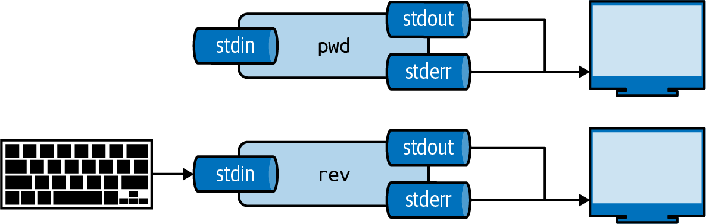

Connecting commands via the pipe operator (`|`) redirects the `stdout` of one process directly into the `stdin` of the next.

#### Limitations of Plain-Text Streams for Data Science

While treating data as unstructured byte streams was revolutionary in 1973, it introduces severe friction for modern data science workflows:

1. **Loss of types and semantic schemas:** Traditional pipes discard all type metadata. Numbers, dates, and nested records collapse into undifferentiated ASCII/UTF-8 text. Every subsequent command in the pipeline must guess column widths, parse delimiters, and reconstruct types from scratch.
2. **Fragility against whitespace and quoting:** If a field contains commas, tabs, spaces, or newline characters, downstream tools (`cut`, `awk`, `xargs`) frequently mangle the record unless guarded by brittle escaping rules.
3. **Redundant serialization overhead:** In a pipeline of five text-based tools, data is converted from internal binary representation to ASCII text and parsed back into binary at each stage.
4. **Ad-hoc parsing:** Extracting specific fields requires brittle regular expressions that easily break when input formats change slightly.

#### The Nushell Paradigm: Structured Data and Typed Pipelines

Nushell replaces unstructured byte streams with **typed data pipelines**. In Nushell, the pipe operator (`|`) does not stream raw bytes; it passes rich in-memory data structures:

```nu
open /data/ch03/movies.txt | lines | find -i "comedy" | length
```

Compare this to the equivalent Bash pipeline:

```bash
cat /data/ch03/movies.txt | grep -i "comedy" | wc -l
```

While the syntax looks deceptively similar, what flows between commands is fundamentally different. In Nushell, `open` parses the file format, `lines` produces a typed list of strings, `find` filters the list, and `length` computes the integer count of matching elements directly in memory without character parsing or subshell spawning.

To write data to disk in Nushell, redirect the structured pipeline to the `save` command:

```nu
"hello" | save -f output.txt
```

Data flows naturally through Nushell pipelines until reaching a terminal command or rendering in the console. You can emit and inspect any data type directly (scalars, lists, records, and tables) by composing commands with the pipe operator (`|`).

## Bashisms and Productivity Shortcuts in Nushell

Although Nushell is not a POSIX shell, it deliberately incorporates familiar interactive shortcuts from Bash (often referred to as *bashisms*) to streamline daily command-line work without compromising structured semantics:

### Bang-Bang History Expansion (`!`)

Powered by Nushell's interactive line editor (`reedline`), history expansion shortcuts are supported out of the box:

- **`!!`:** Inserts the previous command into the editing buffer.
- **`!$`:** Inserts the last argument or whitespace-delimited token from the previous command.
- **`!<index>`:** Retrieves the command at that specific history index (inspected via `history`).
- **`!-<n>`:** Retrieves the command executed $ steps back in history.
- **`!<prefix>`:** Retrieves the most recent command beginning with that prefix.

Unlike Bash, which immediately executes expanded commands upon pressing `Enter`, Nushell **places the expanded command into your line editor**, allowing you to inspect, modify, and confirm the text before execution. You can explore the interactive tutorial by running:

```nu
# skip-docker-exec (tutorial interactivo en terminal)
tutor bashisms
```

### External Process Control and Sequencing

- **Sequencing with semicolons (`;`):** Chain multiple commands sequentially using `;` (for example, `cd /data; ls`). Logical operators in Nushell are the explicit keywords `and` and `or` rather than `&&` and `||`.
- **Explicit external command invocation (`^`):** When a Nushell built-in shares a name with an operating system binary on `.PATH` (such as `ls`, `ps`, or `find`), prefixing the command with a caret `^` (`^ls`, `^ps`) forces the execution of the external system binary.
- **One-shot environment variables:** To define an environment variable scoped exclusively to a single external process execution, prefix the command with the assignment (for example, `FOO=bar ^my_script`).
- **External stream redirections:** Nushell supports redirection operators for external processes (`o>` for *stdout*, `e>` for *stderr*, `o+e>` for combined streams, and `e>|` to pipe errors).

### The Nushell Environment Is Scoped

Nushell draws multiple design principles from compiled programming languages. Foremost among these principles is that programming languages should avoid global mutable state. Traditional shells rely heavily on global mutation to modify the environment, but Nushell intentionally departs from this paradigm.

In Nushell, blocks control their own environment. Any environmental modifications remain strictly scoped to the block where they occur.

In practice, this enables concise, robust pipelines when traversing subdirectories. For example, to compile every project subdirectory within the current folder:

```nu
# skip-docker-exec
ls | where type == dir | each { |row|
    cd $row.name
    make
}
```

The `cd` command modifies the `$env.PWD` environment variable, but this change never escapes the block closure. Consequently, each iteration begins afresh from the original directory before navigating into the next target subdirectory.

Maintaining a scoped environment makes pipelines deterministic, readable, and straightforward to debug. When intentional environment updates are necessary, Nushell provides dedicated commands like `def --env` and `load-env` to batch environment modifications explicitly.

## Basic Elements of Nushell

This section introduces the foundational concepts and interactive workflows of Nushell.

Nushell operates under the principle that all data flowing through pipelines is structured. Consequently, you can query, filter, and transform command outputs using declarative, relational operations similar to SQL. To understand this distinction, contrast the unstructured plain-text stream generated by the operating system's external utility with the structured table returned natively by Nushell.

When invoking the traditional external system binary by prefixing it with a caret `^`:

```nu
^ls
```

> **Note on the `^` operator:** In Nushell, the `^` symbol acts as an escape operator for external operating system binaries. It instructs the engine to bypass any internal built-in command, alias, or custom function and execute the matching executable binary found on `$env.PATH` (in this case, `/bin/ls`). Its output is an unstructured character stream.

Conversely, running Nushell's native built-in `ls` command:

```nu
ls
```

`ls` returns a typed, structured table rather than raw text. Each row represents a file or directory, and each column (`name`, `type`, `size`, `modified`) has a concrete semantic data type. Just as in a database or a spreadsheet, you can sort, filter, project, and query these rows directly.

To sort the table by file size, pipe the output of `ls` into `sort-by`:

```nu
ls | sort-by size | reverse
ls | sort-by size -r
ls | sort-by modified
```

Notice that we do not pass flags to `ls` to sort its output. Instead, we use Nushell's general-purpose `sort-by` command on the structured table emitted by `ls`. To display the largest files first, append `reverse` or use the `-r` flag on `sort-by`.

Nushell provides many commands that operate directly on tables. For example, use `where` to filter rows by size:

```nu
ls | where size > 100kb
```

Consistent with the Unix philosophy of tool composition, commands connect cleanly to form versatile combinations. Consider another built-in command:

```nu
ps
```

This command returns a table of all active processes running on the system, showing their process ID, name, status, and resource consumption. To isolate processes actively consuming CPU time:

```nu
ps | where cpu > 0
```

Nushell supports not only flat tabular structures, but arbitrarily nested hierarchies as well. For example, examine the output of `help commands`:

```nu
help commands
```

Because the output is extensive, filter down to the row corresponding to the `each` command:

```nu
help commands | where name == each
help commands | where name == each | first
```

Extracting a single row from a table produces a *record*, which is an ordered set of key-value pairs. Notice how the `signatures` column contains nested records rather than scalar values. To inspect a specific column value, use `get`:

```nu
help commands | where name == each | first | get description
help commands | where name == each | first | get params
```

The `get` command navigates directly into structured data (tables, records, or lists). You can supply nested path segments to traverse structures to arbitrary depth:

```nu
help commands | where name == each | first | get category
help commands | where name == each | first | get command_type
help commands | where name == each | first | get description
help commands | where name == each | first
```

These path specifications are known as *cell paths*. Nushell uses the cell path to extract the designated value from a table, record, or list. Cell paths also support numeric row indices:

```nu
help commands | where name == each | first | get params
help commands | where name == each | first | get params.0
help commands | where name == each | first | get params.3.description
```

To view deeply nested structures expanded in the console, use `table -e`:

```nu
help commands | where name == each | first | table -e
```

Standard operating system utilities can always be invoked by prefixing them with `^` when a Nushell built-in shares their name. If no built-in conflicts, the caret prefix is optional:

```nu
^ls
open tips.csv | first 5
uname
```

Every Nushell command that outputs structured data does so as a table or list:

```nu
# inspect running system processes
ps

# sort active processes by highest CPU usage
ps | where cpu > 0 | sort-by cpu -r
```

### Getting Help

You can inspect the documentation for any built-in Nushell command using `help` or the `--help` flag. You can also search command descriptions by keyword using `help -f <topic>`:

```nu
help explore
help http get
help -f open
```

Additionally, Nushell provides an interactive tutorial built directly into the terminal, designed for progressive, hands-on learning:

- `tutor`: Displays the welcome message and general instructions.
- `tutor list`: Lists all available learning modules (tables, cell paths, expressions, variables, blocks, conditionals, closures).
- `tutor <topic>`: Opens the interactive lesson for the specified concept (for example, `tutor table`, `tutor closure`, or `tutor pipeline-input`).
- `tutor -f <query>` or `tutor --find <query>`: Searches across lesson texts for specific explanations and patterns.

```nu
tutor
tutor list
tutor table
```

## Data Types and Variables in Nushell

Having worked practically with structured tables, relational filters with physical units (`where size > 100kb`), and cell paths, we now formalize the core mechanics of Nushell's type system, its two-phase compilation architecture, and variable declarations with `let`, `mut`, and `const`.

### The Nushell Type System

One of the most consequential design choices in Nushell is its strongly typed data model. In legacy shells like Bash or Zsh, pipelines pass undifferentiated byte streams, forcing users to constantly parse text with `awk`, `cut`, or regular expressions. In Nushell, every value that travels through a pipeline retains its explicit type identity. This preserves semantic meaning, allows compile-time and runtime validation, and makes complex transformations reliable.

To inspect the runtime type of any value or pipeline output, use the `describe` command:

```nu
[
  (42 | describe),
  (3.14 | describe),
  ("data science" | describe),
  (true | describe),
  (2026-10-21 | describe),
  (15min | describe),
  (2.5gb | describe)
]
```

Nushell categorizes types into primitive scalars, dimensional quantities (filesizes and durations), structured collections, and language runtime types. Table 1 summarizes the core catalog:

| Category | Data Type | Example Syntax and Literals | Operational Description |
| :--- | :--- | :--- | :--- |
| **Scalars** | `int` | `42`, `-10`, `0x2A` | 64-bit signed integer for discrete counts and arithmetic. |
| **Scalars** | `float` | `3.14159`, `-0.001`, `Infinity` | 64-bit IEEE 754 double-precision floating-point number. |
| **Scalars** | `string` | `"text"`, `'simple'`, `r#'raw'#` | UTF-8 encoded text string supporting string interpolation `$"..."`. |
| **Scalars** | `bool` | `true`, `false` | Boolean value for logical branching and filter predicates. |
| **Scalars** | `nothing` | `null` | Represents the explicit absence of a value or an empty result. |
| **Dimensional** | `filesize` | `512b`, `10kb`, `4mb`, `2gb`, `1tb` | Byte magnitude supporting unit arithmetic (`2gb - 500mb`). |
| **Dimensional** | `duration` | `100ms`, `5sec`, `2min`, `3hr`, `7day` | Time interval supporting automatic unit conversion (`1hr + 30min`). |
| **Dimensional** | `datetime` | `2026-10-21`, `2026-10-21T15:30:00Z` | Absolute timestamp in ISO 8601 format with timezone support. |
| **Structures** | `list<T>` | `[1 2 3]`, `["a" "b" "c"]` | Ordered collection of elements indexed sequentially. |
| **Structures** | `record<...>` | `{name: "Carlos", age: 30}` | Set of key-value pairs analogous to a JSON object. |
| **Structures** | `table<...>` | `[[id value]; [1 100] [2 200]]` | Two-dimensional table equivalent to a homogeneous list of records. |
| **Structures** | `range` | `1..10`, `0..<5`, `1..` | Memory-efficient contiguous or half-open interval. |
| **Advanced** | `binary` | `0x[deadbeef]`, `0x[48 65 6c 6c 6f]` | Raw byte sequence for network payloads and binary files. |
| **Advanced** | `closure` | `{|x| $x * 2 }`, `{ $in > 10 }` | Anonymous executable block with parameters or pipeline input `$in`. |
| **Advanced** | `glob` | `*.csv`, `**/*.parquet` | Filesystem pattern matching specification. |
| **Advanced** | `cell-path` | `$.name`, `$.column.0` | Declarative path accessing internal record keys or table cells. |

Table: Fundamental data types in Nushell.

Dimensional types represent a major analytical asset: Nushell natively understands physical units and normalizes comparisons automatically. When filtering records by file size (`where size > 50mb`) or latency thresholds (`where latency < 200ms`), the engine performs exact unit arithmetic without requiring manual algebraic conversions.

### Nushell as a Compiled Language

A key architectural aspect of Nushell where it diverges from dynamic shells is its two-phase execution model: source code is compiled before it runs. Nushell does not provide an `eval` function that injects arbitrary new syntax into an executing environment. Tasks like importing files must use paths known at compile time, much like `#include` directives in C++ or `use` statements in Rust.

For example, the following sequence fails when executed as a script:

```nu
# skip-docker-exec (compilation error demonstration)
"def abc [] { 1 + 2 }" | save -f output.nu
source "output.nu"
abc
```

The `source` statement expands code during the compilation phase, but the preceding `save` command has not yet executed. Nushell analyzes the entire block as a cohesive unit before evaluating runtime instructions. Because `output.nu` does not exist on disk when the parser runs, `source` cannot locate the definition of `abc`.

Similarly, building source paths dynamically at runtime fails:

```nu
# skip-docker-exec (compile-time error demonstration)
source $"($my_path)/common.nu"
```

If `$my_path` is a regular runtime variable declared with `let`, the compilation phase cannot resolve the path string.

However, if `$my_path` is declared as a compile-time constant, the parser can evaluate the string ahead of execution:

```nu
# skip-docker-exec (constant path demonstration)
const my_path = ([$nu.home-dir nushell] | path join)
source $"($my_path)/common.nu"
```

Nushell uses a single compilation pass for source code, keeping parsing strictly separated from evaluation. This architecture enables reliable IDE integration, descriptive compile-time diagnostics, and clean interoperability with developer tooling.

### Variable Declarations: let, mut, and const {#declaracion-y-ciclo-de-vida-de-variables-let-mut-y-const}

Binding values in Nushell centers around three keywords: `let`, `mut`, and `const`. Each defines specific semantics regarding evaluation timing (compile time versus runtime), memory immutability, and closure capture.

#### Naming and Referencing Rules

Once declared, a variable is referenced by prefixing its identifier with a dollar sign (`$`):

Nushell restricts certain characters in variable names to prevent syntactic ambiguity with operators:

```text
.  [  (  {  +  -  *  ^  /  =  !  <  >  &  |
```

In declaration statements, prefixing the variable name with `$` is optional (`let $var = 42` is identical to `let var = 42`).

#### Runtime Immutability: let

Emphasizing functional programming principles, Nushell defaults to immutability. Variables declared with `let` are evaluated dynamically at runtime and remain strictly unmodifiable throughout their scope:

```nu
# skip-docker-exec (immutability demonstration)
let rate = 0.15
$rate = 0.20 # Error: nu::shell::assignment_requires_mutable_variable
```

While immutable bindings cannot be reassigned with `=`, Nushell fully supports **variable shadowing**. You can declare a new binding with the same name in the same scope or an inner block, replacing the reference without violating referential transparency:

```nu
let count = 10
do {
  let count = 50
  $count # evaluates to 50 in inner scope
}
$count # outer scope remains 10
# Explicit shadowing in the current scope: now 11
let count = $count + 1
```

Immutable bindings declared with `let` are thread-safe and can be captured freely inside functional closures such as `each` and `par-each`.

#### Controlled Imperative Mutability: mut

When algorithms require iterative state accumulation (such as in `loop` or `while` constructs), Nushell provides the `mut` keyword. Mutable variables can be updated in place using compound assignment operators:

```nu
mut total = 0
$total += 15
$total *= 2
$total # result: 30
```

Nushell supports several assignment operators for mutable variables, detailed in Table 2:

| Operator | Operational Description |
| :--- | :--- |
| `=` | Assigns a new value directly to the mutable variable. |
| `+=` | Adds a value to the variable in place (`$val += 5`). |
| `-=` | Subtracts a value from the variable in place (`$val -= 2`). |
| `*=` | Multiplies the variable by a value in place (`$val *= 3`). |
| `/=` | Divides the variable by a value in place (`$val /= 2`). |
| `++=` | Appends an item or concatenates a list onto an existing list variable. |

Table: Assignment operators for mutable variables in Nushell.

Compound arithmetic operators (`+=`, `-=`, `*=`, `/=`) only apply to types that support the corresponding arithmetic operation. The `++=` operator requires that the target variable or operand be a list.

Crucially, **closures and nested functions cannot capture mutable variables**. The following pipeline triggers an immediate compiler error:

```nu
# skip-docker-exec (closure restriction demonstration)
mut counter = 0
[1 2 3] | each { $counter += 1 } # Error: nu::shell::capture_of_mutable_var
```

This restriction protects pipeline integrity: Nushell pipelines stream elements lazily and frequently run concurrently across threads (via `par-each`). Allowing closures to mutate external state would introduce data races and nondeterministic behavior.

#### Parse-Time Constants: const

Nushell enforces a strict two-stage lifecycle:

1. **Parse-time (static compilation):** The Nushell parser analyzes the complete source code of a script or command block before execution begins. In this stage, syntax is validated, command signatures are resolved, keywords are checked, and modules are loaded (`source`, `use`).
2. **Runtime (dynamic evaluation):** Data streams through pipelines, expressions are evaluated, files are written (`save`), external processes are spawned, and results are returned.

Understanding this boundary is vital. Consider the following sequence:

```nu
# skip-docker-exec (parse-time vs runtime demonstration)
"def abc [] { 1 + 2 }" | save -f output.nu
source "output.nu"
abc
```

When entered line by line in the interactive REPL, this works as expected: the first line compiles and runs, creating `output.nu` on disk; when the second line is entered, `output.nu` exists physically, allowing the parser to read it and register `abc`.

However, executing the block as a single script invocation fails immediately with `nu::parser::sourced_file_not_found`:

```text
Error: nu::parser::sourced_file_not_found
  × File not found: output.nu
  help: sourced files need to be available before your script is run
```

Because `source` is a parse-time directive, Nushell attempts to read `output.nu` during the compilation pass to check the call to `abc`. At that point, the preceding `save` command has not yet executed.

To provide values needed during compilation (such as static module paths or default parameter values in command signatures), use `const`. Constants declared with `const` are evaluated statically during parse time and can only be bound to literal values or pure expressions that the compiler can evaluate ahead of time:

```nu
# skip-docker-exec (compile-time constant definition)
const module_path = ([$nu.home-dir my_scripts] | path join)
use $"($module_path)/utilities.nu" *
```

Supplying a runtime variable declared with `let` to `use` fails compilation immediately, because runtime values do not exist in memory when the script is parsed.

Table 3 compares the operational characteristics of the three binding mechanisms:

| Criterion | `let` (Immutable) | `mut` (Mutable) | `const` (Compile-time Constant) |
| :--- | :--- | :--- | :--- |
| **Evaluation Timing** | Runtime | Runtime | Parse-time |
| **Direct Reassignment (`=`)** | Not permitted | Permitted (`$var = ...`, `+=`) | Not permitted |
| **Variable Shadowing** | Yes (`let x = $x + 1`) | No (reassignment is used) | Yes (in inner scopes) |
| **Closure Capture** | Yes (thread-safe for streaming/parallel) | No (rejected by compiler) | Yes |
| **Usable in `source` / `use`** | No (unknown at parse time) | No | Yes (resolved statically) |
| **Recommended Usage** | Default choice for 90%+ of code | Imperative loops (`while`, `loop`) | Module paths, fixed schemas |

Table: Variable binding models in Nushell: `let`, `mut`, and `const`.

#### Functional Pipelines versus Imperative Mutation

In idiomatic Nushell code, immutable variables and functional transformations are strongly preferred for analytical tasks. Pipeline-oriented transformations offer three major advantages:

1. **Performance:** They avoid repetitive reallocations of intermediate buffers in memory.
2. **Native streaming:** Subsequent pipeline stages begin processing data as soon as the first item is emitted, without waiting for earlier loops to finish.
3. **Concurrency:** Functional pipelines easily parallelize across multi-core processors using `par-each`.

Common accumulation patterns that require mutable variables in imperative languages are expressed declaratively in Nushell:

- **Index tracking:** Instead of incrementing a counter variable, combine `enumerate` with `each`:
  ```nu
  ls |
    enumerate |
    each { |elt|
      $"Item #($elt.index) has size ($elt.item.size)"
    }
  ```

- **Accumulation and reduction:** To fold a collection into an aggregate value, use `reduce`:
  ```nu
  [one two three four five six] | reduce { |current, longest|
    if ($current | str length) > ($longest | str length) {
      $current
    } else {
      $longest
    }
  }
  ```

- **Dynamic sequence generation:** To consume data from generators or streams on demand, use `generate`:
  ```nu
  # skip-docker-exec (functional sequence generation)
  generate { |counter|
    if $counter < 5 {
      { out: ($counter * 10), next: ($counter + 1) }
    }
  } 0
  ```

##### Performance Implications

Using pipeline filters with immutable variables is often orders of magnitude faster than imperative mutation using `for` and `while` loops. When appending items to a mutable list inside a `for` loop, each `append` allocates a new list buffer:

- **Imperative approach with `for` loop and mutable variable:**
  ```nu
  timeit {
    mut randoms = []
    for _ in 1..500 {
      $randoms = ($randoms | append (random int))
    }
  }
  ```

- **Idiomatic functional approach with `each`:**
  ```nu
  timeit {
    let randoms = 1..500 | each { random int }
  }
  ```

In addition to executing much faster, `each` streams its results immediately through the pipeline, allowing downstream commands to process records concurrently.

## Navigating the Filesystem

Navigating and inspecting the filesystem is a fundamental responsibility of any shell. Nushell provides dedicated commands that operate cleanly on structured filesystem metadata:

### Inspecting Directory Contents

```nu
cd /data/ch03
ls
```

As demonstrated earlier, `ls` returns directory contents as a structured table.

`ls` also accepts an optional glob pattern to filter entries. For example, to list only CSV files:

```nu
cd /data/ch03
ls *.csv
```

### Glob Patterns (Wildcards)

The asterisk (`*`) in `*.csv` represents a *glob pattern* matching paths on the filesystem. The pattern `*.csv` matches any filename ending with `.csv`.

The most general wildcard is `*`, which matches any sequence of characters in the current directory. You can combine it with prefixes or file extensions, such as `*.bak` or `temp*`.

Nushell also supports the recursive glob `**`, which traverses nested subdirectories. For instance, `ls **/*.csv` searches through all directory levels starting from `/data`:

```nu
cd /data
ls **/*.csv
```

In addition to `*`, Nushell glob syntax supports single-character wildcards with `?` and character classes with `[...]`.

Literal wildcards (`*`, `?`, `[]`) can be escaped by enclosing the path in single quotes, double quotes, or raw string syntax (`r#'...'#`). For example, to inspect a literal directory named `[slug]`, use `ls "[slug]"` or `ls '[slug]'`.

However, strings enclosed in backticks do not escape glob characters. Compare these three cases:

1. Bare words: Interpreted as glob patterns.
   ```nu
   rm *myfile*
   ```

2. Quoted strings: Treated as literal strings with escaped wildcard characters.
   ```nu
   rm "*myfile*"
   ```

3. Backtick-quoted strings: Interpreted as glob patterns, allowing spaces within glob paths.
   ```nu
   rm `*myfile*`
   ```

> Nushell also includes a standalone `glob` command for building advanced file matching pipelines.

#### Programmatic Glob Generation

When glob patterns must be generated dynamically in code, use these patterns:

1. `into glob`: Converts a string into a typed glob value:
   ```nu
   let current_month = date now | format date '%Y-%m'
   let glob_pattern = $"*($current_month)*" | into glob
   ls $glob_pattern
   ```

2. The spread operator (`...`) combined with `glob`:
   ```nu
   let current_month = date now | format date '%Y-%m'
   ls ...(glob $"*($current_month)*")
   ```

3. Explicit type annotation:
   ```nu
   let current_month = date now | format date '%Y-%m'
   let glob_pattern: glob = $"*($current_month)*"
   ls $glob_pattern
   ```

## Working with Strings

Strings represent sequences of characters used for filenames, column labels, text corpora, and configuration settings. Nushell provides several string literal formats tailored for different situations:

### String Formats

| String Format | Example | Escaping Rules | Notes |
| :--- | :--- | :--- | :--- |
| [Single-quoted strings](#single-quoted-strings) | `'[^\n]+'` | None | Cannot contain single quotes inside the string. |
| [Double-quoted strings](#double-quoted-strings) | `"The\nEnd"` | C-style backslash escapes | Literal backslashes must be escaped. |
| [Raw strings](#raw-strings) | `r#'Raw string'#` | None | May contain single and double quotes. |
| [Bare-word strings](#bare-word-strings) | `ozymandias` | None | Only alphanumeric word characters; cannot appear in command position. |
| [Backtick-quoted strings](#backtick-quoted-strings) | <code>`[^\n]+`</code> | None | Simple string that may include whitespace. |
| [Single-quoted interpolation](#string-interpolation) | `$'Captain ($name)'` | None | Cannot contain unescaped single quotes. |
| [Double-quoted interpolation](#string-interpolation) | `$"Captain ($name)"` | C-style backslash escapes | Literal backslashes and parentheses must be escaped. |

### Single-Quoted Strings {#single-quoted-strings}

Single-quoted strings are enclosed in `'`. They do not interpret escape sequences, making them ideal for regular expressions and literal text:

```nu
'hello world'

'The
end'
```

### Double-Quoted Strings {#double-quoted-strings}

Double-quoted strings are enclosed in `"` and support standard backslash escape sequences:

```nu
"hello\nworld"
```

Supported escape sequences include:
- `\"` (double quote)
- `\'` (single quote)
- `\\` (backslash)
- `\/` (forward slash)
- `\b` (backspace)
- `\f` (form feed)
- `\r` (carriage return)
- `\n` (newline)
- `\t` (tab)
- `\u{X...}` (Unicode code point with 1 to 6 hexadecimal digits)

### Raw Strings {#raw-strings}

Raw strings allow single and double quotes inside text without escaping. They are delimited by `r#'` and `'#`:

```nu
r#'Raw strings can contain 'quoted' text.'#
```

You can increase the number of `#` delimiters to nest raw strings:

```nu
r###'r##'This is an example of a raw string.'##'###
```

### Bare-Word Strings {#bare-word-strings}

Simple alphanumeric words can often be written without quotes:

```nu
print hello
print "hello"

[hello] | describe
```

However, bare words in the leading position of an expression or inside parentheses `(...)` are evaluated as command names:

```nu
hello
Error: nu::shell::external_command

  × External command failed
   ╭─[entry #5:1:1]
 1 │ hello
   · ──┬──
   ·   ╰── executable was not found
   ╰────
  help: program not found
```

If a bare word conflicts with a built-in keyword (`true`, `false`, `null`), Nushell treats it as that keyword rather than a string:

```nu
true | describe
[true] | describe
[trueX] | describe
"trueX" | describe
```

In structured scripts, using explicit quotes is recommended to avoid parsing ambiguities.

### Backtick-Quoted Strings {#backtick-quoted-strings}

Enclosed by <code>`</code>, backtick strings can contain spaces while functioning similarly to bare words:

```nu
# skip-docker-exec
^ls
```

They are especially useful for passing paths with spaces to commands:

```nu
# skip-docker-exec
ls `./my dir/*`
```

### Executing Strings as External Commands

Prefixing any string expression or variable with `^` instructs Nushell to execute its contents as an external command:

```nu
^ls
^'ls'
let foo = 'ls'
^$foo
```

You can also use `run-external` for advanced process configuration.

### String Concatenation and Joins

Nushell provides several operators and commands for combining strings:

```nu
['foo', 'bar'] | each {|s| '~/' ++ $s}
['foo', 'bar'] | each {|s| '~/' + $s}
```

Regular expressions can also prepend or append substrings across collections:

```nu
['foo', 'bar'] | str replace -r '^' '~/'
['foo', 'bar'] | str replace -r '$' '~/'
```

To join list elements into a single string:

```nu
"hello" | append "world!" | str join " "
ls | get name | str join "/"
```

Using `reduce`:

```nu
1..10 | reduce -f "" {|elt, acc| $acc + ($elt | into string) + " + "}
```

For most join operations, `str join` is the clearest and most idiomatic choice.

### String Interpolation {#string-interpolation}

String interpolation allows evaluating subexpressions directly inside text literals, delimited by `$"..."` (with escape processing) or `$'...'` (without escape processing):

```nu
let name = "Alice"
$"greetings, ($name)"
$"greetings, (ls | get name.2)"
```

Subexpressions inside `(...)` evaluate fully, and their results are concatenated into the final string.

Literal parentheses inside interpolated strings can be escaped with backslashes:

```nu
$"2 + 2 is (2 + 2) \(you guessed it!)"
```

Interpolated strings can be evaluated at parse time when assigned to constants:

```nu
const x = $"(2kb)"
```

### Splitting Strings

Use `split row` to break a string into a list based on a delimiter:

```nu
"red,green,blue" | split row ","
```

Use `split column` to parse delimited text into a structured table:

```nu
"red,green,blue" | split column ","
```

Use `split chars` to divide text into individual characters:

```nu
'aeiou' | split chars
```

### String Transformation Commands (`str`)

Common string operations are organized as subcommands of `str`. Inspect the full suite with `help str`.

Check whether a string contains a substring:

```nu
"hello world" | str contains "o wo"
```

The regex matching operator `=~` provides pattern searching.

#### Trimming

Use `str trim` to remove leading and trailing whitespace:

```nu
'       My   string   ' | str trim
```

Specify `--left` (`-l`) or `--right` (`-r`) to trim only one side, or pass `--char` (`-c`) to strip specific characters:

```nu
'=== Nu shell ===' | str trim -r -c '='
```

#### Substrings and Indexing

Extract slices of text using character index ranges:

```nu
'Hello World!' | str index-of 'o'
'Hello World!' | str index-of 'r'
'Hello World!' | str substring 4..8
```

#### Padding

Use `fill` to pad strings to a designated width:

```nu
'1234' | fill -a right -c '0' -w 10
'1234' | fill -a left -c '0' -w 10
```

#### Reversing

Use `str reverse` to invert character order:

```nu
'Nushell' | str reverse
['Nushell' 'is' 'cool'] | str reverse
```

#### Structured Parsing

Use `parse` to extract structured fields into a table using pattern templates or regular expressions:

```nu
'Nushell 0.80' | parse '{shell} {version}'
'where all data is structured!' | parse --regex '(?P<subject>\w*\s?\w+) is (?P<adjective>\w+)'
```

Standard delimited streams can be parsed directly with `from csv`, `from tsv`, or `from ssv`:

```nu
"acronym,long\nAPL,A Programming Language" | from csv
"name  duration\nonestop.mid  4:06" | from ssv
"rank\tsuit\nJack\tSpades\nAce\tClubs" | from tsv
```

### String Comparisons

In addition to standard comparison operators (`==`, `!=`), Nushell provides dedicated string predicates:

```nu
'APL' =~ '^\w{0,3}$'
'FORTRAN' !~ '^\w{0,3}$'
```

```nu
'JavaScript' starts-with 'Java'

'OCaml' ends-with 'Caml'
```

### Type Conversions

Convert to string:
1. `into string`: `123 | into string`
2. Interpolation: `$'(123)'`

Convert from string:
1. `into <type>`: `'123' | into int`

### ANSI Terminal Colors

Apply ANSI styling with `ansi`:

```nu
$'(ansi purple_bold)This text is a bold purple!(ansi reset)'
```

Always terminate styled output with `ansi reset` to restore default terminal colors.

## Working with Lists

In Nushell, a list is an ordered collection of values, conceptually equivalent to a single table column without a header label. Commands that operate on table columns work seamlessly on lists. For example, `where` filters list items directly:

```nu
[bell book candle] | where ($it =~ 'b')
```

### Creating Lists

Lists are constructed with square brackets, separating elements with spaces, commas, or newlines:

```nu
[foo bar baz]
[foo, bar, baz]
```

Nushell lists serialize to and from JSON arrays (`["Item1", "Item2", "Item3"]`) transparently.

### Modifying Lists

Use `insert` to place a value at a designated index:

```nu
[1, 2, 3, 4] | insert 2 10
```

Use `update` to replace an element at a given position:

```nu
[1, 2, 3, 4] | update 1 10
```

### Appending, Prepending, and Slicing

Add items with `prepend`, `append`, or the list concatenation operator `++`:

```nu
let colors = [yellow green]
let colors = $colors | prepend red
let colors = $colors | append purple
let colors = $colors ++ ["blue"]
let colors = ["black"] ++ $colors
$colors # [black red yellow green purple blue]
```

Use `skip` to discard leading elements, and `drop` to truncate elements from the end:

```nu
let colors = [red yellow green purple]
let colors = $colors | skip 1
let colors = $colors | drop 2
$colors # [yellow]
```

Extract head and tail elements using `first` and `last`:

```nu
let colors = [red yellow green purple black magenta]
let colors = $colors | last 3
$colors # [purple black magenta]
```

```nu
let colors = [yellow green purple]
let colors = $colors | first 2
$colors # [yellow green]
```

#### Spread Operator (`...`)

Flatten nested lists or interpolate elements into a new list with `...`:

```nu
let x = [1 2]

[
   ...$x
   3
   ...(4..7 | take 2)
]
```

### Iterating over Lists

Use `each` to execute a code block for every element in a list. The block receives each element as an argument (or as `$in`). Combine with `enumerate` to track element indices:

```nu
let names = [Mark Tami Amanda Jeremy]

$names | each { |elt| $"Hello, ($elt)!" }

$names | enumerate | each { |elt| $"($elt.index + 1) - ($elt.item)" }
```

Filter list items with `where`:

```nu
let colors = [red orange yellow green blue purple]
$colors | where ($it | str ends-with 'e')
```

```nu
let scores = [7 10 8 6 7]
$scores | where $it > 7 # [10 8]
```

Aggregate list values using `reduce`. The block accepts the current element (`elt`) and an accumulator (`acc`). Use `--fold` (`-f`) to set an initial accumulator value:

```nu
let scores = [3 8 4]
$"total = ($scores | reduce { |elt, acc| $acc + $elt })" # total = 15

$"total = ($scores | math sum)" # idiomatic equivalent

$"product = ($scores | reduce --fold 1 { |elt, acc| $acc * $elt })" # product = 96

$scores | enumerate | reduce --fold 0 { |elt, acc| $acc + $elt.index * $elt.item } # 0*3 + 1*8 + 2*4 = 16
```

### Accessing List Elements

Access list items by numeric index using cell paths (`$list.index`):

```nu
let names = [Mark Tami Amanda Jeremy]
$names.1 # returns Tami
```

When the index is held in a variable, retrieve the element with `get`:

```nu
let names = [Mark Tami Amanda Jeremy]
let index = 1
$names | get $index # returns Tami
```

Query the number of items with `length`:

```nu
[red green blue] | length
```

Check for empty lists with `is-empty`:

```nu
let colors = [red green blue]
$colors | is-empty # false

let colors = []
$colors | is-empty # true
```

Test membership using `in` and `not-in`:

```nu
let colors = [red green blue]
'blue' in $colors # true
'yellow' in $colors # false
'gold' not-in $colors # true
```

Evaluate conditions across items with `any`:

```nu
let colors = [red green blue]
# Does any color name end with "e"?
$colors | any {|elt| $elt | str ends-with "e" } # true

# Is any color name shorter than 3 characters?
$colors | any {|elt| ($elt | str length) < 3 } # false

let scores = [3 8 4]
# Is any score greater than 7?
$scores | any {|elt| $elt > 7 } # true

# Is any score odd?
$scores | any {|elt| $elt mod 2 == 1 } # true
```

Test whether all elements satisfy a condition using `all`:

```nu
let colors = [red green blue]
# Do all color names end with "e"?
$colors | all {|elt| $elt | str ends-with "e" } # false

# Are all color names at least 3 characters long?
$colors | all {|elt| ($elt | str length) >= 3 } # true

let scores = [3 8 4]
# Are all scores greater than 7?
$scores | all {|elt| $elt > 7 } # false

# Are all scores even?
$scores | all {|elt| $elt mod 2 == 0 } # false
```

### Transforming Lists

Use `flatten` to collapse nested lists into a single list:

```nu
[1 [2 3] 4 [5 6]]
[1 [2 3] 4 [5 6]] | table -e
[1 [2 3] 4 [5 6]] | flatten # [1 2 3 4 5 6]

[[1 2] [3 [4 5 [6 7 8]]]]
[[1 2] [3 [4 5 [6 7 8]]]] | table -e
[[1 2] [3 [4 5 [6 7 8]]]] | flatten

[[1 2] [3 [4 5 [6 7 8]]]] | flatten | flatten | flatten # [1 2 3 4 5 6 7 8]
```

Use `wrap` to turn a list into a single-column table:

```nu
let zones = [UTC CET Europe/Moscow Asia/Yekaterinburg]

# Display world clock for selected time zones
$zones |
  wrap 'Zone' |
  upsert Time {|row|
    (date now | date to-timezone $row.Zone | format date '%Y.%m.%d %H:%M')
  }
```

## Working with Records

Records correspond conceptually to individual rows within a structured table. In essence, a record represents a "single-row table." Consequently, most commands engineered to transform a table row also operate seamlessly on individual records. For example, `update` can be invoked directly on a record:

```nu
let my_record = {
   name: "Sam"
   age: 30
   }
$my_record | update age { $in + 1 }
```

### Creating Records

A record is an ordered mapping of zero or more key-value pairs. It behaves similarly to a JSON object and can be declared using identical syntax:

```nu
# Nushell
{ "apples": 543, "bananas": 411, "oranges": 0 }
╭─────────┬─────╮
│ apples  │ 543 │
│ bananas │ 411 │
│ oranges │ 0   │
╰─────────┴─────╯
# JSON
'{ "apples": 543, "bananas": 411, "oranges": 0 }' | from json
```

In Nushell, key-value entries in a record may also be separated by whitespace or newlines rather than commas.

Because records frequently contain numerous attributes, Nushell renders them vertically by default rather than horizontally across columns. To render a record inline as a single string representation, we convert it to NUON (Nushell Object Notation) via `to nuon`:

```nu
{
   name: "Sam"
   rank: 10
} | to nuon
```

### Updating Records

Just like with lists, values can be inserted into existing records:

```nu
{ "apples": 543, "bananas": 411, "oranges": 0 } | insert pears { 21 }
```

Values can also be updated directly:

```nu
{ "apples": 543, "bananas": 411, "oranges": 0 } | update oranges { 100 }
```

To derive an updated record with new fields while maintaining immutability:

- Invoke the `merge` command:

```nu
let first_record = { name: "Sam", rank: 10 }
$first_record | merge { title: "Mayor" }
```

- Or apply the spread operator (`...`) to expand the fields of the original record inside a new record:

```nu
let first_record = { name: "Sam", rank: 10 }
{
   ...$first_record
   title: "Mayor"
 }
```

### Iterating Over a Record

We can iterate over each key-value pair of a record by first transposing it into a two-column table:

```nu
{ "apples": 543, "bananas": 411, "oranges": 0 } |
  transpose fruit count |
  each {|f| $"We have ($f.count) ($f.fruit)" }
```

<!--AQUI-->


## Working with Tables

Structured tables represent the primary medium for inspecting tabular datasets in Nushell. Nu provides a comprehensive suite of built-in table manipulation commands, enabling rapid filtering, projection, and reduction to isolate the exact subsets required for analysis.

To begin exploring tabular operations, we obtain an initial table from the filesystem:

```nu
ls
```

### Sorting Data

We sort tables using `sort-by`, passing one or more column names as sorting keys. To order directory entries by file size:

```nu
ls | sort-by size
```

Tables can be sorted by any column whose data type implements comparison. In this directory listing, we could alternatively sort by `name`, `accessed`, or `modified`.

### Selecting Data

We project specific columns or slice specific rows using the `select` command:

```nu
ls | select name size
```

This isolates the attributes under study. If we wish to inspect only the five smallest files in the directory:

```nu
ls | sort-by size | first 5
```

Notice how the pipeline orders the table by size first to bring the smallest files to the top, and then applies `first 5` to extract the leading rows.

Rows can also be skipped sequentially:

```nu
ls | sort-by size | first 5 | skip 2
```

Specific row indices can be extracted directly:

```nu
ls | sort-by name | select 5
```

### Retrieving Data from a Table

Up to this point, our transformations have reshaped tables into smaller tabular subsets. Often, analytical routines require stepping beyond tabular containers to extract raw scalar values or individual column vectors. To extract file names directly as a raw list:

```nu
ls | get name
```

At first glance, this invocation may resemble our earlier `select` pipeline:

```nu
ls | select name
```

While their syntax appears related, their computational behavior is fundamentally distinct:

- `select`: Produces a new structured table containing solely the projected columns.
- `get`: Extracts the underlying cell values from the specified column, returning them as a typed list.

### Modifying Data in a Table

In addition to selecting subsets, analytical workflows require reshaping tabular contents. This includes appending rows, merging disjoint attributes, and calculating new values. Following Nushell functional design, commands in this section do not mutate tables in place; each invocation yields an entirely new table.

#### Concatenating Tables

We concatenate tabular streams vertically using `append`:

```nu
let first = [[a b]; [1 2]]
let second = [[a b]; [3 4]]

$first
$second

$first | append $second
```

If column schemas do not match exactly, Nushell dynamically expands the schema, inserting `null` values where corresponding entries are absent:

```nu
let first = [[a b]; [1 2]]
let second = [[a b]; [3 4]]
let third = [[a c]; [3 4]]

$first | append $second | append $third
```

We can also use the binary append operator `++` as an inline shorthand:

```nu
$first ++ $second ++ $third
```

#### Merging Tables

We combine columns from two or more tables side-by-side using `merge`:

```nu
let first = [[a b]; [1 2]]
let second = [[c d]; [3 4]]

$first | merge $second
```

With a third table:

```nu
let third = [[e f]; [5 6]]
```

All three tables can be joined sequentially:

```nu
$first | merge $second  | merge $third
```

Alternatively, we can combine an arbitrary collection of tables dynamically using `reduce`:

```nu
[$first $second $third] | reduce {|elt, acc| $acc | merge $elt }
```

### Adding a Column

We add new columns to an existing table using `insert`:

```nu
{edition: 2024} | save -f edition.json
open edition.json
open edition.json | save -f edition_copia.json
```

We insert a column designated `next_edition` with the scalar value 2025:

```nu
open edition.json | insert next_edition 2025
```

This rendering can occasionally surprise newcomers because a single-row table displays fields vertically. In Nushell tables, row numbers denote observations, whereas column headers denote variables. Appending an additional record clarifies the tabular grid:

```nu
open edition.json | insert next_edition 2025 | append {edition: 2021 next_edition: 2023}
```

Re-inspecting the original file confirms that its contents remain unchanged:

```nu
open edition.json
open edition.json | save -f edition_copia.json
```

Nushell operations are purely functional: they operate on intermediate values in memory without producing unsolicited side effects on disk. This enables safe pipeline composition until the final pipeline stage explicitly commits results using `save`:

```nu
open edition.json |
  insert next_edition 2025 |
  append {edition: 2021 next_edition: 2023} |
  save -f edition2.json

open edition.json
open edition2.json
```

### Updating a Column

Analogous to `insert`, the `update` command replaces the existing contents of a column:

```nu
open edition.json
open edition.json | save -f edition_copia.json
```

Now, update the edition field:

```nu
open edition.json | update edition 2025
```

Nushell also supplies `upsert`, which dynamically updates a column if it already exists or inserts it if it is absent.

### Moving Columns

We reorder columns across a table using `move`. For instance, to position the `name` column after `size` in an `ls` listing:

```nu
ls

ls | move name --after size
```

### Renaming Columns

Columns can be renamed by passing new header identifiers to `rename`:

```nu
ls | rename filename filetype filesize filedate
```

### Rejecting and Removing Columns

Unwanted attributes can be excluded from a table using `reject`:

```nu
ls -l

ls -l | reject readonly num_links inode created accessed modified
```

## Navigating and Accessing Structured Data

Given Nushell native support for structured data, navigating and addressing nested structures constitutes one of the most frequent operations in daily data science workflows.

### Foundational Concepts

The explanations and examples that follow rely on three foundational structural definitions:

- **_List:_** An ordered sequence of zero or more values of arbitrary types. A list containing zero elements is termed an "empty list."
- **_Record:_** An associative collection of zero or more named keys and their associated values. Values within a record may belong to any Nushell type. A record with zero key-value entries is termed an "empty record."
- **_Nested Data:_** Values stored inside a list, record, or table can be scalar primitives or complex structured data types. Data structures can therefore nest arbitrarily across multiple dimensions:
    - Lists can contain tables, records, and further child lists.
        - **_Table:_** A table is fundamentally a list of records.
    - Records can contain tables, lists, and child records.
        - Consequently, records within a table can themselves hold nested tables, lists, and sub-records.

> Because a table is fundamentally a list of records, any command or syntax valid on lists is also valid on tables. The converse does not hold uniformly: certain commands require tabular column structures and cannot operate on primitive lists.

### Cell Paths

A cell path is Nushell primary mechanism for navigating and querying values within structured data. The concept mirrors spreadsheet coordinates, where columns are addressed by name and rows are addressed by numerical index. Segments in a cell path are joined using dot notation (`.`).

#### Records

For a record, a cell path specifies a key name as a `string`.

To query an attribute from a record:

```nu
let my_record = {
    a: 5
    b: 42
  }

$my_record.b + 5
```

#### Lists

For a list, a cell path specifies the zero-based index of the target element as an `int`:

To query an item from a list (remembering that list indices begin at 0):

```nu
let scoobies_list = [ Velma Fred Daphne Shaggy Scooby ]

$scoobies_list.3

```

#### Tables

- To access a column, the cell path specifies the column name (`string`).
- To access a row, the cell path specifies the row index (`int`).
- To access a specific cell, combine the column name and row index.

The following examples utilize this sample dataset:
<!--fix:tabla no cabe dentro del ancho de pagina-->

```nu
let data = [[date                        temps                                   condition ];
            [2022-02-01T14:30:00+05:00,  [ 38.24, 38.50, 37.99, 37.98, 39.10 ],  'summy'   ],
            [2022-02-02T14:30:00+05:00,  [ 35.24, 35.94, 34.91, 35.24, 36.65 ],  'sunny'   ],
            [2022-02-03T14:30:00+05:00,  [ 35.17, 36.67, 34.42, 35.76, 36.52 ],  'cloudy'  ],
            [2022-02-04T14:30:00+05:00,  [ 39.24, 40.94, 39.21, 38.99, 38.80 ],  'rain'    ],
           ]

$data

$data | table -e
```

This table contains meteorological observations across three columns:

1. **_date_**: A Nushell `date` timestamp for each observation day.
2. **_temps_**: A Nushell `list` of five `float` readings recorded by regional weather sensors.
3. **_condition_**: A Nushell `string` describing local atmospheric conditions.

##### Example: Accessing a Table Row (Record)

Access the second observation day as an individual record:

```nu
> $data.1
╭───────────┬───────────────╮
│ date      │ 2 years ago   │
│           │ ╭───┬───────╮ │
│ temps     │ │ 0 │ 35.24 │ │
│           │ │ 1 │ 35.94 │ │
│           │ │ 2 │ 34.91 │ │
│           │ │ 3 │ 35.24 │ │
│           │ │ 4 │ 36.65 │ │
│           │ ╰───┴───────╯ │
│ condition │ sunny         │
╰───────────┴───────────────╯
```

##### Example: Accessing a Table Column (List)

```nu
$data.condition
```

##### Example: Accessing a Table Cell (Value)

Retrieve the atmospheric condition for the fourth day:

```nu
$data.condition.3

$data | get condition | get 3

$data | get condition.3
```

### Nested Data

Because data structures nest arbitrarily, cell paths can chain multiple names and indices into composite query paths.

#### Example: Accessing Nested Table Data

Retrieve the reading from the second temperature sensor on the third day:

```nu
$data.temps.2.1
```

Here, index `2` selects the third observation day, and subsequent index `1` isolates the second sensor measurement in the nested list.

### Using `get` and `select`

In addition to literal dot notation, Nushell provides specialized pipeline commands that accept cell paths. The two most critical commands are:

- `get`: Functionally equivalent to cell path dot notation, with full support for dynamic variable names and expressions. Like literal cell paths, `get` returns the **underlying value** referenced by the path.
- `select`: Fundamentally different from `get`. Rather than extracting raw scalar values, `select` returns a subset of the **data structure itself**:
    - Applying `select` to a table returns a table of equal or reduced dimensions.
    - Applying `select` to a list returns a list of equal or reduced length.
    - Applying `select` to a record returns a record with identical or fewer fields.

Continuing with our meteorological dataset:

#### Example: `get` versus `select` on a Table Row

```nu
$data | get 1
$data | select 1
```

Observe the distinction:

- `get` yields the exact record illustrated in the previous `$data.1` example.
- `select` produces a single-row table complete with column headers and row numbers.

Row indices in a table generated by `select` do not retain their original coordinates; the output table re-indexes its rows beginning at 0.

To preserve original position metadata before slicing, use `enumerate`:

```nu
$data | enumerate | select 1
```

#### Example: `select` with Multiple Rows and Columns

Because `select` constructs a new table, we can specify multiple columns, row ranges, or combined slices. The following pipeline extracts the date and condition columns from the first two rows:

```nu
$data | first 2 | select date condition
```

### Keys and Column Names with Spaces

When a record key or table column contains spaces or special characters that prevent bareword parsing, enclose the identifier in quotes.

Example:

```nu
let record_example = {
    "key x":12
    "key y":4
  }
$record_example."key x"

# o
$record_example | get "key x"
```

Quotes are likewise required when key names look like numerical literals.

Example:

```nu
let record_example = {
    "1": foo
    "2": baz
    "3": far
  }

$record_example."1"

```

In this scenario, do not confuse the string key name with a numeric row index. The first entry has been assigned the string key `"1"`. If this record were transposed into a table using `transpose`, the string key `"1"` would reside at row index `0` (an integer).

### Handling Missing Data

#### The Optional Operator

By default, navigating a non-existent cell path triggers a runtime error. To suppress evaluation errors when querying sparse or irregular structures, append `?` to any member of the cell path to mark it as optional:

##### Example: The Optional Operator

Using our earlier weather dataset:

```nu
let cp: cell-path = $.temps?.1

$data | reject temps | get $cp
```

When navigating via an optional cell path, missing attributes evaluate safely to `null` rather than halting pipeline execution.

#### Supplying a Default Value for Missing or Null Data

The `default` command replaces missing or `null` entries with a fallback value across target columns:

```nu
let missing_value = [{a:1 b:2} {b:1}]
$missing_value

let with_default_value = $missing_value | default 'n/a' a
$with_default_value

$with_default_value.1.a
```

### Other Commands for Accessing Structured Data

- `reject`: Acts as the inverse of `select`, dropping specified rows and columns while preserving the remainder.
- `range`: Extracts a continuous slice of rows from a list or table using a range literal.


## In-Terminal File Editing with `ttt`

When working on command-line data science workflows (especially within Docker containers or remote SSH sessions), an ergonomic, terminal-native text editor is essential. The `dsin` container includes **`ttt`** (*Terminal Text Editor*), placed directly in `$env.PATH` and pre-configured with syntax highlighting and intuitive keyboard shortcuts.

Verify the installed version of `ttt` directly from Nushell:

```nu
ttt -v
```

### Basic Usage of `ttt`

To create or edit a Nushell, Python, or R script, or to adjust configuration files inside our working directory (`/data/ch03`), launch `ttt` within an interactive terminal session:

```nu
# skip-docker-exec
ttt mi_script.nu
```

Essential shortcuts and default settings for `ttt` inside `dsin`:

- **`Alt + Q`:** Exit editor.
- **`Ctrl + S`:** Save current file.
- **`Ctrl + F`:** Search text within file.
- **`Ctrl + Z` / `Ctrl + Y`:** Undo / Redo edits.

The container environment includes the `black-rain-blur` color theme, 4-space soft tabs, automatic word wrap, line numbering, bracket pair colorization, and hidden-file visibility within the built-in file tree.

Structured scripts can also be authored directly from Nushell pipelines using `save -f`, followed by immediate execution or inspection:

```nu
"# Script generado en /data/ch03\ndef saludo [nombre: string] {\n  $\"Hola, ($nombre)!\"\n}\nsaludo 'Ciencia de Datos en Nushell'\n" | save -f ejemplo_ttt.nu
nu ejemplo_ttt.nu
nu ejemplo_ttt.nu | save -f saludo_salida.txt
open saludo_salida.txt
```

## Version Control

This section introduces version control with Git and demonstrates how platforms such as GitHub and GitLab streamline collaboration and reproducibility in data science.

Throughout analytical workflows, code, pipelines, and transformation scripts evolve continuously. Systematically tracking these iterations prevents data loss, simplifies collaboration, and guarantees the scientific reproducibility of empirical findings. This is the domain of **version control**.

A _version control system_ records modifications made to a file or repository over time. It allows developers to inspect historical snapshots, compare revisions, identify which change introduced a bug, and restore earlier working states.

Version control provides four critical advantages for data science:

- **Change Tracking:** Exposes the evolution of data pipelines, simplifying bug diagnosis and performance audits.
- **Collaborative Workflows:** Enables multiple analysts to contribute concurrently without overwriting peer contributions.
- **State Restoration:** Allows reverting broken pipelines to verified historical checkpoints.
- **Reproducibility:** Guarantees that analytical code, parameters, and computational artifacts remain consistent over time.

### Git: The Essential Tool

**Git** is a distributed version control system. Unlike centralized predecessors, every clone contains the complete operational history of the project, enabling offline development and rapid branch switching.

**Core Git Concepts:**

- **Repository:** The directory hosting all project files, configuration assets, and the historical change log (`.git`).
- **Branch:** An independent line of development. Branches allow feature experimentation and bug fixing without compromising the stable `main` branch.
- **Commit:** An immutable snapshot of the project state at a specific point in time, identified by a cryptographic hash and accompanied by an explanatory message.
- **Merge:** The integration of commits from one branch into another.

**File Lifecycle States:**

- **Modified:** Files containing unsaved local changes not yet staged for inclusion.
- **Staged:** Files marked for inclusion in the upcoming commit snapshot.
- **Committed:** Files safely recorded in the local repository database.

**Essential Git Commands:**

- **`git init`**: Initializes a new Git repository in the current directory.
- **`git clone <URL>`**: Clones an existing remote repository onto the local machine.
- **`git add <file>`**: Stages modified files for the next commit.
- **`git commit -m "Commit message"`**: Records staged changes as a new commit snapshot.
- **`git push`**: Transmits local commits to a designated remote repository.
- **`git pull`**: Fetches and merges remote changes into the active local branch.
- **`git branch`**: Lists, creates, or deletes development branches.
- **`git checkout <branch>`**: Switches context to the specified branch.
- **`git merge <branch>`**: Combines history from the specified branch into the current branch.

**Common Git Workflows:**

- **Centralized Workflow:** All collaborators commit directly to a single shared `main` branch. This model is straightforward and suitable for small, tightly-scoped projects.
- **Feature Branch Workflow:** Distinct branches are created for each feature or bug fix. This isolates experimental code and facilitates peer review before integration into `main`.

### Cloning and Installing CLI Tools: An Example with ddgr

To examine the real-world cycle of downloading, compiling, and integrating external CLI utilities into the `dsin` container environment, we examine `ddgr`. Written in Python, this utility enables command-line web searches via DuckDuckGo directly from the terminal.

First, navigate to the user home directory (`~`), create a dedicated source directory, and clone the repository:

```nu
# skip-docker-exec (requiere conexión a internet para clonar)
cd ~
mkdir ~/software
cd ~/software
git clone --depth 1 https://github.com/jarun/ddgr.git
cd ddgr
```

Next, install the tool via `make`. In the `dsin` container, `/home/dsin/bin` is already configured in `$env.PATH`, so we specify `/home/dsin` as the installation prefix:

```nu
# skip-docker-exec (instalación local en ~/bin)
make install PREFIX=/home/dsin
which ddgr
```

Once installed, `ddgr` can be utilized in two complementary ways:

#### 1. Interactive Terminal Mode

Run search queries interactively within the console:

```nu
# skip-docker-exec (modo interactivo en terminal)
ddgr como clonar un repositorio github
```

In this mode, navigate result pages using `n` (next page) and `p` (previous page), open links by entering the corresponding number, and exit by pressing `q`.

#### 2. Structured Output and Pipeline Integration in Nushell

A primary strength of modern command-line tools is their capacity to emit structured data. Supplying `--json` to `ddgr` allows streaming search results directly into Nushell pipelines for parsing with `from json`:

```nu
# skip-docker-exec (consulta web que requiere acceso a red en vivo)
ddgr --json -n 3 "nushell data science" |
  from json |
  select title url
```

Web query results immediately become a structured Nushell table, ready for filtering with `where`, column projection with `select`, or direct serialization into analytical formats.

### GitHub and GitLab

**GitHub** and **GitLab** are cloud-based hosting platforms built on Git that provide issue tracking, code review, continuous integration, and project governance.

**Creating a Remote Repository:**

1. Register an account on GitHub or GitLab.
2. Initialize a new repository with an appropriate title and description.

**Connecting a Local Repository to a Remote Host:**

1. In the repository settings on the web platform, copy the remote clone URL.
2. In the terminal, navigate to the root directory of your local project.
3. Link the remote repository via: `git remote add origin <remote_repository_url>`.

**Collaborative Mechanisms:**

- **Cloning:** Use `git clone <URL>` to pull a complete local copy of an existing project.
- **Forking:** Create an independent copy of an upstream repository under your personal account to test modifications without affecting upstream history.
- **Pull Requests / Merge Requests:** Submit formal review proposals requesting upstream maintainers to integrate your branch changes into their canonical branches.

**Platform Features:**

- **Issue Tracking:** Organizes bug reports, roadmap milestones, and technical discussions.
- **Wikis:** Dedicated spaces for team documentation and project knowledge bases.
- **Continuous Integration / Continuous Deployment (CI/CD):** Automates test execution, static analysis, container image builds, and deployments on every push.

### Best Practices for Data Science Repositories

- **Project Structure:** Organize code, raw datasets, processed data, and documentation into distinct directories.
- **`.gitignore` Rules:** Keep ephemeral artifacts, compiler caches, operating system metadata, and raw datasets out of source control.
- **Meaningful Commit Messages:** Write clear, concise commit messages explaining the intent behind each change.
- **Dependency Declarations:** Document software requirements explicitly using manifest files (`requirements.txt`, `Cargo.toml`, `environment.yml`) or container specifications (`Dockerfile`).


### Commit and Push

To publish projects on GitHub or GitLab, register an account. GitHub and GitLab both support public and private repositories.

Authentication is established via an SSH key pair. Generate a new SSH key if one is not already present:

```bash
ssh-keygen -t rsa
cat ~/.ssh/id_rsa.pub
```

Copy the public key string and register it under the SSH Keys settings in your GitHub or GitLab user profile.

Next, create an empty repository on the web platform and connect your local workspace:

```bash
git config --global init.defaultBranch main
cd ~/software
mkdir test #o algun nombre seleccionado
cd test
echo "# test" >> README.md
git init
git add README.md
git commit -m "first commit" #mensaje a eleccion
git branch -M main
git remote add origin git@github.com:your_user/your_repo_name.git
git push -u origin main
```

This registers the remote origin and synchronizes local commits.

When files change (for instance, editing `README.md`):

```bash
nano README.md
```

Stage, commit, and push updates using:

```bash
git add -A
git status
git commit -am "mensaje apropiado"
git push origin main
```

### Contributing to a Repository

To contribute changes to an open-source project via a pull request (PR):

1. **Fork the Upstream Repository:**

- In your web browser, navigate to the target repository.
- Click "Fork" in the top-right corner to establish a personal copy under your account.

2. **Clone the Forked Repository:**

- Copy the SSH clone URL of your fork.
- In the terminal, clone the fork:

```bash
    git clone <copied_https_url>
    ```

Replace `<copied_https_url>` with the URL copied in the previous step.

3. **Create a Dedicated Feature Branch:**

```bash
    cd <repository_directory>
    git checkout -b <your-branch-name>
    ```

> For example: `git checkout -b fix-typo-in-readme`

4. **Implement Changes and Commit:**

- Apply edits to code or documentation.
- Stage and commit changes using `git add` and `git commit`, then push to your fork with `git push origin <your-branch-name>`.

5. **Open the Pull Request:**

- **Navigate to the Upstream Repository:** Open the original repository in your browser.
- **Initiate PR:** Select "Compare & pull request" on the notification banner for your pushed branch, or open "Pull requests" and click "New pull request".
- **Review and Submit:** Review diff changes, provide a concise summary of the modifications in the PR description, and click "Create pull request".

### Guidelines for Commit Messages

Conventional commit conventions ensure an informative, structured commit history:

1. Select a conventional prefix:

- _build_: Changes affecting build configurations or external dependencies (e.g., `make`, `npm`, `cargo`).
- _chore_: Maintenance tasks, dependency updates, and configuration adjustments.
- _ci_: Updates to CI/CD pipeline definitions (e.g., GitHub Actions, GitLab CI).
- _docs_: Documentation enhancements and typographical corrections.
- _feat_: Implementation of a new feature or analytical capability.
- _fix_: Bug fixes and corrections.
- _perf_: Performance optimizations.
- _refactor_: Code changes that neither fix a bug nor introduce a feature.
- _style_: Formatting adjustments, whitespace cleanup, and linting fixes.
- _test_: Adding missing test cases or correcting existing test suites.

2. Provide a concise, imperative title.

3. Include a bulleted summary of specific modifications when necessary.

4. Structure the final commit message:

```md
    <etiqueta>: <título>

    - Item 1
    - Item 2
      etc
    ```

### Additional Resources

- **Official Documentation:**
    - Git: [https://git-scm.com/docs](https://git-scm.com/docs)
    - GitHub: [https://docs.github.com/](https://docs.github.com/)
    - GitLab: [https://docs.gitlab.com/](https://docs.gitlab.com/)

- **Data Science Projects Utilizing Git and GitHub:**
    - [TensorFlow](https://github.com/tensorflow/tensorflow)
    - [scikit-learn](https://github.com/scikit-learn/scikit-learn)
    - [Pandas](https://github.com/pandas-dev/pandas)

### For Further Exploration

A comprehensive catalogue of command-line tools featured throughout this curriculum is maintained at: [https://jeroenjanssens.com/dsatcl/list-of-command-line-tools](https://jeroenjanssens.com/dsatcl/list-of-command-line-tools).

\newpage

<!-- capitulo 3 -->


\newpage

# Programming and Creating Command-Line Tools {#chapter-4-programming-cli-tools}

## Programming in Nushell

This section explores Nushell in depth as a general-purpose programming language.

Just as traditional programming languages provide functions for encapsulating reusable logic, Nushell employs custom commands (*custom commands*) for this purpose.

Nushell *aliases* function similarly to aliases in conventional shells, but exist as native constructs within the language rather than mere textual substitutions.

Standard data transformations, from arithmetic evaluation to regular expression matching, are performed using *operators*. Because operations are strictly validated against operand types, Nushell provides immediate syntax and type diagnostics whenever an incompatible operation is attempted.

Intermediate values can be assigned to *variables*. Nushell variables can be immutable (`let`), mutable (`mut`), or parse-time constants (`const`).

*Scripts* represent the simplest mechanism for organizing code: assemble pipeline statements in a file and execute them directly. Moreover, Nushell scripts can function as standalone executable CLI utilities featuring strongly typed argument signatures via the `main` command.

### Operators

Nushell supports the following operators across arithmetic, logic, and string manipulation:

| Operator      | Description                                                               |
| ------------- | ------------------------------------------------------------------------- |
| `+`           | Add                                                                       |
| `-`           | Subtract                                                                  |
| `*`           | Multiply                                                                  |
| `/`           | Divide                                                                    |
| `//`          | Floor division                                                            |
| `mod`         | Modulo                                                                    |
| `**`          | Exponentiation (power)                                                    |
| `==`          | Equal                                                                     |
| `!=`          | Not equal                                                                 |
| `<`           | Less than                                                                 |
| `<=`          | Less than or equal to                                                     |
| `>`           | Greater than                                                              |
| `>=`          | Greater than or equal to                                                  |
| `=~`          | Regex match / string contains                                             |
| `!~`          | Inverse regex match / string does not contain                             |
| `in`          | Value in collection                                                       |
| `not-in`      | Value not in collection                                                   |
| `not`         | Logical NOT                                                               |
| `and`         | Short-circuit logical AND                                                 |
| `or`          | Short-circuit logical OR                                                  |
| `xor`         | Logical XOR                                                               |
| `bit-or`      | Bitwise OR                                                                |
| `bit-xor`     | Bitwise XOR                                                               |
| `bit-and`     | Bitwise AND                                                               |
| `bit-shl`     | Bitwise shift left                                                        |
| `bit-shr`     | Bitwise shift right                                                       |
| `starts-with` | String starts with                                                        |
| `ends-with`   | String ends with                                                          |
| `++`          | Append lists                                                              |

Parentheses can be used for subexpression grouping to dictate evaluation precedence or to invoke commands and embed their structured results directly inside an expression.

#### Order of Operations

To inspect operator precedence rules directly from the terminal, run: `help operators | sort-by precedence -r`.

Arranged in descending order of precedence, Nushell evaluates expressions as follows:

- Parentheses (`()`)
- Exponentiation (`**`)
- Multiplication (`*`), Division (`/`), Floor Division (`//`), and Modulo (`mod`)
- Addition (`+`) and Subtraction (`-`)
- Bitwise shifts (`bit-shl`, `bit-shr`)
- Comparison operators (`==`, `!=`, `<`, `>`, `<=`, `>=`), membership tests (`in`, `not-in`, `starts-with`, `ends-with`), regex matching (`=~`, `!~`), and list concatenation (`++`)
- Bitwise AND (`bit-and`)
- Bitwise XOR (`bit-xor`)
- Bitwise OR (`bit-or`)
- Logical AND (`and`)
- Logical XOR (`xor`)
- Logical OR (`or`)
- Assignment operations
- Logical NOT (`not`)

For example:

```nu
3 * (1 + 2)
```

#### Types

Not all operations make semantic sense across every data type. When attempting an operation between incompatible types, Nushell halts evaluation with an explanatory error diagnostic:

```nu
> "spam" - 1
Error: nu::parser::unsupported_operation (link)

  × Tipos no coincidentes para la operación.
   ╭─[entry #49:1:1]
 1 │ "spam" - 1
   · ───┬── ┬ ┬
   ·    │   │ ╰── int
   ·    │   ╰── no admite estos valores.
   ·    ╰── string
   ╰────
  help: Cambie string o int para que sean los tipos correctos e intente nuevamente.
```

These static typing boundaries may initially seem strict, yet they systematically eliminate unexpected runtime side effects and subtle type coercion bugs common in traditional shells.

#### Regular Expression and Substring Matching Operators

The `=~` and `!~` operators provide an ergonomic syntax for evaluating regular expressions without invoking external utilities. Even without complex regular expressions, they serve as a straightforward mechanism for testing whether a string contains a target substring:

- `string =~ pattern` evaluates to **true** if `string` contains a match for `pattern`, and **false** otherwise.
- `string !~ pattern` evaluates to **false** if `string` contains a match for `pattern`, and **true** otherwise.

For example:

```nu
"foobarbaz" =~ "bar" # devuelve true
"foobarbaz" !~ "bar" # devuelve false
ls | where name =~ ^nu # devuelve todos los archivos cuyos nombres comienzan con "nu"
```

#### Case Sensitivity

Nushell operators enforce case sensitivity when comparing text. Several idioms allow performing case-insensitive string evaluations:

1. In regular expression operators, supply the case-insensitive inline flag `(?i)`:

```nu
"FOO" =~ "foo" # devuelve falso
"FOO" =~ "(?i)foo" # devuelve verdadero
```

2. Pass the `--ignore-case` flag to the `str contains` command:

```nu
"FOO" | str contains --ignore-case "foo"
```

3. Convert strings to lowercase via `str downcase` prior to evaluation:

```nu
("FOO" | str downcase) == ("Foo" | str downcase)
```

#### The Spread Operator

Nushell provides a spread operator (`...`) designed to unpack lists and records. It expands compound collections into individual values or key-value attributes wherever multiple arguments or parameters are expected.

The spread operator is valid in three operational contexts:

- Inside list literals.
- Inside record literals.
- Across command invocations.

##### In List Literals

Suppose we need to concatenate multiple lists while interspersing individual scalar elements. While this can be achieved by chaining `append` and `prepend`, the spread operator offers significantly cleaner syntax:

```nu
let dogs = [Spot, Teddy, Tommy]
let cats = ["Mr. Humphrey Montgomery", Kitten]
[
    ...$dogs
    Polly
    ...($cats | each { |elt| $"($elt) \(cat\)" })
    ...[Porky Bessie]
    ...Nemo
]
```

The following pipeline represents the equivalent transformation constructed with `append`:

```nu
$dogs |
  append Polly |
  append ($cats | each { |elt| $"($elt) \(cat\)" }) |
  append [Porky Bessie] |
  append ...Nemo
```

Observe that each invocation of `append` allocates a new intermediate list in memory. In this second pipeline, three superfluous intermediate collections are instantiated. The spread operator eliminates these allocations, yielding concrete performance advantages when combining multiple large collections.

Note that the final item in the resulting list above is `"...Nemo"`. Within list literals, the spread operator can only unpack list collections, not bare strings. Consequently, inside list literals, `...` is recognized exclusively before variables (`...$foo`), subexpressions (`...(foo)`), and nested list literals (`...[foo]`).

Furthermore, `...` will not be parsed as a spread operator if whitespace separates the dots from the target expression:

```nu
[ ... [] ]
```

This parsing constraint prevents ambiguity with standard filesystem paths, such as `mv ... $dir`.

##### In Record Literals

Consider a configuration record where additional attributes must be merged dynamically:

```nu
let my_config = { path: /tmp, limit: 5 }
```

We can derive a new record combining all attributes from `$my_config` alongside new entries using the spread operator. Multiple records can be unpacked simultaneously within a single record literal:

```nu
{
    ...$my_config,
    users: [alice bob],
    ...{ url: example.com },
    ...(sys mem)
}
```

Analogous to lists, the spread operator within record literals is recognized exclusively before variables (`...$foo`), subexpressions (`...(foo)`), and nested record literals (`...{foo:bar}`). Whitespace between `...` and the target expression is strictly prohibited.

##### In Command Invocations

Arguments can also be unpacked dynamically into command calls, provided the receiving command declares a `rest` parameter or corresponds to an external system binary.

Here is an example custom command featuring a `rest` parameter:

```nu
def foo [ --flag req opt? ...args ] { [$flag, $req, $opt, $args] | to nuon }
```

This command declares a named flag (`--flag`), a required positional parameter (`req`), an optional positional parameter (`opt?`), and a variable rest parameter (`args`).

To pass an existing list into `args`, spread it just as you would inside a list literal. Identical parsing rules apply: the spread operator is recognized solely before variables, subexpressions, and list literals, with no whitespace permitted:

```nu
foo "bar" "baz" ...[1 2 3] # Con ..., los números se tratan como argumentos separados
foo "bar" "baz" [1 2 3] # Sin ..., [1 2 3] se trata como un solo argumento
```

A frequent application of the spread operator arises when writing wrapper commands that forward variable arguments directly to an underlying command:

```nu
def bar [ ...args ] { foo --flag "bar" "baz" ...$args }
bar 1 2 3
```

Multiple collections can be unpacked within a single invocation alongside individual positional arguments:

```nu
foo "bar" "baz" 1 ...[2 3] 4 5 ...(6..9 | take 2) last
```

Named flags can appear after a spread argument, just as they can follow conventional `rest` parameters:

```nu
foo "bar" "baz" 1 ...[2 3] --flag 4
```

If a spread argument precedes an optional positional parameter, that optional parameter is treated as omitted:

```nu
foo "bar" ...[1 2] "not opt"
```

### Variables in Scripts and CLI Tools

The conceptual variable model of Nushell, naming conventions, and the architectural distinction between `let`, `mut`, and `const` were established in [Chapter 3](#declaracion-y-ciclo-de-vida-de-variables-let-mut-y-const). When designing reusable CLI tools and functions, the governing principle is to prioritize immutable variables with `let` and continuous pipeline streams, reserving `mut` strictly for imperative algorithms where local state accumulation is indispensable and `const` for static dependencies evaluated during compilation (`source`, `use`).

### Custom Commands

Nushell ability to compose extended pipelines provides granular control over data and system state. However, typing lengthy pipelines repeatedly quickly becomes inefficient. Reusable pipelines should be encapsulated into callable routines.

This is where custom commands come in.

Here is a basic custom command definition:

```nu
def greet [name:string] {
  ['hello' $name]
}
```

This definition declares the command `greet`, accepting a single parameter `name`. Following the parameter signature is the code block executed when the command is invoked. Upon invocation, the argument supplied for `name` is bound to `$name` and made accessible throughout the block.

To execute the custom command, invoke it identically to built-in commands:

```nu
greet "world"
```

> The value yielded by the final expression of a command automatically becomes its return value. In this case, the command returns a list containing the string `'hello'` and `$name`. To suppress output, pipe to `ignore` or append `null`: `['hello' $name] | ignore`. Note also that most filesystem commands, such as `save` or `cd`, always return `null`.

> To produce a formatted string directly, use string interpolation syntax to embed `$name`:

```nu
def greet [name:string] {
  $"hello ($name)"
}

greet nushell
```

### Command Names

In Nushell, command names are plain strings. Valid identifiers include: `greet`, `get-size`, `mycommand123`, `my command`, and `emoji_cmd` (including supported Unicode symbols).

> Idiomatic Nushell convention separates words in command names with hyphens (`-`) for enhanced readability. For instance, prefer `get-size` over `getsize` or `get_size`.

### Subcommands

Subcommands are defined naturally by separating command components with spaces. For example, to extend `str` with a new subcommand, declare a command whose name begins with `"str "`:`

```nu
def "str mycommand" [] {
  "hello"
}
```

The custom command can then be invoked identically to native subcommands of `str`:

```nu
def "str mycommand" [] { "hello" }
str mycommand
```

Commands containing whitespace in their primary names are declared following the identical syntax:

```nu
def "custom command" [] {
  "this is a custom command with a space in the name!"
}
```

### Parameter Types

When declaring custom commands, parameters can be annotated with explicit static types. For instance, the earlier example can be annotated as:

```nu
def greet [name: string] {
  $"hello ($name)"
}
```

Parameter type annotations are optional. When omitted, Nushell assigns the type `any`. When a static type is declared, Nushell validates the argument at parse time before execution begins.

For instance, suppose we require an `int` parameter instead:

```nu
# skip-docker-exec (demostración de verificación de tipos)
def greet [name: int] {
  $"hello ($name)"
}

greet world
```

If we attempt to supply an incompatible argument, Nushell halts evaluation with an explicit type mismatch error:

```
error: Type Error
  ┌─ shell:6:7
  │
5 │ greet world
  │       ^^^^^ Expected int
```

This mechanism ensures callers supply data of the expected shape. For a full inventory of supported Nushell types (`string`, `int`, `float`, `filesize`, `datetime`, `table`, etc.), refer to [Table 1 in Chapter 3](#chapter-3-nushell-fundamentals).

### Parameters with Default Values

To make a parameter optional while specifying a fallback value, assign a default directly in the parameter list:

```nu
def greet [age, name = "nushell"] {
  $"hello ($name) + ($age)"
}
```

The command can then be called with or without an explicit argument:

```nu
def greet [name = "nushell"] { $"hello ($name)" }
greet
greet world
```

Default values can be combined seamlessly with static type annotations:

```nu
def congratulate [age: int = 18] {
  $"Happy birthday! You are ($age) years old now!"
}
```

When you need to determine whether an optional argument was explicitly provided rather than relying on a static fallback, use optional positional parameters instead.

### Optional Positional Parameters

By default, positional parameters are strictly required. Omitting a required positional argument produces a syntax error:

```nu
  × Missing required positional argument.
   ╭─[entry #23:1:1]
 1 │ greet
   ·      ▲
   ·      ╰── missing name
   ╰────
  help: Usage: greet <name>
```

A positional parameter can be marked optional by appending a question mark (`?`) to its identifier:

```nu
def greet [name?: string] {
  $"hello ($name)"
}

greet
greet world
```

Marking a parameter optional does not alter its identifier within the command body; it remains accessible via `$name`, without the trailing `?`.

When an optional parameter is omitted by the caller, its value inside the command body resolves to `null`. This allows branching on whether an argument was provided:

```nu
def greet [name?: string] {
  if ($name == null) {
    "hello, I don't know your name!"
  } else {
    $"hello ($name)"
  }
}

greet
```

If the objective is simply to substitute a fallback value when an argument is missing, declaring a default value is typically more concise.

When combining required and optional positional parameters, required parameters must precede optional ones in the signature.

### Flags

In addition to positional arguments, commands can accept named parameters by defining flags.

For example:

```nu
def greet [
  name: string
  --age: int
] {
  [$name $age]
}
```

In this definition of `greet`, we declare the positional parameter `name` alongside an optional named flag `age`. Callers can optionally provide the `--age` flag during invocation.

The command can be invoked as:

```nu
greet world --age 10
```

Or:

```nu
greet --age 10 world
```

Or by omitting the flag entirely:

```nu
greet world
```

Flags can also define shorthand single-character aliases, allowing both concise interactive use and self-documenting scripts.

We extend the previous command to provide `-a` as a shorthand for `--age`:

```nu
def greet [
  name: string
  --age (-a): int
] {
  [$name $age]
}
```

> _Note:_ Flags are bound inside the command body using their full name; the example above accesses `$age` rather than `$a`.

The updated command can now be invoked using the shorthand flag:

```nu
greet -a 10 hello
```

Flags can also serve as boolean switches. Their presence or absence indicates a true or false condition. Extending the definition:

```nu
def greet [
  name: string
  --age (-a): int
  --twice
] {
  if $twice {
    [$name $name $age $age]
  } else {
    [$name $age]
  }
}
```

The command can now be executed with the switch:

```nu
greet -a 10 --twice hello
```

Or without it:

```nu
greet -a 10 hello
```

Boolean values can also be passed explicitly to enable or disable switches:

```nu
greet -a 10 --twice=false hello
greet -a 10 --twice=true hello
```

Flag names may contain hyphens. When accessed inside the command body, hyphens are translated to underscores:

```nu
def greet [
  name: string
  --age (-a): int
  --two-times
] {
  if $two_times {
    [$name $name $age $age]
  } else {
    [$name $age]
  }
}
```

### Rest Parameters

When a command needs to accept an arbitrary number of positional arguments, declare a `rest` parameter using the `...` syntax:

```nu
def greet [...name: string] {
  print "hello all:"
  for $n in $name {
    print $n
  }
}

greet earth mars jupiter venus
```

The `greet` command can now be called with any number of arguments, including none. All supplied values are gathered into `$name` as a typed list.

Rest parameters can follow standard positional parameters:

```nu
def greet [vip: string, ...name: string] {
  print $"hello to our VIP ($vip)"
  print "and hello to everybody else:"
  for $n in $name {
    print $n
  }
}

greet moon earth mars jupiter venus
```

To pass an existing list into a `rest` parameter, use the spread operator (`...`):

```nu
let planets = [earth mars jupiter venus]

greet moon ...$planets
```

### Documenting a Command

To streamline usage and maintainability, Nushell allows embedding detailed documentation for commands, parameters, and flags directly in the source definition.

Additionally, Nushell provides an annotation system utilizing `@` prefixes placed immediately before `def`:

- **`@category <name>`:** Classifies the command within the system catalog (visible in `help commands`).
- **`@search-terms <terms...>`:** Registers keywords enabling semantic discovery via `help --find`.
- **`@example "description" { code } --result outcome`:** Embeds executable test examples with expected outputs, rendered automatically in the examples section of `help`.

The following listing illustrates a fully documented command definition:

```nu
# Comando de saludo personalizado que ilustra anotaciones y documentación
@category utilidades
@search-terms saludo bienvenida mensaje
@example "Saludar indicando la edad" { greet "Carlos" --age 28 } --result ["Carlos", 28]
def greet [
  name: string      # Nombre de la persona a saludar
  --age (-a): int   # Edad opcional de la persona
] {
  [$name $age]
}
```

Once defined, running `help greet` generates an exhaustive technical reference sheet automatically:

```text
Comando de saludo personalizado que ilustra anotaciones y documentación

Search terms: saludo, bienvenida, mensaje

Usage:
  > greet <name> {flags}

Flags:
  -a, --age <int>: Edad opcional de la persona
  -h, --help: Muestra este mensaje de ayuda

Parameters:
  name <string>: Nombre de la persona a saludar

Examples:
  Saludar indicando la edad
  > greet "Carlos" --age 28
  ╭───┬────────╮
  │ 0 │ Carlos │
  │ 1 │     28 │
  ╰───┴────────╯
```

Running `help greet` on a standard command similarly provides formatted guidance:

```text
A greeting command that can greet the caller

Usage:
  > greet <name> {flags}

Parameters:
  <name> The name of the person to greet

Flags:
  -h, --help: Display this help message
  -a, --age <integer>: The age of the person
```

### Closures

A **closure** in Nushell is an anonymous, first-class block of executable code capable of receiving arguments, consuming pipeline input (`$in`), and capturing variables from its enclosing lexical scope. Closures can be stored in variables, passed into higher-order commands, and evaluated dynamically on demand.

#### Syntax and Parameters

Closures are enclosed in curly braces `{ ... }`. When declaring formal parameters, specify them between vertical bars at the beginning of the block (`{ |param1, param2| ... }`), optionally including static type annotations:

```nu
# Cierre con un parámetro tipado
let duplicar = { |x: int| $x * 2 }

# Cierre con dos parámetros
let ponderar = { |val: float, peso: float| $val * $peso }
```

#### Dynamic Invocation with `do`

To execute a closure stored in a variable, invoke it using the built-in `do` command:

```nu
do $duplicar 21
do $ponderar 4.5 0.8
```

#### Higher-Order Functions in Pipelines

In data science workflows, closures achieve their primary utility when processing tables and collections via higher-order commands such as `each`, `where`, `filter`, `reduce`, and `par-each`:

```nu
# Transformación elemento a elemento con each
[1 2 3 4 5] | each { |n| $n ** 2 }

# Filtrado condicional con where
[10 25 3 48 7] | where { |val| $val > 20 }
```

When a closure omits explicit parameters between `|...|`, it can access incoming pipeline records directly via the special variable `$in`:

```nu
[5 12 18] | each { $in * 10 }
```

#### Lexical Scoping and Immutability

A closure can capture immutable variables (`let` or `const`) from its defining scope. However, by architectural design to ensure thread safety and deterministic concurrency across parallel pipelines, **closures in Nushell are strictly prohibited from capturing and mutating mutable variables (`mut`)**. Any attempt to mutate an exterior mutable variable from within a closure produces an immediate parse error (`nu::shell::capture_of_mutable_var`).

### Pipeline Output

Custom commands stream their output downstream just like native commands. For example:

```nu
ls | get name
```

We wrap `ls` inside a custom command:

```nu
def my-ls [] { ls }
```

We can consume the output of this custom command identically to `ls`:

```nu
my-ls | get name
```

This design allows constructing modular command pipelines that pass structured tables between stages. Note that Nushell does not require explicit return statements; instead, pipelines generate continuous data streams that connect cleanly into subsequent pipeline stages.

### Pipeline Input

Custom commands can also accept incoming pipeline streams. Incoming data is passed automatically to the command body.

Consider the following command that doubles each element in an incoming list:

```nu
def double [] {
  each { |elt| 2 * $elt }
}
```

It can be consumed directly from a pipeline:

```nu
[1 2 3] | double
```

Pipeline input can also be captured explicitly for multi-stage processing using `$in`:

```nu
def nullify [...cols] {
  let start = $in
  $cols | reduce --fold $start { |col, df|
    $df | upsert $col null
  }
}
```

### Control Flow

Nushell provides robust control flow constructs to govern conditional branching and iterative execution.

#### Conditionals

Conditional expressions execute code blocks based on boolean conditions.

::: tip
In Nushell, conditional constructs are expressions that evaluate to concrete values, unlike statement-based control flow in conventional shells. This means conditionals can be embedded directly within pipelines:

```nu
'foo' | if $in == 'foo' { 1 } else { 0 } | $in + 2
```

:::

##### `if`

`if` evaluates conditional branches, executing code based on the truth value of one or more expressions. For example:

```nu
let x = 5
if $x > 0 { 'positivo' }
```

This returns `'positive'` when the condition is `true` (`$x > 0`) and `null` when `false` (`$x <= 0`).

An `else` branch can be appended to provide an explicit fallback value when the condition evaluates to `false`:

```nu
if $x > 0 { 'positivo' } else { 'no-positivo' }
```

This returns `'positive'` when `$x > 0` and `'non-positive'` otherwise.

Multiple conditions can be chained using `else if`:

```nu
if $x > 0 { 'positive' } else if $x == 0 { 'zero' } else { "negative" }
```

Or formatted across multiple lines:

```nu
if $x > 0 {
   'positive'
} else if $x == 0 {
   'zero'
} else {
   "negativo"
}
```

When the first condition is `true` (`$x > 0`), it returns `'positive'`; when the second condition holds (`$x == 0`), it returns `'zero'`; otherwise, it returns `'negative'`.

##### `match`

`match` performs pattern matching against an incoming value, branching execution to the matching arm. It can unpack structured compound types such as lists and records.

In its simplest form, `match` functions analogously to a `switch` statement in other programming languages. It compares the target value against each arm before `=>`, executing the block corresponding to the first match:

```nu
match 2 {
    1 => 'one',
    2 => {
        let w = 'w'
        't' + $w + 'o'
    },
    3 => 'three',
    4 => 'four'
}
```

Arms can return single values or full expression blocks.

###### Wildcard Arm

A wildcard arm (`_`) matches any value not caught by earlier arms, serving as a catch-all branch:

```nu
let foo = match 7 {
    1 => 'one',
    2 => 'two',
    3 => 'three',
    _ => 'other number'
}

$foo
```

> Because `match` is an expression, its result can be assigned directly to a variable.

###### Pattern Matching

Compound values such as records and lists can be destructured using pattern matching. Variable bindings in the pattern capture corresponding components for use within the arm expression:

```nu
let foo = { name: 'bar', count: 7 }

match $foo {
    { name: 'bar', count: $it } => ($it + 3),
    { name: _, count: $it } => ($it + 7),
    _ => 1
}
```

The wildcard `_` in the second arm matches any record containing fields `name` and `count`, regardless of the value stored in `name`.

###### Guards

Guards add boolean conditions to pattern arms using `if`, ensuring an arm matches only when both the structural pattern and the guard condition are satisfied:

```nu
let foo = { name: 'bar', count: 7 }

match $foo {
    { name: 'bar', count: $it } if $it < 5 => ($it + 3),
    { name: 'bar', count: $it } if $it >= 5 => ($it + 7),
    _ => 1
}
```

#### Loops

Loop constructs repeatedly execute a block of code.

##### Loops versus Functional Iterators

Loop commands share functionality with higher-order iteration commands like `each` and `where`. Often, identical transformations can be accomplished using either paradigm:

```nu
mut result = []
for $it in [1 2 3] {
   $result = ($result | append ($it + 1))
}

$result


[1 2 3] | each { $in + 1 }
```

While imperative loops may feel familiar to programmers arriving from other languages, the idiomatic Nushell standard is to favor functional pipeline commands that apply closures. This preference stems from a fundamental architectural limitation of loops.

###### Disadvantages of Loops

The primary disadvantage of loops is that they are statements rather than expressions. Commands like `each` are expressions that invariably evaluate to structured output, whereas loop statements return nothing.

Consequently, loops cannot be used with immutable variables. Without a mutable accumulator variable initialized prior to the loop, it is impossible for `for` to return an accumulated collection.

Furthermore, loop statements cannot be embedded inside Nushell pipelines. Attempting to pipe into or out of a loop triggers a syntax error:

```nu
[1 2 3] | for x in $in { $x + 1 } | $in ++ [5 6 7]
Error: nu::parser::unexpected_keyword

  × Statement used in pipeline.
   ╭─[entry #5:1:1]
 1 │ [1 2 3] | for x in $in { $x + 1 } | $in ++ [5 6 7]
   ·           ─┬─
   ·            ╰── not allowed in pipeline
   ╰────
  help: 'for' keyword is not allowed in pipeline. Use 'for' by itself, outside of a pipeline.
```

Because Nushell is fundamentally pipeline-centric, expression commands like `each` integrate far more naturally into data transformations.

###### When Loops are Appropriate

Why do loops exist if expression commands are preferred? One reason is that closures, such as those passed to `each`, cannot mutate variables in their enclosing scope. Attempting to modify an exterior mutable variable from within a closure produces an error:

```nu
mut foo = []

[1 2 3] | each { $foo = ($foo | append ($in + 1)) }
Error: nu::parser::expected_keyword

  × Capture of mutable variable.
   ╭─[entry #8:1:1]
 1 │ [1 2 3] | each { $foo = ($foo | append ($in + 1)) }
   ·                  ──┬─
   ·                    ╰── capture of mutable variable
   ╰────
```

While a closure can modify environment variables locally within its own execution scope, those changes do not persist outside. Loops, however, execute standard blocks rather than closures, allowing them to mutate exterior state or update environment variables across the broader scope:

```nu
mut result = []

for $it in [1 2 3] { $result = ($result | append ($it + 1)) }

$result
```

##### `for`

`for` iterates over collections, such as ranges, lists, or tables:

```nu
for x in [1 2 3] { $x * $x | print }
```

###### Expression Alternatives to `for`

- `each`
- `par-each`
- `where`
- `reduce`

##### `while`

`while` repeatedly executes a block as long as its condition evaluates to `true`:

```nu
mut x = 0;

while $x < 10 { $x = $x + 1 }

$x
```

###### Expression Alternatives to `while`

- `take until`
- `take while`
- `skip until`
- `skip while`

##### `loop`

`loop` repeats a block indefinitely. It is typically controlled via `break` and is useful for continuous monitoring routines or interactive prompts:

```nu
mut x = 0; loop { if $x > 10 { break }; $x = $x + 1 }; $x

```

##### `break`

`break` terminates loop execution immediately, transferring control to the statement following the loop block:

```nu
for x in 1..10 { if $x > 3 { break }; print $x }
```

##### `continue`

`continue` halts the current iteration, skipping remaining statements in the loop body and proceeding to the next iteration:

```nu
mut x = -1
while $x <= 6 {
	$x = $x + 1;
	if $x mod 3 == 0 {
		continue
	}
	print $x
}

```

##### Errors

###### `error make`

`error make` raises a runtime error that halts execution up through the call stack until caught by a `try` block or terminating the script with a diagnostic report:

```nu
error make { msg: 'Some error info' }; print 'unprinted'


Error:   × Some error info
   ╭─[entry #9:1:1]
 1 │ print 'printed'; error make { msg: 'Some error info' }; print 'unprinted'
   ·                  ─────┬────
   ·                       ╰── originates from here
   ╰────
```

The record passed to `error make` provides metadata for upstream error handlers or terminal diagnostics.

###### `try`

`try` catches runtime errors occurring within its block, resuming execution cleanly after the block:

```nu
try { error make { msg: 'Some error info' }}; print 'Resuming'

```

This includes intercepting built-in evaluation errors such as division by zero:

```nu
try { 1 / 0 }; print 'Resuming'
```

The resulting value is `nothing` if an error occurs, or the return value of the block if execution succeeds.

An optional `catch` block executes custom recovery logic when an error is trapped:

```nu
try { 1 / 0 } catch { 'An error happened!' } | $in ++ ' And now I am resuming.'
```

> The `catch` block is bypassed entirely when execution succeeds without errors.

```nu
try { 1 / 0 } catch { |e| $e.msg }
```

##### Other Statements

###### `return`

`return` terminates a custom command or closure early, returning the specified value immediately. While rarely required because the final expression in a block automatically forms its return value, `return` is useful for early exit conditions:

```nu
def 'positive-check' [it] {
    if $it > 0 {
        return 'positive'
    };

    'non-positive'
}
```
```nu
positive-check 3

positive-check (-3)

let positive_check = {|elt| if $elt > 0 { return 'positive' }; 'non-positive' }

do $positive_check 3

do $positive_check (-3)
```

## Converting One-Liners into Command-Line Tools

Throughout this textbook, we construct numerous compact, single-line pipelines (*one-liners*). When a one-liner is needed repeatedly across different files or with variable arguments, it is best converted into an **executable command-line tool**.

In `/data/ch04`, we have the complete unabridged text of *Alice's Adventures in Wonderland* (`alice.txt`) alongside a stopword list (`stopwords`):

```nu
ls
```

First, we demonstrate how to compute the 10 most frequent words from `alice.txt` in Nushell (both unfiltered and filtering stopwords), rendering the output to the terminal and saving it as a CSV file:

```nu
open --raw alice.txt |
  str lowercase |
  parse --regex '(?P<word>[a-z]{2,})' |
  get word |
  uniq -c |
  rename word count |
  sort-by count --reverse |
  first 10
```

Next, we filter out stopwords using `stopwords` and save the resulting table both to the console and to `top10_alice.csv`:

```nu
let sw = open --raw stopwords | lines | each { str trim | str lowercase }
let top10 = open --raw alice.txt
    | str lowercase
    | parse --regex '(?P<word>[a-z]{2,})'
    | get word
    | where { |w| not ($w in $sw) }
    | uniq -c
    | rename word count
    | sort-by count --reverse
    | first 10

$top10
$top10 | save -f top10_alice.csv
```

To convert this one-liner into a reusable, parameterized command-line tool in Nushell, we follow **six systematic steps**:

1. Create the script file (`top-words-1.nu`).
2. Grant execution permissions (`chmod u+x`).
3. Define the shebang directive (`#!/usr/bin/env -S nu --stdin`).
4. Decouple fixed input to read dynamically from standard input (`$in`).
5. Add typed arguments and flags via `def main [...]`.
6. Place the binary in `$env.PATH`.

### Step 1: Create the File

In `/data/ch04`, we save the initial pipeline within `top-words-1.nu` (which can be edited interactively via `ttt top-words-1.nu`):

```nu
# skip-docker-exec (código de top-words-1.nu)
# Código de top-words-1.nu
let sw = if ("stopwords" | path exists) {
    open --raw stopwords | lines | each { str trim | str lowercase }
} else {
    []
}
open --raw alice.txt
| str lowercase
| parse --regex "(?P<word>[a-z]{2,})"
| get word
| where { |w| not ($w in $sw) }
| uniq -c
| rename word count
| sort-by count --reverse
| first 10
```

To inspect script source code directly from the terminal, Nushell prints raw text via `open --raw <file>`. Additionally, for syntax highlighting and line numbers, the environment includes **`bat`** (`bat top-words-1.nu`). We utilize `bat` for code inspection throughout the remainder of this chapter:

```nu
open --raw top-words-1.nu
bat top-words-1.nu
nu top-words-1.nu
nu top-words-1.nu | save -f salida_paso1.csv
```

### Step 2: Grant Execution Permissions

We copy `top-words-1.nu` to `top-words-2.nu` and grant execution permissions to the owner via `chmod u+x`:

```nu
# skip-docker-exec (código de top-words-2.nu)
# Código de top-words-2.nu (idéntico en contenido a top-words-1.nu)
let sw = if ("stopwords" | path exists) {
    open --raw stopwords | lines | each { str trim | str lowercase }
} else {
    []
}
open --raw alice.txt
| str lowercase
| parse --regex "(?P<word>[a-z]{2,})"
| get word
| where { |w| not ($w in $sw) }
| uniq -c
| rename word count
| sort-by count --reverse
| first 10
```

We inspect the updated permissions using `chmod` and `ls`:

```nu
cp top-words-1.nu top-words-2.nu
chmod u+x top-words-2.nu
ls -l top-words-1.nu top-words-2.nu | select name mode size
```

In the `mode` column (e.g., `-rwxr-xr-x`), the leading `-` denotes a regular file, followed by permission triads for read (`r`), write (`w`), and execute (`x`) across user (`u`), group (`g`), and others (`o`).

### Step 3: Define the Shebang

The shebang directive (`#!/usr/bin/env -S nu --stdin`) on the first line instructs the operating system kernel which interpreter to invoke when calling the script directly as an executable binary (`./top-words-3.nu`):

```nu
# skip-docker-exec (código de top-words-3.nu)
# Código de top-words-3.nu
#!/usr/bin/env -S nu --stdin
let sw = if ("stopwords" | path exists) {
    open --raw stopwords | lines | each { str trim | str lowercase }
} else {
    []
}
open --raw alice.txt
| str lowercase
| parse --regex "(?P<word>[a-z]{2,})"
| get word
| where { |w| not ($w in $sw) }
| uniq -c
| rename word count
| sort-by count --reverse
| first 10
```

Inspect the script with `bat` and execute it directly:

```nu
bat top-words-3.nu
./top-words-3.nu
./top-words-3.nu | save -f salida_paso3.json
```

### Step 4: Remove Fixed Input

By replacing the hardcoded reference to `alice.txt` with `$in` inside a `main` function in `top-words-4.nu`, the tool decouples from specific files and processes any stream received via a pipeline (`|`):

```nu
# skip-docker-exec (código de top-words-4.nu)
# Código de top-words-4.nu
#!/usr/bin/env -S nu --stdin
def main [] {
    $in
    | str lowercase
    | parse --regex "(?P<word>[a-z]{2,})"
    | get word
    | uniq -c
    | sort-by count --reverse
    | first 10
}
```

Inspect with `bat` and test pipeline streaming from the terminal:

```nu
bat top-words-4.nu
open --raw alice.txt | ./top-words-4.nu
open --raw alice.txt | ./top-words-4.nu | save -f salida_paso4.json
```

### Step 5: Add Typed Arguments and Options (`def main`)

By declaring formal parameters in `def main [num_words: int = 10, --stopwords-file (-s): path = "stopwords"]` inside `top-words-5.nu`, Nushell enforces static type checking, assigns default values, and auto-generates the `--help` manual:

```nu
# skip-docker-exec (código de top-words-5.nu)
# Código de top-words-5.nu
#!/usr/bin/env -S nu --stdin

# Extrae las palabras más frecuentes de un texto excluyendo stopwords
def main [
    num_words: int = 10 # Número de palabras frecuentes a retornar
    --stopwords-file (-s): path = "stopwords" # Archivo de palabras vacías
] {
    let input_text = $in
    let sw = if ($stopwords_file | path exists) {
        open --raw $stopwords_file | lines | each { str trim | str lowercase }
    } else {
        []
    }
    $input_text
    | str lowercase
    | parse --regex "(?P<word>[a-z]{2,})"
    | get word
    | where { |w| not ($w in $sw) }
    | uniq -c
    | rename word count
    | sort-by count --reverse
    | first $num_words
}
```

Inspect with `bat` and execute while passing positional parameters:

```nu
bat top-words-5.nu
open --raw alice.txt | ./top-words-5.nu 8
open --raw alice.txt | ./top-words-5.nu 8 | save -f top8_alice.json
```

### Step 6: Extend `$env.PATH`

To invoke the utility from any directory without specifying `./`, install the script into a directory registered in `$env.PATH` (such as `/home/dsin/bin`):

```nu
cp top-words-5.nu /home/dsin/bin/top-words-nu
chmod +x /home/dsin/bin/top-words-nu
open --raw alice.txt | top-words-nu 5
open --raw alice.txt | top-words-nu 5 | save -f top5_alice.json
```

## Creating Command-Line Tools with Python and R

Because the command line is language-agnostic, scripts written in **Python** (`#!/usr/bin/env python3`) and **R** (`#!/usr/bin/env Rscript`) integrate smoothly into Nushell pipelines. Following our established methodology, we inspect the `.py` or `.R` script inside the chapter directory, invoke it from Nushell, parse its standard output into a structured table via `from csv`, and persist the results.

### Porting the Tool to Python (`top-words.py`) and R (`top-words.R`)

In `/data/ch04`, we have complete implementations in Python (`top-words.py`) and R (`top-words.R`). First, inspect `top-words.py` and run it from Nushell:

```nu
bat top-words.py
open --raw alice.txt | python3 top-words.py 5 | from csv
open --raw alice.txt | python3 top-words.py 5 | from csv | save -f top_words_py.csv
```

Now inspect the R implementation (`top-words.R`), execute it against `alice.txt`, parse its output into a Nushell table, and save it to `top_words_r.csv`:

```nu
bat top-words.R
open --raw alice.txt | Rscript top-words.R 5 | from csv
open --raw alice.txt | Rscript top-words.R 5 | from csv | save -f top_words_r.csv
```

### Streaming Data from `stdin` (`fizzbuzz.py` and `fizzbuzz.R`)

When input arrives as a line-by-line stream, both Python and R can process lines incrementally as they arrive over `stdin`. In `/data/ch04`, `fizzbuzz.py` and `fizzbuzz.R` implement the classic FizzBuzz challenge (printing `"fizz"` for multiples of 3, `"buzz"` for multiples of 5, and `"fizzbuzz"` for multiples of 15):

```nu
bat fizzbuzz.py
1..15 | to text | python3 fizzbuzz.py | lines | wrap resultado_py
1..15 | to text | python3 fizzbuzz.py | lines | wrap resultado_py | save -f fizzbuzz_py.csv
```

And identically with the R script `fizzbuzz.R`:

```nu
bat fizzbuzz.R
1..15 | to text | Rscript fizzbuzz.R | lines | wrap resultado_r
1..15 | to text | Rscript fizzbuzz.R | lines | wrap resultado_r | save -f fizzbuzz_r.csv
```


\newpage

# Data Acquisition {#chapter-5-data-acquisition}

This chapter addresses the initial phase of the OSEMN framework: **data acquisition** (*Obtain*). In computational data science, data originates across diverse media: local filesystem artifacts, HTTP and HTTPS endpoints, compressed tarballs (`.tar.gz`, `.zip`), Microsoft Excel workbooks (`.xlsx`), embedded relational SQLite databases (`.db`), RESTful web services, and continuous real-time event streams.

We begin by navigating into `/data/ch05`, which is mounted by default within the `dsin` container:

```nu
cd /data/ch05
```

From this point forward, commands in this chapter execute within `/data/ch05`. Let us inspect the available files:

```nu
ls | sort-by name
```

## Copying Local Files into the Docker Container

While the `dsin` container image bundles all textbook datasets within `/data/ch03` through `/data/ch09`, project work frequently requires transferring external files between the host workstation and the container:

- **Mounting a local directory when launching the container:** Execute `docker run --rm -it -v "$(pwd):/data/my_data" ghcr.io/kurokirasama/dsin:latest`.
- **Copying files into or out of a running container:** Execute `docker cp local_file.csv <container_id>:/data/ch05/` from the host operating system.

## Downloading Data from the Internet with `http get`

Nushell incorporates a native HTTP client suite (`http get`, `http post`, `http head`, `http put`, `http delete`), eliminating dependencies on legacy utilities such as `curl` or `wget`. A major advantage of `http get` is that whenever the remote server returns structured payloads (such as JSON), **Nushell automatically parses the response into an navigable table or record**.

### Fetching JSON Endpoints and Web Pages

In `/data/ch05`, we have `urls.json` alongside sample JSON publications. When querying a REST endpoint or reading local JSON responses like `posts_sample.json`, we can manipulate the resulting table and write it directly to disk via `save -f`:

```nu
let response = open posts_sample.json
$response | first 3 | select userId id title
$response | save -f posts.json
open posts.json | first 3 | select id title
```

When fetching or inspecting HTML documents (such as `MolinosFriesland.html` in `/data/ch05`), we can review leading lines using `open --raw` and persist a processed extract:

```nu
# skip-docker-exec (requiere descarga web previa)
open --raw MolinosFriesland.html | lines | first 10
open --raw MolinosFriesland.html | lines | first 10 | to text | save -f molinos_encabezado.txt
```

### Fetching from Multiple URLs and Dispatching `http post` Requests

The `/data/ch05/urls.json` file contains a collection of target endpoints under the `urls` key:

```nu
open urls.json
open urls.json | get urls
open urls.json | get urls | to text | save -f lista_urls.txt
```

In environments with active Internet connectivity, we can iterate over multiple URLs concurrently with `each { |u| http get $u }` or transmit structured JSON payloads to a remote server using `http post`:

```nu
# skip-docker-exec
open urls.json | get urls | each { |u| http get $u } | save -f respuestas_api.json

{
  my_payload: {
    title: "foo"
    body: "bar"
    userId: 1
  }
} | get my_payload | to json | http post --content-type "application/json" https://jsonplaceholder.typicode.com/posts $in
```

### Following Redirects and Inspecting HTTP Headers (`http head`)

When resolving shortened URLs (such as `bit.ly`) or diagnosing web services, it is helpful to inspect solely HTTP headers and status codes (such as `200 OK`, `301 Moved Permanently`, `303 See Other`, `403 Forbidden`, `404 Not Found`) using `http head` or the `--full` flag on `http get`:

```nu
# skip-docker-exec
http head https://www.wikipedia.org | first 8
```

## Decompressing and Extracting Archives

When datasets involve substantial volume or bundle hundreds of disparate files, they are routinely distributed as compressed archives such as `.tar.gz`, `.zip`, or `.7z`.

The `/data/ch05` directory provides the compressed archive `logs.tar.gz`. Before proceeding with extraction, it is prudent practice to inspect its table of contents. This can be accomplished using standard `tar` (`-tzf`) or the universal **`7z`** utility (passing the `l` sub-command to list contents):

```nu
tar -tzf logs.tar.gz | lines | first 10
tar -tzf logs.tar.gz | lines | save -f indice_logs.txt
7z l logs.tar.gz
```

Because the files packaged within `logs.tar.gz` lack an enclosing root directory, we create an extraction target directory (`logs_extraidos`) prior to unpacking. First, extraction using `tar` with `-C`:

```nu
rm -rf logs_extraidos
mkdir logs_extraidos
tar -xzf logs.tar.gz -C logs_extraidos
```

Equivalently, archive extraction can be performed using **`7z`** (specifying `-o` to direct output to the target folder):

```nu
rm -rf logs_7z
mkdir logs_7z
7z x logs.tar.gz -so | 7z x -si -ttar -o./logs_7z
```

Once extraction finishes, we consolidate file sizes and line counts across all extracted log files into a structured Nushell table, writing the resulting summary to `resumen_logs.csv`:

```nu
let resumen_logs = ls logs_extraidos
    | each { |f|
        {
            archivo: ($f.name | path basename)
            bytes: $f.size
            lineas: (open --raw $f.name | lines | length)
        }
    }
    | sort-by archivo
$resumen_logs | first 5
$resumen_logs | save -f resumen_logs.csv
```

## Working with Spreadsheets (Microsoft Excel) and CSV Files

The CSV (*Comma-Separated Values*) format stores tabular records separated by newlines with column fields delimited by commas. The `/data/ch05` directory includes three variations of a Teenage Mutant Ninja Turtles dataset (`tmnt-with-header.csv`, `tmnt-basic.csv`, and `tmnt-missing-newline.csv`).

In Nushell, `open` automatically detects headers in well-formed files such as `tmnt-with-header.csv`:

```nu
open tmnt-with-header.csv
open tmnt-with-header.csv | save -f tmnt_con_encabezado.json
```

When a CSV file **lacks a header row** (as in `tmnt-missing-newline.csv`), we invoke `open --raw` paired with `from csv --noheaders`, assigning descriptive column names using `rename` and writing the normalized table to `tmnt_normalizado.csv`:

```nu
open --raw tmnt-missing-newline.csv | from csv --noheaders | rename nombre apodo color arma
open --raw tmnt-missing-newline.csv | from csv --noheaders | rename nombre apodo color arma | save -f tmnt_normalizado.csv
```

For working with **Microsoft Excel spreadsheets (`.xlsx` and `.xls`)**, Nushell requires no external translation utilities: `open` parses the workbook directly, returning a record whose keys correspond to individual worksheets. Let us inspect `cars.xlsx` in `/data/ch05`:

```nu
open cars.xlsx | columns
```

We observe that `cars.xlsx` contains the worksheet `autos`. We extract this sheet via `get autos`, inspect its leading rows, and export it as a CSV file (`cars_exportado.csv`):

```nu
open cars.xlsx | get autos | first 5 | select make "body.style" horsepower "city.mpg" price
open cars.xlsx | get autos | save -f cars.csv
open cars.xlsx | get autos | save -f cars_exportado.csv
```

To filter records matching brand `toyota` using a regular expression anchor (`^toyota$`), we project key attributes and persist the filtered subset to `cars_toyota.csv`:

```nu
open cars.csv | where make =~ '^toyota$' | select make "body.style" "engine.size" horsepower price | first 8
open cars.csv | where make =~ '^toyota$' | save -f cars_toyota.csv
```

## Querying Relational Databases (SQLite)

In `/data/ch05`, we have an embedded SQLite relational database (`r-datasets.db`) storing classic R benchmark datasets. In Nushell, database tables can be audited directly using `open r-datasets.db | columns`:

```nu
open r-datasets.db | columns | first 10
```

To execute SQL `SELECT` queries directly against `r-datasets.db`, we employ the native **`query db`** command, rendering the result as a Nushell table and saving it to `mtcars_ordenado.csv`:

```nu
open r-datasets.db | query db "SELECT row_names, mpg, cyl, hp, wt FROM mtcars ORDER BY mpg DESC" | first 8
open r-datasets.db | query db "SELECT row_names, mpg, cyl, hp, wt FROM mtcars ORDER BY mpg DESC" | save -f mtcars_ordenado.csv
```

We can likewise execute SQL aggregate calculations directly via `query db`, saving the grouped summary to `mtcars_por_cilindros.csv`:

```nu
let resumen_cyl = open r-datasets.db
    | query db "SELECT cyl, COUNT(*) AS n_autos, ROUND(AVG(mpg), 2) AS mpg_promedio, ROUND(AVG(hp), 1) AS hp_promedio FROM mtcars GROUP BY cyl ORDER BY cyl"
$resumen_cyl
$resumen_cyl | save -f mtcars_por_cilindros.csv
```

## Consuming Web APIs

Web APIs (*Application Programming Interfaces*) return structured data (predominantly in JSON format) ready for immediate ingestion and transformation within Nushell pipelines. In contemporary data science, analytical inputs rarely reside exclusively on local disks; they are routinely queried from remote platforms via authenticated HTTP requests or real-time event streams.

Below, we examine key authentication and four practical case studies in Nushell, structured as reusable commands and modules ready for pipeline integration:

1. **Authenticated URL Construction with News API:** Secure endpoint generation using structured records and `url join`.
2. **Geocoding with the Google Maps API:** Bidirectional translation between postal addresses and geographic coordinates (latitude and longitude).
3. **Automated Translation with Google Translate:** Dynamic text translation within analytical pipelines.
4. **Structured Web Search with Ollama Search:** Live querying and ingestion of web search results directly into Nushell tables.
5. **Real-Time Event Streams (*Streaming*):** Continuous event processing using Wikimedia EventStreams.

All modules and example scripts in this section reside in `/data/ch05` (with duplicate references in `/data/ch04`):

```nu
cd /data/ch05
```

### API Key Authentication and URL Construction

Many web APIs (such as *News API* or *Google Maps*) require an authentication key stored securely in a local credential file (for example, `.secret/newsapi.org_apikey` in `/data/ch05`). In Nushell, we read the secret key using `open --raw` and construct the authenticated endpoint cleanly with `url join`:

```nu
# skip-docker-exec (requiere clave de API en .secret)
let api_key = open --raw .secret/newsapi.org_apikey | str trim
let news_url = {
    scheme: "https"
    host: "newsapi.org"
    path: "/v2/everything"
    params: {
        q: "linux"
        apiKey: $api_key
    }
} | url join
$news_url
$news_url | save -f news_endpoint.txt
```

### Geocoding with the Google Maps API

According to the [official Google Maps Geocoding API documentation](https://developers.google.com/maps/documentation/geocoding/overview), the service converts postal addresses into geographic coordinates (forward geocoding) or translates latitude and longitude coordinates into human-readable formatted addresses (reverse geocoding) via HTTP GET requests.

#### Obtaining an API Access Key

Using Google Maps Platform services requires an *API Key* provisioned through the [Google Cloud Console](https://console.cloud.google.com/):

1. Sign in to Google Cloud Console with your Google account.
2. Create a new project or select an existing project from the top navigation bar.
3. Navigate to **APIs & Services** $\rightarrow$ **Library**.
4. Search for **Geocoding API** and click **Enable**.
5. Navigate to **APIs & Services** $\rightarrow$ **Credentials**.
6. Click **Create Credentials** $\rightarrow$ **API Key**. Copy the generated key and store it in a secure location.

#### Anatomy of the Request and url join

To query the API, we construct a URL specifying scheme `https`, host `maps.googleapis.com`, path `/maps/api/geocode/json`, and query parameters (`address` or `latlng`, alongside `key`).

Rather than concatenating strings manually (which introduces escaping errors with whitespace and special symbols), Nushell provides **`url join`**, which composes and URL-encodes a clean request string from a structured record:

```nu
let mapsAPIkey = "the_api_key"
let address = "Paseo Yugoslavo 176, Valparaiso, Chile"
let url_record = {
    scheme: "https"
    host: "maps.googleapis.com"
    path: "/maps/api/geocode/json"
    params: {
        address: $address
        key: $mapsAPIkey
    }
}
$url_record | url join
$url_record | save -f consulta_maps.json
```

Equivalently, the inverse command **`url parse`** deconstructs any existing URL string into a structured Nushell record:

```nu
open consulta_maps.json | url join | url parse
```

Dispatching the request with `http get $url` returns the parsed JSON payload, from which we can extract coordinates via `results.geometry.location`, returning `lat` and `lng`:

```nu
# Estructura de respuesta devuelta por Google Geocoding API
let sample_response = {
    status: "OK"
    results: [
        {
            formatted_address: "Paseo Yugoslavo 176, Valparaíso, Región de Valparaíso, Chile"
            geometry: {
                location: { lat: -33.0400281, lng: -71.6289843 }
            }
        }
    ]
}
$sample_response.results | select formatted_address
$sample_response.results.geometry.location
$sample_response.results.geometry.location | save -f coordenadas.json
```

#### Implementing the maps.nu Module

We encapsulate these operations in the module `/data/ch05/maps.nu` (also accessible in `/data/ch04/maps.nu`). Its complete source code is as follows:

```nu
# Módulo de geocodificación con la API de Google Maps

export def loc-from-address [
    address: string
    --api-key (-k): string = "the_api_key"
] {
    let url = {
        scheme: "https"
        host: "maps.googleapis.com"
        path: "/maps/api/geocode/json"
        params: {
            address: $address
            key: $api_key
        }
    } | url join

    http get $url | get results.geometry.location
}

export def address-from-loc [
    latitude: number
    longitude: number
    --api-key (-k): string = "the_api_key"
] {
    let url = {
        scheme: "https"
        host: "maps.googleapis.com"
        path: "/maps/api/geocode/json"
        params: {
            latlng: $"($latitude),($longitude)"
            key: $api_key
        }
    } | url join

    let response = http get $url
    if $response.status != "OK" {
        error make -u {msg: "address not found!"}
    }
    $response.results.0.formatted_address
}
```

To utilize the module, import it into your session via `use maps.nu *`:

```nu
# skip-docker-exec
use maps.nu *
loc-from-address "Paseo Yugoslavo 176, Valparaiso, Chile"
address-from-loc -33.0400281 -71.6289843
```

### Automated Translation with Google Translate

Our second case study addresses translating text attributes and labels within data pipelines. Following the [Google Cloud Translation API documentation](https://cloud.google.com/translate/docs/basic/translating-text), the service dynamically translates text across dozens of languages via HTTP requests.

#### Obtaining an API Access Key

1. Inside the [Google Cloud Console](https://console.cloud.google.com/), navigate to your project.
2. Go to **APIs & Services** $\rightarrow$ **Library**.
3. Locate **Cloud Translation API** and click **Enable**.
4. You may reuse the API key created for Google Maps or provision a dedicated key in **APIs & Services** $\rightarrow$ **Credentials** $\rightarrow$ **Create Credentials** $\rightarrow$ **API Key**.

#### Implementing the translate.nu Module

The `/data/ch05/translate.nu` module accepts text either via pipeline input (`$in`) or as a positional argument (`text`), offering optional parameters for source language (`--source`, defaulting to auto-detection) and destination language (`--destination`, defaulting to Spanish). If a commercial API key is not supplied, the script falls back to Google Translate's direct web endpoint, enabling immediate local experimentation:

```nu
# Módulo de traducción con Google Translate

export def trans [
    text?: string                      # Texto a traducir (o desde el pipeline $in)
    --source (-s): string = "auto"     # Idioma de origen (por defecto auto-detección)
    --destination (-d): string = "es"  # Idioma de destino (por defecto español)
    --api-key (-k): string = ""        # Clave opcional de Google Cloud Translation API
] {
    let input_text = if ($text | is-empty) { $in } else { $text }
    if ($input_text | is-empty) {
        error make -u { msg: "Debe proporcionar un texto para traducir (como argumento o mediante tubería)." }
    }

    if ($api_key | is-not-empty) {
        let url = {
            scheme: "https"
            host: "translation.googleapis.com"
            path: "/language/translate/v2"
            params: {
                key: $api_key
                q: $input_text
                source: (if $source == "auto" { "" } else { $source })
                target: $destination
                format: "text"
            }
        } | url join

        let response = http post $url {}
        $response.data.translations.0.translatedText
    } else {
        let url = {
            scheme: "https"
            host: "translate.googleapis.com"
            path: "/translate_a/single"
            params: {
                client: "gtx"
                sl: $source
                tl: $destination
                dt: "t"
                q: $input_text
            }
        } | url join

        http get $url | get 0.0.0
    }
}
```

Import the `trans` command and apply it within your pipelines:

```nu
# skip-docker-exec
use translate.nu *
"Data science workflows at the command line" | trans
trans "Structured data pipelines in Nushell" --destination "fr"
```

### Structured Web Search and Ingestion with the Ollama Search API

Our third case study integrates live web searches directly into typed Nushell tables using the [Ollama](https://ollama.com) web search API. This enables analytical pipelines to enrich datasets with live internet information without resorting to graphical web browsers or unstructured HTML dumps.

#### Obtaining an Access Token (API Key)

1. Register or sign in at [ollama.com](https://ollama.com).
2. Navigate to your account settings at [ollama.com/settings/keys](https://ollama.com/settings/keys).
3. Generate and copy your personal API token (*Ollama API Key*).
4. In Nushell, export the environment variable `$env.OLLAMA_API_KEY = "your_key"` in your configuration or pass it explicitly via `--api-key` (`-k`).

#### Implementing the ollama_search.nu Module

The `/data/ch05/ollama_search.nu` module issues an HTTP POST request with the `Authorization: Bearer <token>` header, receives the structured JSON response, and returns search results directly as a typed Nushell table (or as Markdown text when passing `--md`):

```nu
# Módulo de búsqueda web estructurada mediante Ollama Search API

export def ollama-search [
    query: string                      # Consulta de búsqueda web
    --max-results (-n): int = 5        # Cantidad máxima de resultados a devolver
    --api-key (-k): string = ""        # Token de autenticación de Ollama
    --md (-m)                          # Formatear la salida como texto Markdown
    --verbose (-v)                     # Mostrar mensajes informativos
] {
    let token = if ($api_key | is-not-empty) {
        $api_key
    } else {
        try { $env.OLLAMA_API_KEY } catch { "" }
    }

    if ($token | is-empty) {
        error make -u { msg: "Se requiere un token de Ollama. Use --api-key (-k) o defina $env.OLLAMA_API_KEY." }
    }

    let url = "https://ollama.com/api/web_search"
    let body = { query: $query, max_results: $max_results }
    let headers = {
        Authorization: $"Bearer ($token)"
        "Content-Type": "application/json"
    }

    if $verbose { print $"Consultando la web mediante Ollama Search API: ($query)" }

    let response = try {
        http post -t application/json $url -H $headers $body -e
    } catch { |e|
        error make -u { msg: $"Error de conexión con Ollama Search API: ($e.msg)" }
    }

    let data = if ($response | describe) == "string" {
        $response | from json
    } else {
        $response
    }

    if ($data | get -o error | is-not-empty) {
        error make -u { msg: $"Ollama API Error: ($data.error)" }
    }

    if $md {
        return (
            $data.results
            | default []
            | each { |item|
                [
                    $"# ($item.title)"
                    $"link: ($item.url)"
                    ""
                    $item.content
                ] | str join (char nl)
            }
            | str join $"(char nl)(char nl)"
        )
    }

    $data.results | default []
}
```

We can use this tool to feed downstream pipelines with commands like `select`, `where`, or `save`:

```nu
# skip-docker-exec
use ollama_search.nu *
ollama-search "nushell data science pipelines" -n 3 | select title url
ollama-search "command line data science" --md | save -f resultados_busqueda.md
```

### Real-Time Streaming APIs

Certain web services stream real-time events continuously over persistent connections, such as the Wikimedia *EventStreams* endpoint (`https://stream.wikimedia.org/v2/stream/recentchange`). In `/data/ch05`, we provide a captured stream sample in `wikimedia-stream-sample`.

In Nushell, we filter lines prefixed with `data: `, strip the prefix via `str replace`, parse each line into a record with `from json`, and isolate revisions originating on English Wikipedia (`en.wikipedia.org`), displaying the table on screen and saving it to `wikimedia_edits_en.csv`:

```nu
let edits_en = open --raw wikimedia-stream-sample
    | lines
    | where ($it | str starts-with "data: ")
    | each { |line| $line | str replace "^data: " "" | from json }
    | where ($it.type? == "edit") and ($it.server_name? == "en.wikipedia.org")
    | select -o title user bot timestamp

$edits_en | first 10
$edits_en | save -f wikimedia_edits_en.csv
```


\newpage

# Data Cleaning and Transformation {#chapter-6-data-cleaning}

This chapter explores the second stage of the OSEMN framework: **data cleaning and transformation** (*Scrub*). Raw data acquired from files, databases, or web endpoints is rarely organized for immediate modeling. It frequently contains missing entries, extraneous delimiters, inconsistent character encodings, unstructured free text, or unnormalized schemas.

We begin by entering the `/data/ch06` working directory:

```nu
cd /data/ch06
```

From this point forward, all transformations in this chapter execute within `/data/ch06`. Let us inspect the available files:

```nu
ls | sort-by name
```

## Transformations in a Data Pipeline

A central advantage of command-line data science is the ability to stream transformations progressively through chained pipes (`|`). In Nushell, transformations operate on strongly typed in-memory values rather than unparsed byte streams.

Consider generating a FizzBuzz evaluation sequence from 1 to 100, restructuring it into a typed table, and persisting it to `fb.csv`:

```nu
1..100 | to text | python3 fizzbuzz.py | save -f fb.seq
let conteo_fb = open --raw fb.seq
    | lines
    | where ($it =~ "fizz|buzz")
    | uniq -c
    | rename value count
    | sort-by count --reverse
$conteo_fb
$conteo_fb | save -f fb.csv
```

## Plain Text

When analytical inputs arrive as unstructured raw text (such as raw log entries, exported documents, or scraped book transcripts), Nushell provides specialized operators to filter lines, extract token fields, and normalize text without needing legacy tools like `sed` or `awk`.

### Filtering Lines

The file `alice.txt` contains the full text of *Alice's Adventures in Wonderland*. We can inspect and partition text subsets into files:

```nu
open --raw lines | lines
```

- **First 3 lines (`first 3`) and last 3 lines (`last 3`):**

```nu
open --raw lines | lines | first 3
open --raw lines | lines | last 3
open --raw lines | lines | first 3 | to text | save -f lines_primeras3.txt
```

- **Skip the first 3 lines (`skip 3`), and slice lines 4, 5, and 6 (`slice 3..5`):**

```nu
open --raw lines | lines | skip 3
open --raw lines | lines | drop 3
open --raw lines | lines | slice 3..5
open --raw lines | lines | slice 3..5 | to text | save -f lines_4_a_6.txt
```

- **Extract strictly even- or odd-positioned lines by pairing `enumerate` with the modulo operator (`mod`):**

```nu
open --raw lines | lines | enumerate | where ($it.index mod 2) == 0 | get item
open --raw lines | lines | enumerate | where ($it.index mod 2) == 0 | get item | to text | save -f lines_impares.txt
```

#### Pattern-Based Filtering

To isolate lines containing specific syntactic patterns (such as roman-numeral chapter headers `CHAPTER I`, `CHAPTER II`), we filter lines with regular expression anchors (`=~ '^CHAPTER [IVXLCDM]+'`). To remove empty lines, we exclude blank strings via `str trim` and `where`:

```nu
open --raw alice.txt | lines | where ($it =~ '(?i)^chapter')
open --raw alice.txt | lines | where ($it =~ '^CHAPTER (.*)\. The')
open --raw alice.txt | lines | where ($it =~ '^CHAPTER (.*)\. The') | to text | save -f capitulos_the.txt
open --raw alice.txt | lines | where ($it | str trim | is-not-empty) | length
```

#### Random Sampling

When analyzing large text corpora, inspecting a random sample is often preferable to reading sequential head lines. We shuffle line arrays using **`shuffle`**, combined with **`first`**:

```nu
1..1000 | each { |i| $"Line ($i)" } | shuffle | first 10
1..1000 | each { |i| $"Line ($i)" } | shuffle | first 10 | to text | save -f muestra_10_lineas.txt
```

### Extracting Values

To extract structured attributes from unstructured text, the **`parse --regex`** command applies named capturing groups (`(?P<group_name>pattern)`), converting matching patterns directly into typed table columns.

Here, we parse roman numeral chapter numbers and chapter titles from `alice.txt`, persisting the structured catalog to `capitulos_alice.csv`:

```nu
let caps = open --raw alice.txt
    | lines
    | where ($it =~ '^CHAPTER ')
    | parse --regex '^CHAPTER (?P<numero>[IVXLCDM]+)\.\s+(?P<titulo>.*)$'

$caps
$caps | save -f capitulos_alice.csv
```

Similarly, to construct a dataset of words containing both the letter "a" and the letter "e", we tokenize words via regular expressions, filter by length and character membership, deduplicate counts, and save the result to `palabras_a_e.csv`:

```nu
let palabras_ae = open --raw alice.txt
    | str lowercase
    | parse --regex '(?P<palabra>[a-z]{2,})'
    | get palabra
    | where ($it =~ '^a.*e$')
    | uniq
    | sort
    | wrap palabra

$palabras_ae | first 15
$palabras_ae | save -f palabras_a_e.csv
```

### Replacing and Stripping Values

For character-level and substring replacements, Nushell provides `str replace`. When batch character transliteration is required (such as converting between case variants or translating specific character sets), the native Linux utility **`tr`** can be invoked directly on byte streams:

```nu
"hello world!" | str replace -a " " "_"
"hello world!" | str replace -a --regex '[ !]' ''
"hallo wêreld!" | str uppercase
"helló világ" | str uppercase
"  hello     world!  " | str trim | str replace -a --regex '\s+' ' ' | str replace "hello" "bye"
"  hello     world!  " | str trim | str replace -a --regex '\s+' ' ' | str replace "hello" "bye" | save -f saludo_limpio.txt
```

## Parsing Command Output

Many command-line utilities emit tabular information as formatted plain text rather than structured objects (for example, `df -h` or `docker ps`). Nushell provides three complementary strategies to parse text streams into structured, typed tables:

1. **`detect columns`:** Automatically identifies column boundaries based on spacing between text headings.
2. **`from ssv`:** Parses space-separated values (*space-separated values*), with support for multi-space alignment.
3. **`parse`:** Extracts column fields according to an explicit template string.

Let us examine the output of `df -h`:

```nu
df -h

df -h | str replace "Mounted on" Mounted_On | detect columns
```

For command output formatted with tabular column headers like `df`, `detect columns` is typically the most direct parsing strategy:

```nu
df -h | str replace "Mounted on" Mounted_On | from ssv --aligned-columns --minimum-spaces 1
```

Alternatively, **`from ssv --aligned-columns`** parses columns where values are aligned beneath space-padded headers:

```nu
'nu = "0.116.1" # A new type of shell
ttt = "1.8.0" # Terminal text editor' | lines | parse '{crate_name} = "{version}" #{description}' | update description { str trim }
```

Finally, when output contains irregular spacing or complex formatting, **`parse`** provides explicit template extraction:

```nu
open tips.csv | update day { str uppercase } | first 5
open tips.csv | update day { str uppercase } | save -f tips_day_upper.csv
```

## CSV and Structured Tables

The CSV (*Comma-Separated Values*) format is the lingua franca of tabular datasets. In `/data/ch06`, we have `tips.csv`, which documents restaurant transactions, customer gratuities, party sizes, and customer demographics.

### Headers, Bodies, and Columns

When opening `tips.csv` with `open`, Nushell parses column types and headers automatically. We can transform column attributes using `upsert` or `update`, such as capitalizing day names and saving to `tips_day_upper.csv`:

```nu
rm -f tips_temp.db
open tips.csv | into sqlite tips_temp.db
open tips_temp.db | query db "SELECT bill, tip, day, time, size FROM main WHERE bill > 40.0 AND day LIKE 'S%'"
open tips_temp.db | query db "SELECT bill, tip, day, time, size FROM main WHERE bill > 40.0 AND day LIKE 'S%'" | save -f tips_sql_resultado.csv
```

### Executing SQL Queries on CSV

Nushell allows running SQL queries directly on tabular CSV streams using **`query db`**. Below, we aggregate tips by customer sex and smoking preference, saving the summary to `tips_sql_resultado.csv`:

```nu
open iris.csv | select sepal_length petal_length sepal_width petal_width | first 5
open iris.csv | reject species | first 5
open iris.csv | select sepal_length petal_length sepal_width petal_width | save -f iris_columnas_reordenadas.csv
```

### Extracting and Reordering Columns

To project specific variables into an analytical dataset, we pass target columns to `select`. When we need to remove unwanted variables while retaining all others, we use `reject`:

```nu
open tips.csv | where size >= 5 | first 6
open tips.csv | where bill > 40.0 and day =~ '^S'
open tips.csv | where bill > 40.0 and day =~ '^S' | save -f tips_altos_finde.csv
```

### Filtering Rows

Filtering rows in Nushell is performed with `where`, passing boolean conditions evaluated per row:

```nu
open names.csv
open names-comma.csv
```

### Combining Columns and Quoted Delimiter Robustness

We can concatenate text columns into composite identifiers (such as combining `first_name` and `last_name` into `full_name`) using `insert` with string interpolation:

```nu
let nombres_limpios = open names-comma.csv
    | insert full_name { |row| $"($row.first_name) ($row.last_name)" }
    | select id full_name born

$nombres_limpios
$nombres_limpios | save -f names_completos.csv
```

### Combining Multiple CSV Files

#### Horizontal Merging (`merge`)

To join two tables by appending columns horizontally on a row-by-row index, use `merge`. For example, from `tips.csv`, we generate two sub-tables (`bills.csv` and `tips.csv`) and merge them column-wise:

```nu
open tips.csv | select bill tip | save -f bills.csv
open tips.csv | select day time | save -f datetime.csv
open tips.csv | select sex smoker size | save -f customers.csv

let unido_horizontal = open bills.csv | merge (open customers.csv) | merge (open datetime.csv)
$unido_horizontal | first 5
$unido_horizontal | save -f tips_horizontal.csv
```

#### Relational Joins (`join`)

When datasets share a key identifier column, relational joins are performed using the **`join`** command.

In `/data/ch06`, two related CSV files illustrate relational joins: `iris.csv` (150 morphological observations referencing `species_id`) and `irismeta.csv` (taxonomic metadata mapping `species_id` to `species_name`):

```nu
open irismeta.csv
let iris_enriquecido = open iris.csv
    | join (open irismeta.csv) species
    | select sepal_length sepal_width species usda_id

$iris_enriquecido | slice 48..53
$iris_enriquecido | save -f iris_usda.csv
```

## Working with XML/HTML and JSON

In `/data/ch06`, we examine `users.json` alongside Wikipedia extracts `wiki.html`, `table.html`, and `table.json`.

Rather than attempting to manipulate structured JSON using stream text tools like `sed` (which risks corrupting nested data or inadvertently altering key names), Nushell loads `users.json` directly into typed memory structures. We select desired attributes from the `results` table, rename `gender` to `sex`, and persist the cleaned dataset to both JSON and CSV:

```nu
let usuarios = open users.json
    | get results
    | select gender email nat phone
    | rename sex email nat phone

$usuarios | first 5
$usuarios | save -f users_sex.csv
```

Similarly, from the HTML table converted to JSON in `table.json` (listing national boundary-to-area ratios from Wikipedia), we extract tabular rows and persist the structured dataset to `countries_from_json.csv`:

```nu
# skip-docker-exec (requiere descarga web previa de Wikipedia)
open countries.csv | first 10
open countries.csv | first 10 | save -f countries_top10.csv
```

## The Nushell Polars Plugin

Polars is a lightning-fast DataFrame library implemented in Rust and built upon the Apache Arrow columnar memory format. It provides a declarative query engine that optimizes computation graphs automatically, enabling high-throughput data processing via lazy evaluation and multi-core parallelism.

### Use Cases

- Processing datasets that exceed available RAM or make in-memory native shell table manipulation impractical.
- High-performance analytical operations on large Apache Parquet archives.
- Vectorized, parallel execution of complex grouping, filtering, and aggregation pipelines.

### Foundational Concepts

#### Polars DataFrames Versus Nushell Tables

- **Nushell Tables:** Strongly typed, in-memory records designed for interactive terminal exploration. Users manipulate rows and columns using commands such as `select`, `where`, and `update`.
- **Polars DataFrames:** Columnar, highly optimized structures backed by Apache Arrow memory buffers. They support lazy evaluation query plans, SIMD vectorization, and multi-threaded execution. Nushell tables convert seamlessly to Polars DataFrames via `polars into-df`, and back to native Nushell tables using `polars into-nu`.

### Basic Usage

To use `nu_plugin_polars`, data must first be ingested into a `DataFrame`. The Polars plugin supports diverse file formats, including CSV, JSON, Parquet, and IPC.

#### Data Ingestion

In this walkthrough, we analyze video game sales records from `vgsales.csv`. We verify the local dataset in `/data/ch06`:

```nu
ls vgsales.csv
```

> Source: [https://raw.githubusercontent.com/rfordatascience/tidytuesday/master/data/2019/2019-07-30/video_games.csv](https://raw.githubusercontent.com/rfordatascience/tidytuesday/master/data/2019/2019-07-30/video_games.csv)

We ingest `vgsales.csv` into an in-memory Polars DataFrame:

```nu
let df = open vgsales.csv | polars into-df
$df | polars first 5 | polars collect
$df | describe
```

This creates a Polars `DataFrame` ready for high-performance analytics.

> If `polars open` encounters path resolution issues in certain environments, load the file into a DataFrame using `open vgsales.csv | polars into-df`.

#### Data Exploration

Once loaded, we inspect DataFrame properties using Polars exploration commands. To examine column names and inferred data types, query its schema:

```nu
$df | polars schema
```

Notice that string attributes default to `object` type, and missing values appear as typed `null` entries in fields like `metascore`.

#### Type Casting and Schema Enforcement

Polars infers types from initial rows, but analytical workflows frequently require strict schema definitions to avoid downstream type errors. To explicitly cast `number` to `i64` and `price` to `f64` during ingestion, pass a schema definition via `--schema`:

```nu
let df = open vgsales.csv
  | polars into-df --schema {
      number: i64,
      game: str,
      release_date: str,
      price: str,
      owners: str,
      developer: str,
      publisher: str,
      average_playtime: str,
      median_playtime: str,
      metascore: str
    }
```

> When missing values (`NA`) are present in raw data, define numerical columns temporarily as `string` and cast them to numeric types following cleansing steps.

```nu
let df = $df
  | collect
  | polars with-column [
    (polars col price
    	| polars str-replace-all --pattern "Free" --replace "0"
     	| polars cast f64
    ),
    (polars col average_playtime | polars cast i64),
    (polars col median_playtime | polars cast i64),
    (polars col metascore | polars cast i64)
  ]

$df | polars schema
$df | polars summary | polars collect
$df | polars summary | polars select descriptor "price (f64)" "average_playtime (i64)" "median_playtime (i64)" "metascore (i64)" | polars collect

$df | polars first 5 | polars collect
```

In this transformation:

- `collect`: Materializes an internal stream into an in-memory DataFrame before evaluating expressions.
- `with-column`: Appends derived columns or modifies existing series using vectorized Polars expressions.
- `str-slice`: Extracts text substrings.
- `as-date`: Parses formatted text strings into temporal date values.

### Data Manipulation

#### Column Selection

To project specific columns from a DataFrame, use `polars select`. For example, to isolate `game`, `price`, and `metascore`:

```nu
$df | polars select game price metascore
```

Polars outputs the following evaluation structure:

```
╭────────────────┬───────────────────────────────────────────────────────╮
│ plan           │ SELECT [col("game"), col("price"), col("metascore")]  │
│                │   DF ["number", "game", "release_date", "price",      │
│                │   ...]; PROJECT */10 COLUMNS                          │
│ optimized_plan │ DF ["number", "game", "release_date", "price", ...];  │
│                │   PROJECT["game", "price", "metascore"] 3/10 COLUMNS  │
╰────────────────┴───────────────────────────────────────────────────────╯
```

This output represents the Polars **query plan**, illustrating how the query optimizer structures execution to maximize computational efficiency. To materialize the actual dataset records, invoke `polars collect`:

```nu
$df | polars select game price metascore | polars collect
```

#### Row Filtering

To filter rows based on boolean conditions, use `polars filter-with`. For example, to filter rows where the price is greater than 10 and the metascore exceeds 80:

```nu
#búsqueda Insensible a Mayúsculas/Minúsculas
let filter_condition = polars col developer | polars contains "(?i)Action"
$df | polars filter $filter_condition | polars collect

#búsqueda Sensible a Mayúsculas/Minúsculas
let filter_condition = polars col developer | polars contains "Action"
$df | polars filter $filter_condition | polars collect

#eliminar na in price
let filter_condition = polars col price | polars is-not-null
$df | polars filter $filter_condition | polars collect
```

Alternatively, to drop all rows containing null values across any column, use `polars drop-nulls`:

```nu
let df_filtered = $df | polars drop-nulls
$df_filtered | polars collect
```

#### Sorting Data

To order a DataFrame by column values, use `polars sort-by`. For example, to sort records in descending order of `price`:

```nu
$df_filtered | polars sort-by price --reverse [true]
```

#### Grouping and Aggregation

Polars aggregates data across categories using `polars group-by` combined with `polars agg`. For example, to compute mean price and mean metascore grouped by game developer:

```nu
$df_filtered |
  polars group-by developer |
  polars agg (polars col game | polars count) |
  polars sort-by game --reverse [true] |
  polars collect
```

- For aggregated statistics grouped by `developer`:

```nu
$df_filtered |
  polars group-by developer |
  polars agg [
    (polars col price | polars mean | polars as "price_mean"),
    (polars col game  | polars count | polars as "n_games")
  ] |
  polars sort-by developer |
  polars collect
```

- For aggregated statistics grouped by `release_date` publication year:

```nu
#se mira la columna release_date
$df_filtered | polars select release_date | polars collect

#primero se extrae año, luego se agrupa
let data_by_year = $df_filtered |
  polars with-column [
    (polars col release_date
       | polars str-replace-all --pattern ".*,\\s*(\\d{4})$" --replace "$1" # extrae el año
       | polars str-replace-all --pattern "^\\s+|\\s+$" --replace ""        # trim
       | polars cast i64
       | polars as "year")
   ] |
  polars group-by year |
  polars agg [
    (polars col price | polars mean | polars as "price_mean"),
    (polars col game  | polars count | polars as "n_games")
  ] |
  polars sort-by year |
  polars collect

#se visualiza
$data_by_year
$data_by_year | describe
$data_by_year | polars into-nu #tabla nu
$data_by_year | polars into-nu | describe
```

### File Formats and Persistence

To export a DataFrame to disk, use `polars save`. The plugin natively writes to Apache Parquet, CSV, and Arrow IPC binary formats:

```nu
$df_filtered | polars collect | polars save vgsales_filtered.parquet
$df_filtered | polars collect | polars save vgsales_filtered.csv
$data_by_year | polars save data_by_year.csv
```

When saving in certain pipeline environments, specify an absolute target path:

```nu
$df_filtered | polars collect | polars save ($env.PWD | path join vgsales_filtered.csv)
```

Or save directly to standard CSV format:

```nu
$df_filtered | polars collect | polars save vgsales_filtered.csv
$data_by_year | polars save data_by_year.csv
```

### Column Pivoting

The `polars pivot` command reshapes data from long format to wide format by transposing unique categorical values into distinct columns while aggregating cell values.

To illustrate pivoting with the video game dataset, we first aggregate mean prices by `developer` and `year`:

```nu
let df_aggregated = $df_filtered |
  polars with-column [
    (polars col release_date
      | polars str-replace-all --pattern ".*,\\s*(\\d{4})$" --replace "$1"
      | polars str-replace-all --pattern "^\\s+|\\s+$" --replace ""
      | polars cast i64
      | polars as "year"
    )
  ] |
  polars select [
    (polars col developer)
    (polars col price)
    (polars col year)
  ] |
  polars group-by [developer year] |
  polars agg [(polars col price | polars mean | polars as price_mean)]

$df_aggregated | polars collect
$df_aggregated | polars sort-by year | polars collect
$df_aggregated | polars sort-by developer | polars collect
```

We then perform the relational pivot operation:

```nu
let df_pivoted = ($df_aggregated | polars sort-by year | polars collect | polars pivot --index [developer] --on [year] --values [price_mean] --stable | polars collect | polars sort-by developer | polars collect)
$df_pivoted | polars first 5 | polars into-nu
$df_pivoted | polars into-nu | save -f vgsales_pivot.csv
```

### Best Practices and Recommendations

- **Name Columns Explicitly:** When applying aggregations or creating derived columns, assign unambiguous column names using descriptive aliases.
- **Leverage Lazy Evaluation:** Build execution plans with `polars into-lazy` before calling `polars collect`, allowing the optimizer to prune unused columns and minimize RAM overhead.
- **Enforce Schemas During Ingestion:** Defining explicit schemas with `--schema` prevents misinferred column types and eliminates runtime type coercion issues.
- **Prefer Parquet for Storage:** For medium to large datasets, persist files in Apache Parquet rather than CSV to reduce storage footprint and achieve orders-of-magnitude faster ingestion.

### Summary

The Nushell Polars plugin delivers enterprise-grade analytical capabilities for large-scale structured data, uniting the raw performance of Rust with Nushell's ergonomic pipeline syntax. By mastering data ingestion, vectorized filtering, multi-level aggregation, and pivoting in Polars, data engineers can run high-throughput workflows directly from the terminal with production-grade efficiency.

# Exploratory Data Analysis and Visualization {#chapter-7-data-exploration}

This chapter focuses on the third phase of the OSEMN framework: **exploratory data analysis and visualization** (*Explore*). Before fitting predictive models or performing formal hypothesis testing, we must inspect the distribution of our variables, identify anomalous observations, compute descriptive statistics, and visualize multidimensional relationships.

In Nushell, exploratory data analysis combines native functional pipelines (`describe`, `math`, `polars summary`) with polyglot scripts in R (`ggplot2`) and Python (`seaborn`, `matplotlib`). Graphics rendered by these scripts can be previewed directly inside the terminal using **`timg`** without leaving the shell.

We begin by navigating into the chapter directory `/data/ch07`:

```nu
cd /data/ch07
```

From this point forward, all commands in this chapter execute within `/data/ch07`. Let us inspect the available files:

```nu
ls
```

## Inspecting Data and Its Properties

When approaching a new dataset, our initial questions are fundamental: Does it include a header row? How many observations and features are present? What data types are inferred for each column? Are there duplicate rows or invariant columns?

In this section, we examine `vehicles.csv` in `/data/ch07`:

```nu
open --raw venture.csv | lines | first 5
```

Opening the dataset with `open vehicles.csv` reveals its row count and schema inventory via `columns` and `enumerate`:

```nu
open venture.csv | length
open venture.csv | columns | enumerate | first 15
open venture.csv | columns | enumerate | wrap col_info | flatten | save -f venture_columns.csv
```

### Inspecting Data Types and Schema Inference

Nushell automatically infers types upon ingestion (integers, floating-point numbers, booleans, datetimes, and strings):

```nu
open datatypes.csv
open datatypes.csv | save -f datatypes_copy.json
```

To inspect exact column types and nullability inferred by Polars, query `polars schema`:

```nu
open datatypes.csv | polars into-df | polars schema | transpose column dtype
open datatypes.csv | polars into-df | polars schema | transpose column dtype | save -f datatypes_schema.csv
```

### Identifying Unique Values and Removing Invariant Columns

Columns containing a single constant value across all observations provide zero statistical variance for machine learning algorithms. We detect distinct values per column using `get` and `uniq`:

```nu
let df = open venture.csv
let non_const_cols = $df | columns | where {|c| ($df | get $c | uniq | length) > 1 }
$df | select ...$non_const_cols | first 5
$df | select ...$non_const_cols | save -f venture_clean.csv
```

Notice how cleanly Nushell pipelines compose: we isolate invariant columns with `where count == 1`, extract their identifiers, and discard them in a single functional pass via `reject`.

## Computing Descriptive Statistics

Summary statistics provide quantitative characterizations of central tendency, spread, and skewness across numerical distributions. In this section, we explore `/data/ch07/tips.csv`:

```nu
open tips.csv | first 10
open tips.csv | first 10 | save -f tips_sample.csv
```

### Summary Statistics with `math` and `polars summary` in Nushell

Nushell includes a native `math` command family (`math avg`, `math min`, `math max`, `math stddev`, `math median`) that operates directly on numeric columns:

```nu
open tips.csv | select bill tip size | math avg
open tips.csv | select bill tip size | math stddev
open tips.csv | select bill tip size | math median | save -f tips_median.json
```

To compute record counts, mean, standard deviation, quartiles, and range in a single vectorized pass, we invoke `polars summary`:

```nu
open tips.csv | polars into-df | polars summary | polars collect | polars into-nu
open tips.csv | polars into-df | polars summary | polars collect | polars into-nu | save -f tips_summary.csv
```

For categorical variables (such as `day` or `time`), pairing `uniq -c` provides immediate frequency distributions with in-terminal ASCII counts:

```nu
open tips.csv | histogram day
open tips.csv | histogram day | save -f tips_day_freq.csv
```

### Transformations and Statistical Summaries via R and Python Scripts

When analytical tasks demand specialized statistical transformations, Nushell invokes external scripts written in R or Python, consuming their structured tabular output directly from standard output:

```nu
bat mutate_tips.R
```

Executing `Rscript mutate_tips.R` and piping its standard output into `from csv` allows sorting, projecting, and saving the transformed dataset entirely within Nushell:

```nu
Rscript mutate_tips.R | from csv | first 10
Rscript mutate_tips.R | from csv | save -f tips_with_percent.csv
```

Similarly, `summary_tips.R` groups observations by dining time and customer sex, computing average party sizes and gratuities:

```nu
bat summary_tips.R
Rscript summary_tips.R | from csv | sort-by mean_tip -r
Rscript summary_tips.R | from csv | sort-by mean_tip -r | save -f tips_grouped_summary.csv
```

With Python (`corr_tips.py`), we compute a Pearson correlation matrix and stream it directly back to Nushell:

```nu
bat corr_tips.py
python3 corr_tips.py | from csv
python3 corr_tips.py | from csv | save -f tips_correlations.csv
```

## Creating Statistical Visualizations from the Command Line

Visualizations allow analysts to detect nonlinear relationships, multimodality, and outliers that summary metrics frequently conceal. In `/data/ch07`, we generate faceted plots of gratuities across meal times and days (`tips_faceted.png`):

```nu
bat plot_faceted.R
Rscript plot_faceted.R
ls tips_faceted.png
```

### Viewing Images Directly in the Terminal with `timg`

To inspect graphical artifacts without leaving the terminal session or launching a graphical desktop, the `dsin` container includes **`timg`** (*Terminal Image Viewer*). To render an image in `/data/ch07`, invoke:

```nu
timg -g 80x25 tips_faceted.png
```

Multiple figures can also be arranged and displayed as a composite terminal gallery using `--grid`:

```nu
Rscript plot_histogram.R
Rscript plot_density.R
timg --grid=2x1 -g 80x25 tips_histogram.png tips_density.png
```

### Remote Alternatives: Copying Graphics via `scp`

When working over SSH connections where high-resolution terminal graphics are unsupported, image files can be transferred to a local workstation using standard `scp` (*secure copy*):

```bash
# skip-docker-exec
scp usuario@servidor:/data/ch07/tips_faceted.png .
```

## Catalog of Statistical Graphics via R and Python Scripts

This section provides a reference gallery of standard statistical visualizations authored in R (`ggplot2`) and Python (`seaborn`), ready for CLI execution.

### Bar Charts (`geom_bar`)

To visualize discrete distributions across categorical groups, execute `plot_bar.R`:

```nu
bat plot_bar.R
Rscript plot_bar.R
timg -g 80x25 tips_bar.png
```

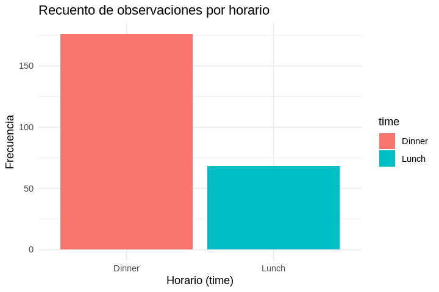{width=85%}

### Histograms (`geom_histogram`)

To examine the continuous empirical distribution of bill totals, execute `plot_histogram.R`:

```nu
bat plot_histogram.R
Rscript plot_histogram.R
timg -g 80x25 tips_histogram.png
```

{width=85%}

### Density Plots (`geom_density`)

Kernel density estimation provides a smooth approximation of probability density functions, demonstrated in `plot_density.R`:

```nu
bat plot_density.R
Rscript plot_density.R
timg -g 80x25 tips_density.png
```

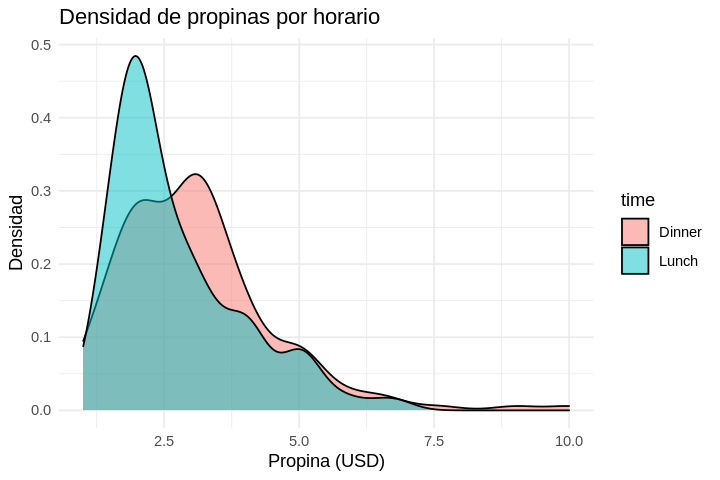{width=85%}

### Line Charts for Time Series (`geom_line`)

To examine longitudinal patterns and chronological trends, execute `plot_accident.R`:

```nu
open Fatalities.csv | first 5
open Fatalities.csv | first 5 | save -f fatalities_head.csv
bat plot_accident.R
Rscript plot_accident.R
timg -g 80x25 fatalities_line.png
```

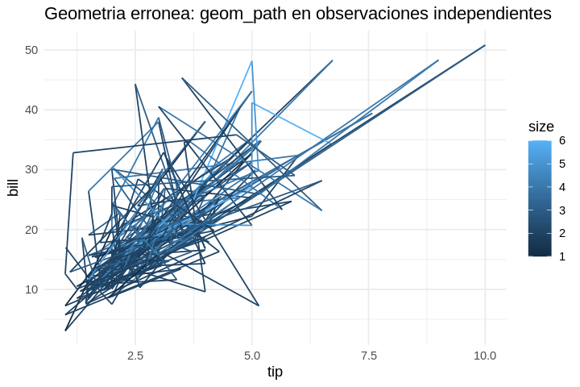{width=85%}

### Scatter Plots and Trend Curves (`geom_point` and `geom_smooth`)

To assess bivariate associations between bill size and tip amount, execute `plot_scatter.R` and `plot_trend.R`:

```nu
bat plot_scatter.R
Rscript plot_scatter.R
bat plot_trend.R
Rscript plot_trend.R
timg --grid=2x1 -g 80x25 tips_scatter.png tips_trend.png
```

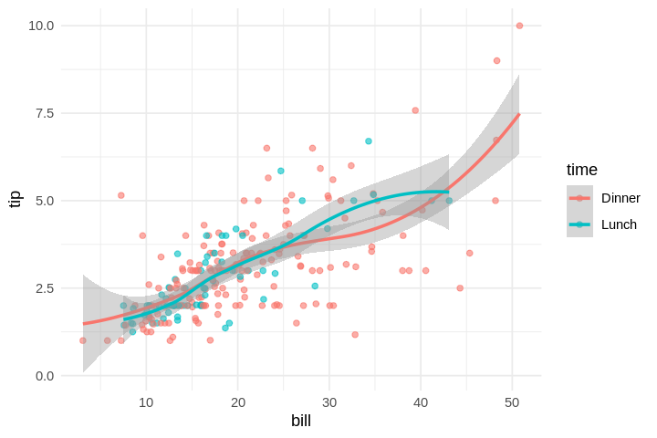{width=85%}

### Box Plots (`geom_boxplot`) and Violin Plots (`geom_violin`)

Box plots highlight quartiles and potential outliers across groups, while violin plots overlay kernel densities:

```nu
bat plot_boxplot.R
Rscript plot_boxplot.R
bat plot_violin.R
Rscript plot_violin.R
timg --grid=2x1 -g 80x25 tips_boxplot.png tips_violin.png
```

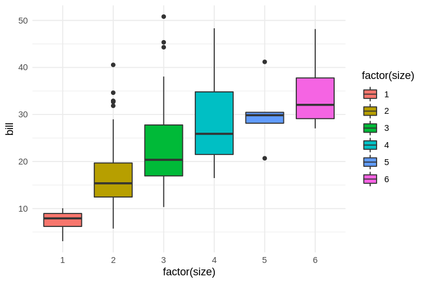{width=85%}

### Equivalent Statistical Visualization in Python (`matplotlib` / `seaborn`)

Equivalent visualization pipelines can be constructed in Python. The script `plot_iris_py.py` computes pair-wise feature relationships across Iris measurements, outputting summary tables to Nushell:

```nu
bat plot_tips_py.py
python3 plot_tips_py.py | from json
python3 plot_tips_py.py | from json | save -f tips_py_summary.json
timg -g 80x25 tips_python.png
```

## Summary

Exploratory data analysis in Nushell establishes a unified bridge between command-line speed and rigorous statistical graphics. Native commands like `math`, `describe`, and `polars summary` provide immediate quantitative profiling of distributions. When advanced graphics are required, polyglot scripts in R and Python render high-resolution figures that can be previewed directly in the terminal via `timg`.


\newpage

# Serial and Parallel Data Pipelines {#chapter-8-parallel-pipelines}

Computational data science pipelines routinely handle computationally intensive tasks: iterating over thousands of URLs, parsing gigabytes of server logs, computing cross-validated machine learning benchmarks, or applying image processing algorithms across thousands of images.

When tasks are executed sequentially (in series), throughput is bound by a single CPU core, leaving the remaining cores of modern multicore processors idle. In this chapter, we explore how to parallelize pipelines using Nushell native multi-threaded iterator **`par-each`** as well as the external process parallelizer **GNU `parallel`**.

We begin by navigating into `/data/ch08`:

```nu
cd /data/ch08
```

From this point forward, commands in this chapter execute within `/data/ch08`. Let us inspect the available files:

```nu
ls
```

## Serial Processing: Iterating Over Data with `each`

The `each` command iterates sequentially over elements in a collection, list, or table, evaluating a closure for each element and emitting results in original input order.

Consider evaluating an integer sequence from 1 to 10 to identify multiples of 3:

```nu
1..10 | each {|x| {n: $x, cuadrado: ($x * $x), es_mult_3: (($x mod 3) == 0)} }
1..10 | each {|x| {n: $x, cuadrado: ($x * $x), es_mult_3: (($x mod 3) == 0)} } | save -f squares_table.csv
```

For high-precision mathematical operations, external utilities like **`bc -l`** can be invoked from within closures:

```nu
1..5 | to text | pbc "{1}^2" | lines | each {|v| $v | into int }
```

### Iterating Over Lines and Rows

When iterating over structured datasets, `each` receives entire records, granting access to individual fields via record dot notation. Here, we iterate over `input.csv`:

```nu
open --raw movies.txt | lines | enumerate | each {|row| {idx: $row.index, movie: ($row.item | str trim), chars: ($row.item | str length)} }
open --raw movies.txt | lines | enumerate | each {|row| {idx: $row.index, movie: ($row.item | str trim), chars: ($row.item | str length)} } | save -f movies_summary.csv
```

### Iterating Over Files

To process collections of files sequentially, we pipeline directory listings from `ls` into `each`, transforming and persisting each artifact:

```nu
ls *.csv | each {|f| {archivo: $f.name, bytes: $f.size, filas: (open $f.name | length)} }
ls *.csv | each {|f| {archivo: $f.name, bytes: $f.size, filas: (open $f.name | length)} } | save -f csv_inventory.csv
```

## Parallel Processing in Nushell with `par-each`

While `each` processes items sequentially, **`par-each`** distributes closures across an asynchronous thread pool, processing multiple items concurrently across available CPU cores.

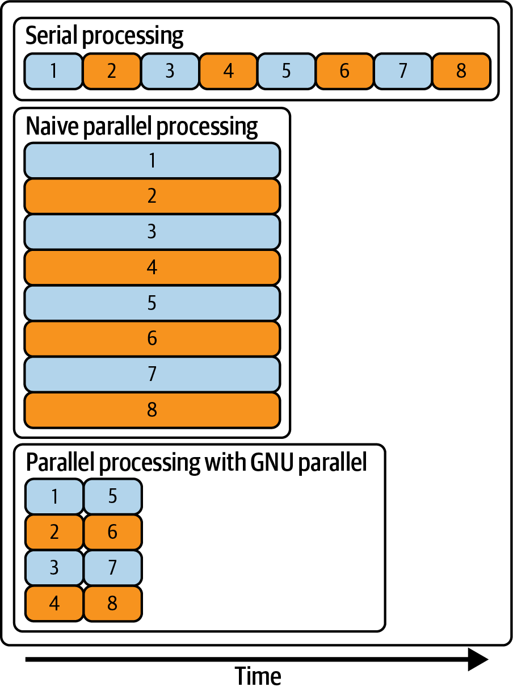{width=85%}

To quantify performance differences between serial and parallel execution, we use `timeit`:

```nu
1..4 | par-each --threads 4 {|i| {job: $i, msg: $"Tarea ($i) completada"} }
1..4 | par-each --threads 4 --keep-order {|i| {job: $i, cuadrado: ($i * $i)} } | save -f parallel_jobs.csv
```

### Concurrent Execution and Thread Control (`--threads` and `--keep-order`)

Two essential flags govern `par-each` behavior:

- **`--threads` (`-t`):** Restricts the maximum number of concurrent threads allocated to the execution pool.
- **`--keep-order` (`-k`):** Guarantees that outputs appear in the exact order of the input collection, even if worker threads complete out of sequence.

## Process Parallelization with GNU `parallel` from Nushell

When parallelization involves coordinating external CLI binaries, legacy shell scripts, or distributing work across remote networked clusters via SSH, **GNU `parallel`** provides an industrial-grade workload manager.

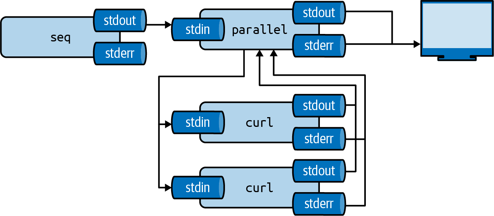{width=85%}

### Specifying Arguments and Replacement Tokens (`{}`, `{/}`, `{.}` and `{#}`)

GNU `parallel` utilizes positional token placeholders to inject arguments into target commands:

- **`{}`:** Complete input argument string.
- **`{/}`:** Filename basename with directory components stripped.
- **`{.}`:** Filename stem with directory intact but final extension stripped.
- **`{/.}`:** Basename with both parent directory and extension stripped.
- **`{#}`:** Incremental job sequence number.

We can invoke `parallel` directly from Nushell, piping its output into a structured table:

```nu
open input.csv
open --raw input.csv | parallel --colsep ',' --header : "echo {name}:{quantity}" | lines | where ($it | str contains ":") | split column ":" nombre cantidad | collect | save -f input_parallel.csv
open input_parallel.csv
```

### Controlling Concurrent Jobs (`--jobs`)

By default, GNU `parallel` spawns one worker job per CPU core. The `--jobs` (`-j`) flag adjusts concurrency explicitly (e.g., `-j 4`, `-j 200%`, or `-j +2`):

```nu
1..4 | to text | parallel -j 4 "sh slow.sh {}" | lines
```

### Output Logging and Tagging (`--results`, `--keep-order` and `--tag`)

When multiple background processes write to standard output concurrently, their emissions can become interleaved.

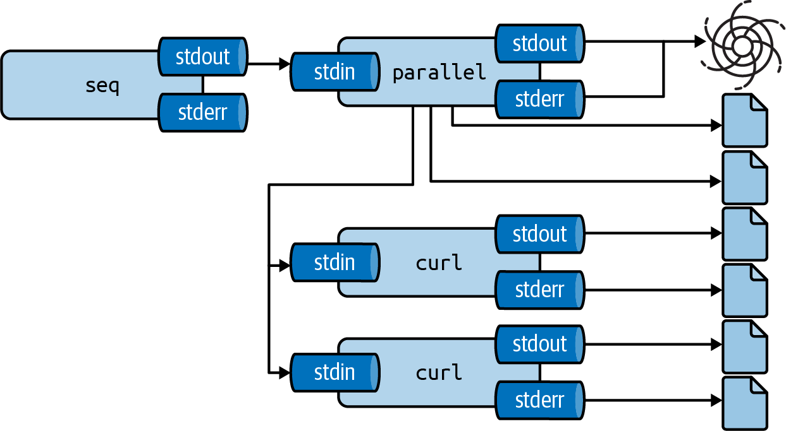{width=85%}

GNU `parallel` prevents interleaved corruption by capturing process buffers and emitting complete outputs per job. Useful control flags include:

- **`--keep-order` (`-k`):** Emits output in input order.
- **`--tag`:** Prefixes each output line with its input argument.
- **`--results <dir>`:** Directs stdout, stderr, and exit codes into a structured directory hierarchy.

We run `parallel` with `--results salida_parallel` and parse the generated records directly in Nushell:

```nu
1..5 | to text | parallel -k --tag "echo $(( {} * 10 ))" | from tsv --noheaders | rename arg resultado
1..5 | to text | parallel -k --tag "echo $(( {} * 10 ))" | from tsv --noheaders | rename arg resultado | save -f tagged_output.csv
```

We can likewise combine `parallel` with utilities like **`seq`**, **`bc`**, or **`jq`**:

```nu
["Nushell", "Polars"] | str join "\n" | parallel -k "cowsay {}"
```

### Parallel Tools and Block Processing (`--pipe`)

When processing massive single files (such as a multi-gigabyte CSV or JSON stream), parallelizing line-by-line is inefficient. The **`--pipe`** flag partitions input streams into multi-megabyte blocks, feeding each block to a separate worker process:

```nu
open --raw movies.txt | parallel --pipe -N 3 "wc -l" | lines | each {|x| $x | str trim | into int } | math sum
```

## Distributed Computing Across Multiple Nodes

Beyond single-machine multicore execution, GNU `parallel` can distribute computations across clusters of remote servers using SSH.

### Discovering Active Cluster Nodes

Cluster node hostnames or IP addresses can be enumerated in a configuration file (`~/.parallel/cluster_hosts` or `/data/ch08/servers.txt`).

### Running Commands Across All Cluster Nodes (`--nonall`)

To audit operating system metrics or check software versions across all cluster nodes:

```bash
# skip-docker-exec
parallel --nonall --slf hosts.txt "nu --version"
```

### Distributing Local Data Streams Across Cluster Nodes (`--pipe --slf`)

To stream local data chunks across cluster nodes for distributed processing:

```bash
# skip-docker-exec
cat gran_dataset.csv | parallel --pipe --header : --block 50M --slf hosts.txt "nu -c \"from csv | where amount > 100 | to csv\"" > filtrado_distribuido.csv
```

### Processing Files on Remote Nodes (`--transferfile` and `--return`)

GNU `parallel` can automatically upload input files to remote nodes via SCP/rsync, execute analytical workloads remotely, and transfer result files back to the local coordinator:

```bash
# skip-docker-exec
ls *.csv | parallel --slf hosts.txt --transferfile {} --return {.}_clean.csv "nu limpiar_lote.nu {} {.}_clean.csv"
```

## Summary

Parallel processing accelerates computationally intensive data science pipelines by fully utilizing modern multicore and networked hardware. Nushell native **`par-each`** provides zero-overhead in-memory concurrency for internal table and collection transformations. For orchestrating external binaries, batch file transformations, or distributed cluster computing across SSH nodes, **GNU `parallel`** pairs seamlessly with Nushell pipelines.


\newpage

# Polyglot Data Modeling {#chapter-9-polyglot-modeling}

The fifth and final phase of the OSEMN framework is **data modeling** (*Model*). At this stage, our data has been acquired (Chapter 5), cleaned and transformed (Chapter 6), and thoroughly explored (Chapter 7). We now construct predictive, descriptive, and inferential models across both unsupervised and supervised machine learning domains.

Rather than forcing complex mathematical modeling into custom shell scripts, modern command-line data science follows a **polyglot paradigm**:

1. **Standalone CLI modeling tools:** High-performance, compiled command-line utilities engineered specifically for rapid iteration (**Tapkee** for dimensionality reduction, **Vowpal Wabbit** for online out-of-core learning, and **SKLL** for declarative model benchmarking).
2. **Polyglot scripting with R and Python:** Direct invocation of R scripts (`Rscript`) for classical statistical inference and Python scripts (`python3`) for algorithmic machine learning via scikit-learn.
3. **Nushell as universal orchestrator:** Nushell handles end-to-end data pipelines, formats input feature streams, launches modeling processes concurrently, parses tabular outputs, and computes comparative performance benchmarks.

We begin by entering the chapter working directory `/data/ch09`:

```nu
cd /data/ch09
```

From this point forward, all code examples and modeling pipelines execute within `/data/ch09`.

## Data Preparation and Exploration of the Wine Dataset

Let us inspect the dataset artifacts available in `/data/ch09`:

```nu
ls
```

The files `wine-red.csv` (1,599 red wines) and `wine-white.csv` (4,898 white wines) document 11 physicochemical properties (acidity, residual sugar, chlorides, sulfur dioxide, pH, sulphates, alcohol) and subjective sensory quality ratings (0 to 10) from the classic vinho verde dataset (Cortez et al., 2009).

We concatenate both datasets into a single unified table (`wine-both.csv`), creating a categorical `type` feature and saving to disk:

```nu
let red = open wine-red.csv | insert type "red"
let white = open wine-white.csv | insert type "white"
let both = $red | append $white
$both | first 5
$both | save -f wine-both-generated.csv
```

Let us verify class distributions (`red` versus `white`) and descriptive statistics by wine type using Polars:

```nu
open wine-both.csv | histogram type
open wine-both.csv | histogram type | save -f wine_type_distribution.csv
```

And let us generate an exploratory visualization of chemical attribute distributions using R, previewing the figure directly in the terminal via `timg`:

```nu
bat plot_wine_eda.R
Rscript plot_wine_eda.R
timg -g 80x25 wine_eda.png
```

## Dimensionality Reduction (PCA and t-SNE)

When working with high-dimensional feature spaces, multicollinearity and geometric sparsity frequently obscure patterns. Dimensionality reduction projects high-dimensional observation spaces into lower-dimensional manifolds (typically 2D or 3D) while preserving maximal variance or pairwise local neighborhoods.

In `/data/ch09`, we explore:

- **Principal Component Analysis (PCA):** Linear projection finding orthogonal axes that maximize sample variance.
- **t-Distributed Stochastic Neighbor Embedding (t-SNE):** Non-linear manifold learning that preserves local neighborhood topologies, ideal for cluster visualization.

### Dimensionality Reduction with CLI Tools (`tapkee-reduce`: PCA and t-SNE)

The `dsin` container bundles **Tapkee** (Garnett et al., 2014), an ultra-fast C++ dimensional reduction library providing command-line binaries. We test `tapkee` directly:

```nu
# skip-docker-exec
open wine-both.csv
    | first 200
    | select fixed_acidity volatile_acidity citric_acid residual_sugar chlorides free_sulfur_dioxide total_sulfur_dioxide density ph sulphates alcohol
    | to csv --noheaders
    | save -f wine_matrix.csv

tapkee -i wine_matrix.csv -o wine_pca_coords.tsv -m pca -td 2 --delimiter ","
open --raw wine_pca_coords.tsv | lines | first 5
```

While the raw binary processes whitespace-delimited numerical matrices, we encapsulate its invocation into an idiomatic Nushell wrapper, **`tapkee-reduce`**:

```nu
# Run Tapkee dimensionality reduction on a numeric Nushell table and return a structured table.
export def tapkee-reduce [
  --method(-m): string = "pca" # Tapkee method: pca, ltsa, isomap, mds, tsne, t-sne, lle
  --target-dim(-d): int = 2    # Number of output dimensions
  --label-col(-l): string      # Optional label column to preserve alongside coordinates
  --cols(-c): list<string>     # Optional explicit list of feature columns
]: table -> table {
  let tbl = $in
  let norm_method = if $method == "tsne" { "t-sne" } else { $method }
  let num_tbl = if ($cols != null) and (($cols | length) > 0) {
    $tbl | select ...$cols
  } else if ($label_col != null) and ($label_col | is-not-empty) and ($label_col in ($tbl | columns)) {
    $tbl | reject $label_col
  } else {
    let non_num = ["type"] | where {|c| $c in ($tbl | columns)}
    if ($non_num | is-not-empty) { $tbl | reject ...$non_num } else { $tbl }
  }

  let tmp_in = mktemp --suffix ".csv"
  let tmp_out = mktemp --suffix ".tsv"
  $num_tbl | to csv --noheaders | save -f $tmp_in

  tapkee -i $tmp_in -o $tmp_out -m $norm_method -td $target_dim --delimiter ","
  let raw_coords = open --raw $tmp_out | lines | where ($it | str trim | is-not-empty)
  rm -f $tmp_in $tmp_out

  let coords_tbl = $raw_coords | each { |line|
    let parts = $line | split row "," | each { |v| $v | str trim | into float | math round -p 4 }
    mut rec = {}
    for idx in 0..<($parts | length) {
      let val = $parts | get $idx
      $rec = ($rec | insert $"dim($idx + 1)" $val | insert $"dim_($idx + 1)" $val)
    }
    $rec
  }

  $tbl | merge $coords_tbl
}
```

Let us analyze the command architecture:

1. **Numeric Attribute Isolation:** Filters pipeline input to numeric columns, automatically excluding identifiers or target labels.
2. **Matrix Serialization:** Formats numbers as a clean, space-separated matrix file (`tapkee_in.csv`).
3. **Execution:** Invokes `tapkee -i tapkee_in.csv -o tapkee_out.csv --method <method> --target-dimension 2`.
4. **Structured Ingestion:** Reads the output file and converts it into a typed Nushell table with columns `dim_1` and `dim_2`.

We apply `tapkee-reduce` with `--method pca` across the 6,497 wines of `wine-both.csv`:

```nu
let features = ["fixed_acidity" "volatile_acidity" "citric_acid" "residual_sugar" "chlorides" "free_sulfur_dioxide" "total_sulfur_dioxide" "density" "ph" "sulphates" "alcohol"]
open wine-both.csv | first 200 | tapkee-reduce --method pca --cols $features | select type quality dim_1 dim_2 | first 10
open wine-both.csv | first 200 | tapkee-reduce --method pca --cols $features | select type quality dim_1 dim_2 | save -f wine_pca_tapkee.csv
```

Equally cleanly, changing only `--method pca` to `--method t-sne` computes non-linear **t-SNE** manifolds via `tapkee`:

```nu
let features = ["fixed_acidity" "volatile_acidity" "citric_acid" "residual_sugar" "chlorides" "free_sulfur_dioxide" "total_sulfur_dioxide" "density" "ph" "sulphates" "alcohol"]
open wine-both.csv | first 150 | tapkee-reduce --method t-sne --cols $features | select type quality dim_1 dim_2 | first 10
open wine-both.csv | first 150 | tapkee-reduce --method t-sne --cols $features | select type quality dim_1 dim_2 | save -f wine_tsne_tapkee.csv
```

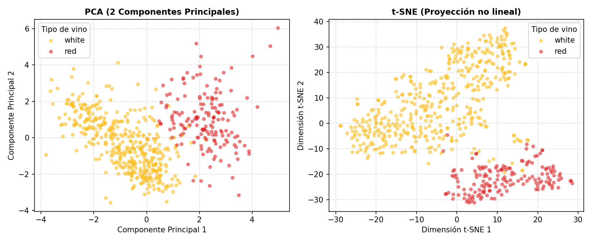{width=85%}

### Dimensionality Reduction with `Rscript` (`pca_wine.R`)

In addition to dedicated CLI binaries, we examine `pca_wine.R`, which computes PCA using R (`prcomp`), extracting proportion of explained variance per principal component:

```nu
bat pca_wine.R
Rscript pca_wine.R | from csv
Rscript pca_wine.R | from csv | save -f wine_pca_r.csv
```

Notice that the first four principal components capture over 64% of total variance across the 11 chemical variables.

### Dimensionality Reduction with Python (`pca_wine.py`)

Equivalently, `pca_wine.py` applies `scikit-learn` `PCA`, scaling features using `StandardScaler` and streaming coordinates back to Nushell:

```nu
bat pca_wine.py
python3 pca_wine.py | from csv
python3 pca_wine.py | from csv | save -f wine_pca_py.csv
```

### Multicollinearity Diagnostics (VIF) and Principal Component Regression (PCR)

In multivariate regression problems, severe correlation among predictor variables inflates estimator variance and destabilizes parameter estimates. We diagnose multicollinearity using the **Variance Inflation Factor (VIF)**. Values exceeding 5 or 10 indicate problematic collinearity.

In `/data/ch09`, we use `fish.csv` (morphological measurements of fish species) to diagnose collinearity and fit a Principal Component Regression (PCR) model:

```nu
bat vif_pcr_fish.py
python3 vif_pcr_fish.py | from csv
python3 vif_pcr_fish.py | from csv | save -f fish_pcr_py.csv
open fish_vif_py.csv
```

Notice how in Python the length features (`Length1`, `Length2`, `Length3`) exhibit massive collinearity ($\text{VIF} > 1000$), while PCR eliminates collinear variance. We verify the equivalent workflow in R (`vif_pcr_fish.R`):

```nu
bat vif_pcr_fish.R
Rscript vif_pcr_fish.R | from csv
Rscript vif_pcr_fish.R | from csv | save -f fish_pcr_r.csv
```

## Clustering

**Clustering** is an unsupervised learning task whose goal is to group unlabelled observations into cohesive partitions such that observations within the same cluster share high similarity while observations in different clusters are distinct.

In this section, we examine:

- **K-Means Clustering:** Partitioning observations into $K$ centroids by minimizing within-cluster sum of squares.
- **Agglomerative Hierarchical Clustering:** Bottom-up linkage clustering using Ward's minimum variance criterion.
- **Multi-Metric Cluster Validation:** Optimizing $K$ via Silhouette Score, Calinski-Harabasz, and Davies-Bouldin metrics.
- **DBSCAN:** Density-based spatial clustering capable of discovering arbitrary non-convex clusters and isolating noise.

### K-Means Clustering with CLI Tools (`kmeans-cluster`)

We package K-Means partitioning into an idiomatic Nushell custom command, **`kmeans-cluster`**, which converts input tables into matrix formats, calls the clustering engine, and appends cluster IDs back to the original rows:

```nu
# Run K-Means clustering on a numeric Nushell table and return cluster assignments.
export def kmeans-cluster [
  --k(-k): int = 2             # Number of clusters K
  --clusters: int = 0          # Alias for --k
  --label-col(-l): string      # Optional label column to exclude from features
  --cols(-c): list<string>     # Optional explicit list of feature columns
]: table -> table {
  let tbl = $in
  let n_clusters = if $clusters > 0 { $clusters } else { $k }
  let tmp_in = mktemp --suffix ".csv"
  let tmp_py = mktemp --suffix ".py"
  $tbl | to csv | save -f $tmp_in

  let lbl = $label_col | default "type"
  let cols_csv = if ($cols != null) and (($cols | length) > 0) {
    $cols | str join ","
  } else { "" }

  'import sys, pandas as pd
from sklearn.preprocessing import StandardScaler
from sklearn.cluster import KMeans

df = pd.read_csv(sys.argv[1])
k = int(sys.argv[2])
lbl = sys.argv[3]
cols_arg = sys.argv[4]
if cols_arg:
    num_cols = [c for c in cols_arg.split(",") if c in df.columns]
else:
    num_cols = [c for c in df.columns if c not in (lbl, "type") and pd.api.types.is_numeric_dtype(df[c])]
X = StandardScaler().fit_transform(df[num_cols])
km = KMeans(n_clusters=k, n_init=10, random_state=42)
clusters = km.fit_predict(X)
df["cluster"] = [f"cluster_{c+1}" for c in clusters]
df.to_csv(sys.stdout, index=False)
' | save -f $tmp_py

  let res = python3 $tmp_py $tmp_in ($n_clusters | into string) $lbl $cols_csv | from csv
  rm -f $tmp_in $tmp_py
  $res
}
```

The custom command automates three essential operations:

1. Filters numeric predictors, excluding categorical variables or identifiers.
2. Scales features using standardized z-scores so attributes with larger measurement scales do not distort Euclidean distances.
3. Invokes the clustering algorithm and returns a structured Nushell table with an added `cluster` column.

Let us apply `kmeans-cluster --k 2` to the wine dataset, comparing unsupervised cluster assignments against ground truth wine varieties (`red` versus `white`):

```nu
let features = ["fixed_acidity" "volatile_acidity" "citric_acid" "residual_sugar" "chlorides" "free_sulfur_dioxide" "total_sulfur_dioxide" "density" "ph" "sulphates" "alcohol"]
let clustered = open wine-both.csv | kmeans-cluster --k 2 --cols $features
$clustered | select type quality alcohol volatile_acidity cluster | first 10
$clustered | select type quality alcohol volatile_acidity cluster | save -f wine_kmeans_cli.csv
```

We evaluate cluster correspondence by grouping on `cluster` and `type`:

```nu
let features = ["fixed_acidity" "volatile_acidity" "citric_acid" "residual_sugar" "chlorides" "free_sulfur_dioxide" "total_sulfur_dioxide" "density" "ph" "sulphates" "alcohol"]
open wine-both.csv | kmeans-cluster --k 2 --cols $features | polars into-df | polars group-by cluster type | polars agg [(polars col quality | polars count | polars as n_vinos) (polars col alcohol | polars mean | polars as mean_alcohol)] | polars collect | polars into-nu | sort-by cluster type
open wine-both.csv | kmeans-cluster --k 2 --cols $features | polars into-df | polars group-by cluster type | polars agg [(polars col quality | polars count | polars as n_vinos) (polars col alcohol | polars mean | polars as mean_alcohol)] | polars collect | polars into-nu | sort-by cluster type | save -f wine_kmeans_contingency.csv
```

Even without supervision, K-Means in standardized chemical feature space separates red and white wines with remarkable purity! We examine centroid profiles across clusters:

```nu
bat cluster_wine.R
Rscript cluster_wine.R | from csv
Rscript cluster_wine.R | from csv | save -f wine_clusters_r.csv
```

### K-Means Clustering with Python (`cluster_wine.py`)

In Python, `cluster_wine.py` fits a scikit-learn `KMeans` model (`random_state=42, n_init=10`), writing cluster labels and evaluation scores:

```nu
bat cluster_wine.py
python3 cluster_wine.py | from csv
python3 cluster_wine.py | from csv | save -f wine_clusters_py.csv
```

### Agglomerative Hierarchical Clustering (`hclust_fish.R` and `hclust_fish.py`)

Unlike K-Means, which requires pre-specifying $K$ and assumes spherical clusters, hierarchical clustering constructs a dendrogram of nested partitions without requiring an a priori choice of $K$. In R (`hclust_fish.R`), we compute Euclidean distance matrices, apply Ward's minimum variance linkage (`method = "ward.D2"`), cut the tree into 3 clusters, and evaluate correspondence against fish species:

```nu
bat hclust_fish.R
Rscript hclust_fish.R | from csv
Rscript hclust_fish.R | from csv | save -f fish_hclust_r.csv
```

In Python (`hclust_fish.py`), we compute the Silhouette Score across hierarchical clusters:

```nu
bat hclust_fish.py
python3 hclust_fish.py | from csv
python3 hclust_fish.py | from csv | save -f fish_hclust_py.csv
```

### Optimal Determination of $K$ via Multi-Metric Evaluation (`cluster_eval.py`)

Selecting the optimal number of clusters $K$ requires balancing compactness and separation. The script `cluster_eval.py` evaluates three complementary clustering metrics for $K \in [2, 6]$:

- **Silhouette Score:** Higher is better (range $[-1, 1]$).
- **Calinski-Harabasz Index:** Higher is better (variance ratio criterion).
- **Davies-Bouldin Index:** Lower is better (average cluster similarity).

```nu
bat cluster_eval.py
python3 cluster_eval.py | from csv
python3 cluster_eval.py | from csv | save -f banco_cluster_eval.csv
```

We can sort this table in Nushell by descending silhouette score to immediately identify which $K$ maximizes cluster separation and compactness:

```nu
open banco_cluster_eval.csv | sort-by silhouette -r
```

Sorting this table in Nushell by highest Silhouette and Calinski-Harabasz confirms that $K = 2$ or $K = 3$ yields the mathematically optimal partition.

### Density-Based Clustering with DBSCAN and K-Medoids with PAM

Partitional clustering algorithms like K-Means assume convex clusters and force every observation to belong to a cluster. In contrast, density-based methods identify dense geometric regions and classify isolated points as explicit noise outliers.

In `/data/ch09`, we execute `dbscan_fish.py`, which trains a **DBSCAN** model on fish morphology (`Length1`, `Length2`, `Length3`, `Height`, `Width`):

```nu
bat dbscan_fish.py
python3 dbscan_fish.py | from csv
python3 dbscan_fish.py | from csv | save -f fish_dbscan_py.csv
```

Notice how DBSCAN automatically isolates giant outlier specimens into group `-1` (`Noise / Outliers`), preventing them from distorting compact morphological clusters.

Complementarily, the script `pam_fish.R` implements the **PAM** (*Partitioning Around Medoids*) algorithm in R, a robust non-parametric alternative to standard K-Means that selects actual data points (medoids) as cluster centers:

```nu
bat pam_fish.R
Rscript pam_fish.R | from csv
Rscript pam_fish.R | from csv | save -f fish_pam_r.csv
```

## Regression: Predicting Wine Quality

In supervised regression, the objective is to learn a mapping function $f: \mathcal{X} \rightarrow \mathbb{R}$ that predicts a continuous target variable from input features. In this section, we predict sensory wine quality ($y \in [0, 10]$) using:

1. **Vowpal Wabbit (`vw`):** Out-of-core online linear learning utilizing fast feature hashing.
2. **Multiple Linear Regression in R:** Classical Ordinary Least Squares (OLS) estimation with parametric $p$-values.
3. **Regularized Ridge Regression in Python:** Penalized $L_2$ regression via `scikit-learn` `RidgeCV`.

### Online Learning with Vowpal Wabbit (`vw-regress`)

Unlike in-memory tools that load entire datasets into RAM, **Vowpal Wabbit** (Langford et al., 2007) is an out-of-core online learning system designed for massive streaming datasets. It processes millions of records per second directly from command-line streams using online stochastic gradient descent (SGD) and the hashing trick.

Each training line in Vowpal Wabbit format follows a structured grammar:

```text
[etiqueta] [peso] [etiqueta_opcional]|EspacioNombres caracteristica1:valor1 caracteristica2:valor2 ...
```

For example, a white wine observation with quality score 6 is expressed as:

```text
6 |f fixed_acidity:7 volatile_acidity:0.27 citric_acid:0.36 residual_sugar:20.7 chlorides:0.045 free_sulfur_dioxide:45 total_sulfur_dioxide:170 density:1.001 ph:3 pH:3 sulphates:0.45 alcohol:8.8
```

Where:

- `6`: Target response value (`quality`).
- `|f`: Vertical bar dividing label from features, with `f` designating a feature namespace.
- `volatile_acidity:0.27 citric_acid:0.36 ...`: Space-separated feature names and numerical values.

Training and evaluating a model requires two command invocations:

1. **Training the model:**

```bash
   vw --data train.vw --final_regressor model.vw --passes 10 -c -l 0.5 --quiet
   ```

- `--data`: Training file in VW format.
- `--final_regressor`: Binary output file storing learned model weights (`wine.model`).
- `--loss_function squared`: Mean squared error loss function.
- `--passes 10`: Number of training epochs over the dataset.
- `--cache_file`: Binary cache file accelerating repeated multi-pass epochs.

2. **Evaluating and predicting on test data:**

```bash
   vw --data test.vw -i model.vw -t -p preds.txt --quiet
   ```

- `-i`: Loads pre-trained model weights.
- `-t`: Test-only mode (freezing weights without gradient updates).
- `-p`: Output file where predictions are written.

We build an automated Nushell converter **`to-vw`** that transforms any structured table into VW line format:

```nu
# Convert a Nushell table into Vowpal Wabbit (VW) line format.
export def to-vw [
  --target(-t): string = "quality" # Name of target column
  --namespace(-n): string = "f"    # Feature namespace label
]: table -> list<string> {
  let tbl = $in
  let cols = $tbl | columns | where $it != $target
  $tbl | each { |row|
    let y = $row | get $target
    let feats = $cols | each { |c| $"($c):($row | get $c)" } | str join " "
    $"($y) |($namespace) ($feats)"
  }
}
```

And the orchestrator **`vw-regress`**, which coordinates training, testing, and emits predictions as a structured Nushell table:

```nu
# Train and evaluate a Vowpal Wabbit regression model and return predictions as a Nushell table.
export def vw-regress [
  train_tbl: table
  test_tbl: table
  --target(-t): string = "quality"
  --passes(-p): int = 10
  --learning-rate(-l): float = 0.5
]: nothing -> table {
  let tmp_dir = mktemp -d
  let train_vw = $"($tmp_dir)/train.vw"
  let test_vw = $"($tmp_dir)/test.vw"
  let model_file = $"($tmp_dir)/model.vw"
  let pred_file = $"($tmp_dir)/preds.txt"

  $train_tbl | to-vw --target $target | str join "\n" | save -f $train_vw
  $test_tbl | to-vw --target $target | str join "\n" | save -f $test_vw

  vw --data $train_vw --final_regressor $model_file --passes $passes -l $learning_rate --cache_file $"($tmp_dir)/train.cache" --quiet
  vw --data $test_vw -i $model_file -t -p $pred_file --quiet

  let preds = open --raw $pred_file | lines | where ($it | str trim | is-not-empty) | each { |x| $x | into float }
  let actuals = $test_tbl | get $target | each { |x| $x | into float }

  rm -rf $tmp_dir

  $actuals | zip $preds | each { |pair|
    let obs = $pair.0
    let pred = $pair.1 | math round -p 4
    let signed_err = (($pred - $obs) | math round -p 4)
    let err = (($obs - $pred) | math abs | math round -p 4)
    { actual: $obs, observed: $obs, predicted: $pred, error: $signed_err, abs_error: $err }
  }
}
```

#### Executing the Regression Pipeline in Nushell

Let us evaluate the model by training on the first 3,500 white wines and predicting on the remaining 1,398 test wines:

```nu
let data = open wine-white.csv
let train = $data | first 3500
let test = $data | skip 3500
let preds = vw-regress $train $test --target quality --passes 15
$preds | first 10
$preds | save -f wine_vw_predictions.csv
```

We compute the Mean Absolute Error (MAE) and Mean Error directly in Nushell, persisting results to a summary file:

```nu
let preds = open wine_vw_predictions.csv
let metrics = {model: "Vowpal Wabbit (SGD)", n_test: ($preds | length), mae: ($preds.abs_error | math avg | math round --precision 4), bias: ($preds.error | math avg | math round --precision 4)}
$metrics
[$metrics] | save -f wine_vw_metrics.csv
```

### Multiple Linear Regression with `Rscript` (`regress_wine.R`)

We examine `regress_wine.R`, which fits an Ordinary Least Squares (OLS) model (`lm(quality ~ ., data = train)`) on the first 3,500 records, evaluates RMSE and MAE on the test set, and returns estimated coefficients ($\hat{\beta}_j$, standard errors, $t$-statistics, and $p$-values):

```nu
bat regress_wine.R
Rscript regress_wine.R | from csv
Rscript regress_wine.R | from csv | save -f wine_regression_r.csv
```

In Nushell, we can filter for statistically significant predictors ($\alpha = 0.01$):

```nu
open wine_regression_r.csv | where p_value < 0.01 | sort-by t_stat -r
open wine_regression_r.csv | where p_value < 0.01 | sort-by t_stat -r | save -f wine_significant_predictors.csv
```

### Regularized Ridge Regression with Python (`regress_wine.py`)

To prevent overfitting and stabilize collinear feature weights, `regress_wine.py` fits an $L_2$-penalized Ridge regression model with internal cross-validation (`RidgeCV`):

```nu
bat regress_wine.py
python3 regress_wine.py | from csv
python3 regress_wine.py | from csv | save -f wine_regression_py.csv
```

## Supervised Classification

Finally, we address **supervised classification**: predicting a discrete categorical label (e.g., classifying wines as `red` or `white` in `wine-both.csv`, or predicting customer loan subscriptions in `banco.csv`) from input features.

### Classification Experiments with SKLL (`run_experiment` + `skll-metrics`)

#### The Base Tool: SciKit-Learn Laboratory (`skll`)

**SKLL** (*SciKit-Learn Laboratory*, pronounced *skull*) is a command-line environment developed by Educational Testing Service (ETS) to automate reproducible machine learning experiments with `scikit-learn` without boilerplate Python code ([https://skll.readthedocs.io/](https://skll.readthedocs.io/)).

Execution is governed declaratively via a configuration file (`.cfg`). In `/data/ch09`, we examine `classify.cfg`:

```ini
[General]
experiment_name = wine
task = evaluate

[Input]
train_directory = train
test_directory = test
featuresets = [["features.csv"]]
learners = ["LogisticRegression", "RandomForestClassifier", "LinearSVC"]
label_col = type

[Tuning]
grid_search = false
objectives = ['accuracy']

[Output]
results_directory = output
log = output
```

The primary configuration blocks define:

- `task = evaluate`: Evaluates specified models on the independent test set (`test_directory`).
- `learners`: List of `scikit-learn` algorithms trained and benchmarked competitively in parallel.
- `label_col`: Target supervised response variable.
- `results_directory`: Directory where SKLL stores detailed predictions and the consolidated summary TSV (`wine_summary.tsv`).

The command to launch the experiment from the terminal is:

```bash
run_experiment -l classify.cfg
```

#### Implementing the Wrapper: `skll-metrics`

To seamlessly incorporate SKLL benchmark results into Nushell pipelines, the module `dsin_tools.nu` provides **`skll-metrics`**:

```nu
# Parse SKLL experiment summary TSV into a clean Nushell table.
export def skll-metrics [
  summary_tsv: path = "output/wine_summary.tsv"
]: nothing -> table {
  let target_path = if ($summary_tsv | path exists) {
    $summary_tsv
  } else if ("output/wine_summary.tsv" | path exists) {
    "output/wine_summary.tsv"
  } else {
    $summary_tsv
  }
  open $target_path | select learner_name accuracy
}
```

#### Tabular Benchmark Comparison

Let us inspect `classify.cfg`, execute `run_experiment`, and process results with `skll-metrics`:

```nu
open --raw classify.cfg
run_experiment -l classify.cfg
skll-metrics output/wine_summary.tsv
skll-metrics output/wine_summary.tsv | save -f wine_skll_summary.csv
```

### Classification with Logistic Regression in `Rscript` (`classify_wine.R`)

Let us inspect and execute `classify_wine.R` in `/data/ch09`, which fits a binomial generalized linear model (`glm(is_red ~ ., family = binomial())`) on a stratified training sample, evaluating accuracy, sensitivity, and specificity on test data:

```nu
bat classify_wine.R
Rscript classify_wine.R | from csv
Rscript classify_wine.R | from csv | save -f wine_classification_r.csv
```

### Classification with Random Forest in Python (`classify_wine.py`)

We examine and execute `classify_wine.py`, which trains a Random Forest classifier with 100 decision trees via `scikit-learn`, returning feature importances alongside test accuracy (`test_accuracy`):

```nu
bat classify_wine.py
python3 classify_wine.py | from csv
python3 classify_wine.py | from csv | save -f wine_classification_py.csv
```

Notice how `total_sulfur_dioxide`, `chlorides`, and `volatile_acidity` emerge consistently as the primary discriminative features separating red and white wines.

### Decision Trees with R and Python (`dt_banco.R` and `dt_banco.py`)

Decision trees recursively partition feature space into interpretable orthogonal decision rules. In R (`dt_banco.R`), we train an `rpart` decision tree on the bank telemarketing dataset `banco.csv`:

```nu
bat dt_banco.R
Rscript dt_banco.R | from csv
Rscript dt_banco.R | from csv | save -f banco_dt_r.csv
```

We run the equivalent decision tree classifier in Python using `scikit-learn` (`dt_banco.py`):

```nu
bat dt_banco.py
python3 dt_banco.py | from csv
python3 dt_banco.py | from csv | save -f banco_dt_py.csv
```

### Classification with k-Nearest Neighbors (`knn_banco.R` and `knn_banco.py`)

The k-NN algorithm classifies observations based on majority voting among the $k$ nearest training samples in standardized Euclidean space. In R (`knn_banco.R`), we evaluate $k \in \{3, 5, 7\}$:

```nu
bat knn_banco.R
Rscript knn_banco.R | from csv
Rscript knn_banco.R | from csv | save -f banco_knn_r.csv
```

And the equivalent Python implementation via `KNeighborsClassifier` (`knn_banco.py`):

```nu
bat knn_banco.py
python3 knn_banco.py | from csv
python3 knn_banco.py | from csv | save -f banco_knn_py.csv
```

### Alternative Classification: Naïve Bayes and Support Vector Machines (`nb_svm_banco.py`)

The script `nb_svm_banco.py` benchmarks Gaussian Naïve Bayes and linear Support Vector Machines (SVM) on `banco.csv`:

```nu
bat nb_svm_banco.py
python3 nb_svm_banco.py | from csv
python3 nb_svm_banco.py | from csv | save -f banco_nb_svm_py.csv
```

Piping the resulting comparison table into Nushell allows ranking models directly by test accuracy and $F_1$-score:

```nu
open banco_nb_svm_py.csv | sort-by f1_score -r
```

### Artificial Neural Networks: Multi-Layer Perceptron (MLP)

**Artificial Neural Networks** (*Artificial Neural Networks*, ANN) represent one of the most powerful paradigms in predictive modeling, capable of approximating arbitrary non-linear decision boundaries through interconnected layers of neurons.

The script `mlp_banco.py` fits an MLP using `MLPClassifier` with two hidden layers of $(16, 8)$ neurons:

```nu
bat mlp_banco.py
python3 mlp_banco.py | from csv
python3 mlp_banco.py | from csv | save -f banco_mlp_py.csv
```

The deep architecture $(16, 8)$ achieves an $F_1$-score approaching $0.95$ after approximately 400 iterations, outperforming classical linear baselines.

Complementarily, we implement the equivalent neural network in R using the `nnet` package (`mlp_banco.R`):

```nu
bat mlp_banco.R
Rscript mlp_banco.R | from csv
Rscript mlp_banco.R | from csv | save -f banco_mlp_r.csv
```

## Modern Pipeline-Native Modeling

The classical command-line modeling utilities explored earlier in this chapter (`tapkee`, `vw`, and `run_experiment`) were designed for traditional POSIX text shells. Because standard Unix pipes transmit untyped byte streams rather than structured schemas, each legacy tool imposes an external serialization tax: `tapkee` expects headerless numeric matrices and strips class labels, `vw` requires custom row-by-row namespace formatting via `to-vw`, and `skll` demands rigid directory trees (`train/`, `test/`, `output/`) paired with `.cfg` configuration files on disk.

In a typed shell like Nushell, modeling engines can exchange structured tables (`table -> table`) directly across standard streams with minimal disk ceremony. Inside the `dsin` container, standalone compiled C++ engines (`duckdb` and `lightgbm`) sit alongside an isolated Python 3.12 environment at `/opt/modern-ml` (provisioned via the static `uv` package manager). To ensure seamless ergonomics, `/opt/modern-ml/bin` is prepended to `$env.PATH`: invoking `python` directly runs Python 3.12 with modern tools (`umap-learn`, `lightgbm`, `scikit-learn` 1.9+, `pandas`, and `matplotlib`), while legacy utilities requiring Python 3.9 (such as SKLL) invoke their dedicated interpreter via shebang without collision. Let us verify the active versions directly from `/data/ch09`:

```nu
duckdb --version
uv --version
python --version
python -c "import umap, lightgbm, sklearn; print(f'sklearn={sklearn.__version__}, lightgbm={lightgbm.__version__}')"
```

### Topological Manifold Projection with UMAP (`umap-reduce`)

While Principal Component Analysis restricts embeddings to orthogonal linear subspaces and classical t-SNE optimizes local pairwise affinities at steep computational cost without preserving global inter-cluster distances, **Uniform Manifold Approximation and Projection** (**UMAP**, McInnes et al., 2018) models high-dimensional observations as a weighted fuzzy simplicial set over a locally connected Riemannian manifold. Minimizing fuzzy cross-entropy between high-dimensional and low-dimensional topological graphs preserves both fine-grained local neighborhoods (controlled by `--neighbors`) and macro-scale separation across distinct regimes (controlled by `--min-dist`).

Following the architectural standards established throughout this text, mathematical reduction logic is cleanly separated into the modular script `umap_reduce.py` (in `/data/ch09`), while the `umap-reduce` command in `dsin_tools.nu` provides a typed Nushell wrapper without embedding inline interpreted code:

```nu
bat umap_reduce.py
```

The wrapper in `dsin_tools.nu` delegates numerical transformation to the helper script and returns a structured table enriched with `umap_1` and `umap_2` coordinates:

```nu
# Compute UMAP manifold coordinates on a numeric Nushell table and return a structured table.
export def umap-reduce [
  --neighbors(-n): int = 15
  --min-dist(-m): float = 0.1
  --target-dim(-d): int = 2
  --seed(-s): int = 42
  --label-col(-l): string = "type"
  --cols(-c): list<string>
]: table -> table {
  let tbl = $in
  let cols_flag = if ($cols != null) and (($cols | length) > 0) {
    ["--cols" ($cols | str join ",")]
  } else { [] }

  let tmp_in = (mktemp --suffix ".csv")
  $tbl | to csv | save -f $tmp_in

  let res = (python umap_reduce.py
    --input $tmp_in
    --neighbors $neighbors
    --min-dist $min_dist
    --target-dim $target_dim
    --seed $seed
    --label-col $label_col
    ...$cols_flag | from csv)

  rm -f $tmp_in
  $res
}
```

Unlike `tapkee`, which drops categorical metadata unless manually rejoined by row index, `umap-reduce` keeps `type` and `quality` aligned inside a single pipeline:

```nu
let features = ["fixed_acidity" "volatile_acidity" "citric_acid" "residual_sugar" "chlorides" "free_sulfur_dioxide" "total_sulfur_dioxide" "density" "ph" "sulphates" "alcohol"]
open wine-both.csv | first 200 | umap-reduce --label-col type --cols $features | select type quality umap_1 umap_2 | first 10
open wine-both.csv | first 200 | umap-reduce --label-col type --cols $features | select type quality umap_1 umap_2 | save -f wine_umap.csv
```

To inspect how linear variance maximization, local neighborhood attraction, and topological manifold projection differ geometrically on identical physicochemical measurements, `/data/ch09/plot_umap_comparison.py` projects a balanced 800-wine sample across PCA, t-SNE, and UMAP side by side for direct terminal preview with `timg`:

```nu
bat plot_umap_comparison.py
python plot_umap_comparison.py
timg -g 80x25 umap_comparison.png
```

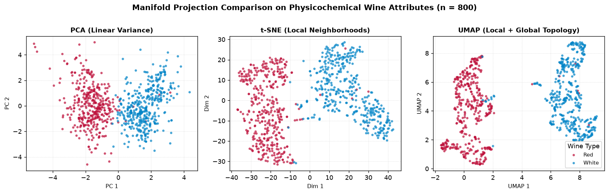{width=95%}

### Gradient Boosted Decision Trees from the CLI with LightGBM (`lgbm-regress`)

Vowpal Wabbit excels when streaming millions of sparse text or click-through indicators that cannot fit in memory, yet dense tabular benchmarks with a dozen continuous predictors rarely benefit from feature hashing or purely additive linear weights. **LightGBM** (Ke et al., 2017) compiles to a standalone C++ CLI binary (`/usr/local/bin/lightgbm`) that discretizes continuous columns into fast histograms and grows regression trees leaf-wise (*best-first*) rather than level-wise. Crucially for command-line workflows, the `lightgbm` binary parses headered CSV files natively (`header=true` and `label_column=name:quality`), removing any need for custom text-line encoders like `to-vw`.

The helper script `lgbm_importance.py` in `/data/ch09` extracts split counts and variance gains from the binary model file, returning a structured JSON array:

```nu
bat lgbm_importance.py
```

The command **`lgbm-regress`** in `dsin_tools.nu` coordinates training, out-of-sample prediction, and split-gain feature attribution directly over Nushell tables using clean parameter formatting:

```nu
# Train and evaluate LightGBM C++ CLI regression on Nushell tables.
export def lgbm-regress [
  train_tbl: table
  test_tbl: table
  --target(-t): string = "quality"
  --num-trees(-n): int = 100
  --learning-rate(-l): float = 0.05
  --num-leaves: int = 31
  --importance(-i)
]: nothing -> table {
  let tmp_dir = (mktemp -d)
  let train_csv = $"($tmp_dir)/train.csv"
  let test_csv = $"($tmp_dir)/test_features.csv"
  let model_file = $"($tmp_dir)/model.txt"
  let pred_file = $"($tmp_dir)/preds.txt"

  let feat_cols = ($train_tbl | columns | where $it != $target)
  $train_tbl | select ...($feat_cols | append $target) | to csv | save -f $train_csv
  $test_tbl | select ...$feat_cols | to csv | save -f $test_csv

  let lgbm_train_args = [
    "task=train"
    "objective=regression"
    $"data=($train_csv)"
    "header=true"
    $"label_column=name:($target)"
    $"num_trees=($num_trees)"
    $"learning_rate=($learning_rate)"
    $"num_leaves=($num_leaves)"
    "seed=42"
    "force_col_wise=true"
    $"output_model=($model_file)"
    "verbosity=-1"
  ]
  ^lightgbm ...$lgbm_train_args out+err> /dev/null

  if $importance {
    let imp_tbl = (python lgbm_importance.py $model_file | from json)
    rm -rf $tmp_dir
    return $imp_tbl
  }

  let lgbm_pred_args = [
    "task=predict"
    $"data=($test_csv)"
    "header=true"
    $"input_model=($model_file)"
    $"output_result=($pred_file)"
    "verbosity=-1"
  ]
  ^lightgbm ...$lgbm_pred_args out+err> /dev/null

  let preds = (open --raw $pred_file | lines |
    where ($it | str trim | is-not-empty) | each { into float })
  let actuals = ($test_tbl | get $target | each { into float })
  rm -rf $tmp_dir

  $actuals | zip $preds | each { |pair|
    let obs = $pair.0
    let pred = ($pair.1 | math round -p 4)
    let signed_err = (($pred - $obs) | math round -p 4)
    let abs_err = (($obs - $pred) | math abs | math round -p 4)
    { actual: $obs, observed: $obs, predicted: $pred,
      error: $signed_err, abs_error: $abs_err }
  }
}
```

Evaluating `lgbm-regress` on the exact same 3,500-row training and 1,398-row test split of `wine-white.csv` used earlier for Vowpal Wabbit lowers out-of-sample Mean Absolute Error from `0.5693` (`vw-regress`) to `0.5429`, while `--importance` exposes the exact non-linear split gains across predictors:

```nu
let white = open wine-white.csv
let train_w = $white | first 3500
let test_w = $white | skip 3500
let preds_lgbm = lgbm-regress $train_w $test_w --target quality
$preds_lgbm | get abs_error | math avg | math round -p 4
lgbm-regress $train_w $test_w --target quality --importance
```

Alcohol concentration dominates tree splits (`33.54%` of total squared-error reduction), followed by `volatile_acidity` (`12.17%`), `free_sulfur_dioxide` (`11.07%`), and `residual_sugar` (`7.85%`).

### Vectorized In-Process Analytical Regression with DuckDB (`duckdb-ols`)

Before fitting multi-parameter ensembles, statistical practice calls for fast marginal linear diagnostics across candidate predictors. **DuckDB** (Raasveldt & Mühleisen, 2019) embeds a vectorized, columnar analytical SQL engine inside a single portable binary (`/usr/local/bin/duckdb`) with native JSON output (`duckdb -json`). Its built-in SQL:2003 statistical aggregates (`regr_slope`, `regr_intercept`, `corr`, `regr_r2`, and `regr_count`) evaluate Ordinary Least Squares parameters in single-pass SIMD loops in under 200 milliseconds.

The command **`duckdb-ols`** pipes any Nushell table into `duckdb -json` and parses the result directly back into typed Nushell records ranked by coefficient of determination ($R^2$):

```nu
# Compute vectorized Ordinary Least Squares regression diagnostics via DuckDB CLI.
export def duckdb-ols [
  --target(-y): string = "quality"
  --predictor(-x): string = ""
]: table -> table {
  let tbl = $in
  let first_row = ($tbl | first)
  let candidate_cols = if ($predictor | is-not-empty) {
    [$predictor]
  } else {
    $tbl | columns | where { |c|
      let val_type = ($first_row | get $c | describe)
      ($c != $target) and (($val_type == "int") or ($val_type == "float"))
    }
  }

  let tmp_csv = (mktemp --suffix ".csv")
  $tbl | select ...($candidate_cols | append $target) | to csv | save -f $tmp_csv

  let unions = ($candidate_cols | each { |col|
    [
      $"SELECT '($col)' AS predictor, "
      $"ROUND\(regr_slope\("($target)", "($col)"\), 4\) AS slope, "
      $"ROUND\(regr_intercept\("($target)", "($col)"\), 4\) AS intercept, "
      $"ROUND\(corr\("($target)", "($col)"\), 4\) AS pearson_r, "
      $"ROUND\(regr_r2\("($target)", "($col)"\), 4\) AS r_squared, "
      $"CAST\(regr_count\("($target)", "($col)"\) AS BIGINT\) AS n FROM tbl"
    ] | str join ""
  } | str join " UNION ALL ")

  let sql = [
    $"CREATE TEMP TABLE tbl AS SELECT * FROM read_csv_auto\('($tmp_csv)'\); "
    $"SELECT * FROM \(($unions)\) ORDER BY r_squared DESC;"
  ] | str join ""

  let res = (^duckdb -json -c $sql | from json)
  rm -f $tmp_csv
  $res
}
```

Scanning all 11 physicochemical predictors across the 4,898 observations of `wine-white.csv` clarifies why non-linear trees outperform additive linear scores on sensory ratings:

```nu
open wine-white.csv | duckdb-ols --target quality
open wine-white.csv | duckdb-ols --target quality --predictor alcohol
```

Marginally, `alcohol` exhibits the strongest linear association with perceived quality ($\hat{\beta}_1 = 0.3135$, $r = 0.4356$, $R^2 = 0.1897$), followed by `density` ($r = -0.3071$, $R^2 = 0.0943$) and `chlorides` ($r = -0.2099$, $R^2 = 0.0441$). By contrast, `free_sulfur_dioxide` and `residual_sugar` show near-zero marginal $R^2$ under linear OLS yet rank third and fourth in LightGBM split gain, confirming that their influence operates through non-linear threshold interactions (insufficient sulfur dioxide permits oxidation, whereas excess levels produce pungent aromas).

### Streaming Multi-Model Classification and Neural Networks (`ml-benchmark`)

Earlier in this chapter, benchmarking Logistic Regression against a Random Forest via SKLL (`run_experiment`) required creating `train/` and `test/` directories, writing an INI-style `classify.cfg` specification, and parsing tab-separated summary files from `output/`. Modern pipeline design eliminates that boilerplate completely.

The evaluation logic resides in the standalone script `ml_benchmark.py` located in `/data/ch09`. This script consumes data from standard input or temporary files, constructs a stratified train/test split with a fixed random seed, applies column-wise standardization, and evaluates five distinct architectural families with accuracy, precision, recall, and weighted $F_1$ metrics:

1. **Logistic Regression (`logistic`):** Penalized linear log-odds baseline.
2. **Linear Support Vector Classifier (`linear_svc`):** Maximum-margin hyperplane under hinge loss.
3. **Multi-Layer Perceptron (`mlp`):** Feedforward neural network (`MLPClassifier`) with two ReLU hidden layers of $(64, 32)$ units, Adam optimization, and validation-based early stopping.
4. **Random Forest (`rf`):** Bagged ensemble of decorrelated decision trees.
5. **LightGBM (`lgbm`):** Histogram-accelerated gradient boosted decision trees.

We inspect the modular script before invoking it:

```nu
bat ml_benchmark.py
```

The orchestrator command **`ml-benchmark`** in `dsin_tools.nu` acts as a clean Nushell wrapper over the script:

```nu
# Benchmark multiple classification architectures on streaming Nushell tables.
export def ml-benchmark [
  --target(-t): string = "type"
  --models(-m): list<string> = ["logistic", "rf", "lgbm", "linear_svc", "mlp"]
  --test-size: float = 0.25
  --seed(-s): int = 42
]: table -> table {
  let tbl = $in
  let models_csv = ($models | str join ",")
  let tmp_in = (mktemp --suffix ".csv")
  $tbl | to csv | save -f $tmp_in

  let res = (python ml_benchmark.py
    --input $tmp_in
    --target $target
    --models $models_csv
    --test-size $test_size
    --seed $seed | from json)

  rm -f $tmp_in
  $res
}
```

Benchmarking all five architectures on `wine-both.csv` and on the retail banking campaign dataset `banco.csv` requires only clean one-line Nushell pipelines, leaving zero `.cfg` files or temporary directories behind:

```nu
open wine-both.csv | ml-benchmark --target type
open banco.csv | reject ID ZIP_cod | ml-benchmark --target prestamo
```

On `banco.csv`, where loan acceptance depends on sharp income, education, and family-size thresholds, linear classifiers plateau near $F_1 \approx 0.95$ (`logistic` at `0.9484` and `linear_svc` at `0.9511`). Introducing non-linear hidden representations via the Multi-Layer Perceptron (`mlp`) lifts weighted $F_1$ to `0.9797` in under half a second of training, while axis-aligned tree ensembles (`rf` at `0.9895` and `lgbm` at `0.9919`) achieve the highest discrimination, matching empirical findings on medium-sized tabular benchmarks (Grinsztajn et al., 2022). Because `ml-benchmark` emits a standard Nushell table, downstream filtering (`where train_time_ms < 500` or `first 3`) composes naturally with every operator learned in earlier chapters.

### The Pure-Rust Machine Learning Frontier

Because Nushell itself and `nu_plugin_polars` are written in Rust on top of the Apache Arrow columnar memory specification, the long-term trajectory of command-line modeling points toward native Rust plugins that read Arrow record batches without CSV or JSON serialization. Four active projects illustrate this architectural direction:

1. **`linfa` and `smartcore`:** Pure-Rust statistical learning libraries implementing PCA, K-Means, DBSCAN, elastic-net linear models, SVMs, and random forests with strong compile-time type guarantees.
2. **`candle` and `burn`:** Minimalist Rust tensor and deep learning frameworks capable of compiling feedforward neural networks (`MLP`) and modern architectures into self-contained native binaries with optional GPU acceleration and no Python runtime dependency.
3. **`nutorch`:** A Nushell plugin exposing LibTorch tensor operations directly inside Nushell pipelines, demonstrating how neural computation can participate as first-class shell values.

To illustrate how this paradigm manifests in practice, consider two representative workflows analogous to those studied with Python and C++:

#### Pure-Rust Supervised Classification with CLI Tools

A standalone binary compiled with Rust (such as an executable built on `smartcore`) reads structured data from a Nushell pipeline, fits an ensemble in parallel across all CPU cores without interpreter overhead, and emits a structured table directly to the console:

```nu
# skip-docker-exec (illustrative pure-Rust supervised classification workflow)
open wine-both.csv |
  first 500 |
  smartcore-cli fit-predict --model random-forest --target type --trees 100 |
  polars into-df |
  polars group-by actual predicted |
  polars agg [(polars col actual | polars count | polars as frequency)] |
  polars collect |
  polars into-nu
```

#### Zero-Copy In-Memory Tensor Operations with Rust Plugins

Using plugins like `nutorch` or native Apache Arrow extensions, Nushell tables can be mapped instantly into tensor buffers without flattening to plain text:

```nu
# skip-docker-exec (illustrative in-memory tensor operations workflow)
open wine-both.csv |
  select fixed_acidity volatile_acidity citric_acid alcohol |
  first 5 |
  tensor from-table |
  tensor matmul (tensor eye 4) |
  tensor into-table
```

While Python (`scikit-learn`, `umap-learn`) and C++ (`lightgbm`, `duckdb`) remain the most battle-tested numerical engines for day-to-day tabular modeling today, understanding Nushell's plugin architecture prepares practitioners for zero-copy Arrow modeling pipelines as the Rust scientific ecosystem matures.

## Chapter Summary and Concluding Remarks

In this final chapter, we completed the OSEMN data science lifecycle by applying unsupervised and supervised modeling workflows directly from the command line:

1. **Dimensionality Reduction:** Compressed high-dimensional feature spaces using **Tapkee** (`tapkee-reduce`), R (`prcomp`), and Python (`PCA`), visualizing latent projections in 2D.
2. **Multicollinearity Diagnostics:** Diagnosed severe collinearity with VIF and stabilized regression estimates via Principal Component Regression (PCR).
3. **Clustering:** Discovered latent cluster structures using **K-Means** (`kmeans-cluster`), hierarchical clustering (`hclust`), density-based clustering (**DBSCAN**), and robust medoids (**PAM**), optimizing $K$ through multi-metric validation.
4. **Online Regression:** Trained and evaluated out-of-core online linear regression models with **Vowpal Wabbit** (`vw-regress`), achieving high throughput with minimal memory footprint, and contrasted results with Ordinary Least Squares and Ridge regression.
5. **Supervised Classification:** Benchmarked classification algorithms declaratively with **SKLL** (`skll-metrics`), comparing competitive baselines across Logistic Regression, Random Forests, Decision Trees, k-NN, Naïve Bayes, Support Vector Machines, and Multi-Layer Perceptrons.
6. **Modern Pipeline-Native Modeling:** Replaced text-serialization and `.cfg` boilerplate with tabular-native workflows across topological manifold projection (**UMAP** via `umap-reduce`), histogram-binned Gradient Boosted Decision Trees (**LightGBM** via `lgbm-regress`), vectorized analytical SQL regression (**DuckDB** via `duckdb-ols`), and single-command multi-model benchmarking including neural networks (`ml-benchmark`).

By integrating specialized command-line tools into strongly typed Nushell pipelines, data science workflows achieve unparalleled speed, transparency, and reproducibility.

# For Further Exploration

## The Command Line

- **Janssens, J. (2021).** *Data Science at the Command Line* (2nd ed.). O'Reilly Media. [https://datascienceatthecommandline.com/](https://datascienceatthecommandline.com/)
- **Shotts, W. (2019).** *The Linux Command Line: A Complete Introduction* (2nd ed.). No Starch Press.
- **Nushell Official Documentation:** [https://www.nushell.sh/book/](https://www.nushell.sh/book/)

## Shell Programming

- **The Nushell Cookbook:** Community patterns and idiomatic scripts. [https://www.nushell.sh/cookbook/](https://www.nushell.sh/cookbook/)
- **Robbins, A. & Beebe, N. (2005).** *Classic Shell Scripting*. O'Reilly Media.

## Python, R, and SQL

- **Wickham, H. & Grolemund, G. (2017).** *R for Data Science*. O'Reilly Media. [https://r4ds.had.co.nz/](https://r4ds.had.co.nz/)
- **McKinney, W. (2022).** *Python for Data Analysis* (3rd ed.). O'Reilly Media.
- **Beaulieu, A. (2020).** *Learning SQL* (3rd ed.). O'Reilly Media.

## APIs

- **Richardson, L. & Ruby, S. (2007).** *RESTful Web Services*. O'Reilly Media.
- **Google Maps Platform Documentation:** [https://developers.google.com/maps](https://developers.google.com/maps)
- **Wikimedia EventStreams API:** [https://stream.wikimedia.org/](https://stream.wikimedia.org/)

## Machine Learning

- **James, G., Witten, D., Hastie, T., & Tibshirani, R. (2021).** *An Introduction to Statistical Learning with Applications in R* (2nd ed.). Springer.
- **Géron, A. (2022).** *Hands-On Machine Learning with Scikit-Learn, Keras, and TensorFlow* (3rd ed.). O'Reilly Media.
- **LightGBM Documentation:** [https://lightgbm.readthedocs.io/](https://lightgbm.readthedocs.io/)
- **DuckDB Documentation:** [https://duckdb.org/docs/](https://duckdb.org/docs/)
- **UMAP Documentation:** [https://umap-learn.readthedocs.io/](https://umap-learn.readthedocs.io/)
- **Vowpal Wabbit Documentation:** [https://vowpalwabbit.org/](https://vowpalwabbit.org/)
- **SKLL (SciKit-Learn Laboratory):** [https://skll.readthedocs.io/](https://skll.readthedocs.io/)
- **Tapkee Dimension Reduction Library:** [https://tapkee.lisitsyn.me/](https://tapkee.lisitsyn.me/)

# References {#chapter-references}

## Nushell Ecosystem

- Nushell Project: [https://www.nushell.sh/](https://www.nushell.sh/)
- Nushell GitHub Repository: [https://github.com/nushell/nushell](https://github.com/nushell/nushell)
- Nu Plugin Polars: [https://github.com/nushell/nu_plugin_polars](https://github.com/nushell/nu_plugin_polars)
- Nushell Command Reference: [https://www.nushell.sh/commands/](https://www.nushell.sh/commands/)

## Data Science at the Command Line (DSitCL)

- Janssens, J. (2021). *Data Science at the Command Line* (2nd ed.). O'Reilly Media. Online: [https://datascienceatthecommandline.com/](https://datascienceatthecommandline.com/)
- Companion Repository: [https://github.com/jeroenjanssens/data-science-at-the-command-line](https://github.com/jeroenjanssens/data-science-at-the-command-line)

## Command-Line Tools Integrated into `dsin`

- **ttt:** Terminal Text Editor. [https://github.com/liamg/ttt](https://github.com/liamg/ttt)
- **timg:** Terminal Image and Video Viewer. [https://timg.sh/](https://timg.sh/)
- **bat:** A cat clone with syntax highlighting and Git integration. [https://github.com/sharkdp/bat](https://github.com/sharkdp/bat)
- **GNU parallel:** A shell tool for executing jobs in parallel. [https://www.gnu.org/software/parallel/](https://www.gnu.org/software/parallel/)
- **DuckDB:** Fast in-process analytical SQL database management system. [https://duckdb.org/](https://duckdb.org/)
- **LightGBM:** Fast, distributed, high-performance gradient boosting framework based on decision tree algorithms. [https://github.com/microsoft/LightGBM](https://github.com/microsoft/LightGBM)
- **UMAP (`umap-learn`):** Uniform Manifold Approximation and Projection for dimension reduction. [https://github.com/lmcinnes/umap](https://github.com/lmcinnes/umap)
- **uv:** Fast Rust-based Python package and environment manager. [https://github.com/astral-sh/uv](https://github.com/astral-sh/uv)
- **Vowpal Wabbit:** Fast out-of-core online learning system. [https://vowpalwabbit.org/](https://vowpalwabbit.org/)
- **Tapkee:** Fast C++ template library for dimensionality reduction. [https://tapkee.lisitsyn.me/](https://tapkee.lisitsyn.me/)
- **SKLL:** SciKit-Learn Laboratory for command-line machine learning. [https://skll.readthedocs.io/](https://skll.readthedocs.io/)
- **ddgr:** DuckDuckGo from the terminal. [https://github.com/jarun/ddgr](https://github.com/jarun/ddgr)

## Academic Bibliography and Literature

- Cortez, P., Cerdeira, A., Almeida, F., Matos, T., & Reis, J. (2009). Modeling wine preferences by data mining from physicochemical properties. *Decision Support Systems*, 47(4), 547-553.
- Garnett, R., Do, C., & Lisitsyn, S. (2014). Tapkee: An efficient dimension reduction library. *Journal of Machine Learning Research*, 15, 399-403.
- Grinsztajn, L., Oyallon, E., & Varoquaux, G. (2022). Why do tree-based models still outperform deep learning on typical tabular data? *Advances in Neural Information Processing Systems*, 35, 507-520.
- Ke, G., Meng, Q., Finley, T., Wang, T., Chen, W., Ma, W., Ye, Q., & Liu, T. Y. (2017). LightGBM: A highly efficient gradient boosting decision tree. *Advances in Neural Information Processing Systems*, 30, 3146-3154.
- Langford, J., Li, L., & Strehl, A. (2007). Vowpal Wabbit open source project. *Technical Report*, Yahoo! Research.
- McInnes, L., Healy, J., & Melville, J. (2018). UMAP: Uniform Manifold Approximation and Projection for dimension reduction. *arXiv preprint arXiv:1802.03426*.
- Pedregosa, F., Varoquaux, G., Gramfort, A., Michel, V., Thirion, B., Grisel, O., Blondel, M., Prettenhofer, P., Weiss, R., Dubourg, V., Vanderplas, J., Passos, A., Cournapeau, D., Brucher, M., Perrot, M., & Duchesnay, E. (2011). Scikit-learn: Machine learning in Python. *Journal of Machine Learning Research*, 12, 2825-2830.
- R Core Team. (2024). *R: A Language and Environment for Statistical Computing*. R Foundation for Statistical Computing, Vienna, Austria. [https://www.R-project.org/](https://www.R-project.org/)
- Raasveldt, M., & Mühleisen, H. (2019). DuckDB: An embeddable analytical database. In *Proceedings of the 2019 International Conference on Management of Data (SIGMOD '19)* (pp. 1981-1984).
- Wickham, H. (2016). *ggplot2: Elegant Graphics for Data Analysis*. Springer-Verlag New York.
- Mason, H. & Wiggins, C. (2010). A taxonomy of data science. *Dataists Blog*.
- Ester, M., Kriegel, H. P., Sander, J., & Xu, X. (1996). A density-based algorithm for discovering clusters in large spatial databases with noise. In *KDD-96 Proceedings* (pp. 226-231).
- Breiman, L. (2001). Random forests. *Machine Learning*, 45(1), 5-32.
- Hastie, T., Tibshirani, R., & Friedman, J. (2009). *The Elements of Statistical Learning: Data Mining, Inference, and Prediction* (2nd ed.). Springer New York.
