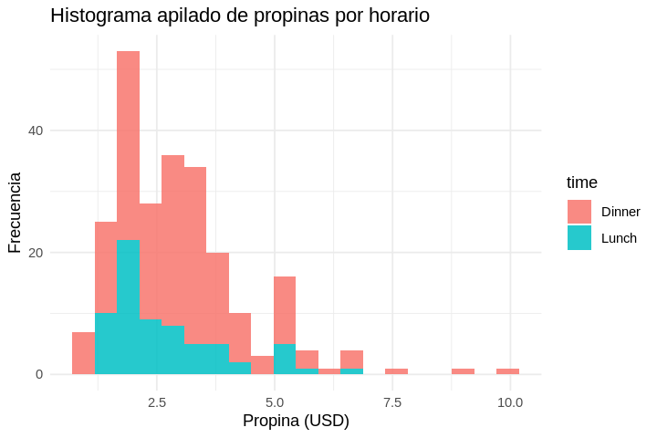
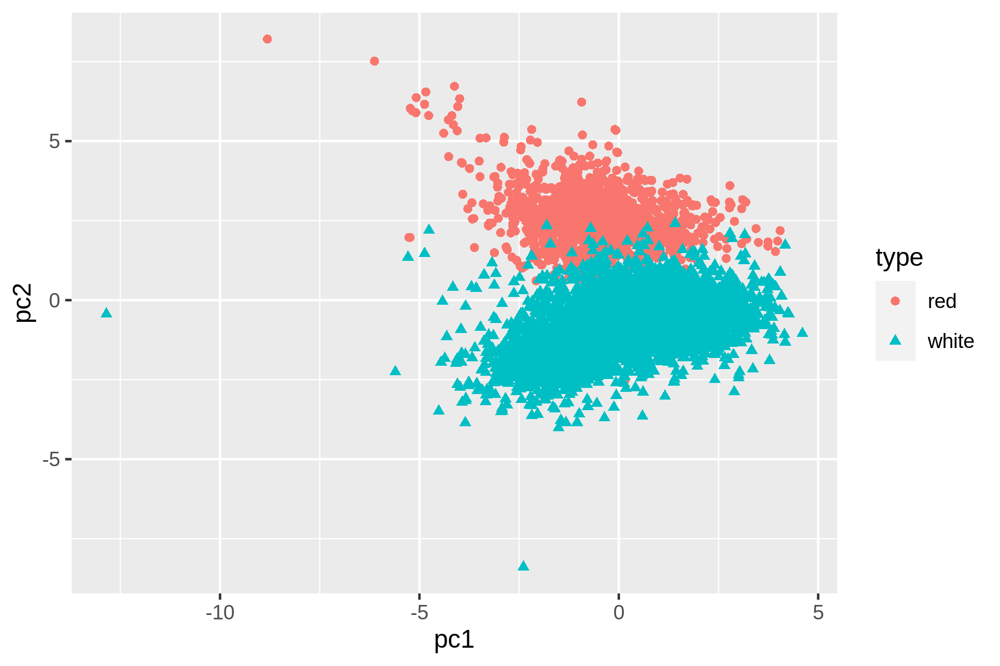

\tableofcontents
\renewcommand{\listfigurename}{Índice de figuras}
\listoffigures
\renewcommand{\listtablename}{Índice de tablas}
\listoftables
\newpage

# Información del curso{-}

## Requisitos computacionales{-}

- Computador con sistema operativo Linux, macOS o Windows 10/11 (con WSL2).
- Docker instalado y configurado con la imagen oficial del curso `ghcr.io/kurokirasama/dsin:latest` (**Data Science in Nushell**).
- Al menos 4 GB de memoria RAM disponibles y 10 GB de espacio libre en disco.

## Evaluaciones{-}

- **Certamen 1 (35%):** Fundamentos de Nushell, tipos de datos estructurados, creación de herramientas CLI y obtención de datos (Capítulos 1 al 4).
- **Certamen 2 (35%):** Depuración y transformación de datos, plugin Polars, exploración estadística, visualización con `timg` y paralelización (Capítulos 5 al 7).
- **Proyecto Aplicado de Modelación Políglota (30%):** Flujo reproducible de extremo a extremo integrando Nushell, herramientas CLI (`tapkee`, `vw`, `SKLL`), `Rscript` y `python3` (Capítulo 8).

## Contenidos{-}

1. **Capítulo 1 — Instalación y el Entorno Contenedorizado `dsin`:** Configuración de WSL2, Docker, imagen `dsin` con Nushell por defecto, actualización automática (`update-dsin-nushell.nu`), editor `ttt` y visor `timg`.
2. **Capítulo 2 — Introducción y Fundamentos de Nushell:** El flujo OSEMN en tuberías estructuradas, cómo piensa Nushell, navegación del sistema, tipos de datos desde bajo a alto nivel (*Strings*, *Listas*, *Registros* y *Tablas*), rutas de celda, edición en terminal con `ttt` y control de versiones con Git.
3. **Capítulo 3 — Programación y Creación de Herramientas CLI:** Operadores, variables inmutables/mutables, comandos personalizados (`def`, tipos, *flags*, *docstrings*, `$in`), control de flujo, módulos y creación de scripts CLI reutilizables en Nushell, R y Python.
4. **Capítulo 4 — Obtención de Datos:** Descarga nativa con `http get`, descompresión de archivos, lectura directa de libros Excel (`.xlsx`), consultas SQL sobre bases de datos relacionales SQLite (`query db`) y consumo de APIs REST / flujos JSON.
5. **Capítulo 5 — Depuración y Transformación de Datos:** Transformación de texto plano (`lines`, `parse`, `split column`, `detect columns`), manipulación nativa de tablas y CSV (`where`, `select`, `upsert`, `join`, `group-by`, `transpose`), procesamiento de XML/JSON y analítica de alto rendimiento con el plugin **Polars** (`nu_plugin_polars`).
6. **Capítulo 6 — Exploración de Datos y Visualización en la Terminal:** Inspección de esquemas, estadísticas descriptivas nativas (`math *`, `polars summary`) y políglotas (`Rscript` y `python3` hacia tablas Nushell), generación de gráficos estadísticos (`ggplot2` y `matplotlib`) y visualización directa en terminal con `timg`.
7. **Capítulo 7 — Procesamiento en Serie y Tuberías Paralelas:** Iteración funcional con `each`, paralelismo nativo multihilo con `par-each --threads`, medición de tiempos con `timeit` y manejo resiliente de errores en paralelo.
8. **Capítulo 8 — Modelación Políglota de Datos:** Preparación del conjunto de datos de vinos e implementación triple (herramienta CLI externa + `Rscript` + `python3` integrados en tablas Nushell) para Reducción de Dimensionalidad (`tapkee` / PCA), Regresión (`vw` / `lm` / `scikit-learn`) y Clasificación (`SKLL` / `glm` / `RandomForest`).

\newpage


# Instalación de software {#chapter-1-installation}

## Windows 10+

### Instalación Ubuntu WSL

1. Habilitar WSL1, ejecutando en Powershell (con permisos de administrador):

```powershell
Enable-WindowsOptionalFeature -Online -FeatureName Microsoft-Windows-Subsystem-Linux

```

2. Habilitar VMP, ejecutando en Powershell:

```powershell
Enable-WindowsOptionalFeature -Online -FeatureName VirtualMachinePlatform

```

3. Listar las distribuciones disponibles y seleccionar (recomendada Ubuntu 24.04):

```powershell
wsl --list --online
```

4. Instalamos la distribución seleccionada:

```powershell
wsl --install -d Ubuntu-24.04
```

4. Configuramos para que la distribución Linux en WSL use v2. Ejecutamos en Powershell:

```powershell
wsl --set-version Ubuntu-24.04 2

```

Para hacerlo por defecto en todas las distribuciones (recomendado):

```powershell
wsl --set-default-version 2

```

5. Actualizar kernel. Descarga desde [WSL](https://wslstorestorage.blob.core.windows.net/wslblob/wsl_update_x64.msi) e instalar.

### Instalación de Docker

1. Descargar instalador Docker para Windows desde: [docker](https://docs.docker.com/desktop/install/windows-install/) y ejecutar. Seleccionar "Usar WSL 2...".

2. Habilitar "Iniciar Docker al iniciar sesión", en la configuración de Docker.

3. Reiniciar.

### Abrir distribución

Para entrar a la distribución instalada, ejecutar en `cmd` o `powershell`:

```powershell
wsl

```


## Linux, WSL2 y el Contenedor `dsin` (Data Science in Nushell) {#section-install-docker}

En este curso trabajaremos sobre una imagen Docker integrada llamada **`dsin`** (*Data Science in Nushell*), publicada en `ghcr.io/kurokirasama/dsin:latest`. A diferencia de los entornos tradicionales basados en *shells* de texto plano, el contenedor `dsin` inicia directamente en **Nushell** como *shell* predeterminado e incluye preconfigurados:

- **Nushell (`nu`)** y el motor columnar **`nu_plugin_polars`** registrados y listos para usar.
- **Editor de texto en terminal `ttt`** con resaltado de sintaxis y atajos preconfigurados.
- **Visor gráfico de terminal `timg`** para inspeccionar imágenes y gráficos estadísticos directamente en la consola.
- **Ecosistema políglota:** R (`Rscript`, `tidyverse`, `ggplot2`), Python 3 (`pandas`, `scikit-learn`, `scipy`, `skll`), **Tapkee** y **Vowpal Wabbit (`vw`)**.
- **Módulo de herramientas del curso (`dsin_tools.nu`):** Comandos personalizados (`to-vw`, `vw-regress`, `tapkee-reduce`) cargados automáticamente al iniciar.

### Instalación de Docker en Linux / WSL (basado en Debian/Ubuntu)

```bash
# skip-docker-exec
sudo apt update && sudo apt upgrade -y
sudo apt install -y ca-certificates curl gnupg lsb-release git
sudo usermod -aG docker $USER
```

### Descarga y Ejecución del Contenedor `dsin`

Para descargar la imagen oficial del curso desde GitHub Container Registry y verificar su funcionamiento:

```bash
# skip-docker-exec
docker pull ghcr.io/kurokirasama/dsin:latest
```

Para iniciar una sesión interactiva compartiendo tu carpeta de trabajo actual con el directorio `/data` del contenedor:

```bash
# skip-docker-exec
mkdir -p ~/DSIN
cd ~/DSIN
docker run --rm -it -v "$(pwd):/data" ghcr.io/kurokirasama/dsin:latest
```

Si ya utilizas Nushell en tu sistema anfitrión, puedes montar el volumen usando interpolación de cadenas de Nushell y definir un alias permanente:

```nu
# skip-docker-exec
alias dsin = docker run --rm -it -v $"($env.PWD):/data" ghcr.io/kurokirasama/dsin:latest
```

Una vez dentro del contenedor `dsin`, podemos verificar las herramientas instaladas directamente en Nushell:

```nu
version | select version major minor patch
which nu ttt timg vw tapkee Rscript python3 | select command path type
```

### Actualización de Nushell en la Imagen `dsin`

El repositorio del curso incluye el script `docker/update-dsin-nushell.nu`, el cual consulta la última versión oficial publicada en GitHub, actualiza la imagen `dsin` con los binarios estáticos de `nu` y `nu_plugin_polars`, y verifica que todos los componentes funcionen correctamente:

```bash
# skip-docker-exec
# Consultar si existe una nueva versión de Nushell disponible
nu docker/update-dsin-nushell.nu --check

# Reconstruir la imagen dsin con la versión más reciente de Nushell
nu docker/update-dsin-nushell.nu --version latest
```

### Instalación Nativa de Nushell y `nu_plugin_polars` (Opcional en Anfitrión)

Si además deseas instalar Nushell directamente en tu sistema operativo anfitrión:

- **Arch Linux / CachyOS / Manjaro:** `sudo pacman -S nushell`
- **macOS (Homebrew):** `brew install nushell`
- **Windows (Winget):** `winget install nushell`
- **Binarios precompilados (Linux/macOS/Windows):** Descargar desde [https://github.com/nushell/nushell/releases](https://github.com/nushell/nushell/releases) y registrar el plugin Polars:

```nu
# skip-docker-exec
plugin add /usr/local/bin/nu_plugin_polars
plugin use polars
```

En nuestro contenedor `dsin`, el plugin `polars` ya se encuentra registrado, por lo que basta con verificar su disponibilidad:

```nu
plugin list | where name == polars | select name status
```


# Introducción y Fundamentos de Nushell {#chapter-2-introduction}

## Ciencia de Datos

De acuerdo a la definición de Hilary Mason and Chris H. Wiggins [^1], la _ciencia de datos_ se define de acuerdo a 4 pasos:

1. Obtención de datos.
2. Depuración de datos.
3. Exploración de datos.
4. Modelación de datos.
5. Interpretación de datos.

En este curso veremos los primeros 4 pasos.

Aunque estos 5 pasos se discuten en forma lineal e incremental, en la practica es común el moverse de uno a otro o incluso realizarlos en paralelo (\refer{Figura}{fig:osemn}). Es decir, la ciencia de datos es un proceso iterativo no lineal.

\begin{figure}[h]
\centering
\includegraphics[width=0.8\textwidth]{dscl_0101.png}
\caption{Proceso de la ciencia de datos.}
\label{fig:osemn}
\end{figure}

[^1]: [A Taxonomy of Data Science, 2010](http://www.dataists.com/2010/09/a-taxonomy-of-data-science).

### Obtención de datos

Sin datos, no hay ciencia de datos, por lo que el primer paso es obtenerlos. Para ello, se puede necesitar realizar uno o mas de las siguientes tareas:

- Descargar datos desde otra ubicación, por ejemplo, pagina web o servidor.
- Obtener datos desde una base de datos o a través de una API, por ejemplo, MySQL o Twitter.
- Extraer datos de un archivo, por ejemplo, html, excel, csv.
- Generar datos, ya sea mediante sensores o haciendo encuestas.

Los formatos mas usuales para almacenar datos son, texto plano (txt), csv, json, html, xml, excel.

### Depuración de datos

No es poco usual que los datos obtenidos tengan valores faltantes, inconsistencias, errores, caracteres erróneos o columnas no interesantes. En tales casos, los datos deben depurarse o limpiarse antes de poder hacer cualquier cosa con ellos. La operaciones mas comunes incluyen:

- Filtrar lineas.
- Extraer algunas columnas.
- Reemplazar valores.
- Extraer palabras.
- Lidiar con datos faltantes y duplicados.
- Convertir de un formato a otro.

Usualmente, un 80% de cualquier trabajo con datos corresponde a la obtención y depuración. El otro 20% es la exploración, modelación y visualización.

### Exploración de datos

Una vez hecha la limpieza de datos, se procede a explorarlos. Es en esta etapa donde realmente se comprende de mejor forma los datos obtenidos. A través de la terminal se puede:

- Observar los datos.
- Derivar estadísticas.
- Crear visualizaciones.

### Modelación de datos

Si se quiere explicar los datos o predecir lo que pasara, probablemente se necesita crear un modelo estadístico de los datos. Algunas técnicas para crear modelos incluyen clustering, clasificación, regresión y reducción de dimensionalidad.

La terminal no es apta para programar un nuevo modelo desde 0, pero es muy útil el ser capaz de crear un modelo desde ella.

### Interpretación de datos

El ultimo y probablemente mas importante paso es interpretarlos. Este paso involucra:

- Obtener conclusiones.
- Evaluación de resultados.
- Comunicación de resultados.

Esta etapa no involucra la terminal, y queda en manos del investigador.

## Historia de la terminal

La _terminal_ (_terminal emulator_) en un programa o interfaz que nos permite acceder a la _linea de comandos_ (_command line_) a través de un tipo particular de sintaxis llamado _shell_.

Originalmente, una terminal era una pieza de _hardware_ usado para ingresar y mostrar datos a/desde un computador.

Los primeros computadores, eran maquinas que ocupaban mucho espacio (ver \refer{Figura}{fig:first}) y las primeras terminales eran tele-impresoras electrónicas (teletypewriter o tty) como se muestra en la (ver \refer{Figura}{fig:firstterminal}).

\begin{figure}[h]
\centering
\includegraphics[width=0.8\textwidth]{univac-9400.jpg}
\caption{Primeros computadores.}
\label{fig:first}
\end{figure}

\begin{figure}[h]
\centering
\includegraphics[width=0.5\textwidth]{teletype-model-33.jpg}
\caption{Primeras terminales.}
\label{fig:firstterminal}
\end{figure}

Conforme fue avanzando la tecnología, estas terminales se reemplazaron por terminales de video (ver \refer{Figura}{fig:videoterminal}).

\begin{figure}[h]
\centering
\includegraphics[width=0.5\textwidth]{DEC-VT100-terminal.jpg}
\caption{Primeras terminales de video.}
\label{fig:videoterminal}
\end{figure}

Notar que lo mostrado en la \refer{Figura}{fig:videoterminal} no es un computador, es solo la interfaz para poder conectarse al computador. En la \refer{Figura}{fig:videoterminal2} se muestra conectada a uno.

\begin{figure}[h]
\centering
\includegraphics[width=0.5\textwidth]{DEC-VT52-terminal-PDP-11-55.jpg}
\caption{Primeras terminales conectadas a un computador.}
\label{fig:videoterminal2}
\end{figure}

En la actualidad no son necesarias estas terminales de _hardware_, por lo que se usan emuladores de terminales para realizar la comunicación directa con el sistema operativo sin necesidad de una interfaz gráfica (gui), esto ultimo siendo lo mas conocido (ventanas, botones, etc).

### Shell

La _shell_ es la sintaxis particular que se utiliza para ejecutar comandos y programas en la terminal. Hay varios tipos de _shell_, como _Nushell_, _csh_, _zsh_, _nushell_, entre muchos otros, siendo la mas usual _Nushell_ como la por defecto en la mayoría de distribuciones Linux.

En este curso, utilizaremos la _shell_ llamada _zsh_, en la cual a cada comando lo precede un símbolo $\$$, llamado _prompt_, e indica que la terminal esta lista para recibir comandos.

### Ventajas del uso de la terminal

El uso de la terminal para ciencia de datos tienes varias ventajas, como por ejemplo:

- Es ágil: permite explorar datos de forma interactiva, obteniendo resultados de forma casi inmediata.
- Es integradora: se integra bien con otras tecnologías y software.
- Es escalable: se pueden automatizar muchas tareas mediante _scripts_, lo que da como resultado herramientas mas complejas.
- Es extensible: permite el uso de diferentes lenguajes de programación.
- Es ubicua: se encuentra en todos los sistemas operativos.


## Como entender nu

### Nushell no es bash

Nushell es tanto un lenguaje de programación como un shell. Debido a esto, tiene su propia forma de trabajar con archivos, directorios, sitios web y más. Se ha modelado para que funcione en estrecha colaboración con lo que se puede estar familiarizado con otros shells. Las _pipelines_ funcionan uniendo dos comandos:

```nu
ls | length
```

Nushell, por ejemplo, también tiene soporte para otras capacidades comunes como obtener el código de salida de comandos ejecutados previamente.

Si bien tiene estas comodidades, Nushell no es bash. La forma de trabajar de bash, y el estilo POSIX en general, no es algo que Nushell soporte. Por ejemplo, en bash, se podrías usar:

```sh
echo "hello" > output.txt
```

En Nushell, se usa `>` como el operador "mayor que". Esto encaja mejor con el aspecto del lenguaje de Nushell. En cambio, se canalizas a un comando que tiene la tarea de guardar contenido:

```nu
"hello" | save -f output.txt
```

La forma en que Nushell ve los datos es que los datos fluyen a través de la _pipeline_ hasta que llegan al usuario o son manejados por un comando final. Se puede simplemente escribir datos, desde cadenas hasta listas y registros de estilo JSON, y seguirlos con `|` para enviarlos a través de la _pipeline_. Nushell usa comandos para hacer el trabajo y producir más datos. Aprender estos comandos y cuándo usarlos ayuda a componer muchos tipos de _pipelines_.

### Nushell como un lenguaje compilado

Una parte importante del diseño de Nushell y específicamente donde difiere de muchos lenguajes dinámicos es que Nushell convierte el código fuente en algo para ejecutar, y luego ejecuta el resultado. No tiene una función `eval` que permita continuar introduciendo nuevo código fuente durante el tiempo de ejecución. Esto significa que las tareas como incluir archivos para que formen parte de un proyecto deben ser rutas conocidas, al igual que las inclusiones en lenguajes compilados como C++ o Rust.

Por ejemplo, lo siguiente no tiene sentido en Nushell, y fallará al ejecutarse si se ejecuta como un script:

```nu
# skip-docker-exec (demostración de error de compilación)
"def abc [] { 1 + 2 }" | save -f output.nu
source "output.nu"
abc
```

El comando `source` aumentará el código fuente que se compila, pero el `save` de la línea anterior no habrá tenido la oportunidad de ejecutarse. Nushell ejecuta todo el bloque como si fuera un solo archivo, en lugar de ejecutar una línea a la vez. En el ejemplo, dado que el archivo `output.nu` no se crea hasta después del paso de 'compilación', el comando `source` no puede leer las definiciones del mismo durante el tiempo de análisis.

Otro problema común es intentar crear dinámicamente el nombre de archivo desde el que obtener el código fuente:

```nu
# skip-docker-exec (demostración de error en tiempo de compilación)
source $"($my_path)/common.nu"
```

Esto no funciona si `my_path` es una variable de tiempo de ejecución regular declarada con `let`. Esto requeriría que el
evaluador se ejecutara y evaluara la cadena, pero desafortunadamente Nushell necesita esta información en tiempo de compilación.

Sin embargo, si `my_path` es una constante, entonces esto
funcionaría, ya que la cadena se puede evaluar en tiempo de compilación:

```nu
# skip-docker-exec (ejemplo ilustrativo de ruta constante)
const my_path = ([$nu.home-dir nushell] | path join)
source $"($my_path)/common.nu" # sources /home/user/nushell/common.nu
```

Nushell está diseñado para usar un solo paso de compilación para todo el código fuente, y esto es independiente de la evaluación. Esto permitirá un fuerte soporte IDE, mensajes de error precisos, un lenguaje más fácil de usar para herramientas de terceros y, en el futuro, incluso una salida más sofisticada, como la posibilidad de compilar Nushell directamente a un archivo binario.

### Las variables son inmutables por defecto

Otra sorpresa común para las personas que vienen de otros lenguajes es que las variables de Nushell son inmutables por defecto. Al llegar a Nushell, se querrá dedicar algún tiempo a familiarizarte con el trabajo en un estilo más funcional, ya que esto tiende a ayudar a escribir código que funciona mejor con variables inmutables.

Si se está acostumbrado a usar variables mutables para diferentes tareas, llevará algún tiempo aprender a hacer cada tarea en un estilo más funcional. Nushell tiene un conjunto de capacidades integradas para ayudar con muchos de estos patrones, y aprenderlos ayudará a escribir código en un estilo más Nushell. El beneficio adicional de acelerar scripts ejecutando partes del código en paralelo es una buena ventaja.

<!--
### El entorno de Nushell es *scoped*
Nushell toma múltiples indicaciones de diseño de lenguajes compilados. Una de esas indicaciones es que los lenguajes deben evitar el estado mutable global. Los shells han utilizado comúnmente la mutación global para actualizar el entorno, pero Nushell se aleja de este enfoque.

En Nushell, los bloques controlan su propio entorno. Los cambios en el entorno tienen un ámbito limitado al bloque donde ocurren.

En la práctica, esto permite escribir código conciso para trabajar con subdirectorios, por ejemplo, si se quisiera construir cada subproyecto en el directorio actual, podrías ejecutar:

```nu
# skip-docker-exec
ls | where type == dir | each { |row|
    cd $row.name
    make
}
```

El comando `cd` cambia las variables de entorno `PWD`, y este cambio de variable no escapa del bloque, lo que permite que cada iteración comience desde el directorio actual e ingrese al siguiente subdirectorio.

Tener el entorno *scoped* de esta manera hace que los comandos sean más predecibles, fáciles de leer y, cuando llegue el momento, fáciles de depurar. Nushell también proporciona comandos auxiliares como `def --env`, `load-env`, como formas convenientes de realizar lotes de actualizaciones en el entorno.

La buena práctica de codificación de no tener variables mutables globales se extiende al entorno en Nushell. El uso de los comandos auxiliares integrados permitirá trabajar más fácilmente con el entorno en Nushell. Aprovechar el hecho de que los entornos tienen un ámbito limitado a los bloques también puede ayudarte a escribir scripts más concisos e interactuar con comandos externos sin agregar cosas a un entorno global que no necesitas.
-->

<!--AQUI-->


## Elementos básicos de nushell

En esta sección se revisarán los primeros elementos de nushell.

Nushell funciona bajo la base de que todo son datos estructurados, y por lo tanto se pueden realizar consultas, similares a SQL, directamente en la salida de cada comando. Comenzamos en el siguiente directorio:

```nu
# cd path/to/DSITCL/
cd ch09
ls
```

Observar como `ls` retorna en lugar de que vuelva un bloque de texto plano, una tabla estructurada. La tabla hace más que mostrar el directorio de una manera diferente. Al igual que las tablas en una hoja de cálculo, esta tabla permite trabajar con los datos de forma más interactiva.

Para ordenar la tabla por tamaño, tomamos la salida de `ls` y la introduciremos en un comando que puede ordenar tablas en función del contenido de una columna.

```nu
ls | sort-by size | reverse
ls | sort-by size -r
ls | sort-by modified
```

Se puede observar que para que esto funcione no se utilizan argumentos de línea de comandos de `ls`. En su lugar, se utiliza el comando `sort-by` que Nu proporciona para hacer la clasificación de la salida del comando `ls`. Para ver los archivos más grandes en la parte superior, también se utiliza `reverse` o la opcion `-r` de `sort-by`.

Nu proporciona muchos comandos que pueden funcionar en tablas. Por ejemplo, se puede utilizar `where` para filtrar el contenido de la tabla `ls` para que sólo muestre los archivos de más de 5 kilobytes

```nu
ls | where size > 100kb
```

Al igual que en la filosofía Unix, ser capaz de hacer que los comandos se comuniquen entre sí entrega formas de mezclar y combinar en muchas combinaciones diferentes. Veamos un comando diferente:

```nu
ps
```

Este comando entrega una lista de todos los procesos actuales que el sistema está ejecutando, cuál es su estado y cuál es su nombre. También podemos ver la carga de CPU de los procesos.

Si se quisiera mostrar los procesos que están utilizando activamente la CPU, se puede proceder como sigue:

```nu
ps | where cpu > 0
```

Nu no solo permite tablas estructuradas de forma simple, si no que también permite anidaciones arbitrarias. Por ejemplo, consideremos el comando `help commands`. Este comando proporciona información para todos los comandos de Nushell como una tabla.

```nu
help commands
```

La salida es bastante extensa, por lo que se obtendra la fila para el comando `each`.

```nu
help commands | where name == each
help commands | where name == each | first
```

Al ecuperar una sola fila de una tabla se obtiene un _registro_ (_record_), que es un conjunto de pares clave-valor. Observar como la columnas "signatures" contiene un registro en lugar de valores simples. Para ver sólo una de estas "claves" o columnas, se puede utilizar el comando `get`:

```nu
help commands | where name == each | first | get description
help commands | where name == each | first | get params
```

El comando `get` nos permite saltar al contenido de los datos estructurados (una tabla, registro o lista). Incluso se puede pasar columnas anidadas para acceder a los datos a cualquier profundidad.

```nu
help commands | where name == each | first | get category
help commands | where name == each | first | get command_type
help commands | where name == each | first | get description
help commands | where name == each | first
```

Estas columnas anidadas se llaman _rutas de celda_ (_cellpaths_). Nu tomará la ruta de la celda e irá al bit de datos correspondiente en una tabla, registro o lista. Las rutas de celda también admiten números de fila, por lo que los comandos anterior también se puede escribir como:

```nu
help commands | where name == each | first | get params
help commands | where name == each | first | get params.0
help commands | where name == each | first | get params.3.description
```

Si se quiere ver la estructura anidada, se puede utilizar `table -e`:

```nu
help commands | where name == each | first | table -e
```

Notar que se pueden acceder a todas las herramientas estandar de la terminal utilizando el símbolo `^` si existe una versión nushell. Si no existe, no es necesario utilizarlo:

```nu
^ls
open wine.csv | first 3
^uname -s
^uname -m
```

Todo comando nushell que retorna datos lo hará en una tabla, por ejemplo:

```nu
#muestra los procesos en ejecucion
ps

#ordenados por mayor utilizacion de cpu
ps | where cpu > 0 | sort-by cpu -r
```

### Obtener Ayuda

Se puede leer texto de ayuda para cualquiera de los comandos incorporados de Nu usando el comando `help` o pasando la opción `--help` a un comando. También se puede buscar un tema utilizando `help -f <topic>`.

```nu
help explore
help http get
help -f open
```


## Moviéndose por el Sistema

Una característica definitoria de un shell es la capacidad de navegar e interactuar con el sistema de archivos. Nushell es, por supuesto, ninguna excepción. Aquí hay algunos comandos comunes que puede usar al interactuar con el sistema de archivos:

### Viendo el Contenido de un Directorio

```nu
ls
```

Como se ve indicó anteriormente, el comando `ls` devuelve el contenido de un directorio. El `ls` de Nushell devolverá el contenido como una tabla.

El comando `ls` también toma un argumento opcional para cambiar lo que se quiere ver. Por ejemplo, se puede listar los archivos que terminan en ".csv"

```nu
ls *.csv
```

### Patrones Glob (comodines)

Al asterisco (`*`) en el argumento opcional anterior `*.csv` a veces se llama comodín o glob. Permite hacer coincidir cualquier cosa. Se puede leer este glob `*.csv` como _"coincidir con cualquier nombre de archivo, siempre que termine con '.csv'."_

El glob más general es `*`, que coincidirá con todas las rutas. Con mayor frecuencia, se verá este patrón utilizado como parte de otro patrón, por ejemplo, `*.bak` y `temp*`.

Nushell también admite un `*` doble que atravesará rutas que están anidadas dentro de otros directorios. Por ejemplo, `ls **/*` enumerará todas las rutas no ocultas anidadas en el directorio actual, recursivamente.

```nu
ls **/*.csv
```

Aquí, buscanmos cualquier archivo que termine con ".csv". Los dobles asteriscos especifican adicionalmente _"en cualquier directorio a partir de aquí."_

La sintaxis globbing de Nushell no solo admite `*`, sino también la coincidencia de caracteres individuales con `?` y grupos de caracteres con `[...]`.

Escapar los patrones `*`, `?` y `[]` funciona delimitándolos entre comillas simples, comillas dobles o
"cadena raw". Por ejemplo, para mostrar el contenido de un directorio llamado `[slug]`, se utiliza use `ls "[slug]"` o `ls '[slug]'`.

Sin embargo, las cadenas delimitados con _comillas inversas_ (o backtips) no escapan los glob. Por ejemplo, compare los siguientes escenarios:

1. Sin comillas: Patrón glob

    Una _cadena de palabra simple_ sin comillas con caracteres glob se interpreta como un patrón glob, por lo que lo siguiente eliminará todos los archivos en el directorio actual que contengan
    `myfile` como cualquier parte del nombre del archivo:

    ```nu
    rm *myfile*
    ```

2. Entre comillas: Literal de cadena con asteriscos

    Cuando se cita con comillas simples o dobles, o se usa una _cadena raw_, se pasa al comando una _cadena_ con los asteriscos literales escapados (u otros caracteres glob). El resultado no es un glob. El siguiente comando solo eliminará un archivo llamado literalmente `*myfile*` (incluidos los asteriscos). Otros archivos con `myfile` en el nombre no se ven afectados:

    ```nu
    rm "*myfile*"
    ```

3. Entre comillas invertidas: Patrón glob

    Los asteriscos (y otros patrones glob) dentro de una _cadena entre comillas invertidas_ se interpretan como un patrón glob. Observe que este es el mismo comportamiento que el del ejemplo de cadena de palabra simple en el n.° 1 anterior.

    Lo siguiente, como en el primer ejemplo, elimina todos los archivos en el directorio actual que contienen `myfile` como parte del nombre del archivo

    ```nu
    rm `*myfile*`
    ```

> Nushell también incluye un comando `glob` dedicado con soporte para escenarios globbing más complejos.

#### Conversión de Cadenas a Globs

Las técnicas de comillas mencionadas anteriormente son útiles al construir globos literales, pero es posible que se deban construir globs mediante programación. Hay varias técnicas disponibles para este propósito:

1. `into glob`

    El comando `into glob` se puede usar para convertir una cadena (y otros tipos) en un glob. Por ejemplo:

    ```nu
    # Encuentra archivos cuyo nombre incluya el mes actual en el formato YYYY-mm
    let current_month = (date now | format date '%Y-%m')
    let glob_pattern = ($"*($current_month)*" | into glob)
    ls $glob_pattern
    ```

2. El operador de propagación (_spread operator_) combinado con el comando `glob`:

    El comando `glob` (nota: no es lo mismo que `into glob`) produce una `list` de nombres de archivo que coinciden con el patrón de globo. Esta lista se puede expandir y pasar a los comandos del sistema de archivos utilizando el operador de propagación `...`:

    ```nu
    # Encuentra archivos cuyo nombre incluya el mes actual en el formato YYYY-mm
    let current_month = (date now | format date '%Y-%m')
    ls ...(glob $"*($current_month)*")
    ```

3. Forzar el tipo `glob` mediante anotación:

    ```nu
    # Encuentra archivos cuyo nombre incluya el mes actual en el formato YYYY-mm
    let current_month = (date now | format date '%Y-%m')
    let glob_pattern: glob = ($"*($current_month)*")
    ls $glob_pattern
    ```


## Trabajando con strings

Como con la mayoría de los lenguajes, los strings son una colección de 0 o más caracteres que representan texto. Esto puede incluir nombres de archivos, rutas de archivos, nombres de columnas, y mucho más. Las strings son tan comunes que Nushell ofrece múltiples formatos de string para que coincidan con cada caso de uso.

### Formatos de String

| Formato de string                                           | Ejemplo                 | Escapes                             | Notas                                                                                     |
| ----------------------------------------------------------- | ----------------------- | ----------------------------------- | ----------------------------------------------------------------------------------------- |
| [String con comillas simples](#single-quoted-strings)       | `'[^\n]+'`              | Ninguno                             | No puede contener comillas simples dentro del string                                      |
| [String con comillas dobles](#double-quoted-strings)        | `"The\nEnd"`            | Escapes de barra invertida estilo C | Todas las barras invertidas literales deben tener escape                                  |
| [Strings raw](#raw-strings)                                 | `r#'Raw string'#`       | Ninguno                             | Puede incluir comillas simples                                                            |
| [String de palabra simple](#bare-word-strings)              | `ozymandias`            | Ninguno                             | Solo puede contener caracteres de "palabra"; No se puede usar en la posición de comando   |
| [String con comillas invertidas](#backtick-quoted-strings)  | <code>\`[^\n]+\`</code> | Ninguno                             | String simple que puede incluir espacios en blanco. No puede contener comillas invertidas |
| [Interpolación con comillas simples](#string-interpolation) | `$'Captain ($name)'`    | Ninguno                             | No puede contener ningún `'` o `()` no coincidentes                                       |
| [Interpolación con comillas dobles](#string-interpolation)  | `$"Captain ($name)"`    | Escapes de barra invertida estilo C | Todas las barras invertidas literales y `()` deben tener escape                           |

### Strings con Comillas Simples

El string más simple en Nushell es el string con comillas simples. Este string usa el carácter `'` para rodear algún texto. Por ejemplo:

```nu
'hello world'

'The
end'
```

Los strings con comillas simples no le hacen nada al texto que se les da, lo que las hace ideales para contener una amplia gama de datos de texto.

### Strings con Comillas Dobles

Para strings más complejas, Nushell también ofrece strings con comillas dobles. Estas strings usan el carácter `"` para rodear el texto. También admiten la capacidad de escapar caracteres dentro del texto usando el carácter `\`.

Por ejemplo, se podría escribir un texto seguido de una nueva línea y luego otro texto, usando caracteres de escape y un string con comillas dobles:

```nu
"hello\nworld"
```

Los caracteres de escape permiten agregar rápidamente un carácter que de otro modo sería difícil de escribir.

Nushell actualmente admite los siguientes caracteres de escape:

- `\"` - carácter de comillas dobles
- `\'` - carácter de comillas simples
- `\\` - barra invertida
- `\/` - barra diagonal
- `\b` - retroceso
- `\f` - avance de formulario
- `\r` - retorno de carro
- `\n` - nueva línea (avance de línea)
- `\t` - tabulación
- `\u{X...}` - un solo carácter unicode, donde X... son 1-6 dígitos hexadecimales (0-9, A-F)

### Strings Raw

Los strings raw se comportan igual que las strings con comillas simples, excepto que las strings raw también pueden contener comillas simples. Esto es posible porque las strings raw están encerradas por un `r#'` inicial y un `'#` final.

```nu
r#'Raw strings can contain 'quoted' text.'#
```

Se pueden agregar símbolos `#` adicionales al principio y al final del string raw para encerrar
uno menos que la misma cantidad de símbolos `#` junto a un símbolo `'` en el string. Esto se puede usar para anidar strings raw:

```nu
r###'r##'This is an example of a raw string.'##'###
```

### Strings de Palabra Simple

Al igual que otros lenguajes de shell (pero a diferencia de la mayoría de los otros lenguajes de programación), las strings que constan de una sola 'palabra' también se pueden escribir sin comillas:

```nu
print hello
print "hello"

[hello] | describe
```

Pero se debe tener cuidado: si usa una palabra simple directamente en la línea de comandos (es decir, no dentro de una estructura de datos o como un parámetro de comando) o dentro de paréntesis redondos `(` `)`, se interpretará como un comando externo:

```nu
hello
Error: nu::shell::external_command

  × External command failed
   ╭─[entry #5:1:1]
 1 │ hello
   · ──┬──
   ·   ╰── executable was not found
   ╰────
  help: program not found
```

Además, muchas palabras simples tienen un significado especial en nu, por lo que no se interpretarán como una string:

```nu
true | describe

[true] | describe

[trueX] | describe

"trueX" | describe
```

Entonces, si bien los strings simples son útiles para el uso informal de la línea de comandos, al programar más formalmente en nu, se recomienda usar comillas.

### Strings con Comillas Invertidas

Las strings de palabras simples, por su naturaleza, no pueden incluir espacios ni comillas. Como alternativa, Nushell también incluye strings con comillas invertidas
usando el carácter <code>`</code>. En la mayoría de los casos, estos deberían funcionar igual que una string de palabra simple.

Por ejemplo, al igual que con una palabra simple, una string entre comillas invertidas en la primera posición de una expresión se interpretará como un _comando_ o _ruta_.
Por ejemplo:

```nu
# skip-docker-exec
# Ejecutar el binario ls externo o cambiar de directorio interactivamente
^ls
```

Las strings con comillas invertidas pueden ser útiles para combinar globs con archivos o directorios que incluyen espacios:

```nu
# skip-docker-exec
ls `./my dir/*`
```

### Strings como comandos externos

Puede colocar el signo `^` delante de cualquier string (incluida una variable) para que Nushell ejecute la string como si fuera un comando externo:

```nu
^ls

^'ls'

let foo = 'ls'
^$foo
```

También se puede usar el comando `run-external` para este propósito, que proporciona indicadores y opciones adicionales.

### Añadir y anteponer a strings

Hay varias formas de anteponer o añadir strings. Si se desea agregar algo al principio de cada string, se puede iterar:

```nu
['foo', 'bar'] | each {|s| '~/' ++ $s} # ~/foo, ~/bar
['foo', 'bar'] | each {|s| '~/' + $s} # ~/foo, ~/bar
```

También puede usar una expresión regular para reemplazar el principio o el final de una string:

```nu
['foo', 'bar'] | str replace -r '^' '~/' # ~/foo, ~/bar
['foo', 'bar'] | str replace -r '$' '~/' # foo~/, bar~/
```

Si se desea obtener un string a partir de una lista:

```nu
"hello" | append "world!" | str join " "

ls | get name | str join "/"
```

También se puede usar reduce:

```nu
1..10 | reduce -f "" {|elt, acc| $acc + ($elt | into string) + " + "}
```

Aunque en el caso de los strings, especialmente si no se tiene que operar en las strings, suele ser más fácil y correcto (observe el + adicional al final del ejemplo anterior) usar `str join`.

Finalmente, también se puede usar la interpolación de strings.

### Interpolación de strings

Los casos de uso de strings más complejos también necesitan una nueva forma de string: interpolación de strings. Esta es una forma de construir texto a partir de texto sin formato y el resultado de ejecutar expresiones. La interpolación de strings combina los resultados, dándo una nueva string.

La interpolación de strings usa `$" "` y `$' '` como formas de encapsular texto interpolado.

Por ejemplo, si se tiene una variable llamada `$name` y queremos saludar al nombre de la persona contenida en esta variable:

```nu
let name = "Alice"

$"greetings, ($name)"

$"greetings, (ls | get name.2)"
```

Al encapsular expresiones en `()`, podemos ejecutarlas hasta su finalización y usar los resultados para ayudar a construir el string.

La interpolación de strings tiene una forma con comillas simples, `$' '`, y una con comillas dobles, `$" "`. Éstas corresponden a las strings con comillas simples y comillas dobles: la interpolación de strings con comillas simples no admite caracteres de escape, mientras que la interpolación de strings con comillas dobles sí.

A partir de la versión 0.61, las strings interpoladas admiten el escape de paréntesis, de modo que los caracteres `(` y `)` se pueden usar en una string sin que Nushell intente evaluar lo que aparece entre ellos:

```nu
$"2 + 2 is (2 + 2) \(adivinaste!)"
```

Los strings interpolados se pueden evaluar en tiempo de análisis, pero si incluyen valores cuyo formato depende de su configuración y su `config.nu` aún no se ha cargado, utilizarán la configuración predeterminada.
Entonces, si se tiene algo como esto en su `config.nu`, `x` será `"2.0 KB"` incluso si su configuración dice que use `MB` para todos los tamaños de archivo (las fechas y horas utilizarán de manera similar la configuración predeterminada).

```nu
const x = $"(2kb)"
```

### Dividir Strings

El comando `split row` crea una lista a partir de una string basándose en un delimitador.

```nu
"red,green,blue" | split row ","
```

El comando `split column` creará una tabla a partir de una string basándose en un delimitador. Esto aplica nombres de columna genéricos a la tabla.

```nu
"red,green,blue" | split column ","
```

Finalmente, el comando `split chars` dividirá una string en una lista de caracteres.

```nu
'aeiou' | split chars
```

### El comando `str`

Muchas funciones de string son subcomandos del comando `str`. Puede obtener una lista completa usando `help str`.

Por ejemplo, puede buscar si una string contiene una subcadena (_substring_) en particular usando `str contains`:

```nu
"hello world" | str contains "o wo"
```

También se puede utilizar el operador `=~`.

#### Recortar Strings

Se puede recortar los lados de una string con el comando `str trim`. De forma predeterminada, el comando `str trim` recorta los espacios en blanco de ambos lados de la string. Por ejemplo:

```nu
'       My   string   ' | str trim
```

Se puede especificar en qué lado se produce el recorte con las opciones `--right` y `--left`. (`-r` y `-l` son las opciones abreviadas respectivamente)

Para recortar un carácter específico, se utiliza `--char <Carácter>` o `-c <Carácter>` para especificar el carácter a recortar.

Ejemplo:

```nu
'=== Nu shell ===' | str trim -r -c '='
```

#### Substrings

Los substrings son porciones de una string. Tienen un punto de inicio y un punto final

```nu
'Hello World!' | str index-of 'o'

'Hello World!' | str index-of 'r'

'Hello World!' | str substring 4..8
```

#### Relleno de Strings

Con el comando `fill` puede agregar relleno a una string. El relleno agrega caracteres a la string hasta que tenga una cierta longitud. Por ejemplo:

```nu
'1234' | fill -a right -c '0' -w 10

'1234' | fill -a left -c '0' -w 10
```

#### Invertir Strings

Esto se puede hacer fácilmente con el comando `str reverse`.

```nu
'Nushell' | str reverse

['Nushell' 'is' 'cool'] | str reverse
```

#### Análisis de Strings

Con el comando `parse` se puede analizar una string en columnas. Por ejemplo:

```nu
'Nushell 0.80' | parse '{shell} {version}'

'where all data is structured!' | parse --regex '(?P<subject>\w*\s?\w+) is (?P<adjective>\w+)'
```

Si se sabe que un string contiene datos separados por comas, separados por tabulaciones o separados por varios espacios, puede usar `from csv`, `from tsv` o `from ssv`, respectivamente:

```nu
"acronym,long\nAPL,A Programming Language" | from csv

"name  duration\nonestop.mid  4:06" | from ssv

"rank\tsuit\nJack\tSpades\nAce\tClubs" | from tsv
```

### Comparación de Strings

Además de los operadores estándar `==` y `!=`, existen algunos operadores para comparar específicamente strings entre sí.

Para expresiones regulares:

```nu
'APL' =~ '^\w{0,3}$'
'FORTRAN' !~ '^\w{0,3}$'
```

Existen otros dos operadores para comparaciones más sencillas:

```nu
'JavaScript' starts-with 'Java'

'OCaml' ends-with 'Caml'
```

### Convertir Strings

Hay varias formas de convertir strings a otros tipos y viceversa.

#### A string

1. Usando `into string`. Ej: `123 | into string`
2. Usando interpolación de strings. Ej: `$'(123)'`

#### De string

1. Usando `into <tipo>`. Ej: `'123' | into int`

### Colorear Strings

Se pueden colorear strings con el comando `ansi`. Por ejemplo:

```nu
$'(ansi purple_bold)This text is a bold purple!(ansi reset)'
```

`ansi purple_bold` hace que el texto sea de color púrpura intenso
`ansi reset` restablece el color al predeterminado. (Consejo: Siempre debe terminar las strings coloreadas con `ansi reset`)


## Trabajando con listas

Las listas son equivalentes a las columnas individuales de las tablas. Una lista es esencialmente una "tabla de una columna" (sin nombre de columna). Por lo tanto, cualquier comando que opere en una columna _también_ opera en una lista. Por ejemplo, `where` se puede usar con listas:

```nu
[bell book candle] | where ($it =~ 'b')
```

### Creando listas

Una lista es una colección ordenada de valores.
Una lista se crea usando corchetes que rodean los valores separados por espacios, saltos de línea y/o comas.
Por ejemplo, `[foo bar baz]` o `[foo, bar, baz]`.

> Las listas de Nushell son similares a las matrices JSON. El mismo `[ "Item1", "Item2", "Item3" ]` que representa una matriz JSON también se puede usar para crear una lista de Nushell.

### Actualizando listas

Se usa `insert` para insertar valores en las listas a medida que fluyen a través de la _pipeline_, por ejemplo, insertamos el valor `10` en el medio de una lista:

```nu
[1, 2, 3, 4] | insert 2 10
```

También se puede usar `update` para reemplazar el segundo elemento con el valor `10`.

```nu
[1, 2, 3, 4] | update 1 10
```

### Eliminando o Agregando Elementos de la Lista

Además de `insert` y `update`, también se tiene `prepend` y `append`. Estos permiten insertar al principio de una lista o al final de la lista, respectivamente.

Por ejemplo:

```nu
let colors = [yellow green]
let colors = ($colors | prepend red)
let colors = ($colors | append purple)
let colors = ($colors ++ ["blue"])
let colors = (["black"] ++ $colors)
$colors # [black red yellow green purple blue]
```

En caso de que se requiera eliminar elementos de la lista, hay muchas maneras. `skip` permite omitir las primeras filas de la entrada, mientras que `drop` permite omitir filas numeradas específicas del final de la lista.

```nu
let colors = [red yellow green purple]
let colors = ($colors | skip 1)
let colors = ($colors | drop 2)
$colors # [yellow]
```

También está `last` y `first` que permiten tomar valores desde el final o el principio de la lista, respectivamente.

```nu
let colors = [red yellow green purple black magenta]
let colors = ($colors | last 3)
$colors # [purple black magenta]
```

Y desde el principio de una lista,

```nu
let colors = [yellow green purple]
let colors = ($colors | first 2)
$colors # [yellow green]
```

#### Usando el Operador de Propagación

Para agregar una o más listas, opcionalmente con valores intercalados, se puede usar el
operador de propagación (`...`)

```nu
let x = [1 2]

[
   ...$x
   3
   ...(4..7 | take 2)
]
```

### Iterando sobre Listas

Para iterar sobre los elementos de una lista, se utiliza el comando `each` con un bloque
de código Nu que especifica qué hacer con cada elemento. El parámetro de bloque (por ejemplo, `|elt|` en `{ |elt| print $elt }`) es el elemento de lista actual, pero el filtro [`enumerate`](/commands/docs/enumerate.md) se puede usar para proporcionar valores de `index` y `item` si es necesario. Por ejemplo:

```nu
let names = [Mark Tami Amanda Jeremy]

$names | each { |elt| $"Hello, ($elt)!" }

$names | enumerate | each { |elt| $"($elt.index + 1) - ($elt.item)" }
```

El comando `where` se puede usar para crear un subconjunto de una lista, filtrando eficazmente la lista según una condición.

El siguiente ejemplo obtiene todos los colores cuyos nombres terminan en "e".

```nu
let colors = [red orange yellow green blue purple]
$colors | where ($it | str ends-with 'e')
# El bloque pasado a `where` debe evaluarse como un booleano.
# Esto imprime la lista [orange blue purple].
```

En este ejemplo, mantenemos solo los valores superiores a `7`.

```nu
let scores = [7 10 8 6 7]
$scores | where $it > 7 # [10 8]
```

El comando `reduce` calcula un solo valor a partir de una lista.
Utiliza un bloque que toma 2 parámetros: el elemento actual (convencionalmente llamado `elt`) y un acumulador
(convencionalmente llamado `acc`). Para especificar un valor inicial para el acumulador, usa la opción `--fold` (`-f`).
Para cambiar `elt` para que tenga valores de `index` y `item`, se usa el filtro [`enumerate`](/commands/docs/enumerate.md).
Por ejemplo:

```nu
let scores = [3 8 4]
$"total = ($scores | reduce { |elt, acc| $acc + $elt })" # total = 15

$"total = ($scores | math sum)" # enfoque más fácil, mismo resultado

$"product = ($scores | reduce --fold 1 { |elt, acc| $acc * $elt })" # product = 96

$scores | enumerate | reduce --fold 0 { |elt, acc| $acc + $elt.index * $elt.item } # 0*3 + 1*8 + 2*4 = 16
```

### Accediendo a la Lista

Para acceder a un elemento de la lista en un índice dado, se usa la forma `$name.index` donde `$name` es una variable que contiene una lista.

Por ejemplo, se puede acceder al segundo elemento de la lista a continuación con `$names.1`.

```nu
let names = [Mark Tami Amanda Jeremy]
$names.1 # da Tami
```

Si el índice está en alguna variable `$index`, podemos usar el comando `get` para extraer el elemento de la lista.

```nu
let names = [Mark Tami Amanda Jeremy]
let index = 1
$names | get $index # da Tami
```

El comando `length` devuelve el número de elementos de una lista.
Por ejemplo, `[red green blue] | length` imprime `3`.

El comando `is-empty` determina si una cadena, lista o tabla está vacía.
Se puede usar con listas de la siguiente manera:

```nu
let colors = [red green blue]
$colors | is-empty # false

let colors = []
$colors | is-empty # true
```

Los operadores `in` y `not-in` se utilizan para probar si un valor está en una lista. Por ejemplo:

```nu
let colors = [red green blue]
'blue' in $colors # true
'yellow' in $colors # false
'gold' not-in $colors # true
```

El comando `any` determina si algún elemento de una lista coincide con una condición dada.
Por ejemplo:

```nu
let colors = [red green blue]
# ¿Algún nombre de color termina con "e"?
$colors | any {|elt| $elt | str ends-with "e" } # true

# ¿La longitud de algún nombre de color es inferior a 3?
$colors | any {|elt| ($elt | str length) < 3 } # false

let scores = [3 8 4]
# ¿Alguna puntuación es superior a 7?
$scores | any {|elt| $elt > 7 } # true

# ¿Alguna puntuación es impar?
$scores | any {|elt| $elt mod 2 == 1 } # true
```

El comando `all` determina si todos los elementos de una lista coinciden con una condición dada.
Por ejemplo:

```nu
let colors = [red green blue]
# ¿Todos los nombres de color terminan con "e"?
$colors | all {|elt| $elt | str ends-with "e" } # false

# ¿La longitud de todos los nombres de color es mayor o igual a 3?
$colors | all {|elt| ($elt | str length) >= 3 } # true

let scores = [3 8 4]
# ¿Todas las puntuaciones son superiores a 7?
$scores | all {|elt| $elt > 7 } # false

# ¿Todas las puntuaciones son pares?
$scores | all {|elt| $elt mod 2 == 0 } # false
```

### Convirtiendo la Lista

El comando `flatten` crea una nueva lista a partir de una lista existente agregando elementos de listas anidadas a la lista de nivel superior. Esto se puede llamar varias veces para aplanar listas anidadas a cualquier profundidad.
Por ejemplo:

```nu
[1 [2 3] 4 [5 6]]
[1 [2 3] 4 [5 6]] | table -e
[1 [2 3] 4 [5 6]] | flatten # [1 2 3 4 5 6]

[[1 2] [3 [4 5 [6 7 8]]]]
[[1 2] [3 [4 5 [6 7 8]]]] | table -e
[[1 2] [3 [4 5 [6 7 8]]]] | flatten

[[1 2] [3 [4 5 [6 7 8]]]] | flatten | flatten | flatten # [1 2 3 4 5 6 7 8]
```

El comando `wrap` convierte una lista en una tabla. Cada valor de la lista se convertirá en una fila separada con una sola columna:

```nu
let zones = [UTC CET Europe/Moscow Asia/Yekaterinburg]

# Mostrar el reloj mundial para las zonas horarias seleccionadas
$zones
| wrap 'Zone'
| upsert Time {|row|
   (date now | date to-timezone $row.Zone | format date '%Y.%m.%d %H:%M')
  }
```


## Trabajando con Registros (records)

Los registros son aproximadamente equivalentes a las filas individuales de una tabla. Esencialmente son una "tabla de una fila". Por lo tanto, la mayoría de los comandos que operan en una fila de tabla _también_ operan en un registro. Por ejemplo, `update` se puede usar con registros:

```nu
let my_record = {
   name: "Sam"
   age: 30
   }
$my_record | update age { $in + 1 }
```

### Creando registros

Un registro es una colección de cero o más asignaciones de pares clave-valor. Es similar a un objeto JSON y se puede crear utilizando la misma sintaxis:

```nu
# Nushell
{ "apples": 543, "bananas": 411, "oranges": 0 }
╭─────────┬─────╮
│ apples  │ 543 │
│ bananas │ 411 │
│ oranges │ 0   │
╰─────────┴─────╯
# JSON
'{ "apples": 543, "bananas": 411, "oranges": 0 }' | from json
```

En Nushell, los pares clave-valor de un registro también se pueden separar utilizando espacios o saltos de línea.

Como los registros pueden tener muchos campos, de forma predeterminada, se muestran verticalmente en lugar de de izquierda a derecha. Para mostrar un registro de izquierda a derecha, de debe convertir a un "nuon". Por ejemplo:

```nu
{
   name: "Sam"
   rank: 10
} | to nuon
```

### Actualizando Registros

Al igual que con las listas, se pueden insertar valores en los registros. Por ejemplo:

```nu
{ "apples": 543, "bananas": 411, "oranges": 0 } | insert pears { 21 }
```

También se pueden actualizar valores:

```nu
{ "apples": 543, "bananas": 411, "oranges": 0 } | update oranges { 100 }
```

Para hacer una copia de un registro con nuevos campos, se puede:

- Usar el comando `merge`:

```nu
let first_record = { name: "Sam", rank: 10 }
$first_record | merge { title: "Mayor" }
```

- Usar el operador de propagación (`...`) para expandir el primer registro dentro de un nuevo registro:

```nu
let first_record = { name: "Sam", rank: 10 }
{
   ...$first_record
   title: "Mayor"
 }
```

### Iterando sobre un Registro

Se puede iterar sobre los pares clave-valor de un registro transponiéndolo primero a una tabla:

```nu
{ "apples": 543, "bananas": 411, "oranges": 0 }
| transpose fruit count
| each {|f| $"We have ($f.count) ($f.fruit)" }
```

<!--AQUI-->


## Trabajando con tablas

Una de las maneras comunes de ver datos en Nu es a través de una tabla. Nu viene con una serie de comandos para trabajar con tablas para que sea conveniente encontrar lo que se está buscando, y para reducir los datos a solo lo que se necesita.

Para comenzar, obtenemos una tabla que podamos usar:

```nu
ls
```

### Ordenando los Datos

Se puede ordenar una tabla llamando al comando `sort-by` y estableciendo qué columnas utilizar para ordenar. Si se quisiese ordenar la tabla anterior por el tamaño del archivo:

```nu
ls | sort-by size
```

Se puede ordenar una tabla por cualquier columna que se pueda comparar. Por ejemplo, se podría también haber ordenado la anterior usando las columnas "name", "accessed", o "modified".

### Seleccionando Datos

Se puede seleccionar datos de una tabla eligiendo seleccionar columnas específicas o filas específicas, con el comando `select`:

```nu
ls | select name size
```

Esto ayuda a crear una tabla que está más enfocada en lo que se necesitan. Si solo quisiéramos ver los 5 archivos más pequeños en este directorio, ejecutamos:

```nu
ls | sort-by size | first 5
```

Notar que primero se ordenam la tabla por tamaño para llegar al archivo más pequeño, y luego se utiliza `first 5` para devolver las primeras 5 filas de la tabla.

También se pueden saltar filas que no se necesitan:

```nu
ls | sort-by size | first 5 | skip 2
```

También se pueden seleccionar filas directamente:

```nu
ls | sort-by name | select 5
```

### Obteniendo Datos de una Tabla

Hasta ahora, se ha trabajado con tablas recortando la tabla a solo lo que se necesita. A veces, se puede necesitar ir un paso más allá y solo mirar los valores en las celdas en sí mismas en lugar de tomar una columna completa. Por ejemplo, supongamos que queremos obtener solo una lista de los nombres de los archivos:

```nu
ls | get name
```

Esto podría verse como el comando `select` que se vió anteriormente:

```nu
ls | select name
```

Se ven similares, pero hay diferencias:

- `select`: crea una nueva tabla que incluye solo las columnas especificadas.
- `get`: devuelve los valores dentro de la columna especificada como una lista.

### Cambiando Datos en una Tabla

En adición a seleccionar datos de una tabla, también se pueden actualizar lo que la tabla tiene. Se puede necesitar combinar tablas, añadir nuevas columnas, o editar el contenido de una celda. En Nu, en lugar de editar en el lugar, cada uno de los comandos en la sección devolverá una nueva tabla.

#### Concatenando Tablas

Se pueden concatenar tablas usando `append`:

```nu
let first = [[a b]; [1 2]]
let second = [[a b]; [3 4]]

$first
$second

$first | append $second
```

Si los nombres de columna no son idénticos, entonces, adicionalmente, se crearán columnas y valores según sea necesario:

```nu
let first = [[a b]; [1 2]]
let second = [[a b]; [3 4]]
let third = [[a c]; [3 4]]

$first | append $second | append $third
```

También puede usar el operador `++` como un reemplazo en línea para `append`:

```nu
$first ++ $second ++ $third
```

#### Combinando Tablas

Se puede utilizar el comando `merge` para combinar dos (o más) tablas:

```nu
let first = [[a b]; [1 2]]
let second = [[c d]; [3 4]]

$first | merge $second
```

Con una tercera tabla:

```nu
let third = [[e f]; [5 6]]
```

Se pueden unir las tres tablas de esta manera:

```nu
$first | merge $second  | merge $third
```

O se podría usar el comando `reduce` para combinar dinámicamente todas las tablas:

```nu
[$first $second $third] | reduce {|elt, acc| $acc | merge $elt }
```

### Añadiendo una columna

Se puede utilizar el comando `insert` para agregar una nueva columna a la tabla. Por ejemplo:

```nu
{edition: 2024} | save -f edition.json
open edition.json
```

Agregamos una columna llamada "next_edition" con el valor 2025:

```nu
open edition.json | insert next_edition 2025
```

Notar que esta visualización puede ser ligeramente confusa, porque parece que lo que se acaba de hacer es añadir una fila. En este caso, se debe recordar que las filas tienen números, las columnas tienen nombres. Si todavía es confuso, se puede añadir una fila mas, lo quehará que la tabla se renderice como se espera:

```nu
open edition.json | insert next_edition 2025 | append {edition: 2021 next_edition: 2023}
```

Notar que si se abre el archivo original, el contenido se ha mantenido igual:

```nu
open edition.json
```

Los cambios en Nu son cambios funcionales, lo que significa que trabajan en los valores en sí mismos en lugar de intentar causar un cambio permanente. Esto permite hacer muchos tipos diferentes de trabajo en la _pipeline_ hasta que se está listo para escribir el resultado con los cambios elegidos. Se puede escribir el resultado usando el comando `save`:

```nu
open edition.json
| insert next_edition 2025
| append {edition: 2021 next_edition: 2023}
| save -f edition2.json

open edition.json
open edition2.json
```

### Actualizando una Columna

De forma similar al comando `insert`, el comando [`update` sirve para cambiar el contenido de una columna a un nuevo valor.

```nu
open edition.json
```

Y ahora, actualizamos la edición:

```nu
open edition.json | update edition 2025
```

También se puede utilizar el comando `upsert`para insertar o actualizar dependiendo de si la columna ya existe.

### Moviendo Columnas

Se puede usar `move` para mover columnas en una tabla. Por ejemplo, si se quisiera mover la columna "name" de `ls` después de la columna "size", se puede realizar:

```nu
ls

ls | move name --after size
```

### Renombrando Columnas

También se puede columnas en una tabla pasándola por el comando `rename`:

```nu
ls | rename filename filetype filesize filedate
```

### Rechazando/Eliminando Columnas

También pueden rechazar/eliminar columnas en una tabla pasándola por el comando de `reject`:

```nu
ls -l

ls -l | reject readonly num_links inode created accessed modified
```


## Navegando y Accediendo a Datos Estructurados

Dado el fuerte soporte de Nushell para datos estructurados, algunas de las tareas más comunes involucran navegar y acceder a esos datos.

### Antecedentes

Para los ejemplos y descripciones a continuación, se debe tener en cuenta varias definiciones con respecto a los datos estructurados:

- **_Lista:_** Las listas contienen una serie de cero o más valores de cualquier tipo. Una lista con cero valores se conoce como una "lista vacía".
- **_Registro:_** Los registros contienen cero o más pares de claves con nombre y su valor correspondiente. Los datos en el valor de un registro también pueden ser de cualquier tipo. Un registro con cero pares clave-valor se conoce como un "registro vacío".
- **_Datos Anidados:_** Los valores contenidos en una lista, registro o tabla pueden ser de un tipo básico o datos estructurados en sí mismos. Esto significa que los datos se pueden anidar en múltiples niveles y en múltiples formas:
    - Los valores de la lista pueden contener tablas, registros e incluso otras listas
        - **_Tabla:_** Las tablas son una lista de registros
    - Los valores de registro pueden contener tablas, listas y otros registros
        - Esto significa que los registros de una tabla también pueden contener tablas anidadas, listas y otros registros

> Debido a que una tabla es una lista de registros, cualquier comando o sintaxis que funcione en una lista también funcionará en una tabla. Lo contrario no es necesariamente el caso; hay algunos comandos y sintaxis que funcionan en tablas pero no en listas.

### Rutas de Celda

Una ruta de celda (_cellpath_) es la forma principal de acceder a valores dentro de datos estructurados. Esta ruta se basa en un concepto similar al de una hoja de cálculo, donde las columnas tienen nombres y las filas tienen números. Los nombres e índices de las rutas de celda están separados por puntos.

#### Registros

Para un registro, la ruta de celda especifica el nombre de una clave, que es una `string`.

Por ejemplo, para acceder a un Valor de Registro:

```nu
let my_record = {
    a: 5
    b: 42
  }

$my_record.b + 5
```

#### Listas

Para una lista, la ruta de celda especifica la posición (índice) del valor en la lista. Este es un `int`:

Por ejemplo, para acceder a un Valor de Lista (recordar que los índices de lista comienzan en 0):

```nu
let scoobies_list = [ Velma Fred Daphne Shaggy Scooby ]

$scoobies_list.3

```

#### Tablas

- Para acceder a una columna, una ruta de celda usa el nombre de la columna, que es una `string`
- Para acceder a una fila, usa el número de índice de la fila, que es un `int`
- Para acceder a una sola celda, usa una combinación del nombre de la columna con el índice de la fila.

Los siguientes ejemplos usarán la siguiente tabla:
<!--fix:tabla no cabe dentro del ancho de pagina-->
```nu
let data = [[date                        temps                                   condition ];
            [2022-02-01T14:30:00+05:00,  [ 38.24, 38.50, 37.99, 37.98, 39.10 ],  'summy'   ],
            [2022-02-02T14:30:00+05:00,  [ 35.24, 35.94, 34.91, 35.24, 36.65 ],  'sunny'   ],
            [2022-02-03T14:30:00+05:00,  [ 35.17, 36.67, 34.42, 35.76, 36.52 ],  'cloudy'  ],
            [2022-02-04T14:30:00+05:00,  [ 39.24, 40.94, 39.21, 38.99, 38.80 ],  'rain'    ],
           ]

$data

$data | table -e
```

Esto representa datos meteorológicos en forma de una tabla con tres columnas:

1. **_date_**: Una `date` de Nushell para cada día
2. **_temps_**: Una `list` de Nushell de 5 valores `float` que representan lecturas de temperatura en diferentes estaciones meteorológicas en el área
3. **_condition_**: Una `string` de Nushell para la condición meteorológica de cada día para el área

##### Ejemplo - Acceder a una Fila de la Tabla (Registro)

Acceder a los datos del segundo día como un registro:

```nu
> $data.1
╭───────────┬───────────────╮
│ date      │ 2 years ago   │
│           │ ╭───┬───────╮ │
│ temps     │ │ 0 │ 35.24 │ │
│           │ │ 1 │ 35.94 │ │
│           │ │ 2 │ 34.91 │ │
│           │ │ 3 │ 35.24 │ │
│           │ │ 4 │ 36.65 │ │
│           │ ╰───┴───────╯ │
│ condition │ sunny         │
╰───────────┴───────────────╯
```

##### Ejemplo - Acceder a una Columna de la Tabla (Lista)

```nu
$data.condition
```

##### Ejemplo - Acceder a una Celda de la Tabla (Valor)

La condición para el cuarto día:

```nu
$data.condition.3

$data | get condition | get 3

$data | get condition.3
```

### Datos Anidados

Dado que los datos se pueden anidar, una ruta de celda puede contener referencias a múltiples nombres o índices.

#### Ejemplo - Accediendo a Datos de Tabla Anidados

Para obtener la temperatura en la segunda estación meteorológica el tercer día:

```nu
$data.temps.2.1
```

El primer índice `2` accede al tercer día, luego el siguiente índice `1` accede a la lectura de temperatura de la segunda estación meteorológica.

### Usando `get` y `select`

Además de la sintaxis literal de la ruta de celda utilizada anteriormente, Nushell también proporciona varios comandos que utilizan rutas de celda. Los más importantes de estos son:

- `get` es equivalente a usar una ruta de celda literal pero con soporte para nombres de variables y expresiones. `get`, como los ejemplos de ruta de celda anteriores, devuelve el **valor** indicado por la ruta de celda.
- `select` es sutilmente, pero críticamente, diferente. Devuelve la **estructura de datos** especificada en sí misma, en lugar de solo su valor.
    - Usar `select` en una tabla devolverá una tabla de igual o menor tamaño
    - Usar `select` en una lista devolverá una lista de igual o menor tamaño
    - usar `select` en un registro devolverá un registro de igual o menor tamaño

Continuando con la tabla de muestra anterior:

#### Ejemplo - `get` vs. `select` una fila de la tabla

```nu
$data | get 1

$data | select 1
```

Observe que:

- `get` devuelve el mismo registro que el ejemplo `$data.1` anterior
- `select` devuelve una nueva tabla de una sola fila, incluidos los nombres de las columnas y los índices de las filas

Los índices de fila de la tabla resultante de `select` no son los mismos que los del original. La nueva tabla tiene su propio índice que comienza en 0.

Para obtener el índice original, puede usar el comando [`enumerate`](/commands/docs/enumerate.md). Por ejemplo:

```nu
$data | enumerate | select 1
```

#### Ejemplo - `select` con múltiples filas y columnas

Debido a que `select` da como resultado una nueva tabla, es posible especificar varios nombres de columna, índices de fila o incluso ambos. Este ejemplo crea una nueva tabla que contiene las columnas de fecha y condición de la primera y segunda filas:

```nu
$data | first 2 | select date condition
```

### Nombres de Clave/Columna con espacios

Si un nombre de clave o un nombre de columna contiene espacios u otros caracteres que impiden que sea accesible como una cadena de palabra simple, entonces el nombre de la clave se puede especificar entre comillas.

Ejemplo:

```nu
let record_example = {
    "key x":12
    "key y":4
  }
$record_example."key x"

# o
$record_example | get "key x"
```

También se requieren comillas cuando un nombre de clave puede confundirse con un valor numérico.

Ejemplo:

```nu
let record_example = {
    "1": foo
    "2": baz
    "3": far
  }

$record_example."1"

```

No se debe confundir el nombre de la clave con un índice de fila en este caso. Aquí, al primer elemento se le _asigna_ el nombre de clave `1` (una cadena). Si se convierte a una tabla usando el comando `transpose`, la clave `1` (`string`) estaría en el índice de fila `0` (un entero).

### Manejo de Datos Faltantes

#### El Operador Opcional

De forma predeterminada, el acceso a la ruta de celda fallará si no puede acceder a la fila o columna solicitada. Para suprimir estos errores, puede agregar un `?` a un miembro de la ruta de celda para marcarlo como opcional:

##### Ejemplo - El Operador Opcional

Usando los datos de temperatura de arriba:

```nu
let cp: cell-path = $.temps?.1

$data | reject temps | get $cp
```

De forma predeterminada, las celdas faltantes se reemplazarán por `null` cuando se acceda a ellas a través del operador opcional.

#### Asignar un `default` para datos faltantes o `null`

El comando `default` se puede usar para aplicar un valor predeterminado al resultado de una columna faltante o nula.

```nu
let missing_value = [{a:1 b:2} {b:1}]
$missing_value

let with_default_value = ($missing_value | default 'n/a' a)
$with_default_value

$with_default_value.1.a
```

### Otros comandos para acceder a datos estructurados

- `reject` es lo opuesto a `select`, eliminando las filas y columnas especificadas
- `range` especifica las filas de una lista o tabla para seleccionar usando un tipo `range`.


## Edición de Archivos en la Terminal con `ttt`

Cuando trabajamos en ciencia de datos desde la línea de comandos (especialmente dentro de contenedores Docker o servidores remotos vía SSH), necesitamos un editor de texto rápido, ergonómico y que funcione íntegramente dentro de la terminal. En el contenedor `dsin` disponemos de **`ttt`** (*Terminal Text Editor*), preconfigurado con resaltado de sintaxis y atajos de teclado intuitivos.

Podemos verificar la versión instalada de `ttt` desde Nushell:

```nu
^ttt -v
```

### Uso Básico de `ttt`

Para crear o editar un script de Nushell, Python, R o un archivo de configuración dentro de nuestro directorio de trabajo `/data`, ejecutamos en una sesión interactiva:

```nu
# skip-docker-exec
ttt mi_script.nu
```

Atajos esenciales preconfigurados en `ttt` dentro de `dsin`:

- **`Ctrl + S`:** Guardar el archivo actual.
- **`Ctrl + Q`:** Salir del editor.
- **`Ctrl + F`:** Buscar texto dentro del archivo.
- **`Ctrl + Z` / `Ctrl + Y`:** Deshacer / Rehacer cambios.

También podemos generar archivos estructurados directamente desde tuberías de Nushell usando `save -f` y luego inspeccionarlos o ajustarlos con `ttt`:

```nu
"# Script generado desde Nushell\ndef saludo [nombre: string] {\n  $\"Hola, ($nombre)!\"\n}\nsaludo 'Ingeniería Estadística UBB'\n" | save -f /tmp/ejemplo_ttt.nu
nu /tmp/ejemplo_ttt.nu
```


## Control de Versiones

Esta sección se introduce en el mundo del control de versiones con Git y cómo plataformas como GitHub y GitLab pueden potenciar el flujo de trabajo en ciencia de datos.

En el desarrollo de cualquier proyecto, especialmente en ciencia de datos, el código fuente evoluciona constantemente. Llevar un control de estos cambios resulta crucial para evitar errores, facilitar la colaboración y garantizar la reproducibilidad de los análisis. Aquí es donde entra en juego el **control de versiones**.

El _control de versiones_ es un sistema que registra los cambios realizados en un archivo o conjunto de archivos a lo largo del tiempo. Permite regresar a versiones anteriores, comparar diferentes versiones, identificar quién realizó un cambio específico y mucho más.

Este sistema es esencial para la ciencia de datos debido a:

- **Seguimiento de cambios:** Permite entender la evolución del código, facilitando la identificación y corrección de errores.
- **Colaboración eficiente:** En proyectos colaborativos, varios miembros pueden trabajar simultáneamente sin sobrescribir el trabajo del otro.
- **Restauración de versiones anteriores:** Permite volver a puntos específicos en el desarrollo, lo cual es útil si se introducen errores o se desea revertir un cambio.
- **Reproducibilidad:** Garantiza la consistencia del código y los resultados a lo largo del tiempo, lo que es fundamental en la investigación científica.

> Notar que en esta sección, trabajaremos fuera del contenedor docker.

### Git: La herramienta esencial

**Git** es un sistema de control de versiones distribuido, ampliamente utilizado en la actualidad. A diferencia de sistemas centralizados, cada usuario posee una copia completa del historial del proyecto, lo que permite trabajar sin conexión y facilita la colaboración.

**Conceptos básicos de Git:**

- **Repositorio:** Un directorio que contiene todos los archivos del proyecto y su historial de cambios.
- **Rama (branch):** Una línea de desarrollo independiente dentro del repositorio. Permite trabajar en nuevas características o corregir errores sin afectar la rama principal.
- **Commit:** Una instantánea del estado del proyecto en un momento determinado. Cada commit contiene un mensaje que describe los cambios realizados.
- **Merge:** La acción de combinar los cambios de una rama a otra.

**Estados de un archivo:**

- **Modificado (modified):** Se han realizado cambios en el archivo, pero aún no se han guardado en el repositorio.
- **Preparado (staged):** Se han marcado los archivos modificados para incluirlos en el siguiente commit.
- **Confirmado (committed):** Los cambios se han guardado en el repositorio.

**Comandos esenciales de Git:**

- **`git init`**: Crea un nuevo repositorio Git en el directorio actual.
- **`git clone <URL>`**: Crea una copia local de un repositorio remoto existente.
- **`git add <archivo>`**: Agrega un archivo al área de preparación (staging area).
- **`git commit -m "Mensaje del commit"`**: Crea un nuevo commit con los archivos preparados.
- **`git push`**: Envía los commits locales al repositorio remoto.
- **`git pull`**: Descarga los cambios del repositorio remoto al repositorio local.
- **`git branch`**: Muestra las ramas existentes.
- **`git checkout <nombre_de_la_rama>`**: Cambia a la rama especificada.
- **`git merge <nombre_de_la_rama>`**: Combina la rama especificada con la rama actual.

**Flujos de trabajo comunes con Git:**

- **Flujo de trabajo centralizado:** Todos los desarrolladores trabajan en una sola rama principal. Es un flujo de trabajo simple, adecuado para proyectos pequeños.
- **Flujo de trabajo con ramas (feature branching):** Se crea una rama separada para cada nueva característica o corrección de errores. Permite un desarrollo más organizado y facilita la colaboración en proyectos grandes.

### GitHub/GitLab

**GitHub** y **GitLab** son plataformas de alojamiento de código basadas en Git que ofrecen herramientas adicionales para la colaboración y gestión de proyectos.

**Creación de un repositorio remoto:**

1. Crear una cuenta gratuita en GitHub o GitLab.
2. Crear un nuevo repositorio e indicar un nombre y una descripción.

**Conexión del repositorio local con el remoto:**

1. En la configuración del repositorio remoto, copiar la URL de clonación.
2. En la terminal, navegar al directorio del repositorio local.
3. Ejecutar el comando `git remote add origin <URL_del_repositorio_remoto>`.

**Colaboración en proyectos:**

- **Clonar un repositorio existente:** Utilizar el comando `git clone <URL_del_repositorio>` para crear una copia local.
- **Bifurcación (fork) de repositorios:** Crear una copia personal de un repositorio para trabajar en él de forma independiente.
- **Pull requests:** Proponer cambios al repositorio original. Se realiza una solicitud al propietario del repositorio para que revise y combine los cambios.

**Herramientas adicionales en GitHub/GitLab:**

- **Gestión de issues:** Permite registrar errores, tareas y solicitudes de características.
- **Wiki:** Un espacio para documentar el proyecto de forma colaborativa.
- **Integración continua/despliegue continuo (CI/CD):** Permite automatizar pruebas, compilación y despliegue del código.

### Mejores prácticas para proyectos de ciencia de datos

- **Organización de proyectos:** Utilizar una estructura de directorios clara para organizar el código, los datos y la documentación.
- **Archivos `.gitignore`:** Excluir del control de versiones archivos innecesarios, como datos sin procesar o archivos temporales.
- **Mensajes de commit informativos:** Describir claramente los cambios realizados en cada commit.
- **Gestión de dependencias:** Utilizar archivos de requisitos para especificar las librerías y versiones necesarias para ejecutar el código.

### Clonar

Clonaremos un repositorio para mostrar el procedimiento, utilizando el repositorio `ddgr`, que permite búsquedas web en la terminal.

Fuera del contenedor docker (salir de él mediante `exit` o `Ctrl+d`), realizar lo siguiente:

Creamos directorios necesarios:

```bash
cd
mkdir -p bin
mkdir -p software
```

Clonamos el repositorio e instalamos:

```bash
cd software
git clone https://github.com/jarun/ddgr.git
cd ddgr
PREFIX=~/bin make install
```

Añadimos el directorio de instalación al `PATH` de sistema:

```bash
export PATH="${PATH}:~/bin"

cd ~/bin/bin
chmod +x ddgr
cd
```

Ejecutamos la herramienta:

```bash
ddgr como clonar un repositorio github
```

> Para salir presione q.

> Para poder visualizar los resultados de búsqueda, se debe tener configurado un navegador por defecto. Esto solo es posible fuera de la imagen docker.

### Commit y Push

Para crear proyectos en Gitlab o Github, primero se debe crear una cuenta de usuario.

Github permite la existencia de solo un repositorio personal privado (en su versión gratis), mientras que Gitlab no tiene esa limitante.

Una vez creada la cuenta de usuario, se debe autentificar la maquina local mediante una clave `ssh`.

Creamos la clave (seleccione Si a todo):

```bash
ssh-keygen -t rsa
cat ~/.ssh/id_rsa.pub
```

Copie el contenido de ese archivo y cree una nueva clave ssh en la web de github/gitlab.

Ahora en la web de github/gitlab, creamos un nuevo repositorio vacío y seleccionamos un nombre.

En la máquina local, realizamos los siguiente para conectarla al repositorio.

```bash
git config --global init.defaultBranch main
cd ~/software
mkdir test #o algun nombre seleccionado
cd test
echo "# test" >> README.md
git init
git add README.md
git commit -m "first commit" #mensaje a eleccion
git branch -M main
git remote add origin git@github.com:your_user/your_repo_name.git
git push -u origin main
```

Esto sincroniza el directorio local con el repositorio.

Supongamos que hacemos algún cambio al contenido de este directorio. Por ejemplo, editamos el archivo `README.md`:

```bash
nano README.md
```

Para subir los cambios realizamos:

```bash
git add -A
git status
git commit -am "mensaje apropiado"
git push origin main
```

### Hacer aportes a un repositorio

Para realizar aportes a un repositorio, o una _pull request_ (PR), se debe realizar un siguiente:

1. **Crear una copia del repositorio o un _fork_.**

- En el navegador web, ir al repositorio de GitHubitlab al que desea contribuir.
- En la esquina superior derecha de la página del repositorio, hacer click en el bóton "Fork". Esto crea una copia del repositorio en su cuenta de GitHub/Gitlab.

2. **Clonar su Repositorio Bifurcado.**

- En la página del _fork_ en su repositorio copie la URL de clonación `ssh`.
- En la terminal, ejecutar:

    ```bash
    git clone <copied_https_url>
    ```

Reemplace `<copied_https_url>` con la URL que copió en el paso anterior.

3. **Crear una Nueva Rama (_branch_).**

    ```bash
    cd <repository_directory>
    git checkout -b <your-branch-name>
    ```

> Por ejemplo: `git checkout -b fix-typo-in-readme`

4. **Hacer sus Cambios y hacer el _commit_.**

- Realice los cambios deseados en el código o la documentación.
- Realice `git add`, `git commit` y `git push` según lo descrito en la sección anterior.

5. **Crear la Solicitud de Aporte (_Pull Request_).**

- **Navegar a GitHub:** Vuelva al repositorio original que bifurcó en GitHub.
- **Crear PR:** Por lo general, verá un aviso sobre su rama recientemente enviada. Haga clic en el botón "Comparar y solicitar PR". Si no es así, vaya a la pestaña "Solicitudes de extracción" y haga clic en "Nueva solicitud de extracción", luego seleccione su rama.
- **Revisar y Enviar:** Revise cuidadosamente sus cambios, agregue un título y una descripción a su solicitud de extracción explicando sus cambios y haga clic en "Crear solicitud de extracción".

### Sugerencias de mensajes commit

Algunas directrices al momento de elegir el mensaje del `commit`.

1. Elija una etiqueta. Algunas sugerencias:

- _build_: Cambios que afectan al sistema de compilación o a las dependencias externas (ejemplos de ámbitos: `gulp`, `broccoli`, `npm`).
- _chore_: Actualización de bibliotecas, derechos de autor u otra configuración del repositorio, incluye la actualización de dependencias.
- _ci_: Cambios en nuestros archivos de configuración y scripts de CI (ejemplos de ámbitos: Travis, Circle, GitHub Actions).
- _docs_: Cambios que no son de código, como corregir errores tipográficos o añadir nueva documentación.
- _feat_: Una confirmación de tipo _feat_ introduce una nueva característica en la base de código.
- _fix_: Una confirmación de tipo _fix_ corrige un error en su base de código.
- _perf_: Un cambio de código que mejora el rendimiento.
- _refactor_: Un cambio de código que no corrige un error ni añade una característica.
- _style_: Cambios que no afectan al significado del código (espacios en blanco, formato, punto y coma faltantes, etc.).
- _test_: Añadir pruebas que faltan o corregir las existentes.

2. Elija un título para la confirmación.

3. Resuma el _commit_, escribiendo una lista mínima de los cambio realizados.

4. El mensaje _commit_ final debe tener el siguiente formato:

    ```md
    <etiqueta>: <título>

    - Item 1
    - Item 2
      etc
    ```

### Recursos adicionales

- **Documentación oficial:**
    - Git: [https://git-scm.com/docs](https://git-scm.com/docs)
    - GitHub: [https://docs.github.com/](https://docs.github.com/)
    - GitLab: [https://docs.gitlab.com/](https://docs.gitlab.com/)

- **Ejemplos de proyectos de ciencia de datos que utilizan Git y GitHub:**
    - [TensorFlow](https://github.com/tensorflow/tensorflow)
    - [scikit-learn](https://github.com/scikit-learn/scikit-learn)
    - [Pandas](https://github.com/pandas-dev/pandas)

### Para mayor exploración

Una lista completa de los comandos o herramientas utilizadas en este curso se encuentran en el siguiente link: [https://jeroenjanssens.com/dsatcl/list-of-command-line-tools](https://jeroenjanssens.com/dsatcl/list-of-command-line-tools).

\newpage

<!-- capitulo 3 -->


# Programación y Creación de Herramientas de Línea de Comandos {#chapter-3-programming-cli-tools}

## Programación en Nushell

Esta sección entra en más detalle de Nushell como un lenguaje de programación.

Al igual que la mayoría de los lenguajes de programación permiten definir funciones, Nushell usa comandos personalizados (_custom commands_) para este propósito.

Los _alias_ de Nushell funcionan de manera similar a los alias de otras shell y son parte del lenguaje de programación, no solo una característica del shell.

Las operaciones comunes pueden, como la suma o la búsqueda regex, hacerse con _operadores_.
No todas las operaciones son compatibles con todos los tipos de datos y Nushell se asegurará de hacerlo saber.

Se pueden almacenar resultados intermedios en _variables_. Las variables pueden ser inmutables, mutables o una constante de tiempo de análisis.

Los _scripts_ son la forma más simple de organización del código: simplemente se escribe el código en un archivo y se ejecuta.
Sin embargo, también se pueden ejecutar scripts como programas independientes con firmas de línea de comandos utilizando el comando `main`.

### Operadores

Nushell soporta los siguientes operadores para operaciones comunes de matemáticas, lógica y cadenas:

| Operador      | Descripción                                                               |
| ------------- | ------------------------------------------------------------------------- |
| `+`           | sumar                                                                     |
| `-`           | restar                                                                    |
| `*`           | multiplicar                                                               |
| `/`           | dividir                                                                   |
| `//`          | división de piso                                                          |
| `mod`         | módulo                                                                    |
| `**`          | exponenciación (potencia)                                                 |
| `==`          | igual                                                                     |
| `!=`          | no igual                                                                  |
| `<`           | menor que                                                                 |
| `<=`          | menor o igual que                                                         |
| `>`           | mayor que                                                                 |
| `>=`          | mayor o igual que                                                         |
| `=~`          | coincidencia de expresiones regulares / cadena contiene otra              |
| `!~`          | coincidencia inversa de expresiones regulares / cadena _no_ contiene otra |
| `in`          | valor en lista                                                            |
| `not-in`      | valor no en lista                                                         |
| `not`         | no lógico                                                                 |
| `and`         | y dos expresiones booleanas (cortocircuitos)                              |
| `or`          | o dos expresiones booleanas (cortocircuitos)                              |
| `xor`         | o exclusivo dos expresiones booleanas                                     |
| `bit-or`      | o bit a bit                                                               |
| `bit-xor`     | xor bit a bit                                                             |
| `bit-and`     | y bit a bit                                                               |
| `bit-shl`     | desplazamiento bit a bit a la izquierda                                   |
| `bit-shr`     | desplazamiento bit a bit a la derecha                                     |
| `starts-with` | cadena comienza con                                                       |
| `ends-with`   | cadena termina con                                                        |
| `++`          | agregar listas                                                            |

Los paréntesis se pueden usar para agrupar para especificar el orden de evaluación o para llamar a comandos y usar los resultados en una expresión

#### Orden de Operaciones

Para entender la precedencia de las operaciones, se puede ejecutar el comando: `help operators | sort-by precedence -r`.

Presentado en orden descendente de precedencia, el artículo detalla las operaciones de la siguiente manera:

- Paréntesis (`()`)
- Exponenciación/Potencia (`**`)
- Multiplicar (`*`), Dividir (`/`), División Entera/Suelo (`//`), y Módulo (`mod`)
- Sumar (`+`) y Restar (`-`)
- Desplazamiento de bits (`bit-shl`, `bit-shr`)
- Operaciones de comparación (`==`, `!=`, `<`, `>`, `<=`, `>=`), pruebas de pertenencia (`in`, `not-in`, `starts-with`, `ends-with`), coincidencia de expresiones regulares (`=~`, `!~`), y agregar a la lista (`++`)
- Bit a bit and (`bit-and`)
- Bit a bit xor (`bit-xor`)
- Bit a bit or (`bit-or`)
- Lógico and (`and`)
- Lógico xor (`xor`)
- Lógico or (`or`)
- Operaciones de asignación
- Lógico not (`not`)

Por ejemplo:

```nu
3 * (1 + 2)
```

#### Tipos

No todos las operaciones tienen sentido para todos los tipos de datos.
Si se intenta realizar una operación en tipos de datos no compatibles, se encontrará con un mensaje de error que debería explicar qué salió mal:

```nu
> "spam" - 1
Error: nu::parser::unsupported_operation (link)

  × Tipos no coincidentes para la operación.
   ╭─[entry #49:1:1]
 1 │ "spam" - 1
   · ───┬── ┬ ┬
   ·    │   │ ╰── int
   ·    │   ╰── no admite estos valores.
   ·    ╰── string
   ╰────
  help: Cambie string o int para que sean los tipos correctos e intente nuevamente.
```

Las reglas a veces pueden parecer un poco estrictas, pero por otro lado, debería haber menos efectos secundarios inesperados

#### Expresión Regular / Operadores string-contains

Los operadores `=~` y `!~` proporcionan una forma conveniente de evaluar expresiones regulares. No se necesita saber de expresiones regulares para usarlos; también son una forma fácil de comprobar si una cadena contiene otra.

- `string =~ pattern` devuelve **true** si `string` contiene una coincidencia para `pattern`, y **false** en caso contrario.
- `string !~ pattern` devuelve **false** si `string` contiene una coincidencia para `pattern`, y **true** en caso contrario.

Por ejemplo:

```nu
"foobarbaz" =~ "bar" # devuelve true
"foobarbaz" !~ "bar" # devuelve false
ls | where name =~ ^nu # devuelve todos los archivos cuyos nombres comienzan con "nu"
```

#### Sensibilidad a Mayúsculas y Minúsculas

Los operadores suelen ser sensibles a mayúsculas y minúsculas cuando operan con cadenas. Hay algunas maneras de trabajar sin distinción entre mayúsculas y minúsculas:

1. En los operadores de expresiones regulares, especifique el modificador de modo insensible a mayúsculas y minúsculas `(?i)`:

```nu
"FOO" =~ "foo" # devuelve falso
"FOO" =~ "(?i)foo" # devuelve verdadero
```

2. Utilice la opción `--ignore-case` del comando `str contains`:

```nu
"FOO" | str contains --ignore-case "foo"
```

3. Convierta las cadenas a minúsculas con `str downcase` antes de comparar:

```nu
("FOO" | str downcase) == ("Foo" | str downcase)
```

#### Operador de propagación

Nushell tiene un operador de propagación (`...`) para desempaquetar listas y registros. Se puede
expandir listas o registros en lugares donde se esperan múltiples valores o pares clave-valor.

Hay tres lugares donde puede usar el operador de propagación:

- En literales de lista.
- En literales de registro.
- En llamadas de comando.

##### En literales de Lista

Supongamos que se tienen varias listas que desea concatenar, pero también quiere intercalar
algunos valores individuales. Esto se puede hacer con `append` y `prepend`, pero la propagación el operador puede permitir hacerlo más fácilmente.

```nu
let dogs = [Spot, Teddy, Tommy]
let cats = ["Mr. Humphrey Montgomery", Kitten]
[
    ...$dogs
    Polly
    ...($cats | each { |elt| $"($elt) \(cat\)" })
    ...[Porky Bessie]
    ...Nemo
]
```

El siguiente código es una versión equivalente usando `append`:

```nu
$dogs
| append Polly
|append ($cats | each { |elt| $"($elt) \(cat\)" })
| append [Porky Bessie]
| append ...Nemo
```

Considerar que cada llamada a `append` da como resultado la creación de una nueva lista, lo que significa que en este segundo
ejemplo, se crean 3 listas intermedias innecesarias. Este no es el caso con el operador de propagación, por lo que puede haber beneficios de rendimiento (muy menores) al usar `...` si se está uniendo muchas listas grandes
juntas, una y otra vez.

Puede haber notado que el último elemento de la lista resultante anterior es `"...Nemo"`. Esto se debe a que dentro de los literales de lista, solo se puede usar para difundir listas, no cadenas. Como tal, dentro de los literales de lista, solo se puede usar antes de variables (`...$foo`), subexpresiones (`...(foo)`), y literales de lista (`...[foo]`).

El `...` tampoco se reconocerá como el operador de propagación si hay algún espacio en blanco entre él y la siguiente expresión:

```nu
[ ... [] ]
```

Esto es principalmente para que `...` no se confunda con el operador de propagación en comandos como `mv ... $dir`.

##### En literales de Registro

Digamos que se tiene un registro con alguna información de configuración y desea agregar más campos a este registro:

```nu
let my_config = { path: /tmp, limit: 5 }
```

Se puede crear un nuevo registro con todos los campos de `$config` y algunas nuevas adiciones usando la propagación operador. Se puede usar la propagación de múltiples registros dentro de un solo literal de registro.

```nu
{
    ...$my_config,
    users: [alice bob],
    ...{ url: example.com },
    ...(sys mem)
}
```

De manera similar a las listas, dentro de los literales de registro, el operador de propagación solo se puede usar antes de las variables (`...$foo`),
subexpresiones (`...(foo)`), y literales de registro (`...{foo:bar}`). Aquí también, no es necesario que haya espacio en blanco entre el `...` y la siguiente expresión para que se reconozca como el operador de propagación.

##### En llamadas de Comando

También se pueden propagar argumentos a un comando, siempre que tenga un parámetro `rest` o sea un comando externo.

Aquí hay un ejemplo de comando personalizado que tiene un parámetro `rest`:

```nu
def foo [ --flag req opt? ...args ] { [$flag, $req, $opt, $args] | to nuon }
```

Tiene una opción (`--flag`), un parámetro posicional requerido (`req`), un parámetro posicional opcional (`opt?`), y el parámetro rest (`args`).

Si se tiene una lista de argumentos para pasar a `args`, se puede propagar de la misma manera que propagaría una lista dentro de un literal de lista. Se aplican las mismas reglas: el operador de propagación solo se reconoce antes de variables, subexpresiones y literales de lista, y no se permiten espacios en blanco en el medio.

```nu
foo "bar" "baz" ...[1 2 3] # Con ..., los números se tratan como argumentos separados
foo "bar" "baz" [1 2 3] # Sin ..., [1 2 3] se trata como un solo argumento
```

Una forma más útil de usar el operador de propagación es si tiene otro comando con un parámetro `rest` y desea que reenvíe sus argumentos a `foo`:

```nu
def bar [ ...args ] { foo --flag "bar" "baz" ...$args }
bar 1 2 3
```

Puede propagar varias listas en una sola llamada y también intercalar argumentos individuales:

```nu
foo "bar" "baz" 1 ...[2 3] 4 5 ...(6..9 | take 2) last
```

Las opciones/argumentos con nombre pueden ir después de un argumento de propagación, al igual que pueden ir después de argumentos `rest` regulares:

```nu
foo "bar" "baz" 1 ...[2 3] --flag 4
```

Si un argumento de propagación viene antes de un parámetro posicional opcional, ese parámetro opcional se trata como omitido:

```nu
foo "bar" ...[1 2] "not opt"
```

### Variables

Los valores de Nushell se pueden asignar a variables con nombre usando las palabras clave `let`, `const` o `mut`. Después de crear una variable, se puede referir a ella usando `$` seguido de su nombre.

#### Tipos de Variables

##### Variables Inmutables

Una variable inmutable no puede cambiar su valor después de la declaración. Se declaran usando la palabra clave `let`,

```nu
# skip-docker-exec (demostración de inmutabilidad)
let val = 42
$val
$val = 100
```

```text
Error: nu::shell::assignment_requires_mutable_variable

  × Assignment to an immutable variable.
   ╭─[entry #10:1:1]
 1 │ $val = 100
   · ──┬─
   ·   ╰── needs to be a mutable variable
   ╰────
```

Sin embargo, las variables inmutables pueden ser 'sombreadas'. Sombrear significa que se vuelven a declarar y su valor inicial ya no se puede usar dentro del mismo alcance.

```nu
let val = 42                   # declare a variable
do { let val = 101;  $val }    # in an inner scope, shadow the variable: 101
$val                           # in the outer scope the variable remains unchanged: 42
let val = $val + 1             # now, in the outer scope, shadow the original variable
$val                           # in the outer scope, the variable is now shadowed,
                               # and its original value is no longer available: 43
```

##### Variables Mutables

Una variable mutable puede cambiar su valor por asignación. Estas se declaran usando la palabra clave `mut`.

```nu
mut val = 42
$val += 27
$val
```

Hay un par de operadores de asignación usados con variables mutables

| Operador | Descripción                                                                   |
| -------- | ----------------------------------------------------------------------------- |
| `=`      | Asigna un nuevo valor a la variable                                           |
| `+=`     | Suma un valor a la variable y hace que la suma sea su nuevo valor             |
| `-=`     | Resta un valor de la variable y hace que la diferencia sea su nuevo valor     |
| `*=`     | Multiplica la variable por un valor y hace que el producto sea su nuevo valor |
| `/=`     | Divide la variable por un valor y hace que el cociente sea su nuevo valor     |
| `++=`    | Agrega una lista o un valor a una variable                                    |

> **Nota**:
>
> 1. `+=`, `-=`, `*=` y `/=` solo son válidos en los contextos donde se espera que sus operaciones raíz
>    funcionen. Por ejemplo, `+=` usa la suma, por lo que no se puede usar para contextos
>    donde la suma normalmente fallaría
> 2. `++=` requiere que la variable **o** el argumento sea una
>    lista.

###### Más sobre Mutabilidad

Los Cierres y las `def` anidadas no pueden capturar variables mutables de su entorno. Por ejemplo

```nu
# skip-docker-exec (demostración de error de captura mutable)
# método ingenuo para contar el número de elementos en una lista
mut x = 0

[1 2 3] | each { $x += 1 }   # error: $x es capturado en un cierre
```

Para usar variables mutables para tal comportamiento, se recomienda usar los bucles.

##### Variables Constantes

Una variable constante es una variable inmutable que puede ser completamente evaluada en tiempo de análisis. Estas son útiles con comandos que necesitan saber el valor de un argumento en tiempo de análisis, como `source`, `use` y `plugin use`. Se declaran usando la palabra clave `const`:

```nu
# skip-docker-exec
const script_file = 'path/to/script.nu'
source $script_file
```

#### Escogiendo entre variables mutables e inmutables

Se debe tratar de usar variables inmutables para la mayoría de los casos de uso.

Muchos, si no la mayoría, de los casos de uso de variables mutables en Nushell tienen una solución funcional que:

- Solo usa variables inmutables, y como resultado ...
- Tiene mejor rendimiento
- Soporta streaming
- Puede soportar características adicionales como `par-each`

Por ejemplo, los contadores de bucles son un patrón común para las variables mutables y están integrados en la mayoría de los comandos de iteración. Por ejemplo, se puede obtener cada elemento y el índice de cada elemento usando `each` con `enumerate`:

```nu
ls
| enumerate
| each { |elt|
	$"Item #($elt.index) is size ($elt.item.size)"
}
```

También se puede usar el comando `reduce` para trabajar de la misma manera que podrías mutar una variable en un bucle. Por ejemplo, si se quisiera encontrar la cadena más grande en una lista de cadenas, se podría hacer:

```nu
[one, two, three, four, five, six] | reduce {|current_item, max|
    if ($current_item | str length) > ($max | str length) {
        $current_item
    } else {
        $max
    }
  }
```

Mientras que `reduce` procesa listas, el comando `generate` se puede usar con fuentes arbitrarias como API REST externas, también sin requerir variables mutables. A continuación, un ejemplo que recupera datos meteorológicos locales cada hora y genera una lista continua a partir de esos datos. El comando `each` se puede usar para consumir cada nuevo elemento de la lista a medida que esté disponible.

```nu
# skip-docker-exec (flujo continuo con sleep 1hr)
generate khot {|weather_station|
  let res = try {
    http get -ef $'https://api.weather.gov/stations/($weather_station)/observations/latest'
  } catch {
    null
  }
  sleep 1hr
  match $res {
    null => {
      next: $weather_station
    }
    _ => {
      out: ($res.body? | default '' | from json)
      next: $weather_station
    }
  }
}
| each {|weather_report|
    {
      time: ($weather_report.properties.timestamp | into datetime)
      temp: $weather_report.properties.temperature.value
    }
}
```

##### Consideraciones de Rendimiento

Usar comandos de filtro con variables inmutables es a menudo mucho más eficiente que las variables mutables con sentencias tradicionales de control de flujo como `for` y `while`. Por ejemplo:

- Usando una sentencia `for` para crear una lista de 50,000 números aleatorios:

```nu
timeit {
  mut randoms = []
  for _ in 1..500 {
    $randoms = ($randoms | append (random int))
  }
}
```

Resultado: 1min 4sec 191ms 135µs 90ns

- Usando `each` para hacer lo mismo:

```nu
timeit {
  let randoms = (1..5_000 | each {random int})
}
```

Resultado: 19ms 314µs 205ns

- Usando `each` con 10,000,000 iteraciones:

```nu
timeit {
  let randoms = (1..50_000 | each {random int})
}
```

Resultado: 4sec 233ms 865µs 238ns

Como con muchos filtros, la sentencia `each` también transmite sus resultados, lo que significa que la siguiente etapa de la tubería puede continuar procesando sin esperar a que los resultados se recopilen en una variable.

Para tareas que pueden ser optimizadas por paralelización, como se mencionó anteriormente, `par-each` puede tener ganancias de rendimiento aún más drásticas.

#### Nombres de Variables

Los nombres de variables en Nushell vienen con algunas restricciones en cuanto a los caracteres que pueden contener. En particular, no pueden contener estos caracteres:

```
.  [  (  {  +  -  *  ^  /  =  !  <  >  &  |
```

Es común que algunos scripts declaren variables que comienzan con `$`. Esto está permitido, y es equivalente a que el `$` no esté allí en absoluto.

```nu
let $var = 42
# identical to `let var = 42`
```

### Comandos personalizados

La capacidad de Nu para componer _pipelines_ largos permite mucho control sobre los datos y sistema, pero tiene el precio de escribir mucho. Idealmente, se podrían guardar las _pipelines_ bien elaborados para usarlos una y otra vez.

Aquí es donde entran los comandos personalizados.

Un ejemplo de definición de un comando personalizado:

```nu
def greet [name:string] {
  ['hello' $name]
}
```

En esta definición, se define el comando `greet`, que toma un solo parámetro `name`. Siguiendo a este parámetro está el bloque que representa lo que sucederá cuando se ejecute el comando personalizado. Cuando se llama, el comando personalizado establecerá el valor pasado para `name` como la variable `$name`, que estará disponible para el bloque.

Para ejecutar lo anterior, podemos llamarlo como llamaríamos a los comandos integrados:

```nu
greet "world"
```

> El valor producido por la última línea de un comando se convierte en el valor devuelto del comando. En este caso, se devuelve una lista que contiene la cadena `'hello'` y `$name`. Para evitar esto, se puede colocar `null` (o el comando `ignore` al final de la _pipeline_, así: `['hello' $name] | null`. También se debe tener en cuenta que la mayoría de los comandos del sistema de archivos, como `save` o `cd`, siempre generan `null`.

> Si se quiere generar una sola cadena de texto, se puede usa la sintaxis de interpolación de cadenas para incrustar `$name` en ella:

```nu
def greet [name:string] {
  $"hello ($name)"
}

greet nushell
```

### Nombres de Comandos

En Nushell, un nombre de comando es una cadena de caracteres. Aquí hay algunos ejemplos de nombres de comandos válidos: `greet`, `get-size`, `mycommand123`, `my command`, y `😊`.

> Es una práctica común en Nushell separar las palabras del comando con `-` para una mejor legibilidad.\_ Por ejemplo `get-size` en lugar de `getsize` o `get_size`.

### Subcomandos

También se pueden definir subcomandos a comandos usando un espacio. Por ejemplo, si se quisiera agregar un nuevo subcomando a `str`, se puede crear nombrando el subcomando de forma tal que comience con "str ". Por ejemplo:

```nu
def "str mycommand" [] {
  "hello"
}
```

Se puede llamar al comando personalizado como si fuera un subcomando incorporado de `str`:

```nu
def "str mycommand" [] { "hello" }
str mycommand
```

Por supuesto, los comandos con espacios en sus nombres se definen de la misma manera:

```nu
def "custom command" [] {
  "this is a custom command with a space in the name!"
}
```

### Tipos de Parámetros

Cuando se definen comandos personalizados, se puede nombrar y, opcionalmente, establecer el tipo para cada parámetro. Por ejemplo, se puede escribir lo anterior como:

```nu
def greet [name: string] {
  $"hello ($name)"
}
```

Los tipos de parámetros son opcionales. Nushell permite omitirlos y tratar el parámetro como `any` si es así. Si se selecciono un tipo en un parámetro, Nushell comprobará este tipo cuando llame a la función.

Por ejemplo, supongamos que necesitamos un dato tipo `int` en su lugar:

```nu
# skip-docker-exec (demostración de verificación de tipos)
def greet [name: int] {
  $"hello ($name)"
}

greet world
```

Si intentamos ejecutar lo anterior, Nushell nos indica que los tipos no coinciden:

```
error: Type Error
  ┌─ shell:6:7
  │
5 │ greet world
  │       ^^^^^ Expected int
```

Esto puede ayudar a guiar a los usuarios de sus definiciones para que las llamen sólo con los tipos admitidos.

Los tipos actualmente aceptados son:

- `any`
- `binary`
- `bool`
- `cell-path`
- `closure`
- `datetime`
- `directory`
- `duration`
- `error`
- `filesize`
- `float`
- `glob`
- `int`
- `list`
- `nothing`
- `number`
- `path`
- `range`
- `record`
- `string`
- `table`

### Parámetros con un Valor Predeterminado

Para hacer un parámetro opcional y directamente proporcionar un valor predeterminado para él, se puede proporcionar un valor predeterminado en la definición del comando.

```nu
def greet [age, name = "nushell"] {
  $"hello ($name) + ($age)"
}
```

Se puede llamar a este comando sin el parámetro o con un valor para anular el valor predeterminado:

```nu
def greet [name = "nushell"] { $"hello ($name)" }
greet
greet world
```

También puede combinar un valor predeterminado con un requisito de tipo:

```nu
def congratulate [age: int = 18] {
  $"Happy birthday! You are ($age) years old now!"
}
```

Si se desea comprobar si un parámetro opcional está presente o no y no solo confiar en un valor predeterminado, se pueden utilizar parámetros posicionales opcionales en su lugar.

### Parámetros Posicionales Opcionales

Por defecto, los parámetros posicionales son requeridos. Si un parámetro posicional no se entrega, se encontrará un error:

```nu
  × Missing required positional argument.
   ╭─[entry #23:1:1]
 1 │ greet
   ·      ▲
   ·      ╰── missing name
   ╰────
  help: Usage: greet <name>
```

Podemos en cambio marcar un parámetro posicional como opcional poniendo un signo de interrogación (`?`) después de su nombre. Por ejemplo:

```nu
def greet [name?: string] {
  $"hello ($name)"
}

greet
greet world
```

Hacer un parámetro posicional opcional no cambia su nombre cuando se accede en el cuerpo. Como el ejemplo de arriba muestra, todavía se accede con `$name`, a pesar del sufijo `?` en la lista de parámetros.

Cuando un parámetro opcional no se entrega, su valor en el cuerpo del comando es igual a `null`. Podemos usar esto para actuar en el caso donde un parámetro no fue entregado:

```nu
def greet [name?: string] {
  if ($name == null) {
    "hello, I don't know your name!"
  } else {
    $"hello ($name)"
  }
}

greet
```

Si solo se quiere establecer un valor por defecto cuando el parámetro falta, es más simple usar un valor por defecto en cambio.

Si se usan parámetros posicionales requeridos y opcionales juntos, entonces los parámetros requeridos deben aparecer en la definición primero.

### Opciones (_flags_)

Además de pasar parámetros posicionales, también puede pasar parámetros con nombre definiendo opciones para los comandos personalizados.

Por ejemplo:

```nu
def greet [
  name: string
  --age: int
] {
  [$name $age]
}
```

En la definición de `greet` anterior, se define el parámetro posicional `name`, así como una opción llamada `age`. Esto permite a quien llama a `greet` pasar opcionalmente también el parámetro `age`.

Se puede llamar a lo anterior usando:

```nu
greet world --age 10
```

O:

```nu
greet --age 10 world
```

O incluso omitir la opción por completo:

```nu
greet world
```

Las opciones también se pueden definir para tener una versión abreviada. Esto permite pasar una opción de forma más simple, así como una opción larga-y-más-fácil-de-leer.

Extendemos el ejemplo anterior para usar una opción abreviada para el valor de `age`:

```nu
def greet [
  name: string
  --age (-a): int
] {
  [$name $age]
}
```

> _Nota:_ Las opciones se nombran por su nombre largo, por lo que el ejemplo anterior necesitaría usar `$age` y no `$a`.

Ahora, se puede llamar a esta definición actualizada usando la la opción abreviada:

```nu
greet -a 10 hello
```

Las opciones también se pueden usar como interruptores (_switches_) básicos. Esto significa que su presencia o ausencia se toma como un argumento para la definición. Extendiendo el ejemplo anterior:

```nu
def greet [
  name: string
  --age (-a): int
  --twice
] {
  if $twice {
    [$name $name $age $age]
  } else {
    [$name $age]
  }
}
```

Y la definición se puede llamar como:

```nu
greet -a 10 --twice hello
```

O simplemente sin la opción del switch:

```nu
greet -a 10 hello
```

También se puede asignar un valor de verdadero/falso para habilitar/deshabilitar la opción:

```nu
greet -a 10 --twice=false hello
greet -a 10 --twice=true hello
```

Las opciones pueden contener guiones. Se puede acceder a ellas reemplazando el guion con un guion bajo:

```nu
def greet [
  name: string
  --age (-a): int
  --two-times
] {
  if $two_times {
    [$name $name $age $age]
  } else {
    [$name $age]
  }
}
```

### Parámetros rest

Puede haber casos en los que se desee definir un comando que tome cualquier número de argumentos posicionales. Podemos hacer esto con un parámetro te tipo `rest`, usando la siguiente sintaxis `...`:

```nu
def greet [...name: string] {
  print "hello all:"
  for $n in $name {
    print $n
  }
}

greet earth mars jupiter venus
```

Se puede llamar a la definición anterior del comando `greet` con cualquier número de argumentos, incluyendo ninguno en absoluto. Todos los argumentos se recopilan en `$name` como una lista.

Los parámetros rest se pueden usar junto con los parámetros posicionales:

```nu
def greet [vip: string, ...name: string] {
  print $"hello to our VIP ($vip)"
  print "and hello to everybody else:"
  for $n in $name {
    print $n
  }
}

greet moon earth mars jupiter venus
```

Para pasar una lista a un parámetro `rest`, puede usar el operador de propagación `...`:

```nu
let planets = [earth mars jupiter venus]

greet moon ...$planets
```

### Documentando un Comando

Para ayudar mejor a los usuarios acerca del uso de los comandos personalizados, también se pueden documentar con descripciones adicionales para los comandos y parámetros.

Tomando el ejemplo anterior:

```nu
def greet [
  name: string
  --age (-a): int
] {
  [$name $age]
}
```

Una vez definido, se puede ejecutar `help greet` para obtener la información de ayuda para el comando:

```text
Usage:
  > greet <name> {flags}

Parameters:
  <name>

Flags:
  -h, --help: Display this help message
  -a, --age <integer>
```

Se puede ver el parámetro y la opción que se definió, así como la bandera de ayuda `-h` que tienen todos los comandos.

Para mejorar esta ayuda, se pueden agregar descripciones a la definición que aparecerán en la ayuda:

```nu
# A greeting command that can greet the caller
def greet [
  name: string      # The name of the person to greet
  --age (-a): int   # The age of the person
] {
  [$name $age]
}
```

Los comentarios que se incluyen en la definición y sus parámetros aparecen como descripciones dentro del `help` del comando.

Ahora, si se ejecuta `help greet`, se entrega un texto de ayuda más útil:

```text
A greeting command that can greet the caller

Usage:
  > greet <name> {flags}

Parameters:
  <name> The name of the person to greet

Flags:
  -h, --help: Display this help message
  -a, --age <integer>: The age of the person
```

### Salida de la _pipeline_

Los comandos personalizados transmiten su salida al igual que los comandos incorporados. Por ejemplo:

```nu
ls | get name
```

Hacemos una copia de `ls` a un comando personalizado:

```nu
def my-ls [] { ls }
```

Se puede usar la salida de este comando tal como se haría con `ls`.

```nu
my-ls | get name
```

Esto nos permite construir fácilmente comandos personalizados y procesar su salida. Tenga en cuenta que no usamos sentencias de retorno como otros lenguajes. En cambio, construimos tuberías que generan flujos de datos que se pueden conectar a otras tuberías.

### Entrada de la _pipeline_

Los comandos personalizados también pueden tomar entrada desde la _pipeline_, al igual que otros comandos. Esta entrada se pasa automáticamente al bloque que utiliza el comando personalizado.

Consideremos el siguiente comando que calcula el doble para cada elemento de una lista:

```nu
def double [] {
  each { |elt| 2 * $elt }
}
```

Y puede utilizarse de la siguiente forma:

```nu
[1 2 3] | double
```

También se puede almacenar la entrada para su uso posterior utilizando la variable `$in`:

```nu
def nullify [...cols] {
  let start = $in
  $cols | reduce --fold $start { |col, df|
    $df | upsert $col null
  }
}
```

### Control de flujo

Nushell proporciona varios comandos que ayudan a determinar cómo se ejecutan diferentes grupos de código. En los lenguajes de programación esta funcionalidad a menudo se conoce como _control de flujo_.

#### Elección (Condicionales)

Los siguientes comandos ejecutan código basado en una condición dada.

::: tip
Los comandos de elección/condicionales son expresiones, por lo que devuelven valores, a diferencia de los otros comandos en esta página. Esto significa que lo siguiente funciona.

```nu
'foo' | if $in == 'foo' { 1 } else { 0 } | $in + 2
```

:::

##### `if`

`if` evalúa de código ramificados basados en los resultados de una o más condiciones similares a la funcionalidad "if" en otros lenguajes de programación. Por ejemplo:

```nu
let x = 5
if $x > 0 { 'positivo' }
```

Devuelve `'positivo'` cuando la condición es `true` (`$x` es mayor que cero) y `null` cuando la condición es `false` (`$x` es menor o igual a cero).

Se puede agregar una rama `else` al `if` después del primer bloque que se ejecuta y devuelve el valor resultante del bloque `else` cuando la condición es `false`. Por ejemplo:

```nu
if $x > 0 { 'positivo' } else { 'no-positivo' }
```

Esta vez devuelve `'positivo'` cuando la condición es `true` (`$x` es mayor que cero) y `'no-positivo'` cuando la condición es `false` (`$x` es menor o igual a cero).

También podemos se pueden anidar múltiples `if`s de la siguiente manera:

```nu
if $x > 0 { 'positive' } else if $x == 0 { 'zero' } else { "negative" }
```

o bien:

```nu
if $x > 0 {
   'positive'
} else if $x == 0 {
   'zero'
} else {
   "negativo"
}
```

Cuando la primera condición es `true` (`$x` es mayor que cero) devolverá `'positivo'`, cuando la primera condición es `false` y la siguiente condición es `true` (`$x` es igual a cero) devolverá `'zero'`, de lo contrario devolverá `'negativo'` (cuando `$x` es menor que cero).

##### `match`

`match` ejecuta una de varias ramas condicionales basadas en el valor dado para coincidir. También puede hacer alguna coincidencia de patrones para desempaquetar valores en tipos compuestos como listas y registros.

El uso básico de `match` puede ejecutar condicionalmente diferentes códigos como una sentencia "switch" común en otros lenguajes. `match` comprueba si el valor después de la palabra `match` es igual al valor al comienzo de cada rama antes del `=>` y si lo es, ejecuta el código después del `=>` de esa rama.

```nu
match 2 {
    1 => 'one',
    2 => {
        let w = 'w'
        't' + $w + 'o'
    },
    3 => 'three',
    4 => 'four'
}
```

Las ramas pueden devolver un solo valor o, como se muestra en la segunda rama, pueden devolver los resultados de un bloque.

###### Rama comodín

También puede tener una condición comodín para cuando el valor dado no coincide con ninguna de las otras condiciones al tener una rama cuyo valor coincidente es `_`.

```nu
let foo = match 7 {
    1 => 'one',
    2 => 'two',
    3 => 'three',
    _ => 'other number'
}

$foo
```

> Notar que , `match` es una expresión, por lo que podemos asignar el resultado a una variable.

###### Coincidencia de patrones

Se pueden "desempaquetar" valores de tipos como listas y registros con coincidencia de patrones. Luego se puede asignar variables a las partes que se desea desempaquetar y usarlas en las expresiones coincidentes.

```nu
let foo = { name: 'bar', count: 7 }

match $foo {
    { name: 'bar', count: $it } => ($it + 3),
    { name: _, count: $it } => ($it + 7),
    _ => 1
}
```

El `_` en la segunda rama significa que coincide con cualquier registro con el campo `name` y `count`, no solo con aquellos donde `name` es `'bar'`.

###### Guardias

También puede agregar una condición adicional a cada rama llamada "guardia" (_guard_) para determinar si la rama debe coincidir. Para hacerlo, después del patrón coincidente, se utiliza un `if` y luego la condición antes del `=>`.

```nu
let foo = { name: 'bar', count: 7 }

match $foo {
    { name: 'bar', count: $it } if $it < 5 => ($it + 3),
    { name: 'bar', count: $it } if $it >= 5 => ($it + 7),
    _ => 1
}
```

#### Bucles

Los comandos de bucle permiten repetir un bloque de código varias veces.

##### Bucles y Otros Comandos de Iteración

La funcionalidad de los comandos de bucle es similar a los comandos que aplican un cierre sobre elementos en una lista o tabla como `each` o `where` y muchas veces se puede lograr lo mismo con cualquiera. Por ejemplo:

```nu
mut result = []
for $it in [1 2 3] {
   $result = ($result | append ($it + 1))
}

$result


[1 2 3] | each { $in + 1 }
```

Si bien puede ser tentador usar bucles si se está familiarizado con ellos en otros lenguajes, se considera más en el estilo Nushell (idiomático) usar comandos que aplican cierres cuando se puede resolver un problema de cualquier manera. La razón de esto es debido a una desventaja bastante grande con el uso de bucles.

###### Desventajas del Bucle

La mayor desventaja de los bucles es que son sentencias, a diferencia de `each` que es una expresión. Las expresiones, como `each` siempre resultan en algún valor de salida, sin embargo, las sentencias no.

Esto significa que no funcionan bien con variables inmutables y el uso de variables inmutables se considera más estilo Nushell. Sin una variable mutable declarada de antemano en el ejemplo de la sección anterior, sería imposible usar `for` para obtener la lista de números con números incrementados, o cualquier valor en absoluto.

Las sentencias tampoco funcionan en las _pipelines_ de Nushell, que requieren alguna salida. De hecho, Nushell dará un error si se intentas:

```nu
[1 2 3] | for x in $in { $x + 1 } | $in ++ [5 6 7]
Error: nu::parser::unexpected_keyword

  × Statement used in pipeline.
   ╭─[entry #5:1:1]
 1 │ [1 2 3] | for x in $in { $x + 1 } | $in ++ [5 6 7]
   ·           ─┬─
   ·            ╰── not allowed in pipeline
   ╰────
  help: 'for' keyword is not allowed in pipeline. Use 'for' by itself, outside of a pipeline.
```

Debido a que Nushell está muy orientado a la _pipeline_, esto significa que usar comandos de expresión como `each` es típicamente más natural que las sentencias de bucle.

###### Ventajas del Bucle

Si los bucles tienen una desventaja tan grande, ¿por qué existen? Bueno, una razón es que los cierres (_clousures_), como los que usa `each`, no pueden modificar variables mutables en el entorno circundante. Si se intentas modificar una variable mutable en un cierre, se obtendrá un error:

```nu
mut foo = []

[1 2 3] | each { $foo = ($foo | append ($in + 1)) }
Error: nu::parser::expected_keyword

  × Capture of mutable variable.
   ╭─[entry #8:1:1]
 1 │ [1 2 3] | each { $foo = ($foo | append ($in + 1)) }
   ·                  ──┬─
   ·                    ╰── capture of mutable variable
   ╰────
```

Si se modifica una variable de entorno en un cierre, se puede, pero solo se modificará dentro del alcance del cierre, dejándola sin cambios en cualquier otro lugar. Los bucles, sin embargo, usan bloques lo que significa que pueden modificar una variable mutable regular o una variable de entorno dentro del alcance mayor.

```nu
mut result = []

for $it in [1 2 3] { $result = ($result | append ($it + 1)) }

$result
```

##### `for`

`for` recorre un rango o colección como una lista o una tabla.

```nu
for x in [1 2 3] { $x * $x | print }
```

###### Alternativas de Comandos de Expresión

- `each`
- `par-each`
- `where`
- `reduce`

##### `while`

`while` repite el mismo bloque de código hasta que la condición dada es `false`.

```nu
mut x = 0;

while $x < 10 { $x = $x + 1 }

$x
```

###### Alternativas de Comandos de Expresión

Los comandos "until" y otros comandos "while"

- `take until`
- `take while`
- `skip until`
- `skip while`

##### `loop`

`loop` repite un bloque infinitamente. Se puede usar `break` (como se describe en la siguiente sección) para limitar cuántas veces se repite. También puede ser útil para ejecutar scripts continuamente, como un indicador interactivo.

```nu
mut x = 0; loop { if $x > 10 { break }; $x = $x + 1 }; $x

```

##### `break`

`break` detendrá la ejecución del código en un bucle y reanudará la ejecución después del bucle. Efectivamente "rompiendo" el bucle.

```nu
for x in 1..10 { if $x > 3 { break }; print $x }
```

##### `continue`

`continue` detendrá la ejecución del bucle actual, omitiendo el resto del código en el bucle, e irá al siguiente bucle. Si el bucle normalmente terminaría, como si `for` ha iterado a través de todos los elementos dados, o si la condición de `while` ahora es falsa, no se repetirá de nuevo y la ejecución continuará después del bloque de bucle.

```nu
mut x = -1
while $x <= 6 {
	$x = $x + 1;
	if $x mod 3 == 0 {
		continue
	}
	print $x
}

```

##### Errores

###### `error make`

`error make` crea un error que detiene la ejecución del código y cualquier código que lo haya llamado, hasta que sea manejado por un bloque `try`, o termine el script y muestre el mensaje de error. Esta funcionalidad es la misma que "excepciones" en otros lenguajes.

```nu
error make { msg: 'Some error info' }; print 'unprinted'


Error:   × Some error info
   ╭─[entry #9:1:1]
 1 │ print 'printed'; error make { msg: 'Some error info' }; print 'unprinted'
   ·                  ─────┬────
   ·                       ╰── originates from here
   ╰────
```

El registro que se le pasa proporciona información al código que lo captura o al mensaje de error resultante.

###### `try`

`try` capturará los errores creados en cualquier lugar del bloque de código de `try` y reanudará la ejecución del código después del bloque.

```nu
try { error make { msg: 'Some error info' }}; print 'Resuming'

```

Esto incluye la captura de errores incorporados.

```nu
try { 1 / 0 }; print 'Resuming'
```

El valor resultante será `nothing` si ocurre un error y el valor devuelto del bloque si no ocurre un error.

Si se incluye un bloque `catch` después del bloque `try`, ejecutará el código en el bloque `catch` si ocurrió un error en el bloque `try`.

```nu
try { 1 / 0 } catch { 'An error happened!' } | $in ++ ' And now I am resuming.'
```

> No se ejecutará el bloque `catch` si no se produce un error.

```nu
try { 1 / 0 } catch { |e| $e.msg }
```

##### Otros

###### `return`

`return` finaliza un cierre o comando anticipadamente donde se llama, sin ejecutar el resto del comando/cierre, y devuelve el valor dado. No es a menudo necesario ya que el último valor en un cierre o comando también se devuelve, pero a veces puede ser conveniente.

```nu
def 'positive-check' [it] {
    if $it > 0 {
        return 'positive'
    };

    'non-positive'
}
```

```nu
positive-check 3

positive-check (-3)

let positive_check = {|elt| if $elt > 0 { return 'positive' }; 'non-positive' }

do $positive_check 3

do $positive_check (-3)
```


## Desarrollo de un Módulo Reutilizable con `ttt` y Nushell

Veamos cómo estructurar un módulo completo de Nushell que encapsule lógica de consulta y procesamiento de datos en tablas estructuradas. Podemos crear el archivo `estaciones_meteo.nu` utilizando `ttt` o guardándolo directamente con `save -f`:

```nu
"# Módulo de análisis meteorológico para estaciones de Chile
export def estaciones-ubb []: nothing -> table {
  [
    { estacion: 'Concepción (Collao)', lat: -36.8225, lon: -73.0133, temp_c: 16.4, humedad: 78 }
    { estacion: 'Chillán (Fernando May)', lat: -36.6019, lon: -72.0786, temp_c: 18.9, humedad: 62 }
    { estacion: 'Los Ángeles', lat: -37.4697, lon: -72.3537, temp_c: 17.5, humedad: 68 }
  ]
}

export def resumen-termico [
  --umbral-calido(-u): float = 17.0
]: table -> table {
  $in | each { |row|
    let clasificacion = if $row.temp_c >= $umbral_calido { 'Templado-Cálido' } else { 'Fresco' }
    $row | insert clasificacion $clasificacion
  }
}
" | save -f /tmp/estaciones_meteo.nu

nu -c "use /tmp/estaciones_meteo.nu *; estaciones-ubb | resumen-termico --umbral-calido 17.0 | to json" | from json
```

## De One-Liners a Herramientas Reutilizables de Línea de Comandos

Una de las prácticas más poderosas en ciencia de datos en la terminal consiste en transformar una tubería exploratoria (*one-liner*) en una herramienta de línea de comandos reutilizable, parametrizada y autodocumentada.

Consideremos el problema clásico de encontrar las palabras más frecuentes en un texto literario —por ejemplo, *Alicia en el País de las Maravillas* (`ch04/alice.txt`)— excluyendo las palabras vacías (*stopwords*) listadas en `ch04/stopwords`.

### Paso 1: Construir el *One-Liner* Estructurado en Nushell

En lugar de encadenar herramientas clásicas de texto (`grep`, `tr`, `sed`, `awk`, `sort`, `uniq`), en Nushell resolvemos todo el flujo mediante datos estructurados:

1. Leemos el archivo de *stopwords* con `open --raw ch04/stopwords | lines`.
2. Leemos `ch04/alice.txt`, convertimos a minúsculas (`str lowercase`), extraemos todas las palabras alfabéticas de al menos 3 letras con `parse --regex '\b([a-z]{3,})\b'`, filtramos las *stopwords* y contamos frecuencias con `uniq -c`:

```nu
let stops = (open --raw ch04/stopwords | lines | where ($it | is-not-empty))
open --raw ch04/alice.txt
| str lowercase
| parse --regex '\b([a-z]{3,})\b'
| get capture0
| where ($it not-in $stops)
| uniq -c
| sort-by count --reverse
| first 10
```

Observa la claridad del resultado: obtenemos directamente una **tabla Nushell** con las columnas `value` (palabra) y `count` (frecuencia exacta).

### Paso 2: Empaquetar como un Script Ejecutable de Nushell (`top-words.nu`)

Para convertir este *one-liner* en una herramienta ejecutable desde cualquier lugar:

1. Añadimos la línea *shebang* `#!/usr/bin/env nu` al inicio del archivo.
2. Definimos el punto de entrada `def main [archivo: path, --top(-n): int = 10, --min-len(-m): int = 3]` con comentarios de documentación (`#`).
3. Guardamos el archivo y le otorgamos permisos de ejecución con `chmod +x`:

```nu
"#!/usr/bin/env nu

# Extrae las palabras más frecuentes de un archivo de texto excluyendo stopwords.
def main [
  archivo: path                # Ruta al archivo de texto a analizar
  --top(-n): int = 10          # Número de palabras más frecuentes a retornar
  --stopwords(-s): path = 'ch04/stopwords' # Archivo de palabras vacías
  --output-json(-j)            # Emitir salida en formato JSON para interoperabilidad
] {
  let stops = (open --raw $stopwords | lines | where ($it | is-not-empty))
  let res = (
    open --raw $archivo
    | str lowercase
    | parse --regex '\\b([a-z]{3,})\\b'
    | get capture0
    | where ($it not-in $stops)
    | uniq -c
    | rename palabra frecuencia
    | sort-by frecuencia --reverse
    | first $top
  )
  if $output_json {
    $res | to json
  } else {
    $res
  }
}
" | save -f /tmp/top-words.nu
^chmod +x /tmp/top-words.nu
```

Ahora podemos consultar la ayuda automática generada por Nushell o ejecutar nuestra herramienta y seguir operando sobre la tabla resultante:

```nu
nu /tmp/top-words.nu ch04/alice.txt --top 5 --output-json | from json
```

### Paso 3: Herramientas CLI Políglotas en Python y R Integradas con Nushell

En un flujo de trabajo políglota, también podemos escribir herramientas de línea de comandos en **Python** (`python3`) o **R** (`Rscript`) que lean datos desde la entrada estándar (`stdin`) y emitan CSV o JSON hacia la salida estándar (`stdout`), permitiendo que Nushell convierta inmediatamente su salida en una tabla estructurada mediante `| from csv` o `| from json`.

#### Versión en Python (`python3`) conectada a Nushell

```nu
open --raw ch04/alice.txt
| ^python3 -c r#'
import sys, re, json
from collections import Counter

with open("ch04/stopwords") as f:
    stops = set(w.strip().lower() for w in f if w.strip())

words = re.findall(r"\b[a-z]{3,}\b", sys.stdin.read().lower())
filtered = [w for w in words if w not in stops]
top = [{"palabra": w, "frecuencia": c} for w, c in Counter(filtered).most_common(8)]
print(json.dumps(top))
'#
| from json
```

#### Versión en R (`Rscript`) conectada a Nushell

```nu
open --raw ch04/alice.txt
| ^Rscript -e r#'
stops <- tolower( trimws(readLines("ch04/stopwords", warn = FALSE)) )
stops <- stops[nzchar(stops)]
txt <- tolower(paste(readLines(file("stdin"), warn = FALSE), collapse = " "))
words <- regmatches(txt, gregexpr("\\b[a-z]{3,}\\b", txt))[[1]]
words <- words[!(words %in% stops)]
tbl <- sort(table(words), decreasing = TRUE)[1:8]
out <- data.frame(palabra = names(tbl), frecuencia = as.integer(tbl))
write.csv(out, stdout(), row.names = FALSE, quote = FALSE)
'#
| from csv
```

Tanto la herramienta nativa en Nushell como los scripts en Python y R producen exactamente la misma **tabla estructurada de Nushell**, lista para ser filtrada, cruzada o graficada en etapas posteriores de la tubería.


# Obtención de Datos {#chapter-4-obtaining-data}

El primer paso del modelo OSEMN es **Obtener datos** (*Obtain*). En un entorno moderno basado en Nushell, podemos ingerir datos estructurados y semiestructurados desde múltiples orígenes (archivos locales, servidores web HTTP/REST, archivos comprimidos, libros de Microsoft Excel y motores de bases de datos relacionales SQLite) directamente como tablas nativas de Nushell.

## Copiando Archivos Locales al Contenedor `dsin`

Cuando iniciamos el contenedor `dsin` con la opción `-v $"($env.PWD):/data"`, cualquier archivo ubicado en nuestra carpeta anfitriona queda disponible de inmediato dentro de `/data` en el contenedor. Si necesitamos copiar un archivo adicional hacia un contenedor en ejecución desde otra ventana de terminal en el anfitrión, utilizamos `docker cp`:

```bash
# skip-docker-exec
docker cp mis_datos.csv <container_id>:/data/
```

Dentro del contenedor `dsin`, verificamos los conjuntos de datos del capítulo 3 disponibles en `ch03/`:

```nu
ls ch03 | select name type size | sort-by name
```


## Descargando datos

Nushell tiene su propia herramienta de descarga, similar a `curl`, llamada `http get`.

### Descargando un archivo json

Por ejemplo, para descargar un archivo desde internet, utilizamos:

```nu
http get https://jsonplaceholder.typicode.com/posts | first 5
```

Podemos almacenar el resultado en una variable:

```nu
let response = http get https://jsonplaceholder.typicode.com/posts
$response
```

Y explorar el resultado con `explore`:

```nu
$response | first 5 # En sesión interactiva puedes usar: $response | explore
```

O podemos ver directamente los primeros elementos:

```nu
$response | first 10
```

Tambien podemos guardar el resultado en un archivo:

```nu
$response | save -f posts.json

ls
open posts.json
```

### Descargando desde multiples urls

Supongamos que se están consultando varios _endpoints_,
tal vez con diferentes parámetros de consulta y se desea ver todas las respuestas como un único conjunto de datos. Se puede usar `each` para ejecutar comandos nu en cada fila de datos.

Por ejemplo:

```nu
{
  "urls": [
    "https://jsonplaceholder.typicode.com/posts/1",
    "https://jsonplaceholder.typicode.com/posts/2",
    "https://jsonplaceholder.typicode.com/posts/3"
  ]
} | save -f urls.json

open urls.json
open urls.json | get urls
```

Luego, ejecutamos:

```nu
open urls.json | get urls | each { |u| http get $u }
```

Si se especifica la opcion `--raw`, el archivo json resultante no se transformará en una tabla:

```nu
open urls.json | get urls | each { |u| http get $u -r }
```

Para combinar estas respuestas en un formato JSON válido, se puede convertir la tabla a json:

```nu
open urls.json | get urls | each { |u| http get $u } | to json
```

Notar que el archivo `urls.json` es opcional, pues se puede realizar directamente:

```nu
{
  "urls": [
    "https://jsonplaceholder.typicode.com/posts/1",
    "https://jsonplaceholder.typicode.com/posts/2",
    "https://jsonplaceholder.typicode.com/posts/3"
  ]
} | get urls | each { |u| http get $u }
```

Tambien se puede realizar consultas `post` con el comando `http post`:

```nu
{
  "my_payload": {
    "title": "foo",
    "body": "bar",
    "userId": 1
  }
} | get my_payload | to json | http post https://jsonplaceholder.typicode.com/posts $in
```

> `$in` indica la salida del comando anterior.

Se puede colocar todo esto en una _pipeline_ donde se leen datos, se manipulan y luego se envian de vuelta a la API. En el siguiente ejemplo se descarga una publicacióm, se incrementa el `id`, y se sube de vuelta al _endpoint_. En este ejemplo en particular, el _endpoint_ de prueba devuelve una respuesta arbitraria:

```nu
open urls.json | get urls | first | http get $in | upsert id {|item| $item.id + 1}
| to json | http post https://jsonplaceholder.typicode.com/posts $in
```

En nushell, también se pueden escribir comandos en varias lineas. El ejemplo anterior queda:

```nu
open urls.json
| get urls
| first
| http get $in
| upsert id {|item|
   $item.id + 1
  }
| to json
| http post https://jsonplaceholder.typicode.com/posts $in
```


## Descomprimiendo y Empaquetando Archivos

Con frecuencia los conjuntos de datos se distribuyen en archivos comprimidos (`.tar.gz`, `.zip`, `.gz`, `.7z`) para reducir el ancho de banda y agrupar múltiples particiones.

En `ch03/logs.tar.gz` disponemos de un archivo comprimido con registros de servidor. Podemos extraerlo en un directorio temporal y cargar todos los archivos extraídos en una sola tabla de Nushell usando `ls`, `each` y `flatten`:

```nu
mkdir /tmp/ch03_logs
^tar -xzf ch03/logs.tar.gz -C /tmp/ch03_logs
ls /tmp/ch03_logs | select name type size | first 5
```

## Hojas de Cálculo Microsoft Excel Nativas en Nushell

En los flujos de trabajo tradicionales de línea de comandos era necesario instalar utilidades externas para convertir archivos `.xlsx` a `.csv` antes de poder inspeccionarlos. **Nushell incluye soporte nativo para abrir archivos de Microsoft Excel (`.xlsx` y `.xls`) directamente mediante el comando `open`**.

Cuando abrimos un libro Excel en Nushell, obtenemos un **registro (`record`)** donde cada clave corresponde al nombre de una hoja del libro y su valor es la tabla contenida en dicha hoja:

```nu
let libro_excel = (open ch03/cars.xlsx)
$libro_excel | columns
```

Para extraer la hoja `autos`, asignarla a una tabla de Nushell, filtrar vehículos con rendimiento en ciudad superior a 30 millas por galón (`city.mpg > 30`) y exportar el resultado a CSV:

```nu
let cars_tbl = (open ch03/cars.xlsx | get autos)
$cars_tbl
| where ($it."city.mpg" > 30)
| select make "body.style" horsepower "city.mpg" price
| sort-by price
| first 6
```

Podemos guardar cualquier hoja procesada directamente en formato `.csv` o `.json`:

```nu
$cars_tbl | to csv | save -f /tmp/cars_from_excel.csv
open /tmp/cars_from_excel.csv | first 3
```

## Consultando Bases de Datos Relacionales (SQLite)

Nushell también posee integración nativa con bases de datos **SQLite** (archivos `.db` y `.sqlite`). Al abrir `ch03/r-datasets.db` con `open`, Nushell carga la estructura de la base de datos:

```nu
open ch03/r-datasets.db | columns
```

Mejor aún: podemos ejecutar consultas SQL arbitrarias directamente desde Nushell utilizando el comando integrado **`query db`**, el cual devuelve el resultado de la consulta SQL inmediatamente como una **tabla nativa de Nushell**:

```nu
open ch03/r-datasets.db
| query db "SELECT row_names AS modelo, mpg, cyl, hp, wt FROM mtcars WHERE cyl = 6 ORDER BY mpg DESC"
```

Incluso podemos combinar agregaciones SQL con tuberías posteriores de Nushell:

```nu
open ch03/r-datasets.db
| query db "SELECT cyl, COUNT(*) AS n_autos, ROUND(AVG(mpg), 2) AS mpg_promedio, ROUND(AVG(hp), 1) AS hp_promedio FROM mtcars GROUP BY cyl ORDER BY cyl"
```

## Llamando a APIs Web y Procesando Flujos JSON Lines

Muchos servicios de transmisión de eventos (*streaming APIs*), como el flujo de cambios recientes de Wikimedia (`ch03/wikimedia-stream-sample`), transmiten eventos Server-Sent Events (SSE) cuyas líneas de datos comienzan con `data: ` seguidas de un objeto JSON.

En Nushell podemos transformar este flujo SSE en una tabla estructurada dividiendo por líneas (`lines`), filtrando las líneas `data: `, parseando cada evento con `from json` y seleccionando los campos de interés:

```nu
open --raw ch03/wikimedia-stream-sample
| lines
| where ($it | str starts-with "data: ")
| first 10
| each { |line| $line | str replace "data: " "" | from json }
| select type user title bot server_name
```

A partir de esta tabla podemos resumir cuántos eventos provienen de *bots* frente a usuarios humanos en una sola línea:

```nu
open --raw ch03/wikimedia-stream-sample
| lines
| where ($it | str starts-with "data: ")
| first 50
| each { |line| $line | str replace "data: " "" | from json }
| get bot
| uniq -c
```


# Depuración y Transformación de Datos {#chapter-5-scrubbing-data}

El segundo paso del flujo OSEMN es **Depurar y Transformar los datos** (*Scrub*). Raramente los datos crudos vienen listos para el análisis estadístico o el modelamiento: pueden venir en texto plano sin estructura, presentar encabezados mal formateados, valores faltantes, formatos anidados (XML/HTML/JSON) o requerir cruces (*joins*) y pivoteos entre múltiples tablas.

## Transformaciones de Texto Plano a Datos Estructurados

Cuando trabajamos con archivos de texto plano (como `ch04/alice.txt` o `ch02/movies.txt`), Nushell ofrece comandos nativos que reemplazan por completo a las antiguas utilidades de texto (`grep`, `sed`, `tr`, `cut`, `awk`) y producen tablas estructuradas:

| Tarea de Depuración | Comando Nativo en Nushell |
| :--- | :--- |
| Dividir texto en líneas | `lines` |
| Filtrar líneas por condición o expresión regular | `where ($it =~ "patrón")` |
| Extraer campos con patrones con nombre o regex | `parse "{campo1}: {campo2}"` o `parse --regex` |
| Dividir columnas por delimitador | `split column "," col1 col2` |
| Reemplazar o limpiar texto | `str replace`, `str trim`, `str lowercase` |
| Seleccionar rangos de filas | `first`, `last`, `skip`, `slice` |
| Eliminar duplicados y contar frecuencias | `uniq`, `uniq -c` |

### Filtrando y Extrayendo Capítulos de un Texto Literario

Por ejemplo, para extraer todos los títulos de capítulos de `ch04/alice.txt` y estructurarlos en una tabla con el número de capítulo en números romanos y su título:

```nu
open --raw ch04/alice.txt
| lines
| where ($it =~ "^CHAPTER ")
| parse --regex '^CHAPTER (?P<romano>[IVXLC]+)\.\s*(?P<titulo>.*)$'
```

### Reemplazando, Limpiando y Dividiendo Campos

Si tenemos registros de texto separados por caracteres variables o espacios (como `ch05/names-comma.csv`), podemos limpiarlos y estructurarlos en columnas con nombre:

```nu
open ch05/names.csv | first 5
```


## Formateando salida de comandos (parsing)

Nushell ofrece la posibilidad de transformar la salida de comandos nushell, con diferentes formas de lograr el mismo objetivo.

Las funciones integradas que se pueden utilizar incluyen:

- `lines`
- `detect columns`
- `parse`
- `str ...`
- `from ssv`

A continuación, se muestran algunos ejemplos ilustrativos de salida tabular.

### `detect columns` (bastante automático)

Esta herramienta intenta dividir automáticamente el texto en varias columnas.

```nu
df -h

df -h | str replace "Mounted on" Mounted_On | detect columns
```

Para una salida como la de `df` esta es probablemente la forma más compacta de lograr una salida tabular. `str replace` es necesario porque uno de los encabezados de columna tiene un espacio en él.

### Usando `from ssv`

También se puede usar el analizador de datos `from` incorporado para `ssv` (*s*pace *s*eparated *v*alues):

```nu
df -h | str replace "Mounted on" Mounted_On | from ssv --aligned-columns --minimum-spaces 1
```

La salida es idéntica al ejemplo anterior. `from ssv` admite varias opciones para ajustar su comportamiento.
Notar que de todas formas se debe corregir los encabezados de las columnas si contienen espacios inesperados.

### Usando `parse`

Permite analizar un patrón arbitrario de una cadena de texto en una tabla de varias columnas.

```nu
'nu = "0.116.1" # A new type of shell
ttt = "1.8.0" # Terminal text editor' | lines | parse '{crate_name} = "{version}" #{description}' | update description { str trim }
```


## Operaciones Nativas sobre CSV y Tablas en Nushell

En Nushell no necesitamos utilidades externas para manipular archivos CSV: el comando `open` parsea automáticamente los encabezados y tipos de datos de cualquier archivo `.csv` o `.tsv`, convirtiéndolo en una tabla sobre la cual operan todos los comandos relacionales de Nushell.

### Inspección de Encabezados, Filas y Columnas

Trabajemos con el clásico conjunto de datos `ch05/iris.csv` y su tabla de metadatos `ch05/irismeta.csv`:

```nu
let iris = (open ch05/iris.csv)
$iris | columns
$iris | first 5
```

Para saltar filas iniciales, tomar una muestra o reordenar y seleccionar columnas específicas (`select`, `reject`, `move`, `rename`):

```nu
$iris
| select species sepal_length sepal_width
| rename especie largo_sepalo ancho_sepalo
| first 5
```

### Filtrado Relacional y Creación de Columnas Calculadas (`where`, `insert`, `upsert`)

Podemos filtrar filas usando expresiones booleanas tipadas (sin necesidad de escribir SQL en archivos planos) y calcular nuevas variables como la razón entre largo y ancho del pétalo:

```nu
$iris
| where species == "Iris-virginica" and petal_length > 6.0
| insert razon_petalo { |row| ($row.petal_length / $row.petal_width) | math round -p 2 }
| select species petal_length petal_width razon_petalo
| sort-by razon_petalo --reverse
| first 6
```

### Cruce de Tablas (`join`) y Agrupación (`group-by`)

Para enriquecer `ch05/iris.csv` cruzándolo con `ch05/irismeta.csv` mediante la columna común `species`, utilizamos el comando nativo `join`:

```nu
let iris_meta = (open ch05/irismeta.csv)
$iris
| first 5
| join $iris_meta species
| select species sepal_length petal_length
```

Y para calcular resúmenes agrupados por especie en Nushell puro:

```nu
$iris
| group-by species --to-table
| each { |grp|
    {
      species: $grp.species
      n: ($grp.items | length)
      sepal_len_avg: ($grp.items | get sepal_length | math avg | math round -p 2)
      petal_len_avg: ($grp.items | get petal_length | math avg | math round -p 2)
    }
  }
```

## Trabajando con XML/HTML y JSON

Los datos provenientes de la web frecuentemente se encuentran en formato **JSON** anidado o **XML/HTML**. Nushell convierte ambos formatos en estructuras navegables mediante `from json` y `from xml`.

Por ejemplo, inspeccionemos el archivo JSON anidado `ch05/users.json`, extrayendo la tabla `results` y seleccionando campos relevantes:

```nu
open ch05/users.json
| get results
| select gender email nat
| first 5
```

De igual manera, podemos parsear documentos XML con `from xml` y navegar sus etiquetas e hijos como registros y tablas de Nushell:

```nu
'<catalogo><vino id="1" tipo="red"><calidad>7</calidad></vino><vino id="2" tipo="white"><calidad>8</calidad></vino></catalogo>'
| from xml
| get content
| each { |item|
    {
      id: ($item.attributes.id | into int)
      tipo: $item.attributes.tipo
      calidad: ($item.content | first | get content | first | get content | into int)
    }
  }
```


## El plugin polars de Nushell

Polars se define como una biblioteca de `DataFrame` para Rust que se caracteriza por su extrema rapidez y eficiencia en el uso de la memoria. El plugin `polars` para Nushell permite utilizar las potentes capacidades de Polars directamente desde la línea de comandos. Esto abre un mundo de posibilidades para el análisis y la manipulación de datos a alta velocidad, directamente en la terminal.

La filosofía de Polars se centra en aprovechar al máximo el hardware moderno, utilizando un motor de consulta paralelizado y optimizado para la ejecución en múltiples núcleos. Esto significa que se pueden procesar conjuntos de datos mucho más grandes que con las herramientas tradicionales de línea de comandos, y a menudo de forma mucho más rápida que con soluciones en memoria como Pandas.

### Casos de uso

El plugin `polars` resulta ideal para:

- **Análisis exploratorio de datos (EDA)**: se pueden investigar y resumir rápidamente grandes conjuntos de datos.
- **Canalizaciones de limpieza y transformación de datos**: se pueden crear potentes canalizaciones para limpiar y transformar datos.
- **Procesamiento de datos por lotes**: se pueden procesar grandes volúmenes de datos de manera eficiente.
- **Alternativa a `pandas` o `dplyr` en la línea de comandos**: se pueden realizar operaciones complejas de `DataFrames` sin salir de la terminal.

### Conceptos básicos

Los dos conceptos principales en Polars son el `DataFrame` y la `Serie`.

- **`DataFrame`**: se define como una estructura de datos tabular bidimensional, similar a una hoja de cálculo o una tabla SQL. Consta de filas y columnas, donde cada columna es una `Serie`.
- **`Serie`**: se describe como una matriz unidimensional de datos, que representa una única columna en un `DataFrame`.

#### Diferencia entre DataFrames de Polars y Tablas de Nushell

Es importante entender la diferencia entre un `DataFrame` de Polars y una tabla de Nushell. Aunque a primera vista pueden parecer similares, se observan diferencias fundamentales en su diseño y uso:

- **Representación en Memoria:** Las tablas de Nushell se representan como una lista de filas, donde cada fila es una colección de pares clave-valor. Esto resulta ideal para la mayoría de las tareas de la línea de comandos. Los `DataFrames` de Polars, por otro lado, utilizan un formato columnar. Esto significa que los datos de cada columna se almacenan juntos en memoria, lo que permite un procesamiento y análisis de datos mucho más rápido, especialmente para conjuntos de datos grandes.

- **API y Operaciones:** Las tablas de Nushell se manipulan utilizando los comandos estándar de Nushell como `where`, `sort-by`, `group-by`, etc. Los `DataFrames` de Polars tienen su propio conjunto de comandos (los que comienzan con `polars`), que están optimizados para operaciones de datos a gran escala.

- **Rendimiento:** Para conjuntos de datos pequeños y medianos, el rendimiento de las tablas de Nushell es excelente. Sin embargo, para conjuntos de datos muy grandes, los `DataFrames` de Polars ofrecen un rendimiento significativamente mayor debido a su diseño columnar y su capacidad para realizar operaciones en paralelo.

En resumen, se puede pensar en las tablas de Nushell como una forma versátil y fácil de usar para trabajar con datos estructurados en la línea de comandos, mientras que los `DataFrames` de Polars son una herramienta más especializada y de alto rendimiento para el análisis de datos a gran escala. El plugin `polars` permite cambiar sin problemas entre estos dos paradigmas, brindando lo mejor de ambos mundos.

### Uso básico

Para utilizar el plugin `polars`, primero se deben cargar los datos en un `DataFrame`. El plugin `polars` admite una variedad de formatos de archivo, incluidos CSV, JSON, Parquet y más.

#### Carga de datos

Para este ejemplo, se utilizará un conjunto de datos de ventas de videojuegos. Se pueden descargar los datos usando el siguiente comando:

```nu
# El archivo vgsales.csv ya está incluido en /data/data/vgsales.csv
ls vgsales.csv
```

> Fuente: [https://raw.githubusercontent.com/rfordatascience/tidytuesday/master/data/2019/2019-07-30/video_games.csv](https://raw.githubusercontent.com/rfordatascience/tidytuesday/master/data/2019/2019-07-30/video_games.csv)

Ahora, se puede cargar el archivo `vgsales.csv` en un DataFrame de Polars de la siguiente manera:

```nu
let df = polars open vgsales.csv
$df | polars first 5 | polars collect
$df | describe
```

Esto crea un `DataFrame` de Polars que puede usarse para su posterior análisis.

> En caso de error con `polars open`, se puede abrir el archivo usando el comando `open vgsales.csv | polars into-df`.

#### Exploración de datos

Una vez que se han cargado los datos en un `DataFrame`, se puede ver su esquema usando el comando `polars schema`. Esto mostrará los nombres de las columnas y sus tipos de datos.

```nu
$df | polars schema
```

Se observa que algunas variables aparecen de tipo `object`, que es el tipo de datos predeterminado para Polars cuando no se especifica un tipo de datos específico. En estos casos, se puede especificar el tipo de datos adecuado usando el comando `polars into-df` con la opción `--schema`.

```nu
let df = open vgsales.csv
  | polars into-df --schema {
      number: i64,
      game: str,
      release_date: str,
      price: str,
      owners: str,
      developer: str,
      publisher: str,
      average_playtime: str,
      median_playtime: str,
      metascore: str
    }
```

> Cuando hay valores `NA`, se definen temporalmente las variables numéricas de tipo `str`.

#### Conversión de tipos de datos

Para poder abrir el archivo, se tuvo que usar el tipo `str` para las columnas `number`, `price`, `owners`, `average_playtime`, `median_playtime`, y `metascore`.

Para convertir estas columnas al tipo apropiado se utilizan:

```nu
let df = $df
  | collect
  | polars with-column [
    (polars col price
    	| polars str-replace-all --pattern "Free" --replace "0"
     	| polars cast f64
    ),
    (polars col average_playtime | polars cast i64),
    (polars col median_playtime | polars cast i64),
    (polars col metascore | polars cast i64)
  ]

$df | polars schema
$df | polars summary | polars collect
$df | polars summary | polars select descriptor "price (f64)" "average_playtime (i64)" "median_playtime (i64)" "metascore (i64)" | polars collect

$df | polars first 5 | polars collect
```

En este proceso:

- `collect`: Recolecta un flujo (*stream*) en un valor.
- `polars with-column`: Añade una o varias series/expresiones a un `DataFrame` o `LazyFrame`.
- `polars col`: Crea una expresión que referencia una columna existente (p. ej. `polars col price`).
- `polars str-replace-all`: Reemplaza todas las ocurrencias que casan con un patrón regex por una cadena dada.
- `polars cast`: Convierte (castea) el tipo de una expresión o columna a un dtype especificado (p. ej. `f64`, `i64`).

Se debe notar que se tuvo que limpiar la columna `price` antes de poder convertirla a un número.

La columna `price` original contenía la palabra "**Free**" (Gratis) en algunas filas. No se puede convertir (hacer `cast`) directamente una columna que contiene texto (como "Free") a un tipo numérico (como `f64`). Intentar hacerlo fallaría porque el computador no sabe qué número corresponde a "Free".

Para arreglar esto, se usa un proceso de dos pasos dentro del comando `with-column`:

1.  `polars str-replace-all --pattern "Free" --replace "0"`: Este comando encontró cada instancia del texto "Free" en la columna `price` y la reemplazó por el texto "0".
2.  `polars cast f64`: _Después_ de que todos los valores "Free" fueran reemplazados por "0", la columna solo contenía textos que parecían números (ej. "1.99", "59.99", y ahora "0"). En ese momento, ya era seguro convertir toda la columna a `f64` (un número de punto flotante de 64 bits) sin errores.

### Manipulación de datos

El plugin `polars` proporciona una amplia gama de comandos para manipular `DataFrames`.

#### Selección de columnas

Se pueden seleccionar columnas de un `DataFrame` usando el comando `polars select`. Por ejemplo, para seleccionar las columnas `game`, `price`, y `metascore` del `DataFrame` de ventas de videojuegos, se usaría el siguiente comando:

```nu
$df | polars select game price metascore
```

Se observa que se obtiene lo siguiente:

```
╭────────────────┬─────────────────────────────────────────────────────────────────────────────────────────────────────────╮
│ plan           │ SELECT [col("game"), col("price"), col("metascore")]                                                    │
│                │   DF ["number", "game", "release_date", "price", ...]; PROJECT */10 COLUMNS                             │
│ optimized_plan │ DF ["number", "game", "release_date", "price", ...]; PROJECT["game", "price", "metascore"] 3/10 COLUMNS │
╰────────────────┴─────────────────────────────────────────────────────────────────────────────────────────────────────────╯
```

Este resultado es el **plan de consulta** de Polars. Es una mirada interna a cómo el motor de Polars procesará la solicitud. Se divide en dos partes:

- **`plan` (Plan Lógico):** Esta es la traducción directa del comando a una serie de operaciones. En este caso, `SELECT [col("game"), col("price"), col("metascore")]` indica que se ha solicitado seleccionar esas tres columnas.

- **`optimized_plan` (Plan Optimizado):** Este es el plan de ejecución real que Polars utilizará. El motor de Polars analiza el plan lógico y lo optimiza para obtener la máxima eficiencia. En este ejemplo, el plan optimizado muestra que realizará una operación de "proyección" para seleccionar solo las 3 columnas que se solicitaron de las 10 columnas totales del DataFrame.

Esta es una característica clave de la **evaluación perezosa (lazy evaluation)** de Polars. En lugar de ejecutar cada comando de inmediato, se construye un plan de todas las operaciones, se optimiza y luego se ejecuta de la manera más eficiente posible. Esto es lo que hace que Polars sea tan rápido, especialmente con grandes conjuntos de datos.

Para ver el resultado, se debe terminar la _pipeline_ con `polars collect`. Esto ejecutará el plan optimizado y devolverá el resultado como un DataFrame.

```nu
$df | polars select game price metascore | polars collect
```

#### Filtrado de filas

Se pueden filtrar filas de un `DataFrame` usando el comando `polars filter`. Por ejemplo, para filtrar el `DataFrame` de ventas de videojuegos para incluir solo los juegos cuyo nombre de desarrollador (_developer_) contiene la palabra "Action", se usaría el siguiente comando:

```nu
#búsqueda Insensible a Mayúsculas/Minúsculas
let filter_condition = polars col developer | polars contains "(?i)Action"
$df | polars filter $filter_condition | polars collect

#búsqueda Sensible a Mayúsculas/Minúsculas
let filter_condition = polars col developer | polars contains "Action"
$df | polars filter $filter_condition | polars collect

#eliminar na in price
let filter_condition = polars col price | polars is-not-null
$df | polars filter $filter_condition | polars collect
```

Por otro lado, para eliminar todas las filas con valores nulos en todas las columnas, se usaría el siguiente comando:

```nu
let df_filtered = $df | polars drop-nulls
$df_filtered | polars collect
```

#### Ordenación de datos

Se puede ordenar un `DataFrame` usando el comando `polars sort-by`. Por ejemplo, para ordenar el `DataFrame` de ventas de videojuegos por la columna `price` en orden descendente, se usaría el siguiente comando:

```nu
$df_filtered | polars sort-by price --reverse [true]
```

#### Agrupación y agregación

Se pueden agrupar y agregar datos en un `DataFrame` usando los comandos `group-by` y `agg`. Por ejemplo, para agrupar el `DataFrame` de ventas de videojuegos por la columna `developer` y calcular el número total de juegos por cada desarrollador, se usaría el siguiente comando:

```nu
$df_filtered
| polars group-by developer
| polars agg (polars col game | polars count)
| polars sort-by game --reverse [true]
| polars collect
```

- Para estadísticas por `developer`:

```nu
$df_filtered
 | polars group-by developer
 | polars agg [
     (polars col price | polars mean | polars as "price_mean"),
     (polars col game  | polars count | polars as "n_games")
   ]
 | polars sort-by developer
 | polars collect
```

- Para estadísticas por año de `release_date`:

```nu
#se mira la columna release_date
$df_filtered | polars select release_date | polars collect

#primero se extrae año, luego se agrupa
let data_by_year = $df_filtered
| polars with-column [
	(polars col release_date
       | polars str-replace-all --pattern ".*,\\s*(\\d{4})$" --replace "$1" # extrae el año
       | polars str-replace-all --pattern "^\\s+|\\s+$" --replace ""        # trim
       | polars cast i64
       | polars as "year")
   ]
 | polars group-by year
 | polars agg [
     (polars col price | polars mean | polars as "price_mean"),
     (polars col game  | polars count | polars as "n_games")
   ]
 | polars sort-by year
 | polars collect

#se visualiza
$data_by_year
$data_by_year | describe
$data_by_year | polars into-nu #tabla nu
$data_by_year | polars into-nu | describe
```

### Guardado y formatos

Para guardar un `DataFrame` en un archivo, se usaría el comando `polars save`. Por ejemplo, para guardar el `DataFrame` de ventas de videojuegos filtrado en un archivo CSV, se usaría el siguiente comando:

```nu
$df_filtered | polars collect | polars save vgsales_filtered.parquet
$df_filtered | polars collect | polars save vgsales_filtered.csv
$data_by_year | polars save data_by_year.csv
```

Si lo anterior no funciona, en algunos casos es necesario entregar la ruta completa del archivo. Por ejemplo:

```nu
$df_filtered | polars collect | polars save ($env.PWD | path join vgsales_filtered.csv)
```

```nu
$df_filtered | polars collect | polars save ($env.PWD | path join my_data/vgsales_filtered.csv)
$data_by_year | polars save ($env.PWD | path join my_data/data_by_year.csv)
```

### Pivoteo de columnas

El comando `polars pivot` en Nushell es una operación de transformación de datos que convierte un DataFrame del formato largo al formato ancho, similar a la función PIVOT en SQL o la función `pivot_wider` en R. Esta operación es fundamental para reorganizar datos tabulares, permitiendo que valores únicos de una columna se conviertan en nuevas columnas, mientras que los valores de otra columna se distribuyen como datos en estas nuevas columnas. Es especialmente útil para crear tablas de resumen, reportes y visualizaciones donde se necesita mostrar múltiples métricas organizadas por categorías específicas.

Dentro de sus opciones principales se encuentran:

- **`--index` (`-i`)**: Define las columnas que servirán como identificadores únicos de las filas en el resultado. Estas columnas mantienen su estructura original y no se transforman, funcionando como las claves que identifican cada fila en el formato ancho resultante.

- **`--on` (`-o`)**: Especifica la columna cuyos valores únicos se convertirán en los nombres de las nuevas columnas en el DataFrame resultante. Cada valor distinto en esta columna generará una nueva columna en el formato ancho.

- **`--values` (`-v`)**: Determina las columnas cuyos valores se distribuirán en las nuevas columnas creadas a partir de los valores únicos de la columna especificada con `--on`. Estas son las columnas que contienen los datos numéricos o categóricos que se desean reorganizar.

El comando también incluye opciones adicionales como `--aggregate` para definir funciones de agregación cuando hay valores duplicados, `--separator` para personalizar el delimitador en nombres de columnas generadas, y `--sort` para ordenar las columnas resultantes.

Para ilustración, se considera el siguiente ejemplo.

Primero, se preparan los datos para el pivoteo:

- Se repite el procesamiento anterior a `release_date`.
- Se extraen columnas `developer`, `price`, `year`.
- Se agrupa por `developer` y `year`.
- Se calcula promedio de `price` de acuerdo al agrupamiento.

```nu
let df_aggregated = $df_filtered
	| polars with-column [
		(polars col release_date
      	| polars str-replace-all --pattern ".*,\\s*(\\d{4})$" --replace "$1"
      	| polars str-replace-all --pattern "^\\s+|\\s+$" --replace ""
      	| polars cast i64
      	| polars as "year"
    	)
  	]
	| polars select [
     	(polars col developer)
     	(polars col price)
     	(polars col year)
	]
	| polars group-by [developer year]
	| polars agg [(polars col price | polars mean | polars as price_mean)]

$df_aggregated | polars collect
$df_aggregated | polars sort-by year | polars collect
$df_aggregated | polars sort-by developer | polars collect
```

Se hace el pivoteo:

```nu
let df_pivoted = ($df_aggregated | polars collect | polars pivot --index [developer] --on [year] --values [price_mean] --stable | polars collect | polars sort-by developer | polars collect)
$df_pivoted | polars first 5 | polars into-nu
```

### Buenas prácticas y recomendaciones

- Siempre se deben nombrar explícitamente las columnas creadas con `polars as` dentro de expresiones complejas.
- Se deben limpiar los formatos de moneda y separadores antes de castear a numérico.
- Se debe llamar `collect` o `save` al final de una _pipeline_.
- Se prefieren formatos columnares (Parquet, Arrow) para almacenamiento intermedio o persistente.
- Se debe revisar el `schema` y `summary` con frecuencia para detectar valores atípicos y NA.
- Para desarrollos iterativos, usar `polars collect | polars into-nu` permite inspeccionar resultados en formato de tabla de Nushell y combinar con otras utilidades de la shell.

### Conclusión

El plugin `polars` para Nushell combina la expresividad y conveniencia de la shell con el rendimiento de Polars. Permite construir pipelines de limpieza, transformación, agregación y guardado de datos de manera eficiente. Usando estrategias sencillas; limpieza de cadenas, uso de `polars as` para nombrar columnas, evaluación perezosa (lazyframes) y formatos columnares; se pueden crear flujos reproducibles y escalables directamente desde la terminal.


# Exploración de Datos y Visualización en la Terminal {#chapter-6-exploring-data}

El tercer paso del flujo OSEMN es **Explorar los datos** (*Explore*). Antes de ajustar cualquier modelo estadístico o de aprendizaje automático, debemos comprender la estructura, distribución, valores extremos y relaciones entre las variables de nuestro conjunto de datos.

## Inspeccionando Datos y sus Propiedades

Utilicemos el conjunto de datos de propinas en restaurantes (`ch07/tips.csv`) y el conjunto de datos de tipos de variables (`ch07/datatypes.csv`). En Nushell podemos inspeccionar simultáneamente los nombres de columnas, sus tipos inferidos y una vista previa de los datos:

```nu
let tips = (open ch07/tips.csv)
$tips | first 5
```

Para conocer el esquema detallado de tipos de datos de toda la tabla, utilizamos `describe`:

```nu
$tips | describe
```

### Identificando Variables Categóricas, Frecuencias e Histogramas en Consola

Para explorar variables categóricas (factores como `day`, `time` o `sex` en `ch07/tips.csv`), el comando **`histogram`** de Nushell calcula automáticamente el conteo, cuantil, porcentaje y dibuja un gráfico de barras directamente con caracteres en la terminal:

```nu
$tips | histogram day
```

También podemos cruzar o inspeccionar valores únicos con `uniq -c`:

```nu
$tips | get time | uniq -c
```

## Calculando Estadísticas Descriptivas Nativas y Políglotas

### Estadísticas Descriptivas Nativas en Nushell (`math` y `polars summary`)

El módulo `math` de Nushell permite calcular estadísticas descriptivas sobre cualquier columna o conjunto de columnas numéricas (`math min`, `math max`, `math avg`, `math median`, `math stddev`, `math variance`, `math sum`):

```nu
let tips = (open ch07/tips.csv)
let num_cols = ($tips | select bill tip size)
[
  { metrica: "min", ...($num_cols | math min) }
  { metrica: "mediana", ...($num_cols | math median) }
  { metrica: "promedio", ...($num_cols | math avg | update bill { math round -p 2 } | update tip { math round -p 2 } | update size { math round -p 2 }) }
  { metrica: "desv_est", ...($num_cols | math stddev | update bill { math round -p 2 } | update tip { math round -p 2 } | update size { math round -p 2 }) }
  { metrica: "max", ...($num_cols | math max) }
]
```

Con el plugin **Polars**, podemos obtener el resumen estadístico completo de un `DataFrame` y convertirlo en tabla Nushell mediante `polars summary`:

```nu
$tips | polars into-df | polars summary | polars collect | polars into-nu
```

### Resúmenes Estadísticos Políglotas (`Rscript` y `python3` hacia Tablas Nushell)

Cuando requerimos estadísticos específicos de **R** (como cuartiles exactos, rango intercuartílico o asimetría) o de **Python** (`pandas.DataFrame.describe`), enviamos la tabla desde Nushell mediante `to csv` y parseamos la salida de vuelta con `from csv`:

#### Resumen Estadístico desde R (`Rscript`) como Tabla Nushell

```nu
$tips | to csv | ^Rscript -e r#'
df <- read.csv(file("stdin"), stringsAsFactors = FALSE)
num_vars <- c("bill", "tip", "size")
res <- do.call(rbind, lapply(num_vars, function(v) {
  x <- df[[v]]
  data.frame(
    variable = v,
    n = length(x),
    media = round(mean(x), 3),
    sd = round(sd(x), 3),
    q25 = round(quantile(x, 0.25), 3),
    mediana = round(median(x), 3),
    q75 = round(quantile(x, 0.75), 3),
    iqr = round(IQR(x), 3)
  )
}))
write.csv(res, stdout(), row.names = FALSE, quote = FALSE)
'# | from csv
```

#### Matriz de Correlación desde Python (`python3`) como Tabla Nushell

```nu
$tips | to csv | ^python3 -c r#'
import sys, pandas as pd
df = pd.read_csv(sys.stdin)
corr = df[["bill", "tip", "size"]].corr().round(4).reset_index()
corr = corr.rename(columns={"index": "variable"})
corr.to_csv(sys.stdout, index=False)
'# | from csv
```

## Creando Visualizaciones Estadísticas desde la Línea de Comandos

La gramática de gráficos de **`ggplot2`** en R y **`matplotlib`** en Python se integra de manera natural con Nushell: podemos definir un comando personalizado en Nushell que reciba cualquier tabla por la tubería, invoque `Rscript` con `ggplot2` y guarde el gráfico resultante en formato PNG de alta resolución.

Definamos el comando auxiliar `gg-tips` y generemos visualizaciones exploratorias sobre `ch07/tips.csv`:

```nu
let tips = (open ch07/tips.csv)
$tips | to csv | ^Rscript -e r#'
suppressPackageStartupMessages(library(ggplot2))
df <- read.csv(file("stdin"), stringsAsFactors = FALSE)

# 1. Histograma de bill
p_hist <- ggplot(df, aes(x = bill)) +
  geom_histogram(bins = 20, fill = "#2b5c8f", color = "white") +
  labs(title = "Distribución del Total de la Cuenta", x = "Total Cuenta (USD)", y = "Frecuencia") +
  theme_minimal()
ggsave("/tmp/tips_hist.png", plot = p_hist, width = 6, height = 4, dpi = 120)

# 2. Diagrama de dispersión con línea de tendencia (bill vs tip)
p_scatter <- ggplot(df, aes(x = bill, y = tip, color = time)) +
  geom_point(alpha = 0.75, size = 2) +
  geom_smooth(method = "lm", se = TRUE) +
  labs(title = "Relación entre Cuenta Total y Propina por Horario", x = "Total Cuenta (USD)", y = "Propina (USD)") +
  theme_minimal()
ggsave("/tmp/tips_scatter.png", plot = p_scatter, width = 6, height = 4, dpi = 120)

# 3. Boxplot de propinas por día de la semana
p_box <- ggplot(df, aes(x = day, y = tip, fill = day)) +
  geom_boxplot(alpha = 0.8) +
  labs(title = "Distribución de Propinas por Día", x = "Día", y = "Propina (USD)") +
  theme_minimal()
ggsave("/tmp/tips_boxplot.png", plot = p_box, width = 6, height = 4, dpi = 120)
'#
ls /tmp/tips_*.png | select name size
```




## Visualización de Imágenes en la Terminal con `timg`

En el contenedor `dsin` contamos con **`timg`** (*Terminal Image and Video Viewer*), una herramienta moderna escrita en C++ que renderiza imágenes PNG, JPEG, SVG y PDFs directamente dentro de la terminal utilizando bloques Unicode de alta densidad, protocolo Kitty, iTerm2 o Sixel.

### Renderizado Individual y Control de Geometría (`-g`)

Podemos visualizar cualquiera de los gráficos que acabamos de generar con `ggplot2` especificando el ancho y alto en celdas de caracteres mediante `-g <ancho>x<alto>`:

```nu
^timg -p q -g 60x20 ch07/plot-histogram.png
```

### Comparación Lado a Lado en Cuadrícula (`--grid`)

Una de las funciones más útiles de `timg` durante el análisis exploratorio de datos es la opción `--grid=<columnas>x<filas>` combinada con `--title`, que permite comparar múltiples gráficos simultáneamente en una sola vista de terminal:

```nu
^timg -p q -g 80x24 --grid=3x1 --title ch07/plot-histogram.png ch07/plot-scatter.png ch07/plot-boxplot.png
```

De este modo, el ciclo completo de exploración (transformar datos en Nushell $\rightarrow$ graficar con `ggplot2`/`matplotlib` $\rightarrow$ inspeccionar visualmente con `timg`) ocurre sin abandonar jamás la terminal ni requerir un servidor gráfico X11 externo.


# Procesamiento en Serie y Tuberías Paralelas {#chapter-7-parallel-pipelines}

A medida que el volumen de datos o la cantidad de archivos y simulaciones crece, ejecutar tareas secuencialmente una por una puede convertirse en un cuello de botella. Una de las mayores ventajas del diseño funcional e inmutable de Nushell es que permite pasar de un flujo en serie (`each`) a un flujo paralelo multihilo (`par-each`) cambiando literalmente una sola palabra en la tubería.

## Procesamiento en Serie con `each`

El comando `each` aplica un bloque (*closure*) a cada elemento de una lista, rango o tabla de entrada de manera secuencial, preservando el orden original.

### Iterando sobre Rangos Numéricos

```nu
1..6 | each { |i|
  { iteracion: $i, cuadrado: ($i * $i), cubo: ($i ** 3) }
}
```

### Iterando sobre Líneas y Registros

Podemos iterar sobre las películas de `ch08/movies.txt` y construir una tabla enriquecida con la longitud de cada título:

```nu
open --raw ch08/movies.txt
| lines
| where ($it | str trim | is-not-empty)
| enumerate
| each { |row|
    {
      id: ($row.index + 1)
      pelicula: $row.item
      caracteres: ($row.item | str length)
    }
  }
| first 6
```

### Iterando sobre Archivos en un Directorio

Cuando tenemos múltiples archivos de texto o CSV (por ejemplo `ch08/hi-1.txt` a `ch08/hi-5.txt`), podemos recorrerlos con `glob` o `ls` y consolidar su información en una tabla:

```nu
ls ch08/hi-*.txt
| each { |f|
    {
      archivo: ($f.name | path basename)
      bytes: $f.size
      contenido: (open --raw $f.name | str trim)
    }
  }
| sort-by archivo
```

## Procesamiento Paralelo Nativo con `par-each`

En las *shells* tradicionales basadas en texto era necesario recurrir a herramientas externas como GNU `parallel` o `xargs -P`, lidiando con problemas de escape de comillas y salidas de texto entrelazadas (*race conditions* en `stdout`).

En Nushell, el comando nativo **`par-each`** ejecuta el bloque de código en paralelo distribuyendo los elementos de entrada entre un *pool* de hilos de trabajo (*worker threads*) y recolecta los resultados como una **tabla o lista estructurada libre de colisiones**.

### Controlando el Número de Hilos Concurrentes (`--threads` / `-t`)

Por defecto, `par-each` utiliza todos los núcleos lógicos disponibles en la CPU, pero podemos especificar explícitamente el número máximo de hilos con la bandera `--threads` (`-t`) y mantener el orden original de entrada con `--keep-order` (`-k`):

```nu
1..8
| par-each --threads 4 --keep-order { |n|
    {
      n: $n
      factorial: (1..$n | math product)
    }
  }
```

### Comparando Rendimiento: `each` vs. `par-each` con `timeit`

Podemos medir empíricamente la ganancia de velocidad del procesamiento paralelo utilizando el comando `timeit`. Supongamos que procesamos en lote múltiples archivos o particiones calculando hashes criptográficos SHA-256 y estadísticas de líneas:

```nu
let archivos = (ls ch05/*.csv | get name)

let res_paralelo = (
  $archivos
  | par-each --threads 4 --keep-order { |ruta|
      let contenido = (open --raw $ruta)
      {
        archivo: ($ruta | path basename)
        lineas: ($contenido | lines | length)
        sha256_prefijo: ($contenido | hash sha256 | str substring 0..12)
      }
    }
)
$res_paralelo
```

### Manejo Resiliente de Errores en Tuberías Paralelas (`try` / `catch`)

Cuando ejecutamos decenas de tareas en paralelo (como descargas web o lectura de archivos potencialmente corruptos), no queremos que el fallo de una sola tarea aborte todo el lote paralelo. Combinando `par-each` con bloques `try { ... } catch { ... }` devolvemos un registro de estado estructurado para cada tarea:

```nu
["ch05/iris.csv", "ch05/archivo_inexistente.csv", "ch05/tips.csv"]
| par-each --keep-order { |ruta|
    try {
      let tbl = (open $ruta)
      { archivo: $ruta, estado: "OK", filas: ($tbl | length), columnas: ($tbl | columns | length) }
    } catch { |err|
      { archivo: $ruta, estado: "ERROR", filas: 0, columnas: 0 }
    }
  }
```

Esta arquitectura permite auditar inmediatamente qué elementos del lote tuvieron éxito (`where estado == "OK"`) y cuáles requieren reintento (`where estado == "ERROR"`).


# Modelación Políglota de Datos {#chapter-8-modeling-data}

El cuarto paso del flujo OSEMN es **Modelar los datos** (*Model*). En este capítulo integraremos todo lo aprendido en el curso para construir flujos de aprendizaje estadístico y *machine learning* sobre el conjunto de datos fisicoquímicos de vinos (`ch09/wine-red.csv`, `ch09/wine-white.csv` y `ch09/wine.csv`).

Para demostrar la versatilidad de Nushell como **orquestador políglota de ciencia de datos**, implementaremos cada una de las tres familias fundamentales de modelamiento (**Reducción de Dimensionalidad**, **Regresión** y **Clasificación**) mediante **tres enfoques complementarios**:

1. **Herramienta CLI Especializada de Alto Rendimiento:** `tapkee`, Vowpal Wabbit (`vw`) y SciKit-Learn Laboratory (`run_experiment` / SKLL).
2. **Versión en R (`Rscript`):** Utilizando las funciones estadísticas nativas de R (`prcomp`, `lm`, `glm`).
3. **Versión en Python (`python3`):** Utilizando `scikit-learn` (`PCA`, `Ridge`, `RandomForestRegressor`, `LogisticRegression`, `RandomForestClassifier`).

En los **tres enfoques**, la salida se transforma e ingiere como una **tabla estructurada de Nushell**, lo que nos permite comparar métricas, cruzar predicciones y graficar resultados dentro de una misma tubería unificada.

## Preparación y Exploración del Dataset de Vinos en Nushell

Los archivos originales `ch09/wine-red.csv` y `ch09/wine-white.csv` contienen mediciones fisicoquímicas de vinos tintos y blancos portugueses (*Vinho Verde*). Veamos cómo combinar ambos archivos en Nushell puro, normalizando los nombres de columnas y añadiendo la columna `type`:

```nu
let red = (open ch09/wine-red-clean.csv | insert type "red")
let white = (open ch09/wine-white-clean.csv | insert type "white")
let wine_combined = ($red | append $white)
$wine_combined | group-by type --to-table | each { |g|
  {
    type: $g.type
    n_vinos: ($g.items | length)
    alcohol_promedio: ($g.items | get alcohol | math avg | math round -p 2)
    calidad_promedio: ($g.items | get quality | math avg | math round -p 2)
  }
}
```

En `ch09/wine.csv` disponemos del conjunto de datos combinado listo para modelar. Carguemos el módulo de herramientas de modelación del curso (`dsin_tools.nu`) e inspeccionemos las primeras filas:

```nu
use ~/.config/nushell/nu_modules/dsin_tools.nu *
let wine = (open ch09/wine.csv)
$wine | first 5
```

---

## 1. Reducción de Dimensionalidad (PCA) — Enfoque Políglota Triple

El conjunto de datos de vinos posee 11 variables fisicoquímicas continuas (`fixed_acidity`, `volatile_acidity`, `citric_acid`, `residual_sugar`, `chlorides`, `free_sulfur_dioxide`, `total_sulfur_dioxide`, `density`, `pH`, `sulphates`, `alcohol`). Para visualizar su estructura latente en dos dimensiones, aplicaremos **Análisis de Componentes Principales (PCA)** mediante nuestras tres herramientas.

### 1A. Herramienta CLI Externa: `tapkee` (`tapkee-reduce`)

**Tapkee** es una biblioteca C++ de línea de comandos para reducción de dimensionalidad lineal y no lineal (`pca`, `lle`, `isomap`, `mds`, `tsne`). Nuestro comando personalizado `tapkee-reduce` (incluido en `dsin_tools.nu`) envía las columnas numéricas de una tabla Nushell a `tapkee`, captura las coordenadas proyectadas y preserva la columna de etiqueta (`--label-col type`) devolviendo una tabla Nushell:

```nu
let wine = (open ch09/wine.csv)
let pca_tapkee = (
  $wine
  | first 300
  | reject quality
  | tapkee-reduce --method pca --target-dim 2 --label-col type
)
$pca_tapkee | first 5
```

También podemos calcular el resumen por tipo de vino sobre las componentes generadas por `tapkee`:

```nu
$pca_tapkee
| group-by type --to-table
| each { |g|
    {
      metodo: "Tapkee_CLI_PCA"
      type: $g.type
      n: ($g.items | length)
      dim1_media: ($g.items | get dim1 | math avg | math round -p 3)
      dim2_media: ($g.items | get dim2 | math avg | math round -p 3)
    }
  }
```

### 1B. Versión en R (`Rscript` + `prcomp`) hacia Tabla Nushell

En R utilizamos `prcomp(..., center = TRUE, scale. = TRUE)` estandarizando las 11 variables fisicoquímicas para que tengan media cero y varianza unitaria antes de proyectar:

```nu
let pca_r = (
  $wine
  | first 300
  | to csv
  | ^Rscript -e r#'
      df <- read.csv(file("stdin"), stringsAsFactors = FALSE)
      num_cols <- setdiff(names(df), c("type", "quality"))
      modelo_pca <- prcomp(df[, num_cols], center = TRUE, scale. = TRUE)
      out <- data.frame(
        PC1 = round(modelo_pca$x[, 1], 4),
        PC2 = round(modelo_pca$x[, 2], 4),
        type = df$type,
        quality = df$quality
      )
      write.csv(out, stdout(), row.names = FALSE, quote = FALSE)
    '#
  | from csv
)
$pca_r | first 5
```

Además, podemos extraer la **proporción de varianza explicada** por los primeros 5 componentes principales directamente como una tabla Nushell desde R:

```nu
$wine | to csv | ^Rscript -e r#'
  df <- read.csv(file("stdin"), stringsAsFactors = FALSE)
  num_cols <- setdiff(names(df), c("type", "quality"))
  pca <- prcomp(df[, num_cols], center = TRUE, scale. = TRUE)
  var_exp <- (pca$sdev^2) / sum(pca$sdev^2)
  out <- data.frame(
    componente = paste0("PC", 1:5),
    desv_est = round(pca$sdev[1:5], 4),
    prop_varianza = round(var_exp[1:5], 4),
    varianza_acumulada = round(cumsum(var_exp)[1:5], 4)
  )
  write.csv(out, stdout(), row.names = FALSE, quote = FALSE)
'# | from csv
```

### 1C. Versión en Python (`python3` + `scikit-learn` `PCA`) hacia Tabla Nushell

En Python combinamos `StandardScaler` y `PCA(n_components=2)` de `scikit-learn`, emitiendo las coordenadas proyectadas hacia Nushell:

```nu
let pca_py = (
  $wine
  | first 300
  | to csv
  | ^python3 -c r#'
import sys, pandas as pd
from sklearn.preprocessing import StandardScaler
from sklearn.decomposition import PCA

df = pd.read_csv(sys.stdin)
num_cols = [c for c in df.columns if c not in ("type", "quality")]
X_scaled = StandardScaler().fit_transform(df[num_cols])
coords = PCA(n_components=2, random_state=42).fit_transform(X_scaled)
out = pd.DataFrame({
    "PC1": coords[:, 0].round(4),
    "PC2": coords[:, 1].round(4),
    "type": df["type"],
    "quality": df["quality"]
})
out.to_csv(sys.stdout, index=False)
'#
  | from csv
)
$pca_py | first 5
```



---

## 2. Regresión (Predicción de Calidad del Vino) — Enfoque Políglota Triple

Ahora abordaremos un problema de **Regresión Supervisada**: predecir el puntaje de calidad sensorial del vino (`quality`, escala de 3 a 9) a partir de sus 11 variables fisicoquímicas. Dividiremos los datos en un conjunto de entrenamiento (80%) y un conjunto de prueba (20%) para evaluar el **Error Absoluto Medio (MAE)** y la **Raíz del Error Cuadrático Medio (RMSE)**.

### 2A. Herramienta CLI Externa: Vowpal Wabbit (`vw`, `to-vw`, `vw-regress`)

**Vowpal Wabbit (`vw`)** es un motor de aprendizaje en línea ultrarrápido desarrollado originalmente en Yahoo! Research y Microsoft Research. `vw` utiliza un formato de texto específico para cada observación:

```text
<etiqueta> |<espacio_nombres> atributo1:valor1 atributo2:valor2 ...
```

Nuestro comando `to-vw` (en `dsin_tools.nu`) transforma cualquier tabla de Nushell al formato nativo de Vowpal Wabbit:

```nu
let wine = (open ch09/wine.csv)
$wine | reject type | first 3 | to-vw --target quality
```

Y el comando `vw-regress` entrena el modelo de regresión en `vw`, genera las predicciones sobre el conjunto de prueba y devuelve una **tabla Nushell** con los valores observados (`observed`), predichos (`predicted`) y el error absoluto (`abs_error`):

```nu
let wine_num = ($wine | reject type)
let n_total = ($wine_num | length)
let n_train = (($n_total * 0.8) | into int)
let train_vw_tbl = ($wine_num | first $n_train)
let test_vw_tbl = ($wine_num | skip $n_train)

let vw_preds = (vw-regress $train_vw_tbl $test_vw_tbl --target quality --passes 10 --learning-rate 0.25)
$vw_preds | first 5
```

Calculamos las métricas globales de evaluación (`MAE` y `RMSE`) del modelo Vowpal Wabbit directamente en Nushell:

```nu
let vw_metrics = {
  modelo: "CLI_VowpalWabbit"
  n_test: ($vw_preds | length)
  mae: ($vw_preds | get abs_error | math avg | math round -p 4)
  rmse: ($vw_preds | each { |r| $r.abs_error ** 2 } | math avg | math sqrt | math round -p 4)
}
[$vw_metrics]
```

### 2B. Versión en R (`Rscript` + `lm`) hacia Tabla Nushell

Ajustemos ahora un modelo de regresión lineal múltiple por Mínimos Cuadrados Ordinarios (`lm(quality ~ ., data = train)`) en R sobre la misma partición 80/20 y retornemos las métricas como tabla Nushell:

```nu
let r_reg_metrics = (
  $wine
  | reject type
  | to csv
  | ^Rscript -e r#'
      df <- read.csv(file("stdin"), stringsAsFactors = FALSE)
      n_train <- floor(0.8 * nrow(df))
      train <- df[1:n_train, ]
      test <- df[(n_train + 1):nrow(df), ]
      modelo <- lm(quality ~ ., data = train)
      preds <- predict(modelo, newdata = test)
      err <- preds - test$quality
      ss_res <- sum(err^2)
      ss_tot <- sum((test$quality - mean(test$quality))^2)
      out <- data.frame(
        modelo = "R_LinearModel_OLS",
        n_test = nrow(test),
        mae = round(mean(abs(err)), 4),
        rmse = round(sqrt(mean(err^2)), 4),
        r2_test = round(1 - ss_res / ss_tot, 4)
      )
      write.csv(out, stdout(), row.names = FALSE, quote = FALSE)
    '#
  | from csv
)
$r_reg_metrics
```

También podemos extraer desde R la tabla de coeficientes estimados ($\hat{\beta}$), errores estándar, estadísticos $t$ y valores-$p$ de nuestro modelo de regresión hacia Nushell:

```nu
$wine | reject type | to csv | ^Rscript -e r#'
  df <- read.csv(file("stdin"), stringsAsFactors = FALSE)
  fit <- lm(quality ~ ., data = df)
  coefs <- as.data.frame(summary(fit)$coefficients)
  out <- data.frame(
    variable = rownames(coefs),
    estimacion = round(coefs[, "Estimate"], 4),
    error_est = round(coefs[, "Std. Error"], 4),
    t_stat = round(coefs[, "t value"], 3),
    p_valor = signif(coefs[, "Pr(>|t|)"], 3)
  )
  write.csv(out, stdout(), row.names = FALSE, quote = FALSE)
'# | from csv | sort-by t_stat --reverse
```

### 2C. Versión en Python (`python3` + `scikit-learn` `Ridge` y `RandomForestRegressor`) hacia Tabla Nushell

En Python ajustamos tanto una regresión regularizada **Ridge ($L_2$)** como un ensamble no lineal **Random Forest Regressor**, devolviendo sus métricas en una tabla Nushell:

```nu
let py_reg_metrics = (
  $wine
  | reject type
  | to csv
  | ^python3 -c r#'
import sys, numpy as np, pandas as pd
from sklearn.linear_model import Ridge
from sklearn.ensemble import RandomForestRegressor
from sklearn.metrics import mean_absolute_error, mean_squared_error, r2_score

df = pd.read_csv(sys.stdin)
n_train = int(0.8 * len(df))
train, test = df.iloc[:n_train], df.iloc[n_train:]
X_train, y_train = train.drop(columns=["quality"]), train["quality"]
X_test, y_test = test.drop(columns=["quality"]), test["quality"]

rows = []
for nombre, mod in [
    ("Python_Ridge_L2", Ridge(alpha=1.0)),
    ("Python_RandomForestRegressor", RandomForestRegressor(n_estimators=80, random_state=42, n_jobs=-1))
]:
    mod.fit(X_train, y_train)
    preds = mod.predict(X_test)
    rows.append({
        "modelo": nombre,
        "n_test": len(test),
        "mae": round(float(mean_absolute_error(y_test, preds)), 4),
        "rmse": round(float(np.sqrt(mean_squared_error(y_test, preds))), 4),
        "r2_test": round(float(r2_score(y_test, preds)), 4)
    })

pd.DataFrame(rows).to_csv(sys.stdout, index=False)
'#
  | from csv
)
$py_reg_metrics
```

### Comparación Consolidada de Modelos de Regresión en Nushell

Unimos en una sola tabla de Nushell los resultados de `vw`, `Rscript` y `python3` y los ordenamos de menor a mayor `mae`:

```nu
[$vw_metrics]
| append ($r_reg_metrics | reject r2_test)
| append ($py_reg_metrics | reject r2_test)
| sort-by mae
```

---

## 3. Clasificación (Tipo de Vino: Tinto vs. Blanco) — Enfoque Políglota Triple

Finalmente, abordaremos un problema de **Clasificación Supervisada**: distinguir automáticamente entre vinos tintos (`red`) y blancos (`white`) a partir de sus propiedades químicas.

### 3A. Herramienta CLI Externa: SciKit-Learn Laboratory (`run_experiment` / SKLL)

**SciKit-Learn Laboratory (SKLL)** permite ejecutar experimentos declarativos de clasificación mediante el comando `run_experiment` y un archivo de configuración `.cfg` (`ch09/classify.cfg`). Al ejecutarse, SKLL genera automáticamente un archivo tabular de resultados (`ch09/output/wine_summary.tsv`) que podemos abrir y transformar en Nushell:

```nu
do {
  cd ch09
  ^run_experiment -l classify.cfg out+err> /dev/null
  open output/wine_summary.tsv
  | select learner_name feature_scaling accuracy
  | rename modelo escalamiento accuracy
  | update accuracy { math round -p 4 }
  | sort-by accuracy --reverse
}
```

### 3B. Versión en R (`Rscript` + `glm` Regresión Logística Binomial) hacia Tabla Nushell

En R ajustamos un Modelo Lineal Generalizado con familia binomial y enlace *logit* (`glm(target ~ ., family = binomial())`) y calculamos *Accuracy*, *Precision*, *Recall* y *F1-Score*:

```nu
let wine = (open ch09/wine.csv)
let r_clf_metrics = (
  $wine
  | to csv
  | ^Rscript -e r#'
      df <- read.csv(file("stdin"), stringsAsFactors = FALSE)
      set.seed(42)
      df <- df[sample(seq_len(nrow(df))), ]
      df$target <- ifelse(df$type == "red", 1, 0)
      df$type <- NULL
      n_train <- floor(0.8 * nrow(df))
      train <- df[1:n_train, ]
      test <- df[(n_train + 1):nrow(df), ]
      fit <- suppressWarnings(glm(target ~ ., data = train, family = binomial()))
      probs <- predict(fit, newdata = test, type = "response")
      preds <- ifelse(probs >= 0.5, 1, 0)
      acc <- mean(preds == test$target)
      tp <- sum(preds == 1 & test$target == 1)
      fp <- sum(preds == 1 & test$target == 0)
      fn <- sum(preds == 0 & test$target == 1)
      prec <- tp / (tp + fp)
      rec <- tp / (tp + fn)
      f1 <- 2 * prec * rec / (prec + rec)
      out <- data.frame(
        modelo = "R_GLM_Logistica",
        accuracy = round(acc, 4),
        precision = round(prec, 4),
        recall = round(rec, 4),
        f1 = round(f1, 4)
      )
      write.csv(out, stdout(), row.names = FALSE, quote = FALSE)
    '#
  | from csv
)
$r_clf_metrics
```

### 3C. Versión en Python (`python3` + `LogisticRegression` y `RandomForestClassifier`) hacia Tabla Nushell

En Python entrenamos y evaluamos un clasificador lineal (`LogisticRegression` con `StandardScaler`) y un ensamble de árboles (`RandomForestClassifier`), enviando la tabla de métricas a Nushell:

```nu
let py_clf_metrics = (
  $wine
  | to csv
  | ^python3 -c r#'
import sys, pandas as pd
from sklearn.model_selection import train_test_split
from sklearn.preprocessing import StandardScaler
from sklearn.pipeline import make_pipeline
from sklearn.linear_model import LogisticRegression
from sklearn.ensemble import RandomForestClassifier
from sklearn.metrics import accuracy_score, precision_score, recall_score, f1_score

df = pd.read_csv(sys.stdin)
X = df.drop(columns=["type"])
y = (df["type"] == "red").astype(int)
X_train, X_test, y_train, y_test = train_test_split(X, y, test_size=0.2, random_state=42, stratify=y)

rows = []
for nombre, clf in [
    ("Python_LogisticRegression", make_pipeline(StandardScaler(), LogisticRegression(max_iter=500))),
    ("Python_RandomForestClassifier", RandomForestClassifier(n_estimators=100, random_state=42))
]:
    clf.fit(X_train, y_train)
    p = clf.predict(X_test)
    rows.append({
        "modelo": nombre,
        "accuracy": round(float(accuracy_score(y_test, p)), 4),
        "precision": round(float(precision_score(y_test, p)), 4),
        "recall": round(float(recall_score(y_test, p)), 4),
        "f1": round(float(f1_score(y_test, p)), 4)
    })

pd.DataFrame(rows).to_csv(sys.stdout, index=False)
'#
  | from csv
)
$py_clf_metrics
```

### Tabla Comparativa Final de Clasificación Políglota en Nushell

Combinamos los resultados de R y Python en una tabla comparativa ordenada por `f1`:

```nu
$r_clf_metrics | append $py_clf_metrics | sort-by f1 --reverse
```

# Para seguir explorando {#further-reading}

- **The Nushell Book (Documentación Oficial):** [https://www.nushell.sh/book/](https://www.nushell.sh/book/)
- **Nushell Command Reference:** [https://www.nushell.sh/commands/](https://www.nushell.sh/commands/)
- **Nushell Cookbook:** [https://www.nushell.sh/cookbook/](https://www.nushell.sh/cookbook/)
- **Nushell Language Reference Guide:** [https://www.nushell.sh/lang-guide/](https://www.nushell.sh/lang-guide/)
- **Polars User Guide:** [https://docs.pola.rs/](https://docs.pola.rs/)
- **Janssens, J. (2021):** *Data Science at the Command Line* (2nd ed., O'Reilly Media) — inspiración conceptual adaptada íntegramente a tuberías estructuradas de Nushell en este curso.
- **Wickham, H., Çetinkaya-Rundel, M., & Grolemund, G. (2023):** *R for Data Science* (2nd ed., O'Reilly Media).
- **McKinney, W. (2022):** *Python for Data Analysis* (3rd ed., O'Reilly Media).
